# 📚 ĐẠI GIÁO TRÌNH LÂM SÀNG DA LIỄU TOÀN TẬP (9 CHUYÊN ĐỀ + TỔNG HỢP)
> Tệp này gom toàn bộ 10 tệp Markdown chuyên đề trong thư mục `markdown/` thành 1 tệp duy nhất giúp tối ưu số lượng file khi tải lên GitHub (< 100 files).


<!-- === VIRTUAL_FILE: 01_Benh_Vay_Nen_Psoriasis.md === -->

---

# PHẦN 1: MỤC TIÊU HỌC TẬP & ĐẠI CƯƠNG (SLIDE 1 - 4)

## SLIDE 1: TIÊU ĐỀ BÀI HỌC


### 1. Nội dung nguyên bản trên Slide
- **Tiêu đề:** BỆNH VẢY NẾN (PSORIASIS)
- **Đơn vị:** Bộ môn Da liễu – Trường Đại học Khoa học Sức khỏe, ĐHQG-HCM
- **Giảng viên:** ThS. BS. NGUYỄN THÀNH ĐẠT

### 2. Giảng giải chuyên sâu của Giảng viên lâm sàng (BSCKII)
- **Tên gọi & Thuật ngữ:** 
  - Trong tiếng Hy Lạp, *"Psora"* có nghĩa là "ngứa" hoặc "vảy ngứa". Tuy nhiên trên thực tế, tính chất ngứa trong vảy nến rất đa dạng: khoảng 60-70% bệnh nhân có ngứa từ nhẹ đến vừa, nhưng ngứa không phải là triệu chứng bắt buộc như trong Viêm da cơ địa hay Ghẻ.
  - Vảy nến là bệnh da viêm mạn tính qua trung gian tế bào T phổ biến nhất ở người.
- **Ý nghĩa chuyên khoa:**
  - Đây là bài giảng nền tảng của chương trình Da liễu Y5. Sinh viên đa khoa thường có xu hướng xem nhẹ chuyên ngành Da liễu, nghĩ rằng bệnh da chỉ cần "thoa kem là khỏi". Bài học này sẽ thay đổi hoàn toàn tư duy đó: các em sẽ thấy sự giao thoa sâu sắc giữa Da liễu, Miễn dịch học lâm sàng, Thấp khớp học và Tim mạch học.

---

## SLIDE 2: MỤC TIÊU HỌC TẬP
### 1. Nội dung nguyên bản trên Slide
1. Trình bày được các yếu tố bệnh sinh của vảy nến.
2. Nắm được các cách chia thể lâm sàng vảy nến.
3. Mô tả được sang thương vảy nến.
4. Phân biệt được các dạng lâm sàng vảy nến.
5. Kể được biến chứng, các bệnh đồng mắc.
6. Nêu được nguyên tắc điều trị.

### 2. Giảng giải chuyên sâu của Giảng viên lâm sàng (BSCKII)
- **Mục tiêu 1 (Bệnh sinh):** Các em không chỉ học thuộc lòng tên các tế bào và cytokine, mà phải giải thích được tại sao tế bào sừng (keratinocyte) lại tăng sinh quá mức (rút ngắn chu kỳ từ 28 ngày xuống còn 3-4 ngày) và tại sao lại có hiện tượng thâm nhiễm dày đặc của bạch cầu đa nhân trung tính vào lớp thượng bì.
- **Mục tiêu 2 & 4 (Thể lâm sàng & Phân biệt):** Phải phân biệt rõ thể mảng (chiếm ưu thế tuyệt đối 80-90%) với các thể nguy hiểm đe dọa tính mạng như **Vảy nến mủ toàn thân (GPP)** và **Vảy nến đỏ da toàn thân (Erythrodermic psoriasis)**.
- **Mục tiêu 3 (Mô tả sang thương):** Đây là kỹ năng sống còn của bác sĩ da liễu. Các em phải mô tả đủ 4 yếu tố kinh điển: *Hồng ban màu đỏ cá hồi + Ranh giới rõ + Cộm gờ nhẹ + Phủ vảy trắng bạc nhiều tầng*.
- **Mục tiêu 5 (Biến chứng & Đồng mắc):** Hiểu rõ khái niệm "Tiến trình vảy nến" (Psoriatic march) – tại sao người bệnh vảy nến lại có nguy cơ tử vong sớm vì nhồi máu cơ tim và đột quỵ.
- **Mục tiêu 6 (Nguyên tắc điều trị):** Nắm vững bậc thang điều trị từ thuốc bôi tại chỗ, quang hóa trị liệu đến các thuốc cổ điển đường toàn thân (Methotrexate, Cyclosporin, Acitretin) và đặc biệt là chỉ định các thuốc sinh học thế hệ mới.

---

## SLIDE 3: HÌNH ẢNH CA LÂM SÀNG MỞ ĐẦU


### 1. Nội dung nguyên bản trên Slide
- Hình ảnh lâm sàng tổn thương vảy nến mảng điển hình ở vùng lưng và thắt lưng.

### 2. Giảng giải chuyên sâu của Giảng viên lâm sàng (BSCKII)
- **Phân tích hình thái tổn thương (Dermatologic Semiocology):**
  - Quan sát bức ảnh này, các em thấy các mảng tổn thương (plaques) kích thước lớn từ vài centimet đến hàng chục centimet, phân bố đối xứng tương đối ở vùng lưng và mông.
  - **Màu sắc:** Nền hồng ban đỏ tươi hoặc đỏ ánh tím nhạt (màu thịt cá hồi - *Salmon-pink*). Màu đỏ này là do hiện tượng dãn rộng và tăng sinh của các quai mao mạch ở nhú bì.
  - **Ranh giới:** Cực kỳ rõ nét (*Well-demarcated*). Em có thể lấy cây bút bi vẽ một đường viền phân định rạch ròi từng milimet giữa vùng da bệnh và vùng da lành xung quanh. Đây là đặc điểm then chốt giúp phân biệt với Viêm da cơ địa (ranh giới thường mờ nhạt, thoái biến dần).
  - **Lớp vảy (Scales):** Phủ kín bề mặt là lớp vảy khô, màu trắng đục ánh bạc (*Silvery-white scales*). Vảy này xếp chồng chất lên nhau thành nhiều lớp mỏng, dễ bong tróc khi cào gãi tạo thành các vụn trắng rơi như sáp nến.
- **Kinh nghiệm lâm sàng (Clinical Pearl):**
  > [!TIP]
  > Khi bệnh nhân bước vào phòng khám, nếu thấy tổn thương phủ vảy trắng bạc dày cộm ở vùng tì đè (khuỷu tay, đầu gối, thắt lưng cùng) với ranh giới "sắc như dao cắt", 90% chẩn đoán lâm sàng hướng ngay về vảy nến mảng mạn tính.

---

## SLIDE 4: ĐẠI CƯƠNG VỀ BỆNH VẢY NẾN
### 1. Nội dung nguyên bản trên Slide
- Bệnh vảy nến là bệnh rối loạn đa gen qua trung gian miễn dịch, chiếm khoảng 2-3% dân số chung.
- Có nhiều yếu tố kích hoạt như môi trường, chấn thương, nhiễm trùng, thuốc,...
- Đỉnh tuổi mắc bệnh là:
  - **Type I:** 16 - 24 tuổi
  - **Type II:** từ 40 - 50 tuổi
- Là một bệnh hệ thống, có 20-30% trường hợp phát triển thành viêm khớp vảy nến.
- Ảnh hưởng rất nhiều đến chất lượng cuộc sống của bệnh nhân.
- Điều trị giảm hiệu quả nhưng không khỏi hoàn toàn.

### 2. Giảng giải chuyên sâu của Giảng viên lâm sàng (BSCKII)
- **Bản chất bệnh sinh đa gen:**
  - Không có một "gen vảy nến" đơn độc nào gây bệnh. Đây là sự tương tác phức tạp của hàng chục locus gen nhạy cảm (Psoriasis susceptibility loci - PSORS) kết hợp với các kích thích môi trường bên ngoài.
- **Dịch tễ học & Phân loại Henseler & Christophers (Type I vs Type II):**
  - Tỷ lệ mắc bệnh 2-3% có nghĩa là tại Việt Nam có khoảng 2 đến 3 triệu người đang mang căn bệnh này.
  - Các em cần phân biệt rõ 2 nhóm tuổi khởi phát vì tiên lượng và đáp ứng điều trị hoàn toàn khác nhau:

| Đặc điểm | Vảy nến Type I (Khởi phát sớm) | Vảy nến Type II (Khởi phát muộn) |
| :--- | :--- | :--- |
| **Độ tuổi khởi phát** | 16 - 24 tuổi (thường < 40 tuổi) | 40 - 50 tuổi (thường > 40 tuổi) |
| **Tỷ lệ trong quần thể** | Chiếm đa số (~70 - 75%) | Chiếm thiểu số (~25 - 30%) |
| **Yếu tố kháng nguyên bạch cầu (HLA)** | Liên quan rất mạnh với **HLA-Cw6 (HLA-C*06:02)** | Ít liên quan hoặc không liên quan HLA-Cw6 |
| **Tiền sử gia đình** | Rất rõ (nhiều thế hệ trong gia đình mắc bệnh) | Thường tản phát, không có yếu tố gia đình |
| **Diễn tiến lâm sàng** | Thường nặng hơn, diện tích rộng, hay tái phát | Thường nhẹ hơn, khu trú, diễn tiến âm ỉ |

- **Bệnh viêm hệ thống (Systemic inflammatory disease):**
  - Slide nêu rõ: 20-30% bệnh nhân có kèm **Viêm khớp vảy nến (PsA)**. Khi khám bất kỳ bệnh nhân vảy nến nào, dù họ chỉ than phiền về da, bác sĩ da liễu luôn luôn phải hỏi: *"Bác có bị đau khớp buổi sáng không? Khớp ngón tay ngón chân có sưng đau khúc dồi không? Đau vùng mông hoặc thắt lưng khi ngủ dậy không?"*.
- **Vấn đề tâm lý & "Không khỏi hoàn toàn":**
  - Vảy nến là bệnh mạn tính kéo dài suốt đời, có từng đợt bùng phát và thuyên giảm. Hiện tại y học chưa có phương pháp nào "chữa dứt điểm 100% không bao giờ tái phát".
  > [!CAUTION]
  > Bác sĩ phải giải thích rõ ràng và khéo léo với người bệnh ngay từ buổi khám đầu tiên. Tránh để bệnh nhân thất vọng rồi chạy theo các lời quảng cáo "chữa khỏi vảy nến vĩnh viễn gia truyền", sử dụng các loại thuốc nam, thuốc bắc, thuốc tễ trộn Corticoid liều cao – nguyên nhân hàng đầu dẫn đến biến chứng suy thượng thận, vảy nến đỏ da toàn thân và vảy nến mủ đe dọa tính mạng!

---

# PHẦN 2: SINH BỆNH HỌC CHUYÊN SÂU: DI TRUYỀN, MIỄN DỊCH & MÔI TRƯỜNG (SLIDE 5 - 9)

## SLIDE 5: SINH BỆNH HỌC – TỔNG QUAN TRỤC MIỄN DỊCH


### 1. Nội dung nguyên bản trên Slide
- Trích dẫn nghiên cứu kinh điển: *Lynde CW, Poulin Y, Vender R, Bourcier M, Khalil S. Interleukin 17A: toward a new understanding of psoriasis pathogenesis. J Am Acad Dermatol. 2014;71(1):141-150.*
- Sơ đồ trục tương tác tế bào miễn dịch và tế bào thượng bì.

### 2. Giảng giải chuyên sâu của Giảng viên lâm sàng (BSCKII)
- **Mô hình bệnh sinh hiện đại: Trục Tế bào tua - Th17 - Tế bào sừng (Dendritic Cell - Th17 - Keratinocyte Axis):**
  1. **Giai đoạn kích hoạt ban đầu (Initiation Phase):** Dưới tác động của chấn thương cơ học, nhiễm trùng hoặc stress, tế bào sừng (Keratinocyte) bị tổn thương giải phóng DNA/RNA tự thân phức hợp với peptide kháng khuẩn **LL-37 (Cathelicidin)**. Phức hợp này gắn vào thụ thể TLR-9 trên tế bào tua dạng tương bào (pDC), kích thích tiết ồ ạt **Interferon-alpha (IFN-α)**.
  2. **Giai đoạn trình diện kháng nguyên:** IFN-α hoạt hóa tế bào tua dòng tủy (mDC). Các tế bào tua này di chuyển về hạch lympho vùng và tiết ra 2 cytokine chỉ huy tối quan trọng: **IL-12** và **IL-23**.
     - IL-12 kích hoạt biệt hóa tế bào T ngây thơ thành **Th1** (tiết IFN-γ, TNF-α).
     - IL-23 kích hoạt và duy trì dòng tế bào **Th17** và **Th22**.
  3. **Giai đoạn effector (Tác động tại mô):** 
     - Tế bào Th17 giải phóng các cytokine trung tâm: **IL-17A, IL-17F và IL-22**.
     - IL-17A kích thích tế bào sừng thượng bì tăng sinh mất kiểm soát, đồng thời tiết ra các chemokines hấp dẫn bạch cầu (CXCL1, CXCL2, CXCL8 / IL-8) lôi kéo bạch cầu đa nhân trung tính (Neutrophils) từ mạch máu trung bì xuyên qua màng đáy vào thẳng thượng bì.
- **Ý nghĩa bước ngoặt của nghiên cứu Lynde 2014:**
  - Nghiên cứu này khẳng định **IL-17A** là cytokine trung tâm điều hòa cả hiện tượng viêm, hiện tượng tăng sinh mạch máu và hiện tượng tăng sản sừng trong vảy nến. Đây chính là tiền đề ra đời của các thuốc ức chế IL-17A (Secukinumab, Ixekizumab) và ức chế IL-23 (Guselkumab, Risankizumab) với hiệu quả sạch da gần như tuyệt đối.

---

## SLIDE 6: SINH BỆNH HỌC – YẾU TỐ DI TRUYỀN
### 1. Nội dung nguyên bản trên Slide
- **Vai trò quan trọng trong bệnh sinh vảy nến:**
  - 9 vùng gen liên quan (PSORS1 - 9), trong đó **PSORS1** quan trọng nhất (trên nhiễm sắc thể 6p, chiếm 50% nguy cơ mắc vảy nến).
  - Type I khởi phát sớm, liên quan đến HLA (đặc biệt là **HLA-C*06:02**).
- **Tần suất mắc bệnh theo phả hệ gia đình:**
  - **4%** nếu không có cha và mẹ mắc vảy nến (nguy cơ nền trong dân số chung).
  - **22%** nếu có cha hoặc mẹ mắc vảy nến.
  - Lên tới **65%** nếu có cả cha và mẹ đều mắc vảy nến.
- Vảy nến được cho là sự tương tác đa gen và yếu tố môi trường.

### 2. Giảng giải chuyên sâu của Giảng viên lâm sàng (BSCKII)
- **Locus PSORS1 và alen HLA-C*06:02:**
  - Vùng nhạy cảm vảy nến 1 (*Psoriasis Susceptibility 1 - PSORS1*) nằm trên nhánh ngắn nhiễm sắc thể số 6 (vị trí 6p21.3), nằm ngay trong vùng phức hợp hòa hợp mô chủ yếu (MHC class I).
  - Alen **HLA-C*06:02** (trước đây gọi là HLA-Cw6) là biến thể di truyền mạnh nhất từng được phát hiện liên quan đến vảy nến:
    - Bệnh nhân mang alen này có nguy cơ mắc vảy nến cao gấp **9 - 15 lần** so với người bình thường.
    - Đa số bệnh nhân vảy nến Type I khởi phát sớm mang alen này. Bệnh nhân có HLA-C*06:02 dương tính thường khởi phát bệnh ở độ tuổi thanh thiếu niên, hay có tiền sử vảy nến giọt sau viêm họng liên cầu, và tổn thương mảng da thường nặng hơn.
    - *Ứng dụng điều trị hiện đại:* Các nghiên cứu dược lý gen gần đây cho thấy bệnh nhân có HLA-C*06:02(+) đáp ứng đặc biệt xuất sắc với thuốc ức chế IL-23 (như Ustekinumab, Guselkumab).
- **Tư vấn di truyền cho người bệnh:**
  - Trên lâm sàng, rất nhiều cặp vợ chồng lo lắng hỏi: *"Thưa bác sĩ, tôi bị vảy nến thì con tôi sinh ra có bị không?"*.
  - Các con số trong slide chính là cơ sở khoa học chính xác nhất để các em tư vấn:
    - Nếu chỉ một mình bố hoặc mẹ bị: Cơ hội con **hoàn toàn bình thường là gần 80%** (chỉ có ~22% nguy cơ mắc).
    - Cần nhấn mạnh: Có mang gen nhạy cảm cũng chưa chắc phát bệnh nếu không gặp các yếu tố kích hoạt môi trường phù hợp.

---

## SLIDE 7: SINH BỆNH HỌC – YẾU TỐ KHỞI PHÁT MÔI TRƯỜNG
### 1. Nội dung nguyên bản trên Slide
- **Nhiễm trùng:**
  - Nhiễm *Streptococcus*, nhiễm trùng da, tiêu hóa do *Staphylococcus*, *Malassezia* và *Candida albicans*.
  - Một số trường hợp nhiễm HIV cũng làm nặng thêm tình trạng vảy nến.
- **Thuốc:**
  - Lithium, Kháng sốt rét tổng hợp, Beta-blockers, NSAIDs, ACEi, Tetracycline, Ức chế TNF-alpha,...
- **Chấn thương da, bỏng nắng (Hiện tượng Koebner):**
  - Rối loạn nội tiết, stress tâm lý, rối loạn chuyển hóa, nghiện rượu, hút thuốc lá cũng là những yếu tố khởi phát hoặc làm vảy nến trở nặng.

### 2. Giảng giải chuyên sâu của Giảng viên lâm sàng (BSCKII)
- **Cơ chế các yếu tố nhiễm trùng:**
  - **Liên cầu khuẩn nhóm A (Streptococcus pyogenes):** Độc tố Streptococcal pyrogenic exotoxin hoạt động như một **Siêu kháng nguyên (Superantigen)**. Siêu kháng nguyên không cần trải qua quá trình xử lý và trình diện kháng nguyên thông thường, mà gắn trực tiếp vào thụ thể TCR vùng Vβ của tế bào lympho T, kích hoạt cùng lúc tới 20% tổng số tế bào T trong cơ thể, gây bùng phát vảy nến giọt cấp tính.
  - **Nghịch lý HIV trong vảy nến:** Ở bệnh nhân AIDS giai đoạn muộn, số lượng lympho T CD4+ giảm thảm hại nhưng bệnh vảy nến lại bùng phát cực kỳ nặng nề và kháng trị. Cơ chế là do sự suy giảm nghiêm trọng của **Tế bào T điều hòa (Treg)** làm mất khả năng ức chế các dòng tế bào T tự phản ứng, kèm theo sự rối loạn đáp ứng miễn dịch qua trung gian lympho CD8+.
- **Phân tích chi tiết các nhóm thuốc gây bùng phát vảy nến (Drug-induced / Drug-aggravated Psoriasis):**
  1. **Beta-blockers (Thuốc chẹn beta giao cảm):** Làm giảm lượng cAMP nội bào trong tế bào sừng, dẫn đến giảm calci nội bào và kích thích tế bào sừng phân chia vô tổ chức.
  2. **Lithium (Thuốc điều trị rối loạn lưỡng cực):** Ức chế enzyme Inositol monophosphatase, làm suy giảm glycogen synthase kinase 3 (GSK-3), hạ cAMP và làm tăng huy động bạch cầu đa nhân trung tính.
  3. **Kháng sốt rét tổng hợp (Chloroquine, Hydroxychloroquine):** Ức chế enzyme transglutaminase thượng bì, dẫn đến bong sừng và kích hoạt phản ứng viêm vảy nến.
  4. **Corticosteroid toàn thân (Tiêm / Uống):** ĐÂY LÀ ĐIỀU TỐI KỴ! Khi đang dùng corticoid toàn thân, tổn thương da có thể lặn rất nhanh, nhưng khi giảm liều hoặc ngưng thuốc, bệnh sẽ bùng phát hồi ứng dữ dội (*Severe rebound flare*) chuyển thành **Vảy nến mủ toàn thân** hoặc **Đỏ da toàn thân**.
  5. **Nghịch lý thuốc ức chế TNF-alpha (Paradoxical Psoriasis):** Khoảng 2-5% bệnh nhân dùng thuốc kháng TNF (để điều trị IBD, viêm cột sống dính khớp hoặc viêm khớp dạng thấp) lại xuất hiện sang thương vảy nến mới (đặc biệt là thể mủ lòng bàn tay bàn chân). Cơ chế do ức chế TNF làm tăng phóng thích quá mức **Interferon-alpha** từ tế bào pDC.
- **Thuốc lá & Rượu bia:**
  - Nicotine kích thích thụ thể acetylcholine trên tế bào biểu mô, thúc đẩy giải phóng chemokine và hoạt hóa bạch cầu trung tính, liên quan đặc biệt chặt chẽ với **Vảy nến mủ lòng bàn tay bàn chân (PPP)**.
  - Rượu bia làm tổn thương chức năng hàng rào ruột, tăng tính thấm nội độc tố vi khuẩn (LPS), gây độc tế bào gan và làm giảm chuyển hóa của các thuốc điều trị.

---

## SLIDE 8: SINH BỆNH HỌC – GÓC NHÌN TỪ TẾ BÀO SỪNG (KERATINOCYTES)


### 1. Nội dung nguyên bản trên Slide
- Trích dẫn: *Zhou, X., Chen, Y., Cui, L. et al. Advances in the pathogenesis of psoriasis: from keratinocyte perspective. Cell Death Dis 13, 81 (2022).*
- Phân tích tương tác miễn dịch giữa hệ thống tế bào sừng và tế bào miễn dịch thâm nhiễm.

### 2. Giảng giải chuyên sâu của Giảng viên lâm sàng (BSCKII)
- **Sự thay đổi quan niệm kinh điển:**
  - Trước thập niên 1980: Người ta nghĩ vảy nến là bệnh nguyên phát của tế bào sừng (tế bào sừng bị đột biến tăng sinh quá đà).
  - Thập niên 1990 - 2010: Khẳng định vảy nến là bệnh qua trung gian tế bào T miễn dịch.
  - Giai đoạn hiện nay (Zhou et al. 2022): Tế bào sừng không đơn thuần là "nạn nhân vô tội" đứng yên chịu trận, mà chính là **một mắt xích chủ động khuếch đại vòng xoắn bệnh lý (Active amplifier)**.
- **Các chức năng bệnh lý của tế bào sừng trong vảy nến:**
  1. **Khởi xướng viêm:** Khi bị stress cơ học, tế bào sừng tiết ra các peptide kháng khuẩn (AMPs) như LL-37, β-defensins và **S100A7 (Psoriasin)**.
  2. **Tăng sinh và chống chết theo chương trình (Hyperproliferation & Anti-apoptosis):** Dưới tác động của IL-22 và IL-17, tế bào sừng kích hoạt con đường tín hiệu **STAT3** và **NF-κB**, phân chia liên tục, chu kỳ tế bào rút ngắn từ 28 ngày xuống chỉ còn 3 - 4 ngày.
  3. **Tiết chemokine thu hút bạch cầu:** Tế bào sừng tiết **CXCL1, CXCL2, CXCL8 (IL-8)** dẫn đường cho bạch cầu trung tính bò lên thượng bì, tạo thành các vi áp xe đặc trưng trên mô bệnh học.

---

## SLIDE 9: SINH BỆNH HỌC – VAI TRÒ TRUNG TÂM CỦA INTERLEUKIN-17A


### 1. Nội dung nguyên bản trên Slide
- Sơ đồ chi tiết tác động đa cơ quan của IL-17A trong vảy nến (Lynde et al. JAAD 2014).

### 2. Giảng giải chuyên sâu của Giảng viên lâm sàng (BSCKII)
- **Tác động 4 hướng của IL-17A tại mô da:**
  1. **Trên tế bào sừng (Keratinocytes):** Kích thích tăng sinh mạnh mẽ, ức chế quá trình biệt hóa cuối cùng (gây hiện tượng á sừng - nhân tế bào sừng không bị tiêu biến).
  2. **Trên tế bào nội mô mạch máu (Endothelial cells):** Kích thích tiết yếu tố tăng trưởng nội mô mạch máu **VEGF**, làm tăng sinh mạng lưới mao mạch ở nhú bì, dãn mạch, ngoằn ngoèo cuộn xoắn (tạo nền hồng ban đỏ rực và hiện tượng giọt sương máu).
  3. **Trên tế bào miễn dịch bẩm sinh:** Kích thích tế bào nội mô và nguyên bào sợi tiết G-CSF và GM-CSF, kích thích tủy xương sản xuất và huy động bạch cầu trung tính.
  4. **Trên khớp và xương:** Kích thích tế bào màng hoạt dịch tiết RANKL, thúc đẩy hủy cốt bào (osteoclasts) phá hủy bề mặt sụn khớp và đầu xương trong viêm khớp vảy nến.
- **Kết luận sư phạm:**
  - Chặn đứng **IL-17A** (hoặc chặn thụ thể IL-17RA, hoặc chặn cytokine sinh ra nó là **IL-23**) sẽ "bẻ gãy" toàn bộ vòng xoắn viêm bệnh lý này, đưa làn da trở về trạng thái giải phẫu học hoàn toàn bình thường.

---

# PHẦN 3: PHÂN LOẠI CÁC THỂ LÂM SÀNG VẢY NẾN (SLIDE 10 - 17)

## SLIDE 10: CÁC THỂ LÂM SÀNG – HỆ THỐNG PHÂN LOẠI TOÀN DIỆN
### 1. Nội dung nguyên bản trên Slide
- **Dựa theo hình thái:**
  - Vảy nến mảng (Plaque psoriasis)
  - Vảy nến mủ (Pustular psoriasis)
  - Vảy nến giọt (Guttate psoriasis)
  - Vảy nến đỏ da toàn thân (Erythrodermic psoriasis)
- **Dựa vào vị trí:**
  - Vảy nến da đầu (Scalp psoriasis)
  - Vảy nến tiết bã (Sebopsoriasis)
  - Vảy nến nang lông (Follicular psoriasis)
  - Vảy nến nếp / vảy nến đảo ngược (Inverse / Flexural psoriasis)
  - Vảy nến móng (Nail psoriasis)
  - Viêm khớp vảy nến (Psoriatic arthritis)
  - Vảy nến sinh dục (Genital psoriasis)
- **Dạng khác:**
  - Vảy nến khởi phát do ánh sáng (Photosensitive psoriasis)
  - Vảy nến do thuốc (Drug-induced psoriasis)
  - Vảy nến do nhiễm HIV (HIV-associated psoriasis)
  - Vảy nến dạng dải hoặc đường (Linear psoriasis)

### 2. Giảng giải chuyên sâu của Giảng viên lâm sàng (BSCKII)
- **Tư duy tiếp cận lâm sàng:**
  - Không có bệnh nhân vảy nến nào giống bệnh nhân nào. Một bệnh nhân có thể khởi đầu bằng vảy nến thể giọt, sau đó chuyển thành thể mảng, và nếu điều trị sai lầm (dùng corticoid toàn thân) có thể bùng phát thành thể mủ hoặc đỏ da toàn thân.
  - **Lưu ý đặc biệt về các thể theo vị trí:**
    - *Vảy nến nếp kẽ (Inverse psoriasis):* Thường bị chẩn đoán nhầm thành nấm da (tinea cruris) hoặc hăm kẽ (intertrigo) do tổn thương nằm ở nếp gấp (bẹn, nách, dưới vú, rãnh liên mông). Tại các vùng này, do độ ẩm và cọ xát liên tục, **vảy trắng bạc bị rụng hết**, chỉ còn lại mảng hồng ban đỏ bóng, nhẵn láng, ranh giới cực kỳ rõ.
    - *Vảy nến sinh dục:* Rất thường gặp nhưng bệnh nhân hay giấu vì e ngại. Bác sĩ phải luôn chủ động thăm khám vùng này. Tổn thương thường không có vảy, đỏ bóng, dễ nhầm với nấm candida hay lậu/giang mai.

---

## SLIDE 11: VẢY NẾN THỂ MẢNG (PLAQUE PSORIASIS)


### 1. Nội dung nguyên bản trên Slide
- Là thể lâm sàng thường gặp nhất, chiếm khoảng 80-90% các trường hợp vảy nến.
- Thương tổn là mảng hồng ban (Salmon pink) không thâm nhiễm, giới hạn rõ, bề mặt có vảy trắng thành phiến, tróc vảy, số lượng 1 hoặc nhiều, hình bầu dục hoặc đa cung.
- Vị trí đặc trưng là vùng tì đè như đầu gối, cùi chỏ, vùng xương cùng, các vùng da khác có thể bị ảnh hưởng.
- **Dấu Auspitz:** Dấu chấm xuất huyết khi lấy lớp vảy đi, gây tổn thương mao mạch bên dưới.
- **Hiện tượng Koebner (+):** Thương tổn xuất hiện ở vị trí da có chấn thương cơ học sau cào gãi, bỏng nắng, phẫu thuật.

### 2. Giảng giải chuyên sâu của Giảng viên lâm sàng (BSCKII)
- **Bốn đặc tính bán học da liễu kinh điển của mảng vảy nến:**
  1. **Hồng ban (Erythema):** Màu đỏ tươi hoặc đỏ cá hồi. Dưới kính soi da (Dermoscopy), ta thấy các quai mạch máu hình dấu chấm hoặc hình kẹp tóc phân bố đồng nhất trên nền đỏ.
  2. **Cộm (Induration):** Khi dùng ngón tay cái và ngón trỏ véo nhẹ mảng tổn thương, ta cảm nhận rõ độ dày cộm của da so với vùng da lành lân cận (do hiện tượng tăng sản thượng bì và phù nề trung bì nhú).
  3. **Vảy (Desquamation):** Vảy trắng đục ánh bạc, xếp nhiều lớp, khô giòn, khi cào gãi vảy rơi lả tả như sáp nến vụn.
  4. **Ranh giới (Demarcation):** Viền tổn thương rõ nét, phân cách rạch ròi với da lành.
- **Vị trí ưa chuộng (Sites of predilection):**
  - Mặt duỗi của các khớp lớn (cùi chỏ, đầu gối): Đây là các vùng chịu tác động cơ học liên tục trong sinh hoạt hàng ngày, giải thích vì sao hiện tượng Koebner làm sang thương tập trung chủ yếu tại đây.
  - Vùng xương cùng - thắt lưng: Chịu áp lực tì đè khi ngồi.
  - Da đầu (đặc biệt là viền chân tóc - *Corona psoriatica*).

---

## SLIDE 12: DẤU HIỆU AUSPITZ (AUSPITZ'S SIGN)


### 1. Nội dung nguyên bản trên Slide
- Tiêu đề: DẤU HIỆU AUSPITZ'S
- Minh họa phương pháp cạo vảy và hình ảnh giọt máu li ti.

### 2. Giảng giải chuyên sâu của Giảng viên lâm sàng (BSCKII)
- **Kỹ thuật thực hiện nghiệm pháp cạo Brocq (Brocq's Curettage):**
  - Dùng thìa nạo cùn (curette) hoặc cạnh của một lam kính vô trùng, cạo nhẹ nhàng và liên tục lên bề mặt mảng tổn thương theo một hướng.
  - Người khám sẽ quan sát thấy **3 hiện tượng xuất hiện tuần tự**:
    1. **Hiện tượng vết nến (Tache de bougie):** Các lớp vảy bong ra từng phiến vụn màu trắng đục, xốp và mỏng, trông hoàn toàn giống như khi chúng ta lấy móng tay cạo lên một cây nến sáp. Hiện tượng này do lớp sừng bị bong tách giữa các lá sừng chứa đầy không khí.
    2. **Hiện tượng màng mỏng (Signe de la pellicule décollable):** Sau khi cạo sạch lớp vảy nến, lộ ra một màng thượng bì mỏng manh, trong suốt, ẩm ướt và bóng láng như vỏ lụa của củ hành tây.
    3. **Hiện tượng giọt sương máu (Auspitz's sign / Rosée sanglante):** Tiếp tục cạo nhẹ nhàng bóc lớp màng mỏng đi, ngay lập tức bên dưới bề mặt sẽ rướm ra các chấm xuất huyết nhỏ li ti màu đỏ tươi như những hạt sương đọng trên lá cỏ buổi sáng.
- **Giải thích cơ chế mô bệnh học tương ứng (Xem sơ đồ slide 12):**
  - Ở da bình thường, trung bì nhú nằm sâu dưới lớp biểu bì dày.
  - Ở bệnh nhân vảy nến:
    - Các nhú bì bị kéo dài ngoằn ngoèo, đẩy nhô cao lên sát bề mặt da.
    - Phần thượng bì nằm ngay trên đỉnh các nhú bì (Suprapapillary plates) bị teo mỏng lại chỉ còn 2 - 3 lớp tế bào gai.
    - Các quai mao mạch trong nhú bì bị dãn to cực độ, uốn khúc và xung huyết.
    - Khi ta bóc lớp màng mỏng thượng bì teo này, đỉnh của các nhú bì bị tổn thương rách toạc, làm lộ các mao mạch dãn xoắn và máu rỉ ra thành từng điểm chấm xuất huyết.
- **Lưu ý lâm sàng:**
  > [!WARNING]
  > Dấu Auspitz rất có giá trị gợi ý vảy nến nhưng không phải là đặc hiệu tuyệt đối 100% (có thể gặp trong bệnh Darier hay dày sừng dạng vảy nến). Ngoài ra, nếu mảng vảy nến đã được bôi mỡ làm mềm hoặc đang thoa Corticoid mạnh thì dấu Auspitz có thể âm tính.

---

## SLIDE 13: HIỆN TƯỢNG KOEBNER (ISOMORPHIC RESPONSE)


### 1. Nội dung nguyên bản trên Slide
- Tiêu đề: HIỆN TƯỢNG KOEBNER
- Hình ảnh sang thương vảy nến mọc thẳng hàng theo đường cào gãi và đường rạch da phẫu thuật.

### 2. Giảng giải chuyên sâu của Giảng viên lâm sàng (BSCKII)
- **Định nghĩa & Lịch sử:**
  - Được mô tả lần đầu tiên vào năm 1876 bởi bác sĩ da liễu người Đức Heinrich Koebner.
  - Là hiện tượng **xuất hiện tổn thương mới giống hệt tổn thương bệnh lý ban đầu (Đồng hình - Isomorphic)** trên vùng da lành sau khi vùng da đó phải chịu một sang chấn cơ học, vật lý hoặc hóa học.
  - Thời gian xuất hiện: Thường từ **7 đến 14 ngày** sau chấn thương (có thể dao động từ 3 ngày đến vài tuần).
- **Các yếu tố kích hoạt hiện tượng Koebner:**
  - Vết cào gãi do ngứa, vết trầy xước, vết cắn côn trùng.
  - Vết sẹo mổ phẫu thuật, vị trí tiêm chích, xăm mình (tattoo).
  - Bỏng nhiệt, bỏng nắng (sunburn).
  - Áp lực cọ xát cơ học mạn tính (dây nịt thắt lưng, quai ba lô, vùng tì đè cùi chỏ khi làm việc văn phòng).
- **Cơ chế sinh học phân tử:**
  - Chấn thương cơ học làm hoại tử một số tế bào sừng -> phóng thích ồ ạt DNA tự thân và peptide kháng khuẩn **LL-37** -> tạo phức hợp kích hoạt tế bào dendritic pDC qua TLR-9 -> sản sinh IFN-α -> kích hoạt chuỗi phản ứng Th17/IL-23 tại chỗ.
- **Ý nghĩa thực hành lâm sàng:**
  - Khi một bệnh nhân vảy nến có hiện tượng Koebner (+), điều đó chứng tỏ **bệnh đang ở giai đoạn hoạt tính cao (Active phase)**.
  - *Lời khuyên cho bệnh nhân:* Tuyệt đối không cào gãi, không kỳ cọ mạnh khi tắm bằng đá bọt hay xơ mướp, không xăm mình, tránh làm trầy xước da.

---

## SLIDE 14: VẢY NẾN THỂ GIỌT (GUTTATE PSORIASIS)


### 1. Nội dung nguyên bản trên Slide
- Khoảng 12% bệnh nhân vảy nến cho biết đã từng có vảy nến giọt.
- Thường gặp ở trẻ em hoặc người trẻ tuổi.
- Sang thương là những sẩn nhỏ (0,5 - 1,5 cm) thường ở thân trên và gốc chi, ít vảy, hình tròn hoặc oval.
- Thường xảy ra nhiều tuần sau khi bị viêm hầu họng gây ra do *Streptococcus* nhóm A.
- Thường tự giới hạn trong khoảng 3 tháng.
- Những bệnh nhân vảy nến giọt thường sau đó sẽ xuất hiện vảy nến mảng.

### 2. Giảng giải chuyên sâu của Giảng viên lâm sàng (BSCKII)
- **Đặc điểm dịch tễ & Lâm sàng:**
  - *"Gutta"* trong tiếng Latin có nghĩa là "giọt nước".
  - Tổn thương mọc rải rác chi chít như mưa rào đổ xuống thân mình và gốc chi (ít khi bị ở lòng bàn tay bàn chân hay da đầu). Sẩn có kích thước nhỏ như giọt mưa (vài milimet đến 1,5 cm), màu hồng tươi, bề mặt chỉ có một lớp vảy mỏng manh chứ không đóng bánh dày cộm như thể mảng.
- **Mối liên hệ kinh điển với Liên cầu khuẩn tán huyết beta nhóm A:**
  - Bệnh nhân (thường là học sinh, sinh viên từ 10 - 25 tuổi) đột ngột nổi ban đỏ toàn thân sau một đợt sốt, đau họng, sưng amidan khoảng 1 - 3 tuần trước đó.
  - **Bilan xét nghiệm cần làm ngay:**
    1. Định lượng hiệu giá kháng thể **ASLO (Anti-streptolysin O)**: thường tăng rất cao (> 400 - 800 IU/ml).
    2. Quệt họng nuôi cấy tìm vi khuẩn *Streptococcus pyogenes*.
- **Tiên lượng & Chiến lược điều trị:**
  - Khoảng 1/3 trường hợp sẽ thoái lui hoàn toàn sau vài tuần đến vài tháng và không bao giờ bị lại.
  - Khoảng 2/3 trường hợp sẽ chuyển dần thành vảy nến thể mảng mạn tính kéo dài suốt đời.
  - **Phác đồ điều trị:**
    - Nếu quệt họng hoặc ASLO cho thấy đang còn ổ nhiễm liên cầu: Cần chỉ định kháng sinh đường uống (Penicillin V, Amoxicillin hoặc Erythromycin/Azithromycin nếu dị ứng penicillin) để triệt tiêu nguồn kích thích kháng nguyên.
    - Thoa dưỡng ẩm và Corticoid bôi nhóm trung bình (Hydrocortisone butyrate, Betamethasone valerate).
    - **Lựa chọn hàng đầu (First-line systemic):** **Quang trị liệu tia cực tím dải hẹp (Narrowband UVB - NB-UVB)**. Vảy nến giọt đáp ứng cực kỳ ngoạn mục với NB-UVB, các nốt sẩn có thể bay sạch chỉ sau 2 - 4 tuần chiếu đèn.

---

## SLIDE 15: VẢY NẾN THỂ MỦ (PUSTULAR PSORIASIS)
### 1. Nội dung nguyên bản trên Slide
- Thương tổn là những mụn mủ nhỏ, nông, vô trùng nằm trên nền hồng ban, có thể hợp lại với nhau thành **hồ mủ**. Mụn mủ nhanh chóng vỡ, khô, để lại bề mặt tróc vảy.
- Các dạng lâm sàng của vảy nến mủ là:
  - Vảy nến mủ toàn thân (thể von Zumbusch)
  - Vảy nến mủ dạng vòng
  - Vảy nến mủ thai kỳ (*Impetigo herpetiformis*)
  - Vảy nến mủ đầu chi (*Acrodermatitis continua of Hallopeau*)
  - Vảy nến mủ lòng bàn tay - bàn chân (*Palmoplantar pustulosis*)
- Tất cả các thể lâm sàng của vảy nến mủ đều có chứa bạch cầu trung tính ở lớp sừng, khi tích tụ đủ nhiều thì biểu hiện thương tổn.

### 2. Giảng giải chuyên sâu của Giảng viên lâm sàng (BSCKII)
- **Đặc điểm then chốt: MỤN MỦ VÔ TRÙNG (STERILE PUSTULES):**
  - Khi nhìn thấy mụn mủ, phản xạ đầu tiên của bác sĩ đa khoa là nghĩ đến "nhiễm trùng tụ cầu" và kê kháng sinh. Nhưng trong vảy nến mủ, dịch mủ này hoàn toàn **vô trùng (Aseptic)**! Đó là tập hợp của hàng triệu bạch cầu đa nhân trung tính bị các chemokine (CXCL1, CXCL8, IL-36) huy động ồ ạt lên lớp sừng tạo thành.
  - Nếu lấy mủ đem nhuộm Gram hoặc nuôi cấy vi khuẩn: Kết quả sẽ là **Âm tính**.
- **Cơ chế phân tử đột biến IL-36:**
  - Các nghiên cứu di truyền hiện đại đã chỉ ra rằng thể vảy nến mủ toàn thân (GPP) có cơ chế bệnh sinh tương đối tách biệt với vảy nến thể mảng. Bệnh liên quan trực tiếp đến đột biến mất chức năng của gen **IL36RN** (mã hóa chất đối vận thụ thể Interleukin-36 - IL-36Ra). Thiếu chất ức chế này khiến trục IL-36 hoạt động quá mức, tạo nên cơn bão cytokine thu hút bạch cầu trung tính cực độ.
  - Hiện nay đã có thuốc sinh học kháng thụ thể IL-36 chuyên biệt (**Spesolimab - Biệt dược Spevigo**) được FDA và Bộ Y tế phê duyệt để cấp cứu vảy nến mủ toàn thân.

---

## SLIDE 16: HÌNH ẢNH CÁC DẠNG VẢY NẾN THỂ MỦ


### 1. Nội dung nguyên bản trên Slide
- Tiêu đề: VẢY NẾN MỦ (Minh họa 5 thể lâm sàng đặc trưng)

### 2. Giảng giải chuyên sâu của Giảng viên lâm sàng (BSCKII)
- **Phân tích chi tiết từng bức ảnh:**
  1. **Thể von Zumbusch (Hình 1 & 2):**
     - Đây là một cấp cứu nội khoa da liễu thực sự. Bệnh khởi phát tối cấp với sốt cao dao động 39 - 40°C, rét run, nhiễm độc toàn thân. Da toàn thân đỏ rực rát bỏng, chỉ trong vài giờ xuất hiện hàng ngàn mụn mủ li ti kích thước 1 - 2mm. Các mụn mủ nhanh chóng liên kết lại tạo thành các mảng lớn chứa dịch mủ đục gọi là **"Hồ mủ" (Lakes of pus)**. Sau vài ngày mủ khô đóng mài nâu vàng và tróc vảy từng mảng lớn.
     - *Nguyên nhân khởi phát điển hình:* Bệnh nhân đang bị vảy nến mảng tự ý tiêm hoặc uống Corticoid liều cao, sau đó đột ngột ngưng thuốc!
  2. **Vảy nến mủ lòng bàn tay - bàn chân (Palmoplantar Pustulosis - PPP) (Hình 3):**
     - Mụn mủ nằm sâu dưới lớp sừng dày cộm của lòng bàn tay, rìa ngón tay và gót chân. Mụn mủ ban đầu màu vàng kem, sau đó khô dần chuyển thành các đốm nâu sẫm như hạt vừng cháy, kèm theo nứt nẻ da gây đau đớn dữ dội khi đi lại hoặc cầm nắm.
     - *Dịch tễ đặc biệt:* Gặp áp đảo ở **phụ nữ trung niên nghiện hút thuốc lá** (> 80% bệnh nhân PPP có tiền sử hút thuốc nặng). Cai thuốc lá là điều kiện tiên quyết để điều trị thể bệnh này.
  3. **Viêm da đầu chi liên tục Hallopeau (ACH) (Hình 4):**
     - Mụn mủ khu trú mạn tính ở đầu một hoặc nhiều ngón tay, ngón chân, thường khởi phát sau một chấn thương nhẹ ở đầu ngón. Tổn thương gây biến dạng phiến móng, rụng móng hoàn toàn và lâu dài gây tiêu hủy tiêu xương đốt xa ngón tay (*Acro-osteolysis*). Thể này cực kỳ kháng trị với các thuốc thông thường.
  4. **Vảy nến mủ thai kỳ (Impetigo herpetiformis) (Hình 5):**
     - Xuất hiện ở tam cá nguyệt thứ 3 của thai kỳ. Các mảng hồng ban viền mụn mủ mọc ở nếp bẹn, nách, đùi trong rồi lan ra toàn thân. Kèm theo sốt cao, mê sảng, hạ calci máu. Thể này có nguy cơ gây suy nhau thai, thai chết lưu hoặc sinh non rất cao, cần sự phối hợp chặt chẽ giữa Bác sĩ Da liễu và Bác sĩ Sản phụ khoa.

---

## SLIDE 17: VẢY NẾN ĐỎ DA TOÀN THÂN (ERYTHRODERMIC PSORIASIS)


### 1. Nội dung nguyên bản trên Slide
- Vảy nến đỏ da toàn thân (Erythrodermic psoriasis): ít gặp.
- Sang thương ảnh hưởng đến toàn bộ diện tích da.
- Thường có những yếu tố khởi phát: bệnh hệ thống, rượu, thuốc kháng sốt rét, thuốc thoa gây kích ứng, chiếu UV, ngưng corticoid/ciclosporin, MTX hệ thống đột ngột.
- Lâm sàng: sốt, mệt mỏi, phù, ngứa (+++).
- Toàn bộ da đỏ bong vảy, các dấu hiệu vảy nến đặc trưng không còn.
- Biến chứng: nhiễm trùng huyết, giảm thân nhiệt, giảm đạm máu, thiếu máu, mất nước và suy tim cung lượng cao.

### 2. Giảng giải chuyên sâu của Giảng viên lâm sàng (BSCKII)
- **Tiêu chuẩn chẩn đoán & Bệnh cảnh:**
  - Khi tổn thương hồng ban và bong vảy lan rộng bao phủ **trên 90% diện tích bề mặt cơ thể (BSA)**, ta chẩn đoán là Đỏ da toàn thân.
  - Lúc này, các đặc điểm kinh điển của vảy nến mảng biến mất: ranh giới rõ không còn, mảng vảy nến điển hình bị xóa nhòa, toàn thân bệnh nhân như một "con tôm luộc", da đỏ rực căng mọng, tróc vảy mịn như cám hoặc tróc từng mảng lớn ở lòng bàn tay bàn chân.
- **Tại sao nói Đỏ da toàn thân là tình trạng cấp cứu hồi sức đe dọa tính mạng?**
  - Da là cơ quan bảo vệ và điều nhiệt lớn nhất cơ thể. Khi 90% diện tích da bị viêm dãn mạch, sinh lý bệnh toàn thân bị đảo lộn hoàn toàn:
    1. **Hạ thân nhiệt (Hypothermia):** Mao mạch toàn bộ cơ thể dãn cực đại làm nhiệt lượng tỏa ra ngoài liên tục. Bệnh nhân luôn có cảm giác rét run bần bật dù nằm trong phòng kín, nhiệt độ cơ thể hạ thấp (< 35.5°C).
    2. **Mất nước và rối loạn điện giải:** Hàng rào thượng bì bị phá vỡ hoàn toàn khiến hiện tượng mất nước qua thượng bì (Transepidermal water loss - TEWL) tăng gấp hàng chục lần. Bệnh nhân nhanh chóng rơi vào tình trạng mất nước nội bào và ngoại bào, suy thận cấp trước thận.
    3. **Suy dinh dưỡng & Giảm Albumin máu nặng:** Sự luân chuyển tế bào thượng bì tăng vọt khiến cơ thể tiêu tốn một lượng protein khổng lồ cho việc tạo sừng. Bệnh nhân có thể mất từ **10 đến 20 gam protein mỗi ngày** chỉ qua việc bong vảy da! Hậu quả là albumin máu tụt giảm nghiêm trọng, gây phù toàn thân, tràn dịch màng phổi, cổ trướng.
    4. **Suy tim cung lượng cao (High-output cardiac failure):** Tình trạng dãn toàn bộ hệ tuần hoàn ngoại vi làm giảm đáng kể sức cản mạch máu ngoại biên, buộc quả tim phải tăng co bóp và tăng thể tích tống máu liên tục để duy trì huyết áp, dẫn đến suy tim cấp.
    5. **Nhiễm trùng huyết (Sepsis):** Da nứt nẻ, mất hàng rào bảo vệ là cửa ngõ cho vi khuẩn (đặc biệt là *Staphylococcus aureus* và *Pseudomonas aeruginosa*) xâm nhập ồ ạt vào dòng máu.
- **Kinh nghiệm xử trí lâm sàng:**
  > [!IMPORTANT]
  > Khi tiếp nhận bệnh nhân vảy nến đỏ da toàn thân, ưu tiên số một KHÔNG PHẢI là vội vàng dùng thuốc điều trị da, mà là **HỒI SỨC TOÀN DIỆN**:
  > - Đặt phòng ấm (nhiệt độ 28 - 30°C), đắp mền giữ nhiệt.
  > - Bù dịch và điện giải đường tĩnh mạch dựa vào áp lực tĩnh mạch trung tâm và lượng nước tiểu.
  > - Bổ sung dinh dưỡng giàu đạm (albumin, đạm cao phân tử).
  > - Kháng sinh toàn thân nếu có dấu hiệu nhiễm trùng huyết.
  > - Tại chỗ: Chỉ thoa kem dưỡng ẩm làm dịu mềm da (Vaseline trắng), đắp gạc nước muối sinh lý ấm. Tuyệt đối không bôi các hoạt chất kích ứng (acid salicylic diện rộng gây độc toan chuyển hóa).
  > - Thuốc toàn thân đặc hiệu có thể dùng sớm là **Cyclosporin A** (tác dụng dập tắt viêm cấp tính nhanh) hoặc **Infliximab**; tránh dùng Acitretin liều cao ngay từ đầu vì làm tăng thêm bong tróc da.

---

# PHẦN 4: VIÊM KHỚP VẢY NẾN (PsA) & TỔN THƯƠNG MÓNG (SLIDE 18 - 21)

## SLIDE 18: VIÊM KHỚP VẢY NẾN (PSORIATIC ARTHRITIS - PsA)
### 1. Nội dung nguyên bản trên Slide
- **Tần suất:** 5 - 30% bệnh nhân vảy nến.
- **Mối liên hệ thời gian giữa da và khớp:**
  - 70% tổn thương da xuất hiện trước.
  - 15% tổn thương da và khớp xuất hiện đồng thời.
  - 10 - 15% triệu chứng viêm khớp có trước biểu hiện da.
- **Yếu tố nguy cơ cao bị viêm khớp vảy nến:**
  - Bệnh vảy nến da nặng.
  - Tổn thương ở 3 vùng đặc biệt:
    - Tổn thương móng (yếu tố dự đoán mạnh nhất liên quan đến vảy nến khớp).
    - Tổn thương vùng rãnh gian mông.
    - Tổn thương da đầu.
- **5 thể lâm sàng theo phân loại kinh điển của Moll & Wright:**
  1. Viêm khớp một khớp hoặc ít khớp không đối xứng (Asymmetric oligoarthritis).
  2. Thể đối xứng giống viêm khớp dạng thấp (Symmetric polyarthritis).
  3. Viêm khớp liên đốt xa (Distal interphalangeal - DIP).
  4. Viêm khớp biến dạng tiêu xương (*Arthritis mutilans*).
  5. Viêm khớp cột sống và khớp cùng chậu (Spondylitis / Sacroiliitis).

### 2. Giảng giải chuyên sâu của Giảng viên lâm sàng (BSCKII)
- **Tầm quan trọng của việc phát hiện sớm PsA:**
  - Viêm khớp vảy nến là bệnh lý viêm khớp phá hủy (destructive arthropathy). Nếu chậm trễ chẩn đoán trên **6 tháng**, tổn thương sụn và xói mòn xương không hồi phục sẽ diễn ra, dẫn đến tàn phế vận động vĩnh viễn cho người bệnh.
- **Tại sao tổn thương móng lại là yếu tố dự đoán mạnh nhất của viêm khớp vảy nến?**
  - Đây là một điểm cực kỳ tinh tế về giải phẫu học chức năng (*Functional Enthesis Organ*):
    - Gân cơ duỗi các ngón tay/ngón chân không chỉ bám vào màng xương đốt xa, mà các thớ sợi collagen của nó đan xen hòa lẫn trực tiếp vào chất nền móng (Nail matrix).
    - Quá trình viêm điểm bám gân (Enthesitis) tại gân duỗi đốt xa sẽ trực tiếp lan tỏa phản ứng viêm sang chất nền móng và ngược lại. Do đó, một bệnh nhân vảy nến có rỗ móng, dày sừng dưới móng hoặc ly móng thì nguy cơ đồng mắc hoặc tiến triển viêm khớp liên đốt xa (DIP) cao gấp **3 đến 5 lần** so với bệnh nhân móng hoàn toàn bình thường!
- **Phân tích 5 thể lâm sàng của Moll & Wright:**
  1. **Thể ít khớp không đối xứng (< 5 khớp):** Chiếm tỷ lệ cao nhất (~70%). Thường tổn thương một bên gối, một bên cổ chân kết hợp ngón tay/ngón chân hình khúc dồi.
  2. **Thể đa khớp đối xứng (Symmetric polyarthritis):** Chiếm ~15-20%. Biểu hiện sưng đau các khớp bàn ngón tay (MCP) và liên đốt gần (PIP) cả 2 bên, rất dễ nhầm với **Viêm khớp dạng thấp (Rheumatoid Arthritis - RA)**. Tuy nhiên có 3 điểm mấu chốt để phân biệt:
     - PsA có tổn thương khớp liên đốt xa (DIP) – RA tuyệt đối không bao giờ tổn thương khớp DIP!
     - Xét nghiệm yếu tố dạng thấp RF và Anti-CCP trong PsA thường âm tính (*Hội chứng viêm khớp huyết thanh âm tính - Seronegative spondyloarthropathy*).
     - PsA không có nốt thấp (Rheumatoid nodules) dưới da.
  3. **Thể viêm khớp liên đốt xa (DIP predominant):** Chiếm ~5%. Đây là thể đặc trưng nhất của vảy nến, gần như luôn luôn đi kèm với loạn dưỡng móng nặng cùng ngón đó.
  4. **Thể viêm khớp biến dạng phá hủy (Arthritis mutilans):** Chiếm < 5% nhưng vô cùng tàn khốc. Xảy ra hiện tượng tiêu xương đốt ngón trầm trọng, các ngón tay bị rút ngắn lại, da chùng nhão có thể kéo dài ra hoặc thụt vào như chiếc kính viễn vọng (*Telescoping finger* hay *Bàn tay ống nhòm / Opera-glass hand*).
  5. **Thể viêm cột sống (Spondylitis):** Chiếm ~5%. Bệnh nhân than đau âm ỉ vùng thắt lưng hoặc vùng mông (khớp cùng chậu), cứng lưng rõ vào buổi sáng thức dậy (> 30 phút), đau tăng khi nghỉ ngơi và giảm khi vận động. Thể này liên quan rất chặt chẽ với kháng nguyên **HLA-B27** (> 50-70% trường hợp dương tính).

---

## SLIDE 19: TIÊU CHUẨN CHẨN ĐOÁN VIÊM KHỚP VẢY NẾN (TIÊU CHUẨN CASPAR)


### 1. Nội dung nguyên bản trên Slide
- Tiêu đề: TIÊU CHUẨN CHẨN ĐOÁN VIÊM KHỚP VẢY NẾN (CASPAR Criteria)

### 2. Giảng giải chuyên sâu của Giảng viên lâm sàng (BSCKII)
- **Hoàn cảnh ra đời:**
  - Tiêu chuẩn **CASPAR (Classification Criteria for Psoriatic Arthritis)** được công bố năm 2006, có độ nhạy 91.4% và độ đặc hiệu lên tới 98.7%, là tiêu chuẩn vàng đang được áp dụng toàn cầu hiện nay.
- **Bảng điểm tiêu chuẩn CASPAR chi tiết:**
  - **Điều kiện tiên quyết:** Bệnh nhân phải có biểu hiện **bệnh lý khớp do viêm** (Viêm khớp ngoại biên, viêm cột sống, hoặc viêm điểm bám gân - Enthesitis).
  - Đạt chẩn đoán Viêm khớp vảy nến khi có **$\ge 3$ điểm** từ 5 nhóm tiêu chí sau:

| STT | Tiêu chí đánh giá | Điểm số | Ghi chú lâm sàng |
| :---: | :--- | :---: | :--- |
| **1** | **Bằng chứng về bệnh vảy nến** (Chọn 1 trong 3 mức) | | |
| | a) Đang có bệnh vảy nến da (Current psoriasis) | **2 điểm** | Bác sĩ khám thấy sang thương vảy nến mảng hoặc được bác sĩ da liễu xác nhận |
| | b) Tiền sử bản thân từng mắc vảy nến (Personal history) | **1 điểm** | Hiện tại da lành nhưng bệnh nhân hoặc bác sĩ xác nhận trước đây từng bị |
| | c) Tiền sử gia đình mắc vảy nến (Family history) | **1 điểm** | Người thân thế hệ 1 (bố, mẹ, anh chị em ruột, con cái) hoặc thế hệ 2 mắc vảy nến |
| **2** | **Loạn dưỡng móng vảy nến điển hình** (Psoriatic nail dystrophy) | **1 điểm** | Khám thấy: Rỗ móng (pitting), ly móng (onycholysis), hoặc dày sừng dưới móng |
| **3** | **Yếu tố dạng thấp (RF) âm tính** (Negative Rheumatoid factor) | **1 điểm** | Xét nghiệm ELISA hoặc đo độ đục huyết thanh |
| **4** | **Viêm ngón tay/chân hình khúc dồi** (Dactylitis) | **1 điểm** | Đang có hiện tượng sưng phù nề toàn bộ một ngón tay/ngón chân, hoặc có tiền sử viêm ngón được ghi nhận |
| **5** | **Bằng chứng X-quang: Tạo xương mới cạnh khớp** (Juxta-articular new bone) | **1 điểm** | X-quang bàn tay/bàn chân thấy hình ảnh mọc gai xương, cốt hóa màng xương cạnh khớp (không tính gai xương thoái hóa) |

- **Ý nghĩa đối với sinh viên Y5:**
  - Rất hay gặp trong câu hỏi thi lâm sàng và thi tốt nghiệp: *"Bệnh nhân đau khớp nghi ngờ PsA nhưng hiện tại da hoàn toàn không có mảng vảy nến nào, ta có chẩn đoán được không?"*
  - Câu trả lời là: **HOÀN TOÀN CÓ THỂ!** Nếu bệnh nhân có tiền sử bản thân bị vảy nến (1đ) + Loạn dưỡng móng (1đ) + Ngón tay hình khúc dồi (1đ) + RF âm tính (1đ) $
ightarrow$ Tổng 4 điểm $\ge 3$ điểm $
ightarrow$ Xác chẩn Viêm khớp vảy nến!

---

## SLIDE 20: HÌNH ẢNH TỔN THƯƠNG TRONG VIÊM KHỚP VẢY NẾN


### 1. Nội dung nguyên bản trên Slide
- Các hình ảnh minh họa A, B, C, D, E về tổn thương khớp và ngón trong PsA.

### 2. Giảng giải chuyên sâu của Giảng viên lâm sàng (BSCKII)
- **Phân tích chi tiết các dấu hiệu hình ảnh:**
  - **Hình A: Ngón tay hình khúc dồi (Dactylitis / Sausage digit):**
    - Toàn bộ ngón tay số 3 và số 4 sưng phù nề to tròn đều từ gốc ngón đến đầu ngón, mất các nếp nhăn da tự nhiên, trông giống như một khúc xúc xích hoặc khúc dồi.
    - *Bản chất sinh lý bệnh:* Dactylitis không đơn thuần là viêm một khớp nhỏ, mà là **phản ứng viêm lan tỏa đồng thời của cả bao gân gấp ngón tay (Flexor tenosynovitis), viêm các điểm bám gân và viêm cả 2 khớp PIP, DIP** của ngón tay đó. Đây là dấu ấn thương hiệu (*Hallmark*) của các bệnh lý cột sống thể huyết thanh âm tính.
  - **Hình C: Hình ảnh X-quang kinh điển "Bút chì lồng ống cắm bút" (Pencil-in-cup deformity):**
    - Xảy ra ở thể viêm khớp phá hủy biến dạng (*Arthritis mutilans*).
    - Đầu xương đốt ngón gần bị tiêu hủy, mòn vẹt và thuôn nhọn lại như một chiếc **đầu bút chì đã gọt**.
    - Trong khi đó, nền xương của đốt ngón xa kế cận lại bị ăn mòn lõm lòng chảo, bè rộng ra như một chiếc **ống cắm bút (Cup)**.
    - Đầu xương nhọn thụt sâu lồng vào trong đáy lõm, làm ngón tay ngắn cụt lại.

---

## SLIDE 21: TỔN THƯƠNG MÓNG TRONG VẢY NẾN (NAIL PSORIASIS)


### 1. Nội dung nguyên bản trên Slide
- Hình ảnh lâm sàng tổn thương móng đa dạng trong vảy nến.

### 2. Giảng giải chuyên sâu của Giảng viên lâm sàng (BSCKII)
- **Dịch tễ & Tầm soát:**
  - Tổn thương móng gặp ở khoảng **50% bệnh nhân vảy nến thể mảng** và lên tới **80 - 90% ở bệnh nhân có viêm khớp vảy nến**.
  - Đôi khi tổn thương móng là dấu hiệu duy nhất của bệnh vảy nến (*Isolated nail psoriasis*), khiến bác sĩ rất dễ nhầm lẫn với bệnh nấm móng (Onychomycosis).
- **Phân loại triệu chứng theo vị trí giải phẫu móng:**

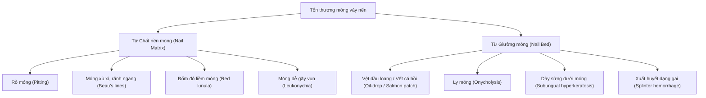

- **Phân tích từng dấu hiệu lâm sàng:**
  1. **Rỗ móng (Nail pitting):** Dấu hiệu phổ biến nhất. Trên bề mặt phiến móng xuất hiện hàng chục lỗ nhỏ li ti đường kính 0.5 - 1mm, phân bố không đều, giống như mặt đê khâu thợ may. Cơ chế: Các ổ á sừng nhỏ ở chất nền móng khi đẩy ra ngoài móng bị bong rụng đi để lại các hố lõm.
  2. **Vết giọt dầu / Vết cá hồi (Oil-drop sign / Salmon patch):** Dấu hiệu có giá trị chẩn đoán **đặc hiệu nhất** cho vảy nến móng! Dưới phiến móng xuất hiện một đốm màu vàng cam hoặc nâu đỏ nhạt giống như ta vừa đánh rơi một giọt dầu ăn lên tờ giấy. Đó là ổ viêm á sừng đọng lại ở giường móng.
  3. **Ly móng (Onycholysis):** Phiến móng bị bong tách rời khỏi giường móng, bắt đầu từ bờ tự do tiến dần về phía gốc móng. Vùng móng bị tách có màu trắng đục do không khí lọt vào, và thường có một **viền hồng ban màu cam/đỏ** bao quanh bờ phân cách giữa móng lành và móng bong.
  4. **Dày sừng dưới móng (Subungual hyperkeratosis):** Chất sừng tăng sinh tích tụ dày cộm thành từng khối dưới phiến móng, đội phiến móng vênh cao lên. Dễ nhầm với nấm móng! (Cần làm xét nghiệm soi tươi KOH và nuôi cấy nấm để loại trừ nấm phối hợp).

---

# PHẦN 5: CẬN LÂM SÀNG & MÔ BỆNH HỌC KINH ĐIỂN (SLIDE 22 - 23)

## SLIDE 22: CẬN LÂM SÀNG TRONG VẢY NẾN
### 1. Nội dung nguyên bản trên Slide
- **Albumin huyết thanh:** Giảm trong trường hợp nặng.
- **Lipid máu:** Cần tầm soát rối loạn.
- **Acid uric huyết thanh:** Tăng ở 50% bệnh nhân.
- **Xét nghiệm mô bệnh học:** Khi lâm sàng không điển hình.
- **Các xét nghiệm chức năng gan, thận:** Khi sử dụng các thuốc điều trị cổ điển hay thuốc sinh học.

### 2. Giảng giải chuyên sâu của Giảng viên lâm sàng (BSCKII)
- **Ý nghĩa chuyên sâu từng xét nghiệm:**
  - **Tăng Acid uric huyết thanh ở 50% bệnh nhân:** Tại sao vảy nến lại tăng acid uric? Các em cần nhớ rằng acid uric là sản phẩm thoái giáng cuối cùng của nhân purine trong tế bào. Ở bệnh nhân vảy nến thể mảng diện tích rộng hoặc thể đỏ da toàn thân, tốc độ phân chia và chết của tế bào sừng thượng bì tăng gấp **7 đến 10 lần** so với người bình thường. Khối lượng nhân tế bào bị phân hủy liên tục làm phóng thích một lượng purine khổng lồ vào máu, gây tăng acid uric thứ phát. Một số bệnh nhân có thể xuất hiện cơn Gout cấp tính phối hợp.
  - **Bilan mỡ máu & Nguy cơ tim mạch:** Vảy nến gắn liền với tăng Triglyceride và giảm HDL-cholesterol.
- **Quy trình xét nghiệm an toàn tiền điều trị (Pre-biologic & Pre-systemic Screening):**
  > [!IMPORTANT]
  > Trước khi đặt bút kê đơn bất kỳ một thuốc toàn thân nào (Methotrexate, Cyclosporin, Acitretin) hoặc Thuốc sinh học (Biologics), bác sĩ da liễu BẮT BUỘC phải hoàn thành bộ xét nghiệm "Bilan sinh học" chuẩn sau:
  > 1. **Công thức máu toàn phần (CBC):** Đánh giá bạch cầu, tiểu cầu, hemoglobin (chống chỉ định MTX nếu có suy tủy).
  > 2. **Chức năng gan & Thận (AST, ALT, GGT, Creatinine máu, eGFR):** Đánh giá chuyển hóa và thải trừ.
  > 3. **Tầm soát lao tiềm ẩn (Latent Tuberculosis Infection - LTBI):**
  >    - Chụp X-quang ngực thẳng (loại trừ lao phổi tiến triển).
  >    - Xét nghiệm máu **IGRA (QuantiFERON-TB Gold Plus)**.
  >    - *Nếu QuantiFERON (+):* Phải điều trị dự phòng lao bằng Isoniazid (INH) trong 6-9 tháng, và phải dùng INH **ít nhất đủ 1 tháng** trước khi tiêm mũi thuốc sinh học đầu tiên!
  > 4. **Tầm soát viêm gan siêu vi & Virus khác:**
  >    - Kháng nguyên bề mặt viêm gan B (**HBsAg**), Kháng thể kháng lõi (**Anti-HBc total**), Kháng thể bảo vệ (**Anti-HBs**).
  >    - Kháng thể viêm gan C (**Anti-HCV**).
  >    - Kháng thể HIV.
  >    - *Lưu ý:* Bệnh nhân HBsAg(+) hoặc Anti-HBc(+) dùng thuốc sinh học (đặc biệt là ức chế TNF) có nguy cơ bùng phát viêm gan B kịch phát dẫn đến suy gan tối cấp. Cần phối hợp chuyên khoa Truyền nhiễm để uống thuốc kháng virus dự phòng (Tenofovir Alafenamide - TAF hoặc Entecavir).
  > 5. **Thử thai (Beta-hCG):** Bắt buộc đối với tất cả phụ nữ trong độ tuổi sinh sản trước khi dùng Methotrexate hoặc Acitretin.

---

## SLIDE 23: MÔ BỆNH HỌC VẢY NẾN (HISTOPATHOLOGY)


### 1. Nội dung nguyên bản trên Slide
- Trích dẫn: *Rook's Textbook of Dermatology 9th, Chapter 35: Psoriasis and related disorders, 1133-1180.*
- **Thay đổi trong giai đoạn sớm:**
  - Dãn mạch, phù bì nhú và thấm nhập tế bào bạch cầu.
  - Tăng sừng, mất lớp hạt và tăng sản thượng bì.
  - Ở lớp gai, neutrophil tụ lại thành **mụn mủ dạng xốp (Kogoj)**.
  - Tăng sản thượng bì tạo mào thượng bì với mao mạch dãn dài, cuộn xoắn và thấm nhập tế bào đơn nhân, đa nhân trung tính.
- **Thay đổi trong giai đoạn hoàn thiện của mảng vảy nến:**
  - Hiện tượng á sừng, tích tụ bạch cầu đa nhân trong lớp sừng (**Munro microabscesses**).
  - Tăng sản thượng bì tạo mào thượng bì với mao mạch dãn dài, cuộn xoắn.
  - Các mào thượng bì kéo dài, kết nối nhau, bạch cầu đơn nhân thâm nhiễm thượng bì.

### 2. Giảng giải chuyên sâu của Giảng viên lâm sàng (BSCKII)
- **Bộ 5 tiêu chuẩn giải phẫu bệnh kinh điển của mảng vảy nến hoàn thiện:**

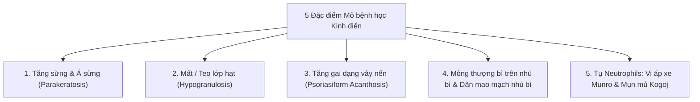

- **Phân tích chi tiết từng tổn thương vi thể:**
  1. **Tăng sừng kèm Á sừng (Hyperkeratosis with Confluent Parakeratosis):**
     - Bình thường lớp sừng gồm các lá sừng mỏng đã mất hết nhân tế bào. Trong vảy nến, do tế bào sừng phân chia quá nhanh, các tế bào sừng bị đẩy vội vã lên bề mặt mà chưa kịp hoàn tất quá trình thoái hóa nhân, do đó nhân tế bào sừng (hình que, bắt màu kiềm tím đậm) vẫn còn tồn tại lổn nhổn trong lớp sừng.
  2. **Mất hoặc teo mỏng lớp hạt (Hypogranulosis / Absence of stratum granulosum):**
     - Bình thường lớp hạt chứa các hạt keratohyalin giúp biệt hóa sừng. Trong vảy nến, tế bào sừng bỏ qua giai đoạn tạo hạt này, lớp hạt bị mỏng lại chỉ còn 1 lớp hoặc biến mất hoàn toàn ngay bên dưới các ổ á sừng.
  3. **Tăng sản thượng bì dạng vảy nến (Regular Psoriasiform Acanthosis):**
     - Lớp gai dầy cộm lên. Các mào thượng bì (Rete ridges) kéo dài cắm sâu xuống trung bì. Đặc điểm rất quan trọng: **Các mào thượng bì này dài rất đồng đều nhau, đáy phình rộng như hình ngón tay găng hoặc hình cọc hàng rào**.
  4. **Thượng bì phía trên nhú bì teo mỏng (Thinning of Suprapapillary plates):**
     - Nhú bì trung bì bị phù nề, dãn rộng nhô cao lên, làm cho lớp thượng bì nằm ngay phía trên đỉnh nhú bì bị ép mỏng lại chỉ còn 2 - 3 lớp tế bào. Các mao mạch trong nhú bì dãn rộng, cuộn xoắn sát bề mặt biểu mô $
ightarrow$ Đây chính là hình ảnh giải phẫu bệnh giải thích tuyệt đối cho **Dấu hiệu Auspitz trên lâm sàng**.
  5. **Tụ bạch cầu đa nhân trung tính (Neutrophilic Infiltration):**
     - **Vi áp xe Munro (Munro microabscesses):** Các ổ tập trung bạch cầu trung tính nhỏ nằm ngay trong lớp sừng và lớp á sừng.
     - **Mụn mủ xốp Kogoj (Spongiform pustules of Kogoj):** Tụ neutrophils nằm ở lớp gai thượng tầng, làm tiêu hủy các liên kết cầu gai xung quanh tạo thành các hốc xốp chứa đầy mủ. Trong vảy nến thể mủ, các mụn mủ xốp Kogoj này phát triển hợp lưu lại thành các hồ mủ khổng lồ nhìn thấy được bằng mắt thường.

---

# PHẦN 6: CHẨN ĐOÁN XÁC ĐỊNH, CHẨN ĐOÁN PHÂN BIỆT & ĐÁNH GIÁ ĐỘ NẶNG (SLIDE 24 - 28)

## SLIDE 24: CHẨN ĐOÁN XÁC ĐỊNH & CHẨN ĐOÁN PHÂN BIỆT
### 1. Nội dung nguyên bản trên Slide
- **Chẩn đoán xác định:** Thường dựa vào lâm sàng. Trong một số trường hợp bệnh sử và thăm khám lâm sàng không đủ chẩn đoán mới có chỉ định sinh thiết làm giải phẫu bệnh để chẩn đoán xác định.
- **Chẩn đoán phân biệt:**
  - **Các bệnh lý viêm:** Viêm da cơ địa, viêm da tiếp xúc dị ứng, chàm đồng tiền, viêm da tiết bã, liken phẳng, liken đơn mạn tính, vảy phấn đỏ nang lông (PRP), vảy phấn dạng liken mạn tính, lupus đỏ, sarcoidosis, vảy phấn hồng, phản ứng quá mẫn do thuốc,...
  - **Các bệnh lý nhiễm trùng:** Nấm da, giang mai, ghẻ đóng mài (ghẻ Na Uy).
  - **Các bệnh lý tân sinh:** Mycosis fungoides (U lympho tế bào T ở da), bệnh Paget ngoài vú.

### 2. Giảng giải chuyên sâu của Giảng viên lâm sàng (BSCKII)
- **Tư duy chẩn đoán tại buồng khám:**
  - 90% chẩn đoán vảy nến thể mảng được xác lập hoàn toàn bằng mắt thường và ngón tay của người thầy thuốc qua việc khám tỉ mỉ 4 thuộc tính (Hồng ban đỏ cá hồi, ranh giới rõ, cộm, vảy trắng bạc) kết hợp nghiệm pháp cạo Brocq (dấu Auspitz).
  - Tuy nhiên, trong những thể không điển hình (ở da đầu, nếp gấp, lòng bàn tay chân hoặc khi đã bị bôi corticoid làm biến dạng tổn thương - *Tinea incognito* hay *Psoriasis incognito*), chẩn đoán phân biệt là cực kỳ hóc búa.
- **Bảng phân tích chẩn đoán phân biệt lâm sàng trọng tâm:**

| Bệnh lý | Triệu chứng tương tự vảy nến | Đặc điểm mấu chốt để phân biệt | Xét nghiệm xác chẩn |
| :--- | :--- | :--- | :--- |
| **Chàm đồng tiền (Nummular eczema)** | Mảng tròn/oval đỏ có vảy, hay gặp ở chân, tay | **Ranh giới không sắc nét**, bề mặt có mụn nước nhỏ li ti hoặc rỉ dịch ướt (*Oozing*), ngứa dữ dội. Không có vảy bạc nhiều tầng, dấu Auspitz âm tính. | Lâm sàng |
| **Viêm da tiết bã (Seborrheic dermatitis)** | Mảng đỏ tróc vảy ở da đầu, vùng giữa ngực | Vị trí nhiều tuyến bã (rãnh mũi má, cung mày, chân tóc). **Vảy màu vàng mỡ, ẩm dính**, không trắng bạc khô ráp. Khi bóc vảy không có giọt sương máu Auspitz. | Lâm sàng |
| **Vảy phấn hồng Gibert (Pityriasis rosea)** | Nhiều dát sẩn đỏ tróc vảy ở thân mình | Khởi đầu bằng một **Mảng báo trước (Herald patch)** to 2-5cm, sau đó vài ngày nổi ban nhỏ hơn xếp hình **"Cây thông Noel"** dọc các đường căng da Langer. Vảy mỏng dính ở rìa tổn thương kiểu **"Viền cổ áo / Cổ lạp xưởng" (Collarette of scale)**. Tự khỏi sau 6-8 tuần. | Lâm sàng |
| **Nấm da thân (Tinea corporis)** | Mảng đỏ tròn tróc vảy | **Bờ tổn thương nổi gờ cao hơn trung tâm**, có mụn nước nhỏ ở rìa tiến triển, trung tâm có xu hướng lành dần (*Central clearing*). Ngứa nhiều. | **Soi tươi KOH:** Thấy sợi tơ nấm có vách ngăn và phân nhánh |
| **Giang mai thời kỳ II (Syphilid)** | Sẩn đỏ tróc vảy ở lòng bàn tay, bàn chân | Sẩn màu đỏ đồng hoặc hồng đào (đào ban), viền vảy mỏng bao quanh chân sẩn (**Viền vảy Biett**). **Hoàn toàn không ngứa!** Kèm theo hạch toàn thân sưng to không đau. | **Huyết thanh giang mai:** RPR/VDRL và TPHA/TPPA dương tính mạnh |
| **Liken phẳng (Lichen planus)** | Sẩn đỏ tím tróc vảy ở cẳng chân, cổ tay | Sẩn đa giác, đỉnh phẳng, màu tím hoa cà (**6 chữ P:** *Pruritic, Polygonal, Planar, Purple, Papules, Plaques*). Soi dermoscopy thấy mạng lưới đường trắng mờ **Wickham striae**. Tổn thương niêm mạc má hình ren hoa. | Mô bệnh học |
| **Vảy phấn đỏ nang lông (PRP)** | Mảng đỏ da tróc vảy rộng | Màu đỏ cam (đỏ cà rốt). Đặc trưng bởi các **Đảo da lành (Islands of normal skin)** nằm lọt thỏm giữa vùng da đỏ, sẩn sừng hóa quanh nang lông ở mu đốt ngón tay, dày sừng lòng bàn tay bàn chân màu vàng sáp ong. | Mô bệnh học |
| **U lympho T ở da (Mycosis Fungoides - MF)** | Mảng đỏ tróc vảy kéo dài nhiều năm | Mảng đỏ thâm nhiễm cứng chắc, hình thái đa dạng kỳ dị (*Poikiloderma*: teo da, giãn mạch, tăng giảm sắc tố loang lổ), ngứa kháng trị với mọi loại thuốc, diễn tiến chậm hàng chục năm. | **Sinh thiết da nhiều vị trí:** Thâm nhiễm tế bào lympho T nhân khúc khuỷu hình não bò vào thượng bì tạo **Vi áp xe Pautrier** |

---

## SLIDE 25: PHÂN LOẠI ĐỘ NẶNG VẢY NẾN


### 1. Nội dung nguyên bản trên Slide
- Tiêu đề: PHÂN LOẠI ĐỘ NẶNG VẢY NẾN
- Sơ đồ phân chia mức độ nhẹ, trung bình, nặng dựa trên diện tích bề mặt (BSA), chỉ số PASI và thang đo chất lượng cuộc sống DLQI.

### 2. Giảng giải chuyên sâu của Giảng viên lâm sàng (BSCKII)
- **Quy tắc số 10 kinh điển (The Rule of Tens):**
  - Trong thực hành da liễu quốc tế, để quyết định một bệnh nhân có cần dùng thuốc toàn thân hay thuốc sinh học hay không, các bác sĩ áp dụng **Quy tắc số 10**:
    - **Mức độ Nhẹ (Mild):** $BSA < 3\%$, $PASI < 10$, $DLQI \le 5$. $\rightarrow$ Ưu tiên điều trị tại chỗ (thuốc bôi + dưỡng ẩm).
    - **Mức độ Trung bình đến Nặng (Moderate-to-Severe):** Khi thỏa mãn **BẤT KỲ** tiêu chí nào sau đây:
      1. $BSA \ge 10\%$ (Diện tích da tổn thương từ 10% bề mặt cơ thể trở lên).
      2. $PASI \ge 10$ (Điểm độ nặng lâm sàng $\ge 10$).
      3. $DLQI > 10$ (Bệnh gây ảnh hưởng trầm trọng đến chất lượng cuộc sống của bệnh nhân).
- **Trường hợp ngoại lệ đặc biệt (Special / Difficult-to-treat locations):**
  > [!IMPORTANT]
  > Một bệnh nhân có diện tích tổn thương rất nhỏ ($BSA < 3\%$, thậm chí chỉ 1-2%), nhưng tổn thương rơi vào các **vị trí nhạy cảm hoặc chức năng đặc biệt**:
  > - **Mặt:** Ảnh hưởng nghiêm trọng đến giao tiếp xã hội, gây trầm cảm nặng nề.
  > - **Bàn tay, bàn chân:** Da nứt nẻ chảy máu, mất khả năng lao động, không cầm nắm hoặc đi lại được.
  > - **Vùng sinh dục:** Đau đớn, cản trở sinh hoạt vợ chồng.
  > - **Móng:** Gây biến dạng tàn phế chức năng ngón.
  > - **Da đầu:** Tróc vảy rụng tóc diện rộng, ngứa dữ dội.
  > $\rightarrow$ Trường hợp này **VẪN ĐƯỢC XẾP VÀO MỨC ĐỘ TRUNG BÌNH - NẶNG** và có chỉ định điều trị toàn thân hoặc thuốc sinh học mà không cần chờ đợi $BSA \ge 10\%$!

---

## SLIDE 26: THANG ĐIỂM PASI (PSORIASIS AREA AND SEVERITY INDEX)


### 1. Nội dung nguyên bản trên Slide
- Tiêu đề: PHÂN LOẠI ĐỘ NẶNG VẢY NẾN – PASI (PSORIASIS AREA SEVERITY INDEX)
- Bảng hướng dẫn chấm điểm độ đỏ, độ dày, độ vảy và tính toán theo trọng số 4 vùng giải phẫu.

### 2. Giảng giải chuyên sâu của Giảng viên lâm sàng (BSCKII)
- **Cấu trúc thang điểm PASI:**
  - Thang điểm dao động từ **0 (hoàn toàn không có bệnh) đến 72 điểm (mức độ nặng tối đa)**.
  - Cơ thể được chia làm 4 vùng giải phẫu với các hệ số trọng số tương ứng:
    - **Đầu mặt (Head - h):** Trọng số **0.1** (chiếm 10% diện tích bề mặt cơ thể).
    - **Chi trên (Upper extremities - u):** Trọng số **0.2** (chiếm 20% diện tích).
    - **Thân mình (Trunk - t):** Trọng số **0.3** (chiếm 30% diện tích).
    - **Chi dưới & Mông (Lower extremities - l):** Trọng số **0.4** (chiếm 40% diện tích).
- **Các bước đánh giá tại mỗi vùng:**
  1. Đánh giá 3 đặc tính lâm sàng từ thang điểm **0 đến 4**:
     - **Độ đỏ (Erythema - E):** 0 = Không đỏ, 1 = Đỏ nhẹ, 2 = Đỏ vừa, 3 = Đỏ nhiều, 4 = Đỏ rất nặng.
     - **Độ dày cộm (Induration - I):** 0 = Không cộm, 1 = Cộm nhẹ, 2 = Cộm vừa, 3 = Cộm dày, 4 = Rất dày.
     - **Độ vảy (Desquamation - D):** 0 = Không vảy, 1 = Vảy ít, 2 = Vảy vừa, 3 = Vảy dày, 4 = Vảy đóng bánh nhiều lớp.
  2. Đánh giá điểm diện tích tổn thương của vùng đó (**Area score - A**) từ **0 đến 6**:
     - 0 = 0%
     - 1 = < 10%
     - 2 = 10 - 29%
     - 3 = 30 - 49%
     - 4 = 50 - 69%
     - 5 = 70 - 89%
     - 6 = 90 - 100%
- **Công thức toán học tổng quát:**
  $$\text{PASI} = 0.1(E_h + I_h + D_h)A_h + 0.2(E_u + I_u + D_u)A_u + 0.3(E_t + I_t + D_t)A_t + 0.4(E_l + I_l + D_l)A_l$$

- **Ý nghĩa các mốc đáp ứng điều trị trong nghiên cứu và lâm sàng:**
  - **PASI 50:** Điểm PASI giảm được 50% so với ban đầu (mức đáp ứng tối thiểu).
  - **PASI 75:** Điểm PASI giảm được 75% so với ban đầu (chuẩn vàng thành công điều trị của các thuốc cổ điển như MTX, Cyclosporin).
  - **PASI 90:** Điểm PASI giảm được 90% (sạch gần như hoàn toàn sang thương da - *Near clear*).
  - **PASI 100:** Điểm PASI giảm 100% (sạch bong hoàn toàn sang thương da, không còn một vết vảy đỏ nào - *Complete clear*). Đây là mục tiêu hướng tới của các thuốc sinh học ức chế IL-17 và IL-23 thế hệ mới nhất hiện nay!

---

## SLIDE 27: ĐÁNH GIÁ DIỆN TÍCH TỔN THƯƠNG BSA (BODY SURFACE AREA)


### 1. Nội dung nguyên bản trên Slide
- Tiêu đề: PHÂN LOẠI ĐỘ NẶNG VẢY NẾN – BSA (BODY SURFACE AREA)
- Minh họa quy tắc lòng bàn tay để ước tính phần trăm diện tích da bị ảnh hưởng.

### 2. Giảng giải chuyên sâu của Giảng viên lâm sàng (BSCKII)
- **Quy tắc bàn tay (The Palm Rule):**
  - Trong thực hành lâm sàng bận rộn tại phòng khám ngoại trú, bác sĩ không có đủ thời gian 15 phút để ngồi tính từng phép nhân của chỉ số PASI. Lúc này, **BSA (Body Surface Area)** là công cụ nhanh chóng, tiện lợi và chính xác nhất.
  - **Định nghĩa chuẩn:** Diện tích bề mặt toàn bộ **một lòng bàn tay của chính bệnh nhân (bao gồm cả lòng bàn tay và mặt trước của cả 5 ngón tay khép lại)** tương đương với **1% diện tích bề mặt cơ thể (1% BSA)** của người đó.
- **Phân loại nhanh theo BSA:**
  - $BSA < 3\%$: Mức độ nhẹ.
  - $3\% \le BSA < 10\%$: Mức độ trung bình.
  - $BSA \ge 10\%$: Mức độ nặng.

---

## SLIDE 28: MỤC TIÊU ĐIỀU TRỊ VẢY NẾN TRUNG BÌNH - NẶNG (EUROGUIDERM 2020)


### 1. Nội dung nguyên bản trên Slide
- Trích dẫn: 
  - *Mrowietz U, Kragballe K, Reich K et al. Definition of treatment goals for moderate to severe psoriasis: a European consensus. Arch Dermatol Res 2011; 303: 1–10.*
  - *Nast A, et al. EuroGuiDerm Guideline on the systemic treatment of Psoriasis vulgaris - Part 1: treatment and monitoring recommendations. J Eur Acad Dermatol Venereol. 2020 Nov;34(11):2461-2498.*
- Sơ đồ thuật toán đánh giá đáp ứng tại tuần 12 - 16 và quyết định lâm sàng.

### 2. Giảng giải chuyên sâu của Giảng viên lâm sàng (BSCKII)
- **Thuật toán đánh giá đáp ứng điều trị tại Tuần 12 - 16 (Thời điểm vàng):**
  - Sau khi khởi đầu một thuốc điều trị toàn thân hoặc thuốc sinh học, thời điểm đánh giá hiệu quả đầu tiên là **sau 12 đến 16 tuần**. Thuật toán đồng thuận Châu Âu phân chia bệnh nhân thành 3 kịch bản:

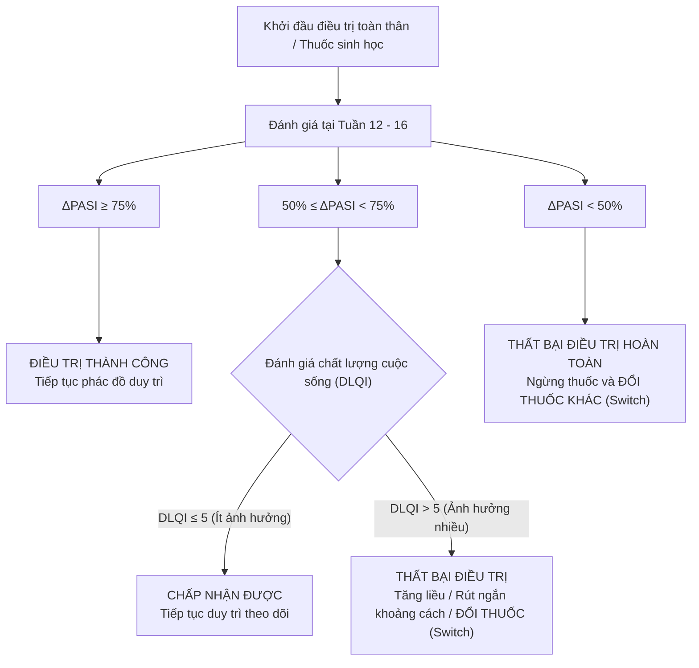

- **Quy tắc đổi thuốc (Switching Rules):**
  - Nếu bệnh nhân không đạt được mức giảm tối thiểu 50% PASI (Non-responder) hoặc mất đáp ứng thứ phát sau một thời gian dùng thuốc: Bác sĩ cần chuyển đổi sang một thuốc sinh học có cơ chế tác động khác (ví dụ: đang dùng kháng TNF thất bại thì chuyển sang kháng IL-23 hoặc kháng IL-17).

---

# PHẦN 7: BIẾN CHỨNG, BỆNH ĐỒNG MẮC & TIẾN TRÌNH VẢY NẾN (SLIDE 29)

## SLIDE 29: BIẾN CHỨNG VÀ BỆNH ĐỒNG MẮC (COMORBIDITIES & PSORIATIC MARCH)
### 1. Nội dung nguyên bản trên Slide
- **Bệnh lý viêm qua trung gian miễn dịch:** IBD (Crohn, Viêm loét đại tràng), Bệnh giáp tự miễn, ĐTĐ tuýp 1, Mày đay, Viêm khớp vảy nến.
- **Stress tâm lý:** Rối loạn chức năng suy nghĩ, lo lắng, sợ hãi, triệu chứng trầm cảm dẫn đến tự sát; Lạm dụng rượu.
- **Ung thư:** Ung thư da không melanoma, Hodgkin lymphoma.
- **Hội chứng chuyển hóa:** Tăng huyết áp, Rối loạn lipid máu, Béo phì, Tiểu đường. Mối quan hệ phức tạp qua cơ chế viêm mạn tính. Béo phì cũng được cho là yếu tố nguy cơ của vảy nến.
- **Bệnh lý tim mạch:** Biến cố tim mạch (Đột quỵ, Nhồi máu cơ tim), Nguy cơ mắc bệnh lý mạch máu ngoại biên, Rung nhĩ, Thuyên tắc huyết khối. Hút thuốc lá làm tăng nguy cơ tim mạch.
- **Bệnh lý gan mật:** Bệnh gan nhiễm mỡ không do rượu (NAFLD) thường gặp nhất, chiếm 50%. Liên quan đến béo phì, hội chứng chuyển hóa, vảy nến nặng. Bệnh lý gan do rượu khá phổ biến.

### 2. Giảng giải chuyên sâu của Giảng viên lâm sàng (BSCKII)
- **Khái niệm "Tiến trình Vảy nến" (The Psoriatic March):**
  - Đây là một trong những khái niệm quan trọng nhất của y học hiện đại giải thích vì sao bệnh nhân vảy nến có **tuổi thọ trung bình bị rút ngắn từ 3 đến 5 năm** so với người không mắc bệnh:

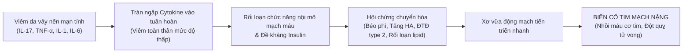

- **Phân tích chi tiết các bệnh đồng mắc lớn:**
  1. **Bệnh tim mạch xơ vữa:**
     - Vảy nến mức độ trung bình - nặng được Hội Tim mạch Hoa Kỳ (AHA) công nhận là một **yếu tố nguy cơ tim mạch độc lập tương đương với bệnh đái tháo đường**.
     - Bệnh nhân trẻ tuổi mắc vảy nến nặng có nguy cơ bị nhồi máu cơ tim cao gấp **3 lần** so với bạn cùng lứa.
  2. **Bệnh gan nhiễm mỡ không do rượu (NAFLD/NASH) chiếm tới 50%:**
     - Tỷ lệ này cao gấp đôi dân số chung. Điều này cực kỳ quan trọng đối với bác sĩ điều trị: Khi muốn kê đơn **Methotrexate**, nếu bệnh nhân đã có sẵn gan nhiễm mỡ hoặc viêm gan thoái hóa mỡ (NASH), nguy cơ xơ gan do MTX sẽ tăng vọt gấp nhiều lần. Bắt buộc phải tầm soát FibroScan kỹ lưỡng.
  3. **Bệnh viêm ruột mạn tính (IBD - Crohn & Viêm loét đại tràng):**
     - Vảy nến và bệnh Crohn chia sẻ chung các locus gen nhạy cảm (IL23R, IL12B).
     > [!CAUTION]
     > Nếu bệnh nhân vảy nến có tiền sử hoặc đang mắc bệnh Crohn hoặc Viêm loét đại tràng, **CHỐNG CHỈ ĐỊNH dùng các thuốc sinh học ức chế IL-17 (như Secukinumab, Ixekizumab)** vì IL-17 đóng vai trò bảo vệ niêm mạc ruột. Ức chế IL-17 có thể kích hoạt đợt bùng phát thủng ruột hoặc xuất huyết tiêu hóa dữ dội! Trong trường hợp này, lựa chọn tối ưu là nhóm **kháng IL-23 (Guselkumab, Risankizumab)** hoặc **kháng TNF (Infliximab, Adalimumab)** vì các nhóm này điều trị tốt cho cả Da và Ruột.
  4. **Gánh nặng tâm lý xã hội & Nguy cơ tự sát:**
     - Bệnh nhân vảy nến thường bị xã hội xa lánh vì sợ "lây bệnh". Họ rơi vào mặc cảm, cô lập, trầm cảm nặng. Tỷ lệ có ý nghĩ tự sát và toan tự sát ở bệnh nhân vảy nến cao gấp 2-3 lần bình thường. Bác sĩ da liễu luôn phải là chỗ dựa tâm lý, lắng nghe và nâng đỡ tinh thần cho người bệnh.

---

# PHẦN 8: CHIẾN LƯỢC & PHÁC ĐỒ ĐIỀU TRỊ TỪ CƠ BẢN ĐẾN NÂNG CAO (SLIDE 30 - 35)

## SLIDE 30: NGUYÊN TẮC ĐIỀU TRỊ VẢY NẾN
### 1. Nội dung nguyên bản trên Slide
- **Đánh giá trước điều trị:** Đánh giá độ nặng, các bệnh đồng mắc, tiền sử điều trị.
- **Tư vấn giáo dục sức khỏe:** Giải thích bản chất bệnh, thay đổi lối sống.
- **Các phương pháp điều trị:**
  - Thuốc tại chỗ (Topical agents)
  - Thuốc toàn thân (Systemic agents)
  - Quang hóa trị liệu (Phototherapy)
- **Các chiến lược điều trị:** Điều trị xoay vòng (Rotational), phối hợp (Combination), ngắt quãng (Intermittent).

### 2. Giảng giải chuyên sâu của Giảng viên lâm sàng (BSCKII)
- **Triết lý điều trị vảy nến hiện đại:**
  - Mục tiêu không còn là "chữa khỏi hẳn 100%" (vì không thể can thiệp sửa chữa mã gen di truyền), mà mục tiêu là:
    1. **Kiểm soát tối đa sang thương da** (hướng tới sạch hoàn toàn da PASI 90 - 100).
    2. **Kiểm soát và ngăn ngừa hủy hoại sụn khớp** trong viêm khớp vảy nến.
    3. **Tối ưu hóa chất lượng cuộc sống (DLQI $\le 1$)** để người bệnh hòa nhập xã hội hoàn toàn bình thường.
    4. **Giảm thiểu tối đa tác dụng phụ tích lũy của thuốc** qua các chiến lược điều trị thông minh.
- **3 chiến lược sử dụng thuốc kinh điển trong Da liễu:**
  1. **Chiến lược điều trị xoay vòng (Rotational therapy):** Luân chuyển các nhóm thuốc toàn thân khác nhau (ví dụ: dùng Methotrexate 1 - 2 năm, sau đó chuyển sang Acitretin hoặc Chiếu đèn PUVA/UVB, rồi chuyển sang Cyclosporin). Mục đích là tránh để một loại thuốc tích lũy liều tối đa gây độc cho cơ quan đích (tránh xơ gan do MTX, tránh xơ thận do Cyclosporin).
  2. **Chiến lược điều trị phối hợp (Combination therapy):** Dùng cùng lúc 2 phương pháp với liều thấp hơn liều đơn độc (ví dụ: Calcipotriol phối hợp Corticoid bôi; hoặc Acitretin phối hợp chiếu tia UVB/PUVA - phác đồ Re-PUVA). Hiệu quả cộng hưởng vượt trội mà giảm độc tính của từng thuốc.
  3. **Chiến lược điều trị ngắt quãng / chủ động duy trì (Intermittent / Proactive maintenance):** Sau khi đã làm sạch da ở giai đoạn tấn công, không ngưng thuốc đột ngột mà chuyển sang bôi thuốc duy trì định kỳ 2 ngày cuối tuần (Weekend therapy).

---

## SLIDE 31: SƠ ĐỒ CHIẾN LƯỢC ĐIỀU TRỊ HIỆN ĐẠI


### 1. Nội dung nguyên bản trên Slide
- Trích dẫn: *Rapalli VK, Singhvi G, Dubey SK, Gupta G, Chellappan DK, Dua K. Emerging landscape in psoriasis management: From topical application to targeting biomolecules. Biomed Pharmacother. 2018;106:707-713.*
- Sơ đồ bậc thang điều trị từ thuốc bôi tại chỗ đến các phân tử sinh học nhắm trúng đích.

### 2. Giảng giải chuyên sâu của Giảng viên lâm sàng (BSCKII)
- **Mô hình tiếp cận bậc thang phân tầng (Step-ladder Approach):**

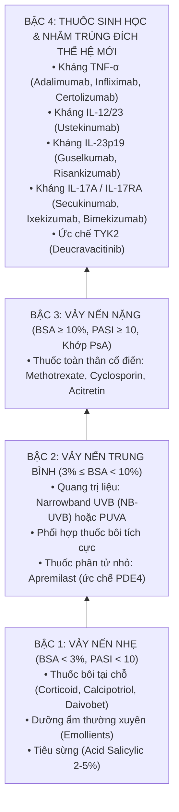

---

## SLIDE 32: ĐIỀU TRỊ TẠI CHỖ (TOPICAL THERAPY)


### 1. Nội dung nguyên bản trên Slide
- Tiêu đề: ĐIỀU TRỊ TẠI CHỖ
- Giới thiệu các nhóm thuốc bôi, dạng bào chế và nguyên tắc sử dụng.

### 2. Giảng giải chuyên sâu của Giảng viên lâm sàng (BSCKII)
- **1. Thuốc Corticosteroid bôi tại chỗ (Topical Corticosteroids - TCS):**
  - **Cơ chế:** Kháng viêm, ức chế miễn dịch, co mạch và ức chế tăng sinh tế bào sừng.
  - **Phân loại theo thang bậc hoạt lực (Potency):**
    - *Nhóm I (Siêu mạnh - Ultra-high):* Clobetasol propionate 0.05%, Betamethasone dipropionate 0.05% dạng mỡ tối ưu hóa. Chỉ dùng cho các mảng vảy nến dày cộm ở vùng da dày (cùi chỏ, đầu gối, lòng bàn tay chân). Thời gian dùng tối đa 2 - 4 tuần liên tục.
    - *Nhóm II & III (Mạnh - High):* Mometasone furoate 0.1%, Betamethasone valerate 0.1%, Fluocinolone acetonide 0.025%. Dùng cho thân mình và các chi.
    - *Nhóm IV & V (Trung bình - Medium):* Hydrocortisone butyrate 0.1%, Desonide 0.05%.
    - *Nhóm VI & VII (Nhẹ - Low):* Hydrocortisone acetate 1%. Dùng an toàn cho vùng mặt, nếp bẹn, sinh dục và trẻ nhỏ.
  - **Khái niệm Đơn vị đốt ngón tay (Fingertip Unit - FTU):**
    - 1 FTU là lượng thuốc mỡ được bóp ra từ tuýp thuốc có đường kính miệng 5mm, trải dài từ nếp gấp liên đốt xa đến đầu ngón tay trỏ của người lớn.
    - **1 FTU $\approx 0.5 \text{ gam}$ thuốc**, đủ để thoa kín một diện tích da tương đương **2 lòng bàn tay** người lớn.
  - **Tác dụng phụ tại chỗ khi lạm dụng:** Teo da (*Atrophy*), rạn da (*Striae rubrae*), giãn mao mạch (*Telangiectasia*), rậm lông, xuất huyết dưới da, viêm da quanh miệng, bùng phát nhiễm nấm, và hiện tượng lệ thuộc corticoid / bùng phát dội ngược (*Tachyphylaxis / Rebound flare*).

- **2. Dẫn xuất Vitamin D3 tại chỗ (Calcipotriol / Calcitriol):**
  - **Cơ chế:** Gắn vào thụ thể VDR trên tế bào sừng, ức chế tế bào sừng tăng sinh quá mức, thúc đẩy quá trình biệt hóa bình thường, đồng thời ức chế tế bào lympho T tiết IL-17 và IL-22.
  - **Ưu điểm lớn:** **Tuyệt đối không gây teo da hay giãn mạch**, rất an toàn khi dùng kéo dài.
  - **Liều giới hạn an toàn:** Không thoa quá **100 gam/tuần** đối với nồng độ Calcipotriol 0.005% để tránh biến chứng tăng calci máu và tăng calci niệu.

- **3. Dạng phối hợp cố định "Tiêu chuẩn vàng" (Calcipotriol + Betamethasone dipropionate):**
  - Biệt dược kinh điển: **Daivobet** (dạng mỡ dùng cho thân mình), **Xamiol** (dạng gel dùng cho da đầu và thân mình), **Enstilar** (dạng bọt xịt foam tạo cảm giác mát lạnh, thẩm thấu siêu nhanh).
  - **Cơ chế hiệp đồng hoàn hảo:**
    - Betamethasone kháng viêm dập tắt triệu chứng nhanh trong những ngày đầu.
    - Calcipotriol điều hòa biệt hóa sừng và duy trì hiệu quả lâu dài.
    - Đặc biệt: Calcipotriol có cơ chế **bảo vệ da chống lại hiện tượng teo da do Corticoid gây ra**!
  - **Cách dùng chuẩn lâm sàng:** Thoa 1 lần/ngày vào buổi tối trong 4 tuần đầu. Sau đó chuyển sang chế độ chủ động duy trì (*Proactive management*): thoa 2 lần/tuần vào các ngày thứ Bảy và Chủ nhật để ngăn ngừa tái phát.

- **4. Thuốc tiêu sừng (Keratolytics - Acid Salicylic 2% - 5%):**
  - Bẻ gãy các liên kết desmosome ở lớp sừng, làm bong các lớp vảy nến dày cộm, dọn đường cho Corticoid và Calcipotriol ngấm sâu vào đáy tổn thương.
  > [!WARNING]
  > - Không thoa trên diện tích rộng $> 20\%$ BSA vì nguy cơ ngộ độc Salicylate toàn thân (ù tai, thở nhanh, toan chuyển hóa).
  > - Tuyệt đối không thoa ngay trước khi chiếu đèn UVB vì Acid Salicylic có tác dụng chống nắng, lọc bỏ tia cực tím làm giảm hiệu quả điều trị.

- **5. Thuốc ức chế Calcineurin bôi (Topical Calcineurin Inhibitors - TCI):**
  - Gồm **Tacrolimus 0.1%** (Protopic) và **Pimecrolimus 1%** (Elidel).
  - Đây là **"Lựa chọn vàng" cho vùng da mỏng, nhạy cảm**: Vùng mặt, cung mày, nếp gấp dưới vú, nếp bẹn, vùng bìu và âm hộ. Thuốc kháng viêm mạnh tương đương corticoid nhóm trung bình nhưng **hoàn toàn không làm teo da, không gây giãn mạch và không làm tăng nhãn áp** khi bôi gần mắt.

---

## SLIDE 33: ĐIỀU TRỊ TOÀN THÂN CỔ ĐIỂN (CONVENTIONAL SYSTEMIC THERAPY)


### 1. Nội dung nguyên bản trên Slide
- Tiêu đề: ĐIỀU TRỊ TOÀN THÂN
- Giới thiệu 3 thuốc trụ cột: Methotrexate (MTX), Cyclosporin A (CsA), Acitretin.

### 2. Giảng giải chuyên sâu của Giảng viên lâm sàng (BSCKII)
- Bảng so sánh toàn diện 3 thuốc toàn thân cổ điển:

| Đặc tính | Methotrexate (MTX) | Cyclosporin A (CsA) | Acitretin (Retinoid) |
| :--- | :--- | :--- | :--- |
| **Cơ chế tác động** | Ức chế Dihydrofolate reductase (DHFR), ức chế tổng hợp Purine/Pyrimidine, tăng tích tụ Adenosine chống viêm | Ức chế Calcineurin, ngăn chặn sự dịch mã NFATc, ức chế sản sinh IL-2 và hoạt hóa tế bào T | Gắn thụ thể nhân RAR, điều hòa phiên mã gen biệt hóa tế bào sừng thượng bì |
| **Liều dùng lâm sàng** | **7.5 - 15 mg/tuần**, tăng dần tối đa 20 - 25 mg/tuần. **UỐNG HOẶC TIÊM 1 LẦN DUY NHẤT/TUẦN!** | **2.5 - 5 mg/kg/ngày**, chia làm 2 lần uống cách nhau 12 giờ | **0.3 - 0.5 mg/kg/ngày** (thường khởi đầu 10 - 25 mg/ngày, duy trì 25 - 50 mg/ngày) |
| **Bổ sung bắt buộc** | **Acid Folic 5mg/tuần** (uống sau liều MTX 24 giờ để giảm độc tính tủy xương và tiêu hóa) | Không cần | Dưỡng ẩm môi và da liên tục |
| **Tốc độ khởi phát tác dụng** | Trung bình (cần 4 - 8 tuần mới thấy hiệu quả rõ rệt) | **Rất nhanh (1 - 2 tuần)** $\rightarrow$ Thuốc dập lửa cấp cứu hàng đầu! | Chậm (cần 8 - 12 tuần) |
| **Chỉ định ưu tiên** | Vảy nến mảng mức độ vừa - nặng, **Viêm khớp vảy nến (PsA)** | Vảy nến bùng phát cấp tính, vảy nến đỏ da toàn thân, vảy nến mủ | **Vảy nến mủ toàn thân, Vảy nến mủ lòng bàn tay chân (PPP)** |
| **Độc tính & Tác dụng phụ chính** | Buồn nôn, loét miệng, **Độc tế bào gan (Tăng men gan, xơ gan)**, **Suy tủy xương (Giảm bạch cầu, tiểu cầu)**, Viêm phổi kẽ | **Tăng huyết áp**, **Độc tính trên thận (Suy thận do co tiểu động mạch đến, tăng Creatinine)**, Tăng Kali máu, Phì đại nướu răng | **Khô da môi cực độ (Viêm môi cheilitis)**, rụng tóc, **Tăng Triglyceride máu**, Quáng gà, Cốt hóa dây chằng |
| **Theo dõi định kỳ** | CBC, AST/ALT, Creatinine mỗi 2-4 tuần lúc đầu, sau đó mỗi 2-3 tháng. Đánh giá xơ gan bằng **FibroScan** | **Đo huyết áp mỗi tuần**. Kiểm tra Creatinine, Điện giải đồ, Acid uric máu mỗi 2-4 tuần | Bilan Lipid máu (Triglyceride, Cholesterol), AST/ALT hàng tháng |
| **Chống chỉ định tuyệt đối** | Phụ nữ có thai / cho con bú; Suy gan nặng; Nghiện rượu; Suy tủy; Suy thận nặng (eGFR < 30) | Tăng huyết áp không kiểm soát; Suy thận; Nhiễm trùng cấp; Ung thư chưa khỏi | **PHỤ NỮ CÓ THAI HOẶC DỰ ĐỊNH CÓ THAI TRONG VÒNG 3 NĂM TỚI!** Suy gan; Rối loạn mỡ máu nặng |

> [!CAUTION]
> **2 LỜI CẢNH BÁO "SỐNG CÒN" TỪ BSCKII KHI DÙNG THUỐC CỔ ĐIỂN:**
> 1. **Với Methotrexate:** Phải ghi vào toa thuốc chữ in hoa đậm: **"CHỈ UỐNG MỘT LẦN DUY NHẤT VÀO MỘT NGÀY CỐ ĐỊNH TRONG TUẦN (VÍ DỤ SÁNG THỨ HAI), TUYỆT ĐỐI KHÔNG ĐƯỢC UỐNG MỖI NGÀY!"**. Đã có nhiều trường hợp bệnh nhân uống nhầm MTX hàng ngày dẫn đến suy tủy toàn bộ, loét hoại tử niêm mạc và tử vong!
> 2. **Với Acitretin (Teratogenicity - Nguy cơ sinh quái thai):** Acitretin khi vào cơ thể (nhất là khi có rượu) sẽ bị ester hóa ngược lại thành **Etretinate** – một chất lưu trữ rất bền vững trong mô mỡ với thời gian bán thải kéo dài đến hàng trăm ngày. Do đó, **phụ nữ trong độ tuổi sinh đẻ sau khi ngưng Acitretin phải thực hiện các biện pháp tránh thai nghiêm ngặt trong suốt 3 NĂM TIẾP THEO!** Nếu có thai trong giai đoạn này, thai nhi gần như chắc chắn sẽ bị dị tật sọ mặt và tim mạch bẩm sinh nặng nề.

---

## SLIDE 34: LIỆU PHÁP THUỐC SINH HỌC & PHÂN TỬ NHỎ (BIOLOGICS & TARGETED MOLECULES)


### 1. Nội dung nguyên bản trên Slide
- Trích dẫn: *Bolognia Dermatology 5th Ed (2024); Lynde CW, Poulin Y, Vender R. J Am Acad Dermatol. 2014;71(1):141-150.*
- Tổng kết 4 nhóm thuốc sinh học điều trị vảy nến nhắm trúng đích.

### 2. Giảng giải chuyên sâu của Giảng viên lâm sàng (BSCKII)
- **Kỷ nguyên Thuốc sinh học (The Biologic Revolution):**
  - Thuốc sinh học là các protein kháng thể đơn dòng (*Monoclonal antibodies*) được sản xuất bằng công nghệ tái tổ hợp DNA, có khả năng gắn đặc hiệu vào một cytokine đích hoặc thụ thể của nó với độ chính xác tuyệt đối như một "viên đạn bạc", không gây độc tế bào tràn lan như Methotrexate hay Cyclosporin.
- **Bảng tổng hợp 4 nhóm thuốc sinh học chính:**

| Nhóm đích tác động | Tên thuốc (Hoạt chất & Biệt dược) | Cơ chế phân tử | Phác đồ dùng thuốc chuẩn | Đặc điểm lâm sàng & Lưu ý an toàn |
| :--- | :--- | :--- | :--- | :--- |
| **1. Kháng TNF-alpha** | **Adalimumab** (Humira)<br>**Infliximab** (Remicade)<br>**Etanercept** (Enbrel)<br>**Certolizumab pegol** (Cimzia) | Ức chế hoạt động của TNF-α hòa tan và xuyên màng | • Adalimumab: Khởi đầu 80mg SC, sau đó **40mg mỗi 2 tuần**<br>• Infliximab: Truyền IV 5mg/kg tuần 0, 2, 6 rồi mỗi 8 tuần | • Rất tốt cho cả **Da và Viêm khớp PsA**<br>• **Certolizumab** không qua nhau thai $\rightarrow$ **An toàn nhất cho phụ nữ có thai**<br>• *Cảnh báo:* Nguy cơ tái hoạt lao và viêm gan B cao nhất trong các nhóm sinh học |
| **2. Kháng IL-12/23** | **Ustekinumab** (Stelara) | Kháng thể gắn vào **tiểu đơn vị chung p40** của cả IL-12 và IL-23 | Tiêm SC 45mg (hoặc 90mg nếu BN > 100kg) tại tuần 0, 4, sau đó **mỗi 12 tuần tiêm 1 lần** | • Khoảng cách tiêm rất thưa (3 tháng/lần), vô cùng tiện lợi<br>• Hồ sơ an toàn dài hạn trên 10 năm rất tốt |
| **3. Kháng IL-23 đặc hiệu (Ức chế p19)** | **Guselkumab** (Tremfya)<br>**Risankizumab** (Skyrizi)<br>**Tildrakizumab** (Ilumya) | Kháng thể gắn chọn lọc vào **tiểu đơn vị riêng p19** của IL-23 (không ức chế IL-12 $\rightarrow$ giữ nguyên miễn dịch chống ung thư) | • Guselkumab: 100mg SC tuần 0, 4, sau đó **mỗi 8 tuần**<br>• Risankizumab: 150mg SC tuần 0, 4, sau đó **mỗi 12 tuần** | • **Hiệu quả sạch da đỉnh cao và bền vững:** Tỷ lệ đạt PASI 90 và PASI 100 lên tới 80-85%<br>• Sau khi ngưng thuốc, thời gian duy trì sạch da kéo dài rất lâu |
| **4. Kháng IL-17** | **Secukinumab** (Cosentyx)<br>**Ixekizumab** (Taltz)<br>**Bimekizumab** (Bimzelx)<br>**Brodalumab** (Siliq) | Kháng chọn lọc IL-17A (Secukinumab, Ixekizumab); hoặc kháng kép cả **IL-17A và IL-17F** (Bimekizumab); hoặc kháng thụ thể IL-17RA (Brodalumab) | • Secukinumab: 300mg SC hàng tuần x 5 tuần đầu, sau đó **300mg mỗi tháng 1 lần**<br>• Ixekizumab: 160mg SC tuần 0, sau đó 80mg mỗi 2 tuần đến tuần 12, rồi mỗi 4 tuần | • **Tốc độ làm sạch da nhanh nhất thế giới:** Sang thương lặn rõ rệt chỉ sau 1 - 2 tuần đầu!<br>• Rất mạnh trên vảy nến móng, da đầu và khớp<br>• *Lưu ý:* Nguy cơ nhiễm nấm Candida niêm mạc miệng/sinh dục (thường nhẹ); Chống chỉ định trên bệnh nhân IBD (bệnh Crohn) |

- **Thuốc phân tử nhỏ đường uống (Targeted Small Molecules):**
  - **Apremilast (Otezla):** Thuốc ức chế enzyme Phosphodiesterase 4 (PDE4), làm tăng cAMP nội bào, giảm giải phóng các cytokine gây viêm. Uống 30mg x 2 lần/ngày. Ưu điểm: Thuốc viên uống, **không cần làm xét nghiệm tầm soát lao hay theo dõi máu định kỳ**. Nhược điểm: Hiệu quả sạch da kém hơn thuốc sinh học (PASI 75 chỉ đạt ~30-40%), tác dụng phụ hay gặp là buồn nôn, tiêu chảy và sụt cân trong những tuần đầu.
  - **Deucravacitinib (Sotyktu):** Thuốc ức chế chọn lọc allosteric Tyrosine Kinase 2 (TYK2) thế hệ mới nhất, ức chế tín hiệu của IL-23, IL-12 và Interferon type I mà không gây tác dụng phụ ức chế JAK1/2/3. Uống 6mg x 1 lần/ngày.

---

## SLIDE 35: PHÂN TẦNG VÀ CHIẾN LƯỢC ĐIỀU TRỊ HỆ THỐNG


### 1. Nội dung nguyên bản trên Slide
- Trích dẫn: *Yan BX, Chen XY, Ye LR, Chen JQ, Zheng M, Man XY. Cutaneous and Systemic Psoriasis: Classifications and Classification for the Distinction. Front Med. 2021;8:649408.*
- Sơ đồ tương quan phân tầng điều trị giữa tổn thương da đơn thuần và bệnh lý vảy nến hệ thống.

### 2. Giảng giải chuyên sâu của Giảng viên lâm sàng (BSCKII)
- **Tóm tắt thông điệp điều trị:**
  - Nếu chỉ có tổn thương da thể mảng khu trú nhẹ $\rightarrow$ Tối ưu hóa điều trị tại chỗ.
  - Nếu có tổn thương da diện rộng ($BSA \ge 10\%$) hoặc kèm theo Viêm khớp vảy nến (PsA) $\rightarrow$ Bắt buộc phải điều trị hệ thống ngay từ đầu bằng MTX hoặc Thuốc sinh học để ngăn chặn sự tàn phế của khớp và cắt đứt "Tiến trình vảy nến" gây xơ vữa động mạch tim mạch.

---

# PHẦN 9: TIÊN LƯỢNG, GIÁO DỤC SỨC KHỎE & PHÂN TÍCH CHÙM CA BỆNH THỰC TẾ (SLIDE 36 - 44)

## SLIDE 36: DIỄN TIẾN VÀ TIÊN LƯỢNG BỆNH
### 1. Nội dung nguyên bản trên Slide
- **Vảy nến mảng mạn tính:** Thường kéo dài suốt đời.
- **Vảy nến giọt:** Thường tự giới hạn, trong 12 - 16 tuần. Khoảng 1/2 đến 2/3 tiến triển đến vảy nến mảng mạn tính.
- **Viêm khớp vảy nến:** 10 - 30% trường hợp vảy nến.
- **Vảy nến đỏ da toàn thân và vảy nến mủ toàn thân:** Nặng và kéo dài, tiên lượng kém. Cần nhập viện và chăm sóc đặc biệt.

### 2. Giảng giải chuyên sâu của Giảng viên lâm sàng (BSCKII)
- **Quy luật diễn tiến tự nhiên:**
  - Vảy nến là bệnh lý có tính chất dao động tự nhiên theo chu kỳ bùng phát (*Exacerbations*) xen kẽ các giai đoạn thuyên giảm (*Remissions*). Mùa đông thời tiết lạnh và khô hanh thường làm bệnh trở nặng hơn; mùa hè có ánh nắng mặt trời tự nhiên giàu tia cực tím giúp bệnh cải thiện hơn.
- **Tiên lượng theo từng thể:**
  - *Vảy nến mảng thông thường:* Tiên lượng sống hoàn toàn bình thường, nhưng chất lượng cuộc sống bị ảnh hưởng nặng nề.
  - *Vảy nến mủ toàn thân (von Zumbusch) & Đỏ da toàn thân:* Tiên lượng tử vong có thể lên tới 5 - 10% nếu xảy ra các biến chứng suy tim cung lượng cao, hạ thân nhiệt hoặc sốc nhiễm trùng huyết.

---

## SLIDE 37: GIÁO DỤC SỨC KHỎE & TƯ VẤN BỆNH NHÂN
### 1. Nội dung nguyên bản trên Slide
- Bác sĩ cần xác định cho bệnh nhân rõ tính chất cũng như tiên lượng bệnh để họ an tâm "sống chung" với vảy nến.
- Giữ nền tảng sức khỏe tốt: Có chế độ ăn hợp lý, ngủ đủ giấc.
- Tránh các yếu tố nguy cơ.
- Phát hiện sớm các biến chứng khớp, đỏ da toàn thân, bệnh lý đi kèm.
- Bỏ thuốc lá.
- Hạn chế rượu bia.
- Giảm stress.
- Tuân thủ chỉ định điều trị của bác sĩ: Sử dụng đúng thuốc, đủ thuốc, không tự mua thuốc điều trị.

### 2. Giảng giải chuyên sâu của Giảng viên lâm sàng (BSCKII)
- **Nghệ thuật giao tiếp của Bác sĩ Da liễu:**
  - Giáo dục sức khỏe quyết định tới 50% sự thành bại của điều trị vảy nến. Nếu bác sĩ chỉ kê đơn mà không dành 10 phút để giải thích cặn kẽ cho bệnh nhân, họ sẽ rất dễ nản lòng và bỏ trị.
  - **3 thông điệp cốt lõi phải truyền tải cho người bệnh:**
    1. *"Vảy nến là bệnh KHÔNG LÂY NHIỄM!"* – Người thân và cộng đồng hoàn toàn có thể bắt tay, ôm hôn, ăn uống chung, giặt quần áo chung mà không sợ lây bệnh. Xóa bỏ kỳ thị là liều thuốc tâm lý đầu tiên.
    2. *"Mục tiêu điều trị là đưa da trở về bình thường và duy trì làn da khỏe mạnh dài lâu, không phải chữa khỏi 100% vĩnh viễn"*. Tránh tâm lý nóng vội tìm kiếm "thuốc tiên trị dứt điểm".
    3. *"Tuyệt đối không bao giờ dùng các loại thuốc bôi không rõ nguồn gốc, thuốc bột, thuốc tễ gia truyền"* – Hầu hết các loại thuốc này đều trộn Dexamethasone hoặc Clobetasol liều cực cao, khi ngưng sẽ gây biến chứng đỏ da toàn thân và suy thượng thận cấp!
- **Chế độ ăn & Lối sống hỗ trợ (Lifestyle Interventions):**
  - **Giảm cân:** Nghiên cứu chứng minh ở bệnh nhân thừa cân béo phì, việc giảm được 5 - 10% trọng lượng cơ thể sẽ làm tăng đáng kể độ nhạy cảm và đáp ứng với thuốc sinh học và Methotrexate.
  - **Chế độ ăn Địa Trung Hải (Mediterranean Diet):** Giàu rau xanh, trái cây, dầu ô liu, cá béo giàu Omega-3 (cá hồi, cá thu) giúp giảm nồng độ các cytokine gây viêm toàn thân.
  - **Cai thuốc lá & Kiêng rượu bia tuyệt đối:** Thuốc lá làm giảm đáp ứng thuốc và làm nặng vảy nến mủ; rượu bia gây tương tác độc gan nguy hiểm với Methotrexate.

---

## SLIDE 38: CHÙM HÌNH ẢNH LÂM SÀNG: VẢY NẾN DA ĐẦU & VẢY NẾN NẾP KẼ


### 1. Nội dung nguyên bản trên Slide
- Chùm hình ảnh tổn thương lâm sàng ở các vị trí giải phẫu đặc biệt.

### 2. Giảng giải chuyên sâu của Giảng viên lâm sàng (BSCKII)
- **1. Vảy nến da đầu (Scalp Psoriasis - Hình 1 & 2):**
  - Gặp ở hơn 50 - 80% bệnh nhân vảy nến. Tổn thương là các mảng đỏ cộm, phủ vảy trắng bạc dày cộp dính chặt vào da đầu và chân tóc.
  - **Dấu hiệu vương miện vảy nến (*Corona psoriatica*):** Mảng vảy nến thường lan vượt qua ranh giới đường viền chân tóc từ 1 đến 2 cm ra phía trước trán, hai bên thái dương và sau gáy. Đây là dấu hiệu rất đặc trưng giúp phân biệt với Viêm da tiết bã (thường chỉ nằm khu trú bên trong vùng có tóc).
  - *Đặc điểm quan trọng:* Mặc dù vảy rất dày cộm nhưng **tóc vẫn mọc xuyên qua mảng vảy nến bình thường**, không gây rụng tóc sẹo vĩnh viễn.
  - *Điều trị da đầu:* Ưu tiên dùng dạng dung dịch (Lotion), Gel (Xamiol gel) hoặc bọt (Foam - Enstilar); kết hợp dầu gội chứa Salicylic acid hoặc Tar (hắc ín) để làm mềm bong vảy trước khi bôi thuốc.
- **2. Vảy nến nếp kẽ / Đảo ngược (Inverse Psoriasis - Hình 3):**
  - Vị trí: Nếp dưới vú, nếp bẹn, nách, rãnh liên mông, nếp gấp quanh rốn.
  - *Hình thái học đặc biệt:* Do môi trường nóng ẩm và ma sát cọ xát liên tục, **lớp vảy sừng trắng bạc bị rụng và phân hủy hoàn toàn**. Bác sĩ chỉ nhìn thấy một mảng màu đỏ tươi, nhẵn bóng, trơn láng, ranh giới sắc nét như kẻ chỉ, đáy nếp gấp có thể có vết nứt nẻ đau rát.
  - *Cạm bẫy:* Rất hay bị chẩn đoán nhầm thành nhiễm nấm Candida kẽ (nấm candida có các mụn mủ vệ tinh xung quanh bờ tổn thương) hoặc chàm kẽ.
  - *Điều trị nếp kẽ:* Tuyệt đối không dùng Corticoid mạnh bôi kéo dài vì gây teo rạn da vùng nếp cực nhanh. **Lựa chọn số 1 là Thuốc ức chế Calcineurin bôi (Tacrolimus 0.1% hoặc Pimecrolimus 1%)**.

---

## SLIDE 39: CHÙM HÌNH ẢNH LÂM SÀNG: BỆNH MÓNG VẢY NẾN ĐA DẠNG


### 1. Nội dung nguyên bản trên Slide
- Các hình ảnh lâm sàng đặc sắc của tổn thương móng trong vảy nến.

### 2. Giảng giải chuyên sâu của Giảng viên lâm sàng (BSCKII)
- **Kỹ năng quan sát trên bệnh nhân thực tế:**
  - Khi quan sát móng của bệnh nhân (Hình 1 & 2), các em thấy đầy đủ các tổn thương phối hợp trên cùng một bàn tay:
    - Các ngón tay có **rỗ móng (Pitting)** sâu và rải rác.
    - Một số móng bị **ly móng (Onycholysis)**: phiến móng bong tách khỏi giường móng có màu vàng đục, bao bọc bởi viền hồng ban màu lòng đỏ trứng gà (*Oil-drop sign*).
    - Các ngón chân có hiện tượng **dày sừng dưới móng (Subungual hyperkeratosis)** đóng thành khối xốp màu nâu vàng đẩy vênh móng lên.
- **Tiêu chuẩn chấm điểm NAPSI (Nail Psoriasis Severity Index):**
  - Chia mỗi móng làm 4 góc phần tư, đánh giá riêng biệt các dấu hiệu của chất nền móng và giường móng để theo dõi đáp ứng điều trị.
- **Điều trị móng vảy nến:**
  - Móng là cơ quan phát triển rất chậm (móng tay cần 6 tháng, móng chân cần 12 - 18 tháng để mọc lại hoàn toàn một phiến móng mới).
  - Thuốc bôi thông thường rất khó thẩm thấu qua phiến móng dày cứng.
  - Trường hợp nhẹ: Có thể tiêm Triamcinolone acetonide (Kenacort) tại chỗ vào nếp gấp móng gần hoặc giường móng (thủ thuật khá đau, cần gây tê lạnh).
  - Trường hợp móng nặng nhiều ngón: Chỉ định điều trị toàn thân bằng **Methotrexate** hoặc **Thuốc sinh học (Secukinumab, Ixekizumab, Guselkumab)** mang lại hiệu quả phục hồi móng ngoạn mục nhất.

---

## SLIDE 40: CHÙM HÌNH ẢNH LÂM SÀNG: VẢY NẾN MẢNG CÁC VỊ TRÍ TÌ ĐÈ


### 1. Nội dung nguyên bản trên Slide
- Hình ảnh lâm sàng tổn thương mảng điển hình ở mặt duỗi cùi chỏ và đầu gối.

### 2. Giảng giải chuyên sâu của Giảng viên lâm sàng (BSCKII)
- **Ý nghĩa định vị tổn thương:**
  - Đây là hình ảnh "sách giáo khoa" điển hình nhất của vảy nến thể mảng. Các em hãy chú ý:
    - Tổn thương luôn nằm ở **Mặt duỗi (Extensor surfaces)** của chi: Mặt sau cùi chỏ, mặt trước đầu gối, cẳng chân. (Trái ngược hoàn toàn với Viêm da cơ địa ở người lớn, vốn ưa chuộng **Mặt gấp - Flexural surfaces** như nếp khoeo chân, nếp khuỷu tay).
    - Tổn thương có tính chất đối xứng hai bên cơ thể.

---

## SLIDE 41: CHÙM HÌNH ẢNH LÂM SÀNG: VẢY NẾN GIỌT VÀ TỔN THƯƠNG PHÂN TÁN


### 1. Nội dung nguyên bản trên Slide
- Hình ảnh tổn thương sẩn đỏ nhỏ dạng giọt nước rải rác toàn thân mình và lưng.

### 2. Giảng giải chuyên sâu của Giảng viên lâm sàng (BSCKII)
- Quan sát hình ảnh này giúp các em so sánh trực quan sự khác biệt giữa **thể giọt (Slide 41)** và **thể mảng (Slide 40)**:
  - Thể giọt là các sẩn nhỏ rời rạc, mật độ dày đặc, phân bố ngẫu nhiên như hạt mưa rào.
  - Thể mảng là các mảng lớn liên kết lại thành hình đa cung, gờ cao và dày cộm.

---

## SLIDE 42: CHÙM HÌNH ẢNH LÂM SÀNG: ĐÁNH GIÁ ĐÁP ỨNG SẠCH DA SAU ĐIỀU TRỊ


### 1. Nội dung nguyên bản trên Slide
- Hình ảnh so sánh Before - After của bệnh nhân vảy nến mảng nặng trước và sau khi được điều trị trúng đích.

### 2. Giảng giải chuyên sâu của Giảng viên lâm sàng (BSCKII)
- **Phân tích bức ảnh Before - After (Slide 42):**
  - **Trước điều trị (Hình 1):** Bệnh nhân có các mảng vảy nến đóng bánh dày cộm toàn bộ lưng và mông, $PASI \approx 28$, da căng nứt nẻ, chảy máu, đau rát dữ dội. Bệnh nhân không thể nằm ngửa khi ngủ.
  - **Sau 12 tuần điều trị bằng Thuốc sinh học kháng IL-17/IL-23 (Hình 2):**
    - Toàn bộ các mảng vảy nến dày cộm đã biến mất hoàn toàn! Bề mặt da phẳng nhẵn mịn màng, không còn vảy trắng, không còn cộm đỏ $\rightarrow$ Đạt mức đáp ứng **PASI 100**!
    - Các em chỉ còn quan sát thấy các dát **Tăng sắc tố sau viêm (Post-inflammatory hyperpigmentation - PIH)** hoặc giảm sắc tố thoáng qua tại vị trí mảng vảy nến cũ. Đây là hiện tượng sinh lý hoàn toàn lành tính, các vết thâm này sẽ mờ dần theo thời gian trong 6 - 12 tháng mà không để lại sẹo.
    - Cuộc sống, tâm lý và sự tự tin của bệnh nhân được phục hồi ngoạn mục. Đó chính là vẻ đẹp và niềm hạnh phúc lớn nhất của người bác sĩ chuyên khoa Da liễu!

---

## SLIDE 43: TÀI LIỆU THAM KHẢO KINH ĐIỂN
### 1. Nội dung nguyên bản trên Slide
1. Bolognia Jean L., Schaffer Julie V., Cerroni Lorenzo (2024), *Dermatology*, Elsevier Saunders, 5th Ed, pp. 138-160.
2. Goldsmith Lowell A., Katz Stephen I. (2008), *Fitzpatrick’s Dermatology in General Medicine*, McGraw-Hill, 8th Ed, pp. 197-231.
3. Griffiths Christopher E. M., Barker Jonathan, Bleiker Tanya et al. (2016), *Rook’s Textbook of Dermatology*, Wiley Blackwell, 9th Ed, Chapter 35, pp. 35.1-35.48.
4. Kang Sewon, Amagai Masayuki et al. (2019), *Fitzpatrick’s Dermatology*, McGraw-Hill, 9th Ed, Chapter 28, pp. 457-497.
5. Lynde CW, Poulin Y, Vender R, Bourcier M, Khalil S (2014), "Interleukin 17A: toward a new understanding of psoriasis pathogenesis", *J Am Acad Dermatol*, 71(1), pp. 141-150.
6. Van de Kerkhof PCM, Nestlé FO (2018), *Psoriasis*, In Dermatology, 4th edition, pp. 138-160.
7. Greb JE, Goldminz AM, Elder JT et al (2016), "Psoriasis", *Nat Rev Dis Primers*, 2(1):16082.

### 2. Giảng giải chuyên sâu của Giảng viên lâm sàng (BSCKII)
- Đây là danh mục những cuốn sách "gối đầu giường" bất hủ của chuyên ngành Da liễu thế giới. Thầy Đạt đã trích dẫn những nguồn tài liệu chuẩn mực nhất. Khi các em đi lâm sàng hoặc làm luận văn tốt nghiệp, hãy luôn trích dẫn từ các tài liệu chuẩn mực này.

---

## SLIDE 44: LỜI CẢM ƠN & KẾT THÚC BÀI GIẢNG


### 1. Nội dung nguyên bản trên Slide
- **Thank you!**

---

## TỔNG KẾT BÀI GIẢNG: 10 NGUYÊN LÝ "VÀNG" CỦA BSCKII KHI ĐI LÂM SÀNG

1. **Bản chất bệnh:** Vảy nến là bệnh viêm hệ thống mạn tính qua trung gian miễn dịch đa gen (trục IL-23/Th17/IL-17A), không phải bệnh ngoài da đơn thuần và **không lây nhiễm**.
2. **Tứ chứng kinh điển:** Mảng hồng ban đỏ cá hồi + Ranh giới sắc nét + Cộm gờ nhẹ + Vảy trắng bạc nhiều tầng.
3. **Nghiệm pháp cạo Brocq:** Vết nến $\rightarrow$ Màng mỏng $\rightarrow$ Giọt sương máu Auspitz (do dãn mao mạch nhú bì sát lớp sừng mỏng).
4. **Hiện tượng Koebner:** Tổn thương xuất hiện trên vết trầy xước/sẹo mổ sau 7-14 ngày $\rightarrow$ Bệnh đang ở giai đoạn hoạt tính.
5. **Cấm kỵ tuyệt đối:** KHÔNG BAO GIỜ dùng Corticoid đường toàn thân (tiêm/uống) để điều trị vảy nến thông thường vì nguy cơ bùng phát Vảy nến mủ toàn thân von Zumbusch hoặc Đỏ da toàn thân khi ngưng thuốc!
6. **Tổn thương móng:** Gặp ở 50% bệnh nhân da và 80-90% bệnh nhân khớp. Rỗ móng và ly móng là yếu tố chỉ điểm dự báo mạnh nhất của Viêm khớp vảy nến (PsA).
7. **Tiêu chuẩn CASPAR:** Áp dụng chẩn đoán Viêm khớp vảy nến khi có bệnh lý khớp viêm + đạt $\ge 3$ điểm.
8. **Mô bệnh học cốt lõi:** Á sừng (còn nhân), mất lớp hạt, tăng gai dạng vảy nến, vi áp xe Munro ở lớp sừng và mụn mủ xốp Kogoj ở lớp gai.
9. **Quy tắc số 10:** $BSA \ge 10\%$, $PASI \ge 10$, hoặc $DLQI > 10$ (hoặc tổn thương vị trí đặc biệt mặt/tay/chân/sinh dục) là chỉ định điều trị toàn thân hoặc thuốc sinh học.
10. **Bilan tiền sinh học:** Bắt buộc phải tầm soát Lao tiềm ẩn (X-quang ngực + QuantiFERON) và Viêm gan siêu vi (HBsAg, Anti-HBc) trước khi chỉ định thuốc sinh học.

---

## BỘ CÂU HỎI LƯỢNG GIÁ LÂM SÀNG & TÌNH HUỐNG THỰC TẾ (MINI-CASES)

### Tình huống lâm sàng 1 (Case 1):
> **Bệnh sử:** Bệnh nhân nam, 28 tuổi, đến khám vì nổi nhiều nốt sẩn đỏ tróc vảy mỏng rải rác khắp ngực, lưng và hai cánh tay xuất hiện đột ngột cách đây 2 tuần. Bệnh nhân không ngứa hoặc ngứa rất nhẹ. Khai thác bệnh sử ghi nhận cách đây 3 tuần bệnh nhân có bị sốt cao, đau rát họng nuốt khó và tự mua thuốc hạ sốt uống.
> 
> **Câu hỏi:**
> 1. Chẩn đoán lâm sàng nghĩ đến nhiều nhất là gì?
> 2. Cần chỉ định những xét nghiệm cận lâm sàng nào để xác định nguyên nhân?
> 3. Hướng điều trị tối ưu cho bệnh nhân này là gì?
> 
> **Phân tích & Hướng dẫn xử trí của BSCKII:**
> - **Chẩn đoán:** Vảy nến thể giọt (Guttate psoriasis) khởi phát sau đợt viêm họng cấp.
> - **Cận lâm sàng:**
>   - Định lượng hiệu giá kháng thể **ASLO (Anti-streptolysin O)** trong máu (dự kiến tăng cao).
>   - Quệt dịch họng cấy tìm vi khuẩn liên cầu khuẩn tán huyết beta nhóm A (*Streptococcus pyogenes*).
> - **Điều trị:**
>   - Nếu còn ổ nhiễm trùng liên cầu: Kháng sinh đường uống (Penicillin V hoặc Erythromycin/Azithromycin) trong 10 ngày.
>   - Dưỡng ẩm toàn thân sau khi tắm.
>   - **Quang trị liệu dải hẹp Narrowband UVB (NB-UVB):** Chiếu 3 lần/tuần là lựa chọn hiệu quả nhất để làm sạch nhanh tổn thương thể giọt.

---

### Tình huống lâm sàng 2 (Case 2):
> **Bệnh sử:** Bệnh nhân nữ, 42 tuổi, có tiền sử vảy nến thể mảng 5 năm nay. Gần đây nghe người quen giới thiệu đã mua một loại "thuốc thảo dược gia truyền dạng viên hoàn" uống mỗi ngày. Ban đầu da sạch vảy đỏ rất nhanh, nhưng 4 ngày trước bệnh nhân hết thuốc và ngưng uống. Hôm nay bệnh nhân được người nhà đưa vào cấp cứu trong tình trạng sốt cao 39.5°C, rét run, toàn thân mệt lả. Khám da thấy toàn bộ da thân mình và tứ chi đỏ rực rát bỏng, nổi chi chít hàng ngàn mụn mủ nhỏ li ti 1-2mm, nhiều nơi mụn mủ hợp lưu thành các "hồ mủ" lớn.
>
> **Câu hỏi:**
> 1. Chẩn đoán xác định thể lâm sàng hiện tại của bệnh nhân?
> 2. Cơ chế bệnh sinh của đợt bùng phát này là gì?
> 3. Thái độ xử trí cấp cứu ban đầu cần thực hiện ngay?
>
> **Phân tích & Hướng dẫn xử trí của BSCKII:**
> - **Chẩn đoán:** Vảy nến mủ toàn thân thể von Zumbusch (Generalized Pustular Psoriasis - GPP) biến chứng sau ngưng thuốc nghi chứa Corticoid toàn thân.
> - **Cơ chế:** Hiện tượng bùng phát hồi ứng kịch phát (*Severe rebound flare*) do ngưng đột ngột Corticoid toàn thân liều cao có trong thuốc gia truyền trôi nổi.
> - **Xử trí cấp cứu:**
>   - Cho bệnh nhân nhập viện ngay tại khoa Hồi sức Da liễu / Phòng cấp cứu.
>   - Bù nước và điện giải đường tĩnh mạch, hạ sốt, giảm đau.
>   - Cấy máu và cấy dịch mụn mủ (mặc dù dịch mủ ban đầu vô trùng nhưng có nguy cơ bội nhiễm vi khuẩn thứ phát).
>   - Kiểm tra chức năng gan thận, điện giải đồ (đặc biệt là calci máu vì thể này hay gây hạ calci máu).
>   - **Thuốc điều trị đặc hiệu:**
>     - Cổ điển: **Cyclosporin A** (3 - 5 mg/kg/ngày) cho tác dụng dập tắt mụn mủ rất nhanh; hoặc **Acitretin** (nếu bệnh nhân đã có đủ con hoặc đã triệt sản, vì thuốc gây quái thai kéo dài 3 năm).
>     - Sinh học hiện đại: Thuốc kháng thụ thể IL-36 **Spesolimab (Spevigo)** truyền tĩnh mạch liều duy nhất mang lại hiệu quả cắt đứt cơn bão mụn mủ chỉ sau 24 - 48 giờ.

---

### Tình huống lâm sàng 3 (Case 3):
> **Bệnh sử:** Bệnh nhân nam, 35 tuổi, kỹ sư xây dựng, mắc vảy nến mảng mức độ vừa ($BSA \approx 8\%$). Bệnh nhân chuẩn bị kết hôn và mong muốn điều trị sạch da nhanh chóng. Bác sĩ dự kiến kê đơn thuốc toàn thân. Kết quả xét nghiệm tiền sinh học: Công thức máu bình thường, Men gan AST/ALT gấp 1.5 lần giới hạn trên, HBsAg (+), HBeAg (-), HBV-DNA: $2.5 \times 10^3 \text{ IU/ml}$, QuantiFERON-TB âm tính.
>
> **Câu hỏi:**
> 1. Thuốc toàn thân cổ điển nào bị chống chỉ định tương đối/thận trọng lớn trên bệnh nhân này?
> 2. Nếu lựa chọn thuốc sinh học, nhóm thuốc nào cần đặc biệt cảnh giác về nguy cơ bùng phát viêm gan B?
> 3. Cần làm gì để đảm bảo an toàn tính mạng cho bệnh nhân trước khi bắt đầu dùng thuốc ức chế miễn dịch?
>
> **Phân tích & Hướng dẫn xử trí của BSCKII:**
> - **Thuốc cổ điển cần thận trọng/tránh:** **Methotrexate** bị chống chỉ định tương đối vì bệnh nhân đang có tình trạng viêm gan B mạn tính hoạt động nhẹ (HBsAg+, men gan tăng, có tải lượng virus). MTX gây độc tế bào gan và thúc đẩy xơ hóa gan nhanh chóng.
> - **Thuốc sinh học cần cảnh giác cao độ:** Nhóm **kháng TNF-alpha (Infliximab, Adalimumab)** có tỷ lệ gây tái hoạt viêm gan B kịch phát (*HBV reactivation*) cao nhất (có thể lên tới 20-30%), dẫn đến suy gan cấp hoại tử tử vong.
> - **Chiến lược phối hợp an toàn:**
>   - Bắt buộc hội chẩn ngay với **Bác sĩ chuyên khoa Truyền nhiễm / Gan mật**.
>   - Bắt đầu cho bệnh nhân uống thuốc kháng virus viêm gan B thế hệ mới (**Tenofovir Alafenamide - TAF 25mg/ngày** hoặc **Entecavir 0.5mg/ngày**).
>   - Sau khi tải lượng virus HBV giảm về dưới ngưỡng phát hiện và men gan ổn định, có thể khởi động thuốc sinh học. Ưu tiên chọn nhóm **ức chế IL-23 (Guselkumab, Risankizumab)** hoặc **ức chế IL-17 (Secukinumab)** vì các nhóm này có nguy cơ tái hoạt viêm gan B thấp hơn rất nhiều so với nhóm kháng TNF-α.
>   - Tiếp tục duy trì thuốc kháng virus TAF trong suốt quá trình dùng thuốc sinh học và kéo dài ít nhất 6 - 12 tháng sau khi ngưng thuốc sinh học.

---
*(Hết giáo trình bài giảng Vảy nến - Slide 1 đến Slide 44)*


<!-- === VIRTUAL_FILE: 02_Trung_Doc_Da_Do_Thuoc_SCARs.md === -->

# GIÁO TRÌNH BÀI GIẢNG CHUYÊN SÂU: TRÚNG ĐỘC DA DO THUỐC & CÁC PHẢN ỨNG DA NẶNG (SCARs)

**Đối tượng đào tạo:** Bác sĩ Y khoa (Y5) – Định hướng Sau đại học (BSNT, CKI, CKII Da liễu, Hồi sức cấp cứu, Dị ứng miễn dịch lâm sàng)  
**Bộ môn:** Da liễu – Trường Đại học Khoa học Sức khỏe, Đại học Quốc gia TP. Hồ Chí Minh (UHS - VNUHCM)  
**Giảng viên biên soạn slide gốc:** ThS. BS. Nguyễn Thành Đạt  
**Phân tích & Giảng giải lâm sàng chuyên sâu:** Bác sĩ Chuyên khoa II Da liễu (Giảng viên lâm sàng)  
**Tài liệu tham khảo chính:** Bolognia Dermatology 4th & 5th Ed, Fitzpatrick's Dermatology 9th Ed, Hướng dẫn Chẩn đoán và Điều trị Phản ứng có hại do thuốc (ADR) – Bộ Y tế, Tiêu chuẩn Quốc tế RegiSCAR và EuroSCAR.

---

## LỜI MỞ ĐẦU CỦA GIẢNG VIÊN LÂM SÀNG (BSCKII)

> *"Chào các em sinh viên Y5 và các bác sĩ đồng nghiệp!*  
> *Trong toàn bộ chương trình Da liễu lâm sàng, nếu có một bài học nào đòi hỏi người thầy thuốc phải có sự nhạy bén tối đa, khả năng chẩn đoán quyết đoán trong tích tắc và thái độ xử trí chuẩn xác như một bác sĩ Hồi sức cấp cứu, thì đó chính là bài: **Trúng độc da do thuốc (Adverse Cutaneous Drug Reactions - ACDR)** và đặc biệt là nhóm **Phản ứng có hại nặng trên da do thuốc (Severe Cutaneous Adverse Reactions - SCARs)**.*
>
> *Thuốc là vũ khí cứu người, nhưng thuốc cũng có thể biến thành con dao hai lưỡi đe dọa trực tiếp tính mạng bệnh nhân. Một phát ban thoạt nhìn tưởng chừng như vô hại nhưng nếu xuất hiện các 'dấu hiệu cờ đỏ' (Red Flags) như đau da, trợt loét niêm mạc, phù nề mặt hoặc sốt cao thì chỉ sau 24 đến 48 giờ, bệnh nhân có thể rơi vào tình trạng hoại tử bong tróc toàn bộ da như bị bỏng nước sôi (TEN) hoặc suy đa tạng do bão cytokine (DRESS) với tỷ lệ tử vong lên tới 30 - 50%.*
>
> *Bài giảng này của ThS. BS Nguyễn Thành Đạt được xây dựng vô cùng công phu với 62 slide. Tôi sẽ cùng các em đi qua từng slide một, phân tích từ cơ chế miễn dịch phân tử, vai trò của các alen HLA nhạy cảm (như HLA-B\*15:02 với Carbamazepine, HLA-B\*58:01 với Allopurinol), cách lập 'Bảng dòng thời gian dùng thuốc' (Drug timeline), cho đến kỹ năng nhận diện và cấp cứu sống còn từng thể bệnh. Hãy tập trung cao độ, vì kiến thức bài này sẽ giúp các em cứu sống người bệnh trong những ca lâm sàng ngặt nghèo nhất!"*

---

## MỤC LỤC BÀI HỌC

1. [Phần 1: Đại cương, Phân loại SCARs, Dịch tễ học & Sinh bệnh học phân tử (Slide 1 - 10)](#phan-1-dai-cuong-phan-loai-scars-dich-te-hoc--sinh-benh-hoc-phan-tu-slide-1---10)
2. [Phần 2: Tiếp cận chẩn đoán một phát ban nghi do thuốc & Dấu hiệu cờ đỏ nguy hiểm (Slide 11 - 17)](#phan-2-tiep-can-chan-doan-mot-phat-ban-nghi-do-thuoc--dau-hieu-co-do-nguy-hiem-slide-11---17)
3. [Phần 3: Mày đay, Phù mạch & Phản vệ do thuốc (Slide 18 - 25)](#phan-3-may-day-phu-mach--phan-ve-do-thuoc-slide-18---25)
4. [Phần 4: Phát ban đa dạng dạng dát sẩn (EDE) & Hồng ban sắc tố cố định (FDE / GBFDE) (Slide 26 - 35)](#phan-4-phat-ban-da-dang-dang-dat-san-ede--hong-ban-sac-to-co-dinh-fde--gbfde-slide-26---35)
5. [Phần 5: Mụn mủ toàn thân cấp tính (AGEP) & Hội chứng DRESS/DIHS (Slide 36 - 44)](#phan-5-mun-mu-toan-than-cap-tinh-agep--hoi-chung-dressdihs-slide-36---44)
6. [Phần 6: Đỉnh cao cấp cứu Da liễu: Hội chứng Stevens-Johnson (SJS) & Hoại tử thượng bì nhiễm độc (TEN) (Slide 45 - 50)](#phan-6-dinh-cao-cap-cuu-da-lieu-hoi-chung-stevens-johnson-sjs--hoai-tu-thuong-bi-nhiem-doc-ten-slide-45---50)
7. [Phần 7: Các hình thái phát ban da đặc biệt khác do thuốc (Slide 51 - 60)](#phan-7-cac-hinh-thai-phat-ban-da-dac-biet-khac-do-thuoc-slide-51---60)
8. [Phần 8: Tổng kết bài giảng: 10 Nguyên lý vàng lâm sàng & 3 Tình huống cấp cứu thực tế (Slide 61 - 62)](#phan-8-tong-ket-bai-giang-10-nguyen-ly-vang-lam-sang--3-tinh-huong-cap-cuu-thuc-te-slide-61---62)

---

# PHẦN 1: ĐẠI CƯƠNG, PHÂN LOẠI SCARs, DỊCH TỄ HỌC & SINH BỆNH HỌC PHÂN TỬ (SLIDE 1 - 10)

## SLIDE 1: TIÊU ĐỀ BÀI GIẢNG
### 1. Nội dung nguyên bản trên Slide
- **Tiêu đề:** TRÚNG ĐỘC DA DO THUỐC (ADVERSE CUTANEOUS DRUG REACTIONS)
- **Đơn vị:** Bộ môn Da liễu – Trường Đại học Khoa học Sức khỏe, ĐHQG-HCM
- **Giảng viên:** ThS. BS. NGUYỄN THÀNH ĐẠT

### 2. Giảng giải chuyên sâu của Giảng viên lâm sàng (BSCKII)
- **Thuật ngữ & Khái niệm cốt lõi:**
  - Trong y văn tiếng Anh, thuật ngữ *"Adverse Cutaneous Drug Reactions (ACDR)"* hoặc *"Toxidermia"* (tiếng Pháp) chỉ tất cả các biểu hiện có hại trên da, niêm mạc và các phần phụ của da (lông, tóc, móng) gây ra bởi thuốc dùng qua bất kỳ đường nào (uống, tiêm truyền, hít, đặt hậu môn, hoặc bôi tại chỗ).
  - Cần phân biệt rõ:
    - **Phản ứng có hại của thuốc (ADR - Adverse Drug Reaction):** Khái niệm rộng theo WHO, là phản ứng độc hại, không định trước xuất hiện ở liều thuốc thường dùng cho người nhằm mục đích phòng bệnh, chẩn đoán hoặc điều trị.
    - **Dị ứng thuốc (Drug Allergy):** Là các phản ứng ADR qua trung gian đáp ứng miễn dịch (miễn dịch dịch thể hoặc miễn dịch qua trung gian tế bào T).
    - **Giả dị ứng (Pseudoallergy / Non-allergic hypersensitivity):** Phản ứng có biểu hiện lâm sàng giống hệt dị ứng (nổi mày đay, tụt huyết áp) nhưng không qua kháng thể hay tế bào T, mà do thuốc kích hoạt trực tiếp tế bào mast giải phóng histamine hoặc làm rối loạn chuyển hóa arachidonic acid (ví dụ: phản ứng phản vệ do thuốc cản quang, phản ứng mày đay do Opiates, phản ứng co thắt phế quản do Aspirin/NSAIDs).

---

## SLIDE 2: MỤC TIÊU HỌC TẬP
### 1. Nội dung nguyên bản trên Slide
1. Kể tên được các dạng phản ứng da nặng do thuốc.
2. Trình bày và giải thích được cơ chế bệnh sinh chính của phản ứng da do thuốc.
3. Trình bày được các bước tiếp cận ban đầu một phát ban da nghi do thuốc và các triệu chứng gợi ý phản ứng da nặng do thuốc.
4. Mô tả được lâm sàng và chẩn đoán được các dạng phản ứng da do thuốc thường gặp.

### 2. Giảng giải chuyên sâu của Giảng viên lâm sàng (BSCKII)
- **Trọng tâm thi cử & Thực hành nghề nghiệp:**
  - **Mục tiêu 1:** Sinh viên Y5 bắt buộc phải nằm lòng danh mục **SCARs** (Severe Cutaneous Adverse Reactions) gồm: SJS, TEN, DRESS/DIHS, AGEP, GBFDE và Hoại tử da do thuốc chống đông.
  - **Mục tiêu 2:** Hiểu bản chất miễn dịch theo phân loại kinh điển Gell & Coombs (Type I đến Type IV) và khái niệm tương tác dược lý thụ thể miễn dịch (*p-i concept*).
  - **Mục tiêu 3:** Nắm vững **Kỹ năng tiếp cận 5 bước** và **Bộ dấu hiệu báo động đỏ (Red Flags)**. Trên lâm sàng, bác sĩ có thể chưa chẩn đoán chính xác ngay thể bệnh, nhưng phải nhận ra ngay bệnh nhân có dấu hiệu nặng hay không để chỉ định ngừng thuốc và chuyển cấp cứu kịp thời.
  - **Mục tiêu 4:** Phân biệt chính xác giữa phát ban lành tính (như dát sẩn EDE) với các thể đe dọa tính mạng.

---

## SLIDE 3: TỔNG QUAN DỊCH TỄ HỌC


### 1. Nội dung nguyên bản trên Slide
- Da là một trong những cơ quan thường gặp những phản ứng có hại do thuốc nhất.
- Mặc dù tình trạng phản ứng da do thuốc quan sát từ 0,1 - 1% trong thử nghiệm trước khi được cho ra thị trường, nhưng tỉ lệ có thể cao hơn đến 5% ở những đối tượng điều trị mới bằng kháng sinh và thuốc chống co giật.
- Phản ứng da do thuốc là nguyên nhân nhập viện ở 2 - 3% bệnh nhân và xảy ra ở khoảng 2% bệnh nhân nội trú.

### 2. Giảng giải chuyên sâu của Giảng viên lâm sàng (BSCKII)
- **Tại sao Da lại là cơ quan bị tấn công nhiều nhất bởi thuốc?**
  - Da không phải là một chiếc vỏ bọc thụ động. Da là một **cơ quan miễn dịch ngoại vi khổng lồ (Skin-Associated Lymphoid Tissue - SALT)**:
    - Da sở hữu mạng lưới tế bào trình diện kháng nguyên dày đặc (Tế bào Langerhans ở thượng bì, Tế bào tua trung bì).
    - Số lượng tế bào lympho T thường trú trong da người trưởng thành lên tới **20 tỷ tế bào** (gấp đôi tổng số lympho T lưu hành trong toàn bộ hệ tuần hoàn!).
    - Da có hệ thống enzym chuyển hóa sinh học (Cytochrome P450, N-acetyltransferase) tham gia hoạt hóa các tiền chất thuốc thành các chất chuyển hóa có hoạt tính phản ứng.
- **Con số thống kê cần ghi nhớ:**
  - Khoảng 2 - 3% tổng số ca nhập viện nội khoa xuất phát từ ADR trên da.
  - Khi bắt đầu dùng một loại thuốc chống động kinh mới (Carbamazepine, Phenytoin) hoặc kháng sinh mới (Beta-lactam, Cotrimoxazole), nguy cơ xảy ra phản ứng da có thể lên tới **1 đến 5%**.

---

## SLIDE 4: SEVERE CUTANEOUS ADVERSE REACTIONS (SCARs)


### 1. Nội dung nguyên bản trên Slide
- **Các dạng phản ứng da nặng do thuốc (SCARs):**
  1. Phản vệ (Anaphylaxis)
  2. Hoại tử da do thuốc chống đông (Anticoagulant-induced skin necrosis)
  3. Phản ứng da do thuốc với tăng bạch cầu ái toan trong máu và triệu chứng toàn thân (DRESS) / Hội chứng quá mẫn do thuốc (DIHS)
  4. Hội chứng hồng ban sắc tố bóng nước lan tỏa (Generalized Bullous Fixed Drug Eruption - GBFDE)
  5. Hội chứng ngoại ban mụn mủ toàn thân cấp tính (Acute Generalized Exanthematous Pustulosis - AGEP)
  6. Hội chứng Stevens-Johnson (SJS) / Hoại tử thượng bì nhiễm độc (TEN)

### 2. Giảng giải chuyên sâu của Giảng viên lâm sàng (BSCKII)
- **Định nghĩa SCARs:**
  - Nhóm SCARs tập hợp các bệnh lý da do thuốc có tính chất bùng phát dữ dội, gây tổn thương cấu trúc da diện rộng, tổn thương các niêm mạc tự nhiên, kèm theo suy giảm chức năng các tạng nội mô và **nguy cơ tử vong rất cao (từ 5% đến hơn 50%)**.
- **Sơ đồ phân loại và đặc trưng của 6 thể SCARs:**

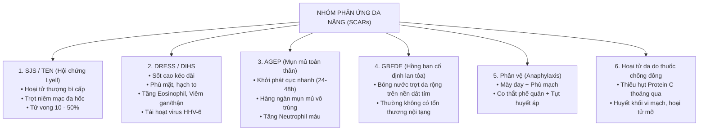

---

## SLIDE 5: DỊCH TỄ HỌC BÁO CÁO ADR TẠI VIỆT NAM (2022)


### 1. Nội dung nguyên bản trên Slide
- Tổng kết công tác báo cáo ADR năm 2022 – Trung tâm Quốc gia về Thông tin thuốc và Theo dõi phản ứng có hại của thuốc (DI & ADR Quốc gia).
- Phân tích cơ cấu các nhóm thuốc và biểu hiện lâm sàng thường gặp tại Việt Nam.

### 2. Giảng giải chuyên sâu của Giảng viên lâm sàng (BSCKII)
- **Những con số biết nói từ thực tiễn y tế Việt Nam:**
  - Theo số liệu của Trung tâm DI & ADR Quốc gia:
    - **Cơ quan bị ảnh hưởng nhiều nhất:** Luôn luôn là **Da và mô dưới da (chiếm trên 60 - 70% tổng số báo cáo ADR)**.
    - **Nhóm thuốc thủ phạm hàng đầu:**
      1. Kháng sinh nhóm **Beta-lactam** (Cephalosporin thế hệ 1, 2, 3, 4; Penicillin; Carbapenem).
      2. Kháng sinh nhóm **Quinolone** (Ciprofloxacin, Levofloxacin).
      3. Thuốc giảm đau kháng viêm không steroid (**NSAIDs**).
      4. Thuốc hạ acid uric máu (**Allopurinol**).
      5. Thuốc chống co giật (**Carbamazepine, Phenytoin**).
      6. Thuốc kháng lao (Rifampicin, Isoniazid, Pyrazinamide).
- **Bài học lâm sàng:**
  - Kháng sinh và NSAIDs là các thuốc được kê đơn và tự mua tại nhà thuốc nhiều nhất ở nước ta, do đó số lượng ca dị ứng tuyệt đối của 2 nhóm này chiếm đa số.
  - Tuy nhiên, khi xét về **tỷ lệ gây ra các thể cực nặng (SJS/TEN và DRESS)**, thì **Allopurinol và Carbamazepine** lại chiếm vị trí quán quân!

---

## SLIDE 6: YẾU TỐ NGUY CƠ DỊ ỨNG THUỐC


### 1. Nội dung nguyên bản trên Slide
- Trích dẫn: *Tanno, LK, Torres, MJ, Castells, on behalf of the Joint Allergy Academies. What can we learn in drug allergy management from World Health Organization's international classifications? Allergy. 2018; 73: 987–99.*
- Sơ đồ tương tác giữa yếu tố thuốc, yếu tố ký chủ và tình trạng bệnh lý phối hợp.

### 2. Giảng giải chuyên sâu của Giảng viên lâm sàng (BSCKII)
- **3 nhóm yếu tố nguy cơ lớn quyết định dị ứng thuốc:**
  1. **Yếu tố liên quan đến thuốc (Drug-related factors):**
     - *Bản chất hóa học:* Thuốc có trọng lượng phân tử lớn (như insulin, kháng thể đơn dòng, vaccine) có tính sinh miễn dịch tự thân cao. Thuốc phân tử nhỏ (< 1000 Da) phải gắn với protein cơ thể để trở thành một hapten hoàn chỉnh.
     - *Đường dùng thuốc:* Đường bôi ngoài da (Topical) có nguy cơ gây nhạy cảm hóa dị ứng tiếp xúc cao nhất; Đường tiêm tĩnh mạch (IV) thường gây phản ứng tối cấp (phản vệ); Đường uống (Oral) thường gây phát ban chậm.
     - *Liều lượng và thời gian dùng:* Dùng thuốc liều cao, kéo dài hoặc dùng lặp đi lặp lại ngắt quãng nhiều đợt làm tăng nguy cơ sinh kháng thể.
  2. **Yếu tố liên quan đến người bệnh (Host-related factors):**
     - *Tuổi và giới:* Người lớn tuổi có suy giảm chức năng gan thận làm chậm đào thải thuốc; Nữ giới có tỷ lệ mắc dị ứng thuốc cao hơn nam giới (khoảng 1.5 - 2 lần).
     - *Yếu tố di truyền (Genetics):* Kiểu hình kháng nguyên bạch cầu người (**HLA**) quyết định nguy cơ mắc SCARs (Slide 7).
     - *Cơ địa dị ứng (Atopy):* Không làm tăng nguy cơ dị ứng thuốc nói chung, nhưng nếu người bệnh atopy bị sốc phản vệ thì mức độ co thắt phế quản và tử vong thường nặng nề hơn.
  3. **Yếu tố bệnh lý phối hợp (Concomitant conditions):**
     - *Nhiễm virus hoạt tính:* Nhiễm **EBV (Epstein-Barr Virus)** hoặc **CMV**: Bệnh nhân bị tăng bạch cầu đơn nhân nhiễm trùng do EBV nếu uống **Ampicillin hoặc Amoxicillin** thì **90 - 100% sẽ bị phát ban đỏ toàn thân**!
     - *Nhiễm HIV/AIDS:* Nguy cơ dị ứng thuốc (đặc biệt là Cotrimoxazole - Bactrim) tăng gấp **40 đến 100 lần** so với người không nhiễm HIV.

---

## SLIDE 7: HLA ĐẶC HIỆU & DƯỢC LÝ DI TRUYỀN (PHARMACOGENOMICS)


### 1. Nội dung nguyên bản trên Slide
- Trích dẫn: *Bolognia, J. et al. Dermatology. 4th ed. Elsevier.*
- Bảng tổng kết các mối liên quan kinh điển giữa các alen HLA và nguy cơ phát triển SCARs.

### 2. Giảng giải chuyên sâu của Giảng viên lâm sàng (BSCKII)
- **Bước ngoặt của Y học chính xác trong Da liễu:**
  - Trước đây, dị ứng thuốc được coi là phản ứng "đặc ứng" (idiosyncratic) không thể dự đoán trước. Nhưng ngày nay, sinh học phân tử đã chứng minh rõ: Sự kết hợp giữa một loại thuốc nhất định với một rãnh gắn kháng nguyên của một phân tử **HLA Class I cụ thể** chính là "ngòi nổ" kích hoạt tế bào T gây độc hoại tử da.
- **Bảng 4 cặp "GEN - THUỐC" kinh điển bắt buộc phải thuộc lòng:**

| Alen HLA nguy cơ | Thuốc thủ phạm | Thể phản ứng da nặng (SCARs) | Quần thể nguy cơ cao nhất | Tỷ số chênh nguy cơ (Odds Ratio - OR) | Khuyến cáo thực hành |
| :--- | :--- | :--- | :--- | :--- | :--- |
| **HLA-B\*15:02** | **Carbamazepine** (Tegretol) | **SJS / TEN** | Người Đông Á, Đông Nam Á (Việt Nam, Trung Quốc, Thái Lan) | **OR > 100 - 250 lần!** | **BẮT BUỘC SÀNG LỌC HLA-B\*15:02** trước khi bắt đầu dùng Carbamazepine cho bệnh nhân gốc Á! Nếu (+): Chống chỉ định tuyệt đối, đổi sang Valproate hoặc Levetiracetam. |
| **HLA-B\*58:01** | **Allopurinol** (Zyloric) | **SJS / TEN & DRESS** | Người Đông Á, người Việt Nam, người suy thận mạn | **OR > 80 - 150 lần!** | Sàng lọc trước khi kê đơn Allopurinol điều trị Gout. Nếu mang gen (+): Thay thế bằng **Febuxostat**. |
| **HLA-B\*57:01** | **Abacavir** (Thuốc kháng virus HIV) | **Hội chứng quá mẫn DRESS** | Người da trắng (Caucasian), người Mỹ gốc Phi | **OR > 100 lần** | Khuyến cáo toàn cầu: Bắt buộc test HLA-B\*57:01 trước khi bắt đầu phác đồ chứa Abacavir. |
| **HLA-B\*13:01** | **Dapsone** (Thuốc trị Phong, viêm da dạng herpes Duhring) | **Hội chứng DRESS do Dapsone** | Quần thể người châu Á | **OR > 40 lần** | Sàng lọc trước khi điều trị Dapsone kéo dài. |

- **Ý nghĩa đối với bác sĩ lâm sàng Việt Nam:**
  - Tần suất mang alen **HLA-B\*15:02** trong cộng đồng người Kinh Việt Nam khá cao (dao động từ **10% đến 13%**).
  - Tần suất mang alen **HLA-B\*58:01** ở người Việt Nam khoảng **6% đến 8%**.
  > [!IMPORTANT]
  > Việc chỉ định xét nghiệm PCR tầm soát HLA-B\*15:02 trước khi dùng Carbamazepine và HLA-B\*58:01 trước khi dùng Allopurinol đã trở thành tiêu chuẩn chăm sóc tại nhiều bệnh viện lớn (như Bệnh viện Da liễu TP.HCM, BV Bạch Mai), giúp ngăn chặn hàng trăm ca tử vong vì SJS/TEN mỗi năm.

---

## SLIDE 8: CÁC NHÓM THUỐC NGUY CƠ CAO GÂY PHẢN ỨNG DA


### 1. Nội dung nguyên bản trên Slide
- **Các thuốc có nguy cơ cao gây dị ứng gồm:**
  - Kháng sinh nhóm Beta-lactam
  - Sulfonamide
  - Thuốc kháng lao
  - Aspirin
  - NSAIDs
  - Thuốc chống động kinh
  - Allopurinol
- Bảng tỷ lệ phần trăm các nhóm thuốc ghi nhận trong 14.739 báo cáo ADR.

### 2. Giảng giải chuyên sâu của Giảng viên lâm sàng (BSCKII)
- **Quy tắc nhớ "7 Nhóm thuốc nguy hiểm nhất" (High-Risk Drug Classes):**
  1. **Kháng sinh Beta-lactam:** Penicillin, Ampicillin/Amoxicillin, Cephalosporin (Cefalexin, Cefuroxime, Ceftriaxone), Carbapenem.
  2. **Sulfonamides (Thuốc chứa gốc Sulfa):** Kháng sinh phối hợp **Cotrimoxazole (Trimethoprim-Sulfamethoxazole / Bactrim)**; Thuốc lợi tiểu Sulfonamide (Furosemide, Thiazide); Thuốc trị đái tháo đường Sulfonylurea (Glibenclamide).
  3. **Thuốc chống động kinh (Anticonvulsants):** Đặc biệt là nhóm có vòng thơm (**Carbamazepine, Phenytoin, Phenobarbital, Lamotrigine**). Nhóm này có hiện tượng dị ứng chéo với nhau lên tới 70-80%!
  4. **Thuốc hạ Acid Uric:** **Allopurinol** – nguyên nhân hàng đầu gây hội chứng DRESS và SJS/TEN tại các khoa hồi sức cấp cứu ở người lớn tuổi điều trị Gout.
  5. **Thuốc kháng viêm không Steroid (NSAIDs) & Aspirin:** Ibuprofen, Diclofenac, Meloxicam, Celecoxib, Piroxicam.
  6. **Thuốc điều trị Lao (Anti-TB drugs):** Phác đồ phối hợp chuẩn gồm **Rifampicin, Isoniazid, Pyrazinamide, Ethambutol**. Khi bệnh nhân lao nổi ban da, việc xác định thuốc nào trong 4 thuốc là thủ phạm là một bài toán lâm sàng rất nan giải.
  7. **Thuốc kháng retrovirus điều trị HIV (ARVs):** Nevirapine (NVP), Efavirenz (EFV), Abacavir (ABC).

---

## SLIDE 9: SINH BỆNH HỌC – CƠ CHẾ MIỄN DỊCH & PHI MIỄN DỊCH


### 1. Nội dung nguyên bản trên Slide
- Phản ứng da do thuốc có cơ chế qua trung gian miễn dịch hoặc không qua miễn dịch.
- **Qua trung gian miễn dịch:** Thuốc hoặc các chất chuyển hóa của nó hoạt động như 1 hapten gây ra đáp ứng miễn dịch tế bào hoặc dịch thể đặc hiệu.
- **Không do miễn dịch:** Liên quan đến liều lượng và/hoặc đặc tính dược lý của thuốc.

### 2. Giảng giải chuyên sâu của Giảng viên lâm sàng (BSCKII)
- **1. Cơ chế miễn dịch kinh điển: Thuyết Hapten (Hapten Hypothesis):**
  - Đa số các phân tử thuốc có kích thước rất nhỏ (< 1.000 Dalton), bản thân chúng không thể tự kích thích hệ miễn dịch.
  - Thuốc (hoặc chất chuyển hóa phản ứng của thuốc) đóng vai trò là một **Hapten**. Khi vào cơ thể, hapten này gắn cộng hóa trị với một protein nội sinh của người (Carrier protein) tạo thành một **Phức hợp Kháng nguyên hoàn chỉnh (Complete Antigen)**.
  - Phức hợp này được tế bào trình diện kháng nguyên (APC) bắt giữ, xử lý và trình diện lên rãnh phân tử MHC (HLA), kích hoạt tế bào lympho T hoặc lympho B sinh đáp ứng miễn dịch.
- **2. Cơ chế miễn dịch hiện đại: Khái niệm p-i (Pharmacological Interaction with Immune Receptors):**
  - Được đề xuất bởi GS. Werner Pichler (Thụy Sĩ).
  - Thuốc **KHÔNG CẦN gắn với protein mang**, không cần qua quá trình chuyển hóa xử lý kháng nguyên thông thường, mà bản thân phân tử thuốc có thể **gắn trực tiếp không cộng hóa trị** vào thụ thể TCR của tế bào T hoặc gắn trực tiếp vào rãnh phân tử HLA.
  - Cơ chế này giải thích tại sao một số phản ứng dị ứng nặng có thể xảy ra rất nhanh ngay trong lần đầu tiên tiếp xúc với thuốc mà không cần giai đoạn mẫn cảm tiên phát kéo dài.
- **3. Cơ chế phi miễn dịch (Non-immune mechanisms):**
  - *Quá liều hoặc tích lũy thuốc:* Ví dụ ngộ độc Methotrexate khi suy thận, ngộ độc Digoxin.
  - *Tác dụng phụ dược lý không thể tránh khỏi:* Rụng tóc do thuốc hóa trị ung thư; Teo da do thoa Corticoid kéo dài.
  - *Kích hoạt trực tiếp tế bào Mast giải phóng Histamine:* Thuốc cản quang chứa iod, Morphine, Codeine, Vancomycin (gây hội chứng Red Man Syndrome khi truyền tĩnh mạch quá nhanh).
  - *Rối loạn tích tụ hoạt chất nội sinh:* Thuốc ức chế men chuyển (ACEi) ngăn cản giáng hóa **Bradykinin** $\rightarrow$ Bradykinin tích tụ gây dãn mạch phù mô dưới da (Phù mạch do ACEi).

---

## SLIDE 10: SINH BỆNH HỌC – PHÂN LOẠI THEO GELL & COOMBS


### 1. Nội dung nguyên bản trên Slide
- Sơ đồ 4 phân loại phản ứng quá mẫn kinh điển của Gell & Coombs:
  - **Type I:** Phản ứng quá mẫn nhanh phụ thuộc IgE, mast cell, basophil (Mày đay, phù mạch, hen, sốc phản vệ).
  - **Type II:** Phản ứng gây độc tế bào thông qua kháng thể IgG/IgM (Ban xuất huyết giảm tiểu cầu, thiếu máu tán huyết).
  - **Type III:** Phức hợp miễn dịch lắng đọng nội mô mạch máu (Viêm mạch, bệnh huyết thanh).
  - **Type IV:** Quá mẫn muộn qua trung gian tế bào T.

### 2. Giảng giải chuyên sâu của Giảng viên lâm sàng (BSCKII)
- **Chi tiết phân nhóm Type IV của Pichler – Chìa khóa hiểu toàn bộ các bệnh da do thuốc:**
  - Trong chuyên khoa Da liễu, phản ứng **Type IV (Quá mẫn muộn qua trung gian tế bào T)** là quan trọng nhất và được chia thành 4 phân nhóm nhỏ (IVa, IVb, IVc, IVd) tương ứng với từng thể bệnh lâm sàng:

| Phân nhóm Gell & Coombs | Tế bào chỉ huy & Effector | Cytokine & Hóa ứng động chủ đạo | Biểu hiện lâm sàng điển hình | Thời gian khởi phát |
| :--- | :--- | :--- | :--- | :--- |
| **Type I (Quá mẫn tức thì)** | Kháng thể **IgE** gắn trên Dưỡng bào (Mast cells) và Bạch cầu ái kiềm | Histamine, Tryptase, Leukotrienes, Prostaglandin D2 | **Mày đay cấp, Phù mạch, Co thắt phế quản, Sốc phản vệ** | **Vài phút đến 1 - 2 giờ** sau dùng thuốc |
| **Type II (Độc tế bào)** | Kháng thể **IgG, IgM** + Hệ thống Bổ thể | Hoạt hóa bổ thể, Phức hợp tấn công màng MAC gây ly giải tế bào máu | **Xuất huyết giảm tiểu cầu do thuốc, Thiếu máu tán huyết, Giảm bạch cầu hạt** | 7 - 14 ngày |
| **Type III (Phức hợp miễn dịch)** | Lắng đọng **Phức hợp KN-KT** tại thành mạch máu nhỏ | Hoạt hóa bổ thể C3a, C5a thu hút bạch cầu trung tính phá hủy thành mạch | **Bệnh huyết thanh (Serum sickness), Viêm mạch máu hoại tử do thuốc (Leukocytoclastic vasculitis)** | 7 - 21 ngày |
| **Type IVa** | Tế bào **Th1** hoạt hóa Đại thực bào (Macrophages) | **IFN-γ**, TNF-α, IL-12 | Viêm da tiếp xúc dị ứng, Phát ban dạng dát sẩn thâm nhiễm đơn nhân | 1 - 3 tuần |
| **Type IVb** | Tế bào **Th2** huy động Bạch cầu ái toan (Eosinophils) | **IL-4, IL-5, IL-13**, Eotaxin | **Hội chứng DRESS / DIHS**, Phát ban dát sẩn tăng bạch cầu ái toan | **2 - 8 tuần** (Khởi phát rất muộn) |
| **Type IVc** | Tế bào T gây độc **CD8+ CTL** & Tế bào NK | **Granulysin**, Perforin, Granzyme B, FasL $\rightarrow$ Giết tế bào sừng thượng bì | **Hội chứng SJS, TEN, Hồng ban đa dạng (EM), FDE bóng nước** | **1 - 4 tuần** (4 - 28 ngày) |
| **Type IVd** | Tế bào **T CD4+/CD8+** huy động Bạch cầu đa nhân trung tính | **IL-8 (CXCL8)**, GM-CSF | **Mụn mủ toàn thân cấp tính (AGEP)** | **24 - 48 giờ** (Khởi phát rất nhanh) |

- **Ý nghĩa sư phạm:**
  - Bảng này là "kim chỉ nam" giúp các em hiểu được tại sao mỗi bệnh lại có tổn thương mô học và thời gian ủ bệnh khác nhau:
    - Tại sao AGEP lại có mụn mủ? Vì tế bào T tiết IL-8 hút Neutrophils (Type IVd).
    - Tại sao DRESS lại tăng bạch cầu ái toan và tổn thương nội tạng? Vì tế bào Th2 tiết IL-5 kích thích tủy xương phóng thích Eosinophils (Type IVb).
    - Tại sao SJS/TEN lại trợt lột da từng mảng? Vì tế bào CD8+ và NK phóng thích **Granulysin** bắn thủng màng tế bào sừng, gây hoại tử thượng bì hàng loạt (Type IVc).

---

# PHẦN 2: TIẾP CẬN CHẨN ĐOÁN MỘT PHÁT BAN NGHI DO THUỐC & DẤU HIỆU CỜ ĐỎ NGUY HIỂM (SLIDE 11 - 17)

## SLIDE 11 & 12: TIẾP CẬN MỘT PHÁT BAN DA NGHI DO THUỐC
### 1. Nội dung nguyên bản trên Slide
- **Đặc điểm lâm sàng:**
  - Loại sang thương: Mề đay, sẩn hồng ban, mụn mủ, sẩn ngứa, mụn nước hoặc bóng nước.
  - Phân bố và số lượng.
  - Tổn thương niêm mạc.
  - Phù mặt.
  - Các triệu chứng kèm theo: Sốt, ngứa, hạch to, tổn thương nội tạng.
- **Yếu tố nguy cơ & Bệnh sử dùng thuốc:**
  - Tập hợp toàn bộ thông tin về các thuốc đã dùng, đang dùng trong vòng 2 tháng qua.

### 2. Giảng giải chuyên sâu của Giảng viên lâm sàng (BSCKII)
- **Quy trình tiếp cận lâm sàng 5 bước của Bác sĩ Da liễu:**
  1. **Bước 1: Xác định kiểu hình thái sang thương cơ bản (Morphology):**
     - Sang thương là dát sẩn (Maculopapular)? Mụn mủ (Pustules)? Mày đay (Wheals)? Bóng nước trợt da (Blisters/Erosions)? Hay hoại tử (Necrosis)?
  2. **Bước 2: Tìm kiếm các dấu hiệu tổn thương nặng (Red Flags):**
     - Khám kỹ niêm mạc mắt, miệng, mũi, sinh dục; khám hạch ngoại vi; sờ nắn tìm phản ứng đau da.
  3. **Bước 3: Lập "Bảng dòng thời gian dùng thuốc" (Drug Timeline Chart):**
     - Đây là công cụ quan trọng nhất để tìm ra "thủ phạm". Bác sĩ phải liệt kê tất cả các thuốc bệnh nhân đã đưa vào cơ thể trong vòng **2 tháng (8 tuần)** gần đây, bao gồm cả: thuốc kê đơn, thuốc tự mua, thuốc nhỏ mắt, thuốc xịt mũi, thực phẩm chức năng, thảo dược, thuốc đông y, vitamin.
  4. **Bước 4: Đối chiếu thời gian ủ bệnh sinh học (Latency period):**
     - So sánh thời điểm bắt đầu uống thuốc với thời điểm phát ban xem có phù hợp với y văn không (Slide 13).
  5. **Bước 5: Áp dụng thang điểm đánh giá mối quan hệ nhân quả (Causality assessment):**
     - Thang điểm **Naranjo** (dùng cho ADR nói chung) hoặc thang điểm **ALDEN (Algorithm of Drug Causality in SJS/TEN)** chuyên biệt cho hoại tử thượng bì.

---

## SLIDE 13: THỜI ĐIỂM XUẤT HIỆN CỦA CÁC PHẢN ỨNG DA DO THUỐC (DRUG TIMELINE)


### 1. Nội dung nguyên bản trên Slide
- Trích dẫn: *Bolognia, J. Dermatology. 4th ed. Elsevier.*
- Biểu đồ trục thời gian (Latency Period) từ lúc bắt đầu dùng thuốc đến khi xuất hiện triệu chứng của các thể bệnh da do thuốc.

### 2. Giảng giải chuyên sâu của Giảng viên lâm sàng (BSCKII)
- **Quy luật thời gian vàng (Biological Latency Windows):**
  - Bác sĩ không thể "đoán mò" thuốc thủ phạm. Mọi chẩn đoán phải dựa trên logic thời gian miễn dịch học:

```mermaid
gantt
    title KHOẢNG THỜI GIAN KHỞI PHÁT KINH ĐIỂN CỦA CÁC THỂ BỆNH DA DO THUỐC
    dateFormat  X
    axisFormat %d ngày
    
    section Cấp tính tức thì
    Mày đay / Phù mạch / Phản vệ (Type I) :active, 0, 1
    
    section Cấp tính 1 - 2 ngày
    Mụn mủ toàn thân cấp (AGEP) :crit, 1, 3
    FDE khi tái tiếp xúc thuốc cũ : 0, 1
    
    section Bán cấp 1 - 3 tuần
    Phát ban dát sẩn (EDE) : 4, 14
    SJS / TEN (Hoại tử thượng bì) :crit, 7, 28
    FDE lần đầu tiên : 7, 14
    
    section Khởi phát muộn 2 - 8 tuần
    Hội chứng DRESS / DIHS :crit, 14, 56
```

- **Phân tích từng mốc thời gian:**
  1. **Vài phút đến vài giờ (< 24 giờ):** Gợi ý phản ứng tức thì qua trung gian IgE (Mày đay, phù mạch, sốc phản vệ) HOẶC là phản ứng Hồng ban cố định tái phát (FDE do đã có sẵn tế bào T nhớ tại chỗ).
  2. **1 đến 2 ngày (24 - 48 giờ):** Cực kỳ đặc trưng cho **AGEP** (kháng sinh nhóm aminopenicillin).
  3. **1 đến 3 tuần (7 - 21 ngày):** Mốc thời gian kinh điển của **Phát ban dạng dát sẩn (EDE)** và **Hội chứng SJS/TEN**.
  4. **2 đến 8 tuần (Trung bình 3 - 6 tuần):** Mốc thời gian đặc thù của **Hội chứng DRESS/DIHS**.
  > [!TIP]
  > **Bẫy lâm sàng thường gặp:** Bệnh nhân uống Allopurinol hoặc Carbamazepine được 4 tuần hoàn toàn êm đẹp, sau đó bị cảm cúm sốt nhẹ và uống thêm 1 viên Paracetamol. Ngày hôm sau bệnh nhân bùng phát sốt cao, phù mặt, nổi ban toàn thân. Bác sĩ thiếu kinh nghiệm thường vội vã đổ tội cho Paracetamol vì "mới uống hôm qua"! Nhưng thực chất thủ phạm chính là Allopurinol đã tích lũy âm ỉ suốt 4 tuần qua để bùng phát hội chứng DRESS!

---

## SLIDE 14: DẤU HIỆU GỢI Ý PHẢN ỨNG DA NẶNG (RED FLAGS)
### 1. Nội dung nguyên bản trên Slide
- **Đặc điểm da:**
  - Đau da
  - Hồng ban sẫm màu
  - Phù mặt
  - Bóng nước, trợt da
  - Trợt niêm mạc
  - Hoại tử
  - Ban xuất huyết
  - Mày đay
  - Sưng nề môi/lưỡi
- **Đặc điểm hệ thống:**
  - Sốt cao
  - Hạch to
  - Đau/viêm khớp
  - Thở ngắn, khò khè
  - Tụt huyết áp
  - Tổn thương nội tạng khác
- **Cận lâm sàng:** Tăng bạch cầu ái toan, tăng men gan, tăng creatinin, giảm tiểu cầu.

### 2. Giảng giải chuyên sâu của Giảng viên lâm sàng (BSCKII)
- **Bộ 4 nhóm "Dấu hiệu cờ đỏ" (Red Flags) báo động tử vong:**
  - Khi tiếp cận bất kỳ bệnh nhân phát ban da nghi do thuốc nào, người thầy thuốc phải lập tức rà soát ngay bộ tiêu chí báo động này:

| Vị trí đánh giá | Dấu hiệu cờ đỏ (Red Flags) | Ý nghĩa bệnh lý & Cảnh báo thể nặng |
| :--- | :--- | :--- |
| **Tại Da (Cutaneous)** | • **Đau da tự nhiên (Skin pain/tenderness):** Da đau rát buốt khi chạm vào hoặc khi cọ xát quần áo<br>• **Hồng ban màu sẫm / Ánh xám chì (Dusky erythema):** Dấu hiệu tế bào thượng bì đang bị hoại tử thiếu máu<br>• **Bóng nước mềm chùng nhẽo, trợt da**<br>• **Dấu Nikolsky (+):** Lấy ngón tay miết nhẹ trên da lành thấy thượng bì trượt tuột ra ngoài<br>• **Phù nề vùng mặt (Facial edema):** Mắt híp lại, môi sưng vều | • Đau da + Ban sẫm màu + Nikolsky (+) $\rightarrow$ **Cảnh báo SJS / TEN!**<br><br>• Phù nề mặt nặng nề $\rightarrow$ **Cảnh báo Hội chứng DRESS!** |
| **Tại Niêm mạc (Mucosal)** | • **Trợt loét từ 2 niêm mạc trở lên:** Mắt đỏ xót, sợ ánh sáng, viêm kết mạc mủ; Môi miệng trợt loét đóng mài máu đen; Niêm mạc sinh dục trợt loét rát buốt khi tiểu | **Đặc trưng bắt buộc của Hội chứng SJS / TEN** |
| **Toàn thân (Systemic)** | • Sốt cao $> 38.5^\circ\text{C}$ kéo dài<br>• Sưng hạch ngoại vi từ 2 vùng trở lên (cổ, nách, bẹn)<br>• Khó thở, thở rít thanh quản, tụt huyết áp ($HA < 90/60\text{ mmHg}$) | • Sốt cao + Hạch to $\rightarrow$ **DRESS**<br>• Khó thở + Tụt HA $\rightarrow$ **Sốc phản vệ** |
| **Cận lâm sàng (Laboratory)** | • **Tăng bạch cầu ái toan:** $> 700/\mu\text{L}$ (hoặc $> 10\%$)<br>• **Tế bào lympho không điển hình** trong máu ngoại vi<br>• **Tăng men gan (AST, ALT) $> 2 - 5$ lần** bình thường<br>• **Tăng Creatinine máu**, protein niệu | Tổn thương tạng đe dọa suy gan cấp, suy thận cấp trong **DRESS** |

---

## SLIDE 15: NGUYÊN TẮC XỬ TRÍ CHUNG
### 1. Nội dung nguyên bản trên Slide
- Ngưng tất cả các thuốc nghi ngờ càng sớm càng tốt.
- Chăm sóc vết thương, bù nước, hỗ trợ dinh dưỡng.
- Xử lý các tình huống liên quan đến tổng trạng, đặc biệt choáng (nếu có).
- Kháng histamin, corticoid tại chỗ có thể dùng để giảm triệu chứng.
- Cân nhắc corticoid toàn thân, IVIG, cyclosporin tùy thể bệnh.

### 2. Giảng giải chuyên sâu của Giảng viên lâm sàng (BSCKII)
- **Mệnh lệnh số 1: NGỪNG NGAY THUỐC THỦ PHẠM:**
  - Các nghiên cứu quốc tế đã chứng minh rõ: Việc **ngừng thuốc thủ phạm càng sớm trong vòng 24 - 48 giờ đầu tiên** sẽ làm giảm tỷ lệ tử vong ở bệnh nhân SJS/TEN xuống một nửa!
  - Nếu bệnh nhân đang dùng nhiều loại thuốc cần thiết cho bệnh nền (thuốc huyết áp, tim mạch, kháng sinh):
    - Ngừng ngay các thuốc có nguy cơ cao (kháng sinh, giảm đau, chống co giật, allopurinol).
    - Thay thế các thuốc tim mạch thiết yếu bằng các nhóm thuốc có cấu trúc hóa học hoàn toàn khác và ít có nguy cơ dị ứng.
- **Hồi sức & Chăm sóc hỗ trợ (Supportive Care):**
  - Trong các thể hoại tử thượng bì (TEN), bệnh nhân mất hàng rào da tương tự như một người bị bỏng nhiệt độ sâu 30 - 50% BSA. Phải chuyển ngay vào phòng chăm sóc tích cực vô trùng (ICU hoặc Khoa Bỏng):
    - Kiểm soát thân nhiệt, bù dịch và điện giải theo công thức Parkland cải biên.
    - Dinh dưỡng qua ống thông dạ dày giàu năng lượng và protein.
    - Chăm sóc mắt hàng ngày bằng nước mắt nhân tạo, bóc tách giả mạc phòng ngừa biến chứng dính mi cầu (*Symblepharon*) gây mù lòa vĩnh viễn.

---

## SLIDE 16 & 17: QUẢN LÝ BỆNH NHÂN & DỰ PHÒNG DỊ ỨNG THUỐC
### 1. Nội dung nguyên bản trên Slide
- **Quản lý bệnh nhân:**
  - Cung cấp cho bệnh nhân và người thân thông tin về thuốc thủ phạm, các loại thuốc có thể gây phản ứng chéo.
  - Bệnh nhân nên được mang thẻ có thông tin về loại thuốc gây ra phản ứng.
  - Hầu hết các đợt bùng phát là do kháng sinh nên việc ghi nhận chính xác rất quan trọng.
- **Ngăn ngừa phản ứng do thuốc:**
  - Bác sĩ hỏi bệnh nhân về tiền sử dị ứng thuốc trước khi kê đơn.
  - Hạn chế dùng thuốc khi bệnh nhân mang thai.
  - Kê thuốc khi có chỉ định thích hợp, uống càng ít thuốc càng tốt.
  - Điều chỉnh liều lượng dựa trên độ tuổi, chức năng gan thận.
  - Cân nhắc xét nghiệm gen (HLA) trước khi dùng một số thuốc nguy cơ cao.

### 2. Giảng giải chuyên sâu của Giảng viên lâm sàng (BSCKII)
- **Thẻ dị ứng thuốc (Drug Allergy Passport) – Tấm bùa hộ mệnh:**
  - Khi cho bệnh nhân SCARs xuất viện, trách nhiệm của bác sĩ chưa kết thúc nếu chưa cấp cho họ một **"Thẻ dị ứng thuốc"** chính thức.
  - Thẻ phải ghi rõ:
    - Họ tên bệnh nhân, số CMND/CCCD.
    - Tên hoạt chất chính xác của thuốc thủ phạm (ghi tên quốc tế phi thương mại - INN, ví dụ: *Carbamazepine*, không chỉ ghi tên biệt dược *Tegretol*).
    - Thể lâm sàng đã xảy ra (ví dụ: *Hội chứng Stevens-Johnson do Carbamazepine*).
    - **Danh sách các thuốc có phản ứng chéo cần cấm dùng suốt đời** (ví dụ: cấm dùng Phenytoin, Phenobarbital, Oxcarbazepine).
    - Dặn dò bệnh nhân: Phải luôn mang thẻ này trong ví/túi xách và xuất trình cho bác sĩ hoặc dược sĩ trước bất kỳ lần khám chữa bệnh nào.
- **Nguyên tắc kê đơn an toàn (Safe Prescribing):**
  - "Uống càng ít thuốc càng tốt" (Less is more). Tránh thói quen kê đơn đa dược phẩm (Polypharmacy), kê đơn kháng sinh và giảm đau bừa bãi cho các trường hợp cảm cúm thông thường do virus.

---

# PHẦN 3: MÀY ĐAY, PHÙ MẠCH & PHẢN VỆ DO THUỐC (SLIDE 18 - 25)

## SLIDE 18 & 19: MÀY ĐAY – PHÙ MẠCH – PHẢN VỆ


### 1. Nội dung nguyên bản trên Slide
- Mày đay do thuốc thường dưới 10% nguyên nhân, chủ yếu là mày đay cấp tính.
- Mày đay có hiện tượng giãn mạch và phù nề trong bì, trong khi phù mạch xảy ra ở bì sâu, mỡ dưới da, vùng niêm mạc.
- Cơ chế chính là giải phóng histamine từ tế bào mast và bạch cầu ái kiềm.

### 2. Giảng giải chuyên sâu của Giảng viên lâm sàng (BSCKII)
- **Bản chất giải phẫu bệnh học khác biệt giữa Mày đay và Phù mạch:**
  - Cả hai đều có chung cơ chế dãn mạch và tăng tính thấm thành mạch làm thoát huyết tương ra ngoài khoang gian bào, nhưng **khác nhau về tầng giải phẫu**:
    - **Mày đay (Urticaria):** Hiện tượng thoát dịch phù nề xảy ra ở **trung bì nông (Superficial dermis)**. Nơi đây tập trung các đầu tận cùng sợi thần kinh cảm giác ngứa $\rightarrow$ Biểu hiện lâm sàng nổi bật là **NGỨA DỮ DỘI**.
    - **Phù mạch (Angioedema / Phù Quincke):** Hiện tượng thoát dịch phù nề xảy ra ở **trung bì sâu và mô mỡ dưới da (Deep dermis & Subcutis)** hoặc lớp dưới niêm mạc. Nơi đây ít thụ thể cảm giác ngứa nhưng có nhiều sợi thần kinh nhận cảm căng giãn $\rightarrow$ Biểu hiện lâm sàng nổi bật là **CẢM GIÁC CĂNG TỨC, ĐAU RÁT HOẶC NÓNG BỎNG (ĐAU >> NGỨA)**.

---

## SLIDE 20: ĐẶC ĐIỂM SẨN PHÙ TRONG MÀY ĐAY


### 1. Nội dung nguyên bản trên Slide
- **Đặc điểm sẩn phù (Wheal) trong MÀY ĐAY:**
  1. Trung tâm phù nề, kích thước thay đổi, bao quanh bởi một viền hồng ban.
  2. Cảm giác ngứa hoặc đôi khi cảm giác rát bỏng.
  3. Xuất hiện và biến mất hoàn toàn trong vòng **30 phút đến 24 giờ**, khi lặn không để lại vết thâm hay sẹo trên da.

### 2. Giảng giải chuyên sâu của Giảng viên lâm sàng (BSCKII)
- **Quy luật "24 Giờ" – Dấu hiệu sinh tử để chẩn đoán phân biệt:**
  - Đây là đặc điểm kinh điển của sẩn phù mày đay thông thường: **Mỗi tổn thương sẩn phù riêng lẻ chỉ tồn tại không quá 24 giờ rồi tự biến mất hoàn toàn không để lại dấu vết**, trong khi tổn thương mới có thể mọc ở vị trí khác.
  > [!WARNING]
  > **Cạm bẫy lâm sàng lớn:** Nếu các em khám một bệnh nhân có sang thương dạng sẩn phù giống mày đay, nhưng:
  > - Tổn thương **tồn tại cố định tại một vị trí kéo dài trên 24 đến 48 giờ** không lặn.
  > - Cảm giác đau rát buốt nhiều hơn ngứa.
  > - Khi lặn để lại **dát xuất huyết hoặc dát tăng sắc tố thâm nâu**.
  > $\rightarrow$ ĐÂY KHÔNG PHẢI MÀY ĐAY ĐƠN THUẦN! Bệnh nhân đang bị **Viêm mạch mày đay do thuốc (Urticarial Vasculitis - Type III)**, cần chỉ định sinh thiết da tìm hoại tử thành mạch và thâm nhiễm bạch cầu trung tính vỡ nhân (*Leukocytoclasia*).

---

## SLIDE 21 & 22: ĐẶC ĐIỂM LÂM SÀNG CỦA PHÙ MẠCH


### 1. Nội dung nguyên bản trên Slide
- **Đặc điểm trong PHÙ MẠCH:**
  - Phù nề, hồng ban ở vùng bì và mô dưới da, hoặc niêm mạc.
  - Cảm giác đau >> ngứa.
  - Thoái triển chậm hơn sẩn phù (có thể kéo dài lên đến 72 giờ).
- Minh họa hình ảnh lâm sàng phù vều mi mắt, sưng to môi trên môi dưới và lưỡi.

### 2. Giảng giải chuyên sâu của Giảng viên lâm sàng (BSCKII)
- **Vị trí ưa chuộng của phù mạch:**
  - Các vùng mô lỏng lẻo: Mi mắt (mắt sưng húp không mở ra được), Môi (môi sưng to biến dạng), Lưỡi, Lưỡi gà, Vòm hầu, Vùng sinh dục (bìu, môi lớn).
- **Mối nguy hiểm chết người:**
  - Nếu phù mạch khu trú ở lưỡi, vòm hầu và **thanh quản**: Bệnh nhân sẽ nhanh chóng bị bít tắc đường thở trên. Triệu chứng báo động gồm: Giọng nói khàn đục, khó nuốt, thở rít thanh quản (*Stridor*), khó thở thì hít vào, tím tái và ngưng thở nếu không được đặt nội khí quản hoặc mở khí quản cấp cứu!

---

## SLIDE 23: PHÙ MẠCH DO THUỐC ỨC CHẾ MEN CHUYỂN (ACEi-INDUCED ANGIOEDEMA)
### 1. Nội dung nguyên bản trên Slide
- Phù mạch là hiện tượng phù bì sâu, mô dưới da và niêm mạc.
- Đi kèm với mày đay trong 50% trường hợp, có thể trong các bệnh cảnh phản vệ nguy hiểm.
- Phù mạch gặp ở **1 - 2 / 1000 bệnh nhân dùng thuốc ức chế men chuyển (ACEi)** do hiện tượng tích tụ Bradykinin.

### 2. Giảng giải chuyên sâu của Giảng viên lâm sàng (BSCKII)
- **Cơ chế phân tử đặc thù (Non-histaminergic / Bradykinin-mediated):**
  - Thuốc ức chế men chuyển (Captopril, Enalapril, Lisinopril, Perindopril) ức chế enzym Angiotensin-Converting Enzyme (ACE). Mà enzym ACE đồng thời cũng chính là enzym **Kininase II** – chịu trách nhiệm thoái giáng **Bradykinin**.
  - Khi enzym này bị ức chế, nồng độ Bradykinin trong máu tăng vọt, gắn vào thụ thể B2 trên tế bào nội mô gây dãn mạch cực mạnh và tăng tính thấm mạch máu.
- **Những đặc điểm "Bẫy" của phù mạch do ACEi:**
  1. **HOÀN TOÀN KHÔNG CÓ MÀY ĐAY ĐI KÈM:** Bệnh nhân chỉ sưng phù môi, lưỡi, thanh quản mà da thân mình hoàn toàn sạch trơn.
  2. **KHÔNG ĐÁP ỨNG VỚI KHÁNG HISTAMINE VÀ CORTICOID:** Vì cơ chế không liên quan đến Histamine của mast cell! Do đó, tiêm Adrenalin hay Solu-Medrol thường mang lại đáp ứng rất kém.
  3. **Thời điểm khởi phát bất thường:** Phù mạch do ACEi có thể xảy ra ngay sau liều đầu tiên, NHƯNG CŨNG CÓ THỂ XẢY RA SAU KHI ĐÃ UỐNG THUỐC ĐỀU ĐẶN SUỐT VÀI THÁNG ĐẾN VÀI NĂM! Bệnh nhân thường nói: *"Tôi uống thuốc huyết áp này 3 năm nay có sao đâu"*, khiến bác sĩ dễ bỏ sót chẩn đoán.
  - **Xử trí:** Ngừng vĩnh viễn nhóm ACEi (và thận trọng với cả nhóm ARB - ức chế thụ thể angiotensin). Đảm bảo thông khí đường thở. Thuốc đối vận thụ thể Bradykinin B2 (**Icatibant**) hoặc C1-esterase inhibitor đậm đặc có thể được chỉ định trong cấp cứu chuyên sâu.

---

## SLIDE 24: PHẢN VỆ (ANAPHYLAXIS)
### 1. Nội dung nguyên bản trên Slide
- Trích dẫn: *Bolognia, J. Dermatology. 4th ed. Elsevier.*
- Tần suất: 1/5000 trường hợp sử dụng penicillin.
- Biểu hiện da (mày đay và/hoặc phù mạch) kết hợp dấu hiệu toàn thân: Tụt huyết áp, co thắt phế quản, sốc đe dọa tính mạng.

### 2. Giảng giải chuyên sâu của Giảng viên lâm sàng (BSCKII)
- **Tiêu chuẩn chẩn đoán Phản vệ theo Thông tư 51/2017/TT-BYT của Bộ Y tế Việt Nam:**
  - Nghĩ đến phản vệ khi xuất hiện một trong các bệnh cảnh sau vài giây đến vài giờ sau khi tiếp xúc với thuốc:
    1. **Bệnh cảnh 1:** Xuất hiện cấp tính ở **Da/Niêm mạc** (mày đay, phù môi lưỡi) VÀ có ít nhất một trong hai biểu hiện:
       - **Hô hấp:** Khó thở, thở rít, thở khò khè, SpO2 giảm.
       - **Tuần hoàn:** Tụt huyết áp ($HA < 90\text{ mmHg}$ hoặc giảm $> 30\%$ huyết áp nền), ngất, đại tiểu tiện không tự chủ.
    2. **Bệnh cảnh 2:** Xuất hiện ít nhất 2 trong 4 triệu chứng sau dùng thuốc: Triệu chứng da niêm; Triệu chứng hô hấp; Tụt huyết áp hoặc triệu chứng tuần hoàn; Triệu chứng tiêu hóa (đau bụng quặn, nôn ói liên tục).
    3. **Bệnh cảnh 3:** Tụt huyết áp xuất hiện đột ngột sau khi tiếp xúc với thuốc mà bệnh nhân đã từng bị dị ứng trước đó.

---

## SLIDE 25: NGUYÊN TẮC XỬ TRÍ MÀY ĐAY, PHÙ MẠCH & PHẢN VỆ
### 1. Nội dung nguyên bản trên Slide
- **Mày đay, phù mạch nhẹ:**
  - Ngưng ngay thuốc nghi ngờ gây ra bệnh.
  - Thuốc kháng Histamin H1 (thế hệ 2).
- **Phản vệ (Anaphylaxis):**
  - Ngưng ngay lập tức các thuốc nghi ngờ.
  - **Epinephrin** tiêm bắp (IM).
  - Corticosteroid hệ thống.
  - Theo dõi sát sinh hiệu, đường thở, tuần hoàn.

### 2. Giảng giải chuyên sâu của Giảng viên lâm sàng (BSCKII)
- **Vũ khí số một duy nhất cứu mạng trong phản vệ: ADRENALINE (EPINEPHRINE):**
  > [!IMPORTANT]
  > **NGUYÊN TẮC VÀNG VỀ SỬ DỤNG ADRENALINE:**
  > - **Đường dùng:** **TIÊM BẮP (IM)** vào mặt trước ngoài đùi (vùng cơ rộng ngoài - *Vastus lateralis*), KHÔNG TIÊM DƯỚI DA (vì tiêm dưới da gây co mạch tại chỗ làm thuốc hấp thu rất chậm!).
  > - **Liều lượng (Ống Adrenaline 1mg/1ml):**
    - Người lớn: Tiêm ngay **$\frac{1}{2}$ đến 1 ống (0.5 - 1 mg)** tiêm bắp.
    - Trẻ em: $0.01\text{ mg/kg}$ (tối đa 0.3 - 0.5 mg/lần).
  > - **Thời gian nhắc lại:** Nếu sau **3 - 5 phút** huyết áp chưa hồi phục hoặc còn khó thở $\rightarrow$ **Tiếp tục tiêm bắp mũi thứ 2, thứ 3**.
  > - **Corticoid (Methylprednisolone) và Kháng Histamin (Diphenhydramine) CHỈ LÀ THUỐC HÀNG HAI:** Các thuốc này cần vài chục phút đến vài giờ mới phát huy tác dụng, mục đích là phòng ngừa **Phản vệ pha 2 (Biphasic anaphylaxis)**. Tuyệt đối không được tiêm Corticoid trước rồi mới tiêm Adrenaline!

---

# PHẦN 4: PHÁT BAN DẠNG DÁT SẨN (EDE) & HỒNG BAN SẮC TỐ CỐ ĐỊNH (FDE / GBFDE) (SLIDE 26 - 35)

## SLIDE 26 & 27: PHÁT BAN DẠNG DÁT SẨN DO THUỐC (EXANTHEMATOUS DRUG ERUPTION - EDE)


### 1. Nội dung nguyên bản trên Slide
- **Nhiều tên gọi đồng nghĩa:** Maculopapular drug eruption, Urticarial drug eruption, Morbilliform drug eruption, "Drug rashes", "Phát ban dạng dát sẩn", "Phát ban đa dạng do thuốc".
- Phát ban dạng dát sẩn là phản ứng da do thuốc phổ biến nhất, **chiếm tới 90 - 95%** các trường hợp phát ban do thuốc.
- **Hình ảnh lâm sàng:** Những dát, sẩn và/hoặc sang thương dạng mày đay xuất hiện ở thân mình và chi trên, diễn tiến tăng dần theo thời gian và có thể hợp lại với nhau thành mảng lớn.
- Sang thương ở chi dưới có thể kèm theo ban xuất huyết. Bệnh nhân có cảm giác ngứa nhiều.

### 2. Giảng giải chuyên sâu của Giảng viên lâm sàng (BSCKII)
- **Đặc trưng dịch tễ & Lâm sàng:**
  - Đây là "bộ mặt quen thuộc nhất" mà các em sẽ gặp hàng ngày tại phòng khám da liễu và các khoa lâm sàng nội ngoại sản nhi.
  - **Thời gian khởi phát:** Điển hình từ **7 đến 14 ngày (1 - 2 tuần)** sau khi bắt đầu dùng thuốc mới (hoặc từ 1 - 2 ngày nếu trước đó đã từng bị nhạy cảm hóa).
  - **Quy luật phân bố ly tâm (Centrifugal distribution):**
    - Ban đỏ thường bắt đầu xuất hiện đầu tiên ở **vùng thân mình (ngực, bụng, lưng)** hoặc vùng nếp gấp lớn, sau đó lan dần ra hai cánh tay, đùi và cẳng chân theo hướng ly tâm. Tổn thương có tính chất đối xứng hai bên cơ thể.
    - Ban đỏ thường tha bổng vùng mặt, lòng bàn tay và lòng bàn chân (trừ một số trường hợp nặng).
  - **Hình thái sang thương:**
    - Gồm các dát đỏ (Macules) và sẩn nhỏ (Papules) đường kính vài milimet, màu hồng tươi hoặc đỏ gạch. Các sẩn có thể đứng rời rạc trông giống như phát ban trong bệnh Sởi (*Morbilliform*) hoặc dày đặc liên kết lại thành mảng giống như trong bệnh Tinh hồng nhiệt (*Scarlatiniform*).
    - Khi ấn kính: Màu đỏ biến mất hoàn toàn (Hồng ban viêm xung huyết). Ở vùng cẳng chân, do áp lực thủy tĩnh tĩnh mạch cao, có thể xuất hiện các chấm xuất huyết nhỏ màu đỏ tía không biến mất khi ấn kính.

---

## SLIDE 28 & 29: CHẨN ĐOÁN PHÂN BIỆT VÀ XỬ TRÍ EDE


### 1. Nội dung nguyên bản trên Slide
- Hình B: Sang thương mảng xuất huyết, chấm xuất huyết ở phần xa chi dưới.
- Hình C: Sẩn màu hồng và sang thương dạng vòng trước trán sau khi dùng phenobarbital.
- **Chẩn đoán phân biệt:** Phát ban dạng siêu vi (EBV, Enterovirus, HIV sớm, HHV-6); Cần loại trừ: Hội chứng sốc nhiễm độc (Toxic Shock Syndrome), Sốt tinh hồng nhiệt, Bệnh Kawasaki, Bệnh ghép chống chủ cấp (acute GVHD).
- **Điều trị:** Chủ yếu là hỗ trợ với thuốc kháng histamine, corticoid bôi tại chỗ, làm dịu da.

### 2. Giảng giải chuyên sâu của Giảng viên lâm sàng (BSCKII)
- **Bài toán hóc búa nhất: "PHÁT BAN DO THUỐC HAY DO VIRUS?"**
  - Đây là câu hỏi kinh điển mỗi khi đi hội chẩn tại khoa Nhi và khoa Nhiễm: Một đứa trẻ bị sốt, viêm hô hấp trên, được bác sĩ cho uống Cefuroxime hoặc Amoxicillin 3 ngày. Đến ngày thứ 5, đứa trẻ nổi ban đỏ toàn thân. Bác sĩ bối rối không biết đây là "Phát ban do virus" (đến giai đoạn lui sốt phát ban) hay là "Dị ứng kháng sinh"?
  - **Bảng so sánh biện luận lâm sàng:**

| Tiêu chí so sánh | Phát ban do Thuốc (EDE) | Phát ban do Siêu vi (Viral Exanthem) |
| :--- | :--- | :--- |
| **Triệu chứng cơ năng** | **NGỨA DỮ DỘI, bứt rứt, khó ngủ** | **Ít ngứa hoặc hoàn toàn không ngứa** |
| **Màu sắc sang thương** | Màu đỏ tươi, đỏ sẫm, rực rỡ | Màu hồng nhạt, ban bay nhanh |
| **Dấu hiệu nhiễm trùng** | Không có triệu chứng nhiễm virus đường hô hấp trên trước đó | Kèm theo: Chảy nước mũi, mắt đỏ, ho, tiêu chảy, viêm kết mạc |
| **Hạch ngoại vi** | Hạch to ít gặp (trừ thể DRESS) | Thường có hạch to vùng sau tai, chẩm, góc hàm |
| **Công thức máu** | Bạch cầu bình thường hoặc tăng nhẹ bạch cầu ái toan | Bạch cầu bình thường hoặc giảm, tỷ lệ lympho tăng |

- **Tiên lượng & Nguyên tắc xử trí:**
  - EDE là thể bệnh lành tính, không gây tổn thương nội tạng và không tổn thương niêm mạc.
  - Ngừng ngay thuốc nghi ngờ.
  - Thoát ban sẽ nhạt dần và biến mất sau **7 đến 14 ngày**, thường kèm theo hiện tượng tróc vảy da mịn như vảy cám (*Desquamation phase*) trước khi hồi phục hoàn toàn.
  - Điều trị triệu chứng: Thuốc kháng histamine H1 đường uống thế hệ 2 (Cetirizine, Levocetirizine, Fexofenadine) để giảm ngứa; Thoa kem làm mát (Calamine lotion) hoặc Corticoid bôi nhóm trung bình (Hydrocortisone butyrate) nếu ngứa nhiều; Bôi kem dưỡng ẩm làm mềm da.

---

## SLIDE 30 & 31: HỒNG BAN SẮC TỐ CỐ ĐỊNH (FIXED DRUG ERUPTION - FDE)


### 1. Nội dung nguyên bản trên Slide
- **Thời điểm xuất hiện:** Phát ban xuất hiện sau vài ngày - 2 tuần kể từ khi tiếp xúc lần đầu tiên. Nếu đã có tiếp xúc từ trước thì sang thương nổi lên **chỉ trong vòng vài giờ đến 24 giờ sau khi tiếp xúc lại**.
- **Nguyên nhân phổ biến:** Kháng sinh (Cotrimoxazole, Tetracycline), Thuốc giảm đau kháng viêm NSAIDs, Paracetamol, Barbiturate.
- **Lâm sàng:** Mảng hồng ban phù nề, giới hạn rõ, hình tròn hoặc oval, số lượng 1 đến nhiều. Đôi khi tổn thương trở nên màu tím đậm, xuất hiện bóng nước mềm và trợt da.

### 2. Giảng giải chuyên sâu của Giảng viên lâm sàng (BSCKII)
- **Đặc trưng bán học của sang thương FDE:**
  - *"Fixed"* ở đây mang hai tầng ý nghĩa: **Cố định về hình dạng** (luôn có ranh giới tròn hoặc oval sắc nét) và **Cố định về vị trí** (luôn mọc lại đúng ngay vị trí giải phẫu cũ mỗi khi uống thuốc!).
  - Sang thương điển hình là một hoặc vài mảng hồng ban phù nề gờ nhẹ, kích thước từ 1 đến 5cm, hình tròn hoặc bầu dục giống như một chiếc đồng xu.
  - **Màu sắc biến đổi độc đáo:** Trung tâm của mảng hồng ban nhanh chóng chuyển sang màu **đỏ sẫm ánh tím (Dusky violaceous)**, sau đó có thể hình thành bóng nước mềm ở giữa rồi vỡ ra tạo vết trợt ướt. Bệnh nhân có cảm giác nóng rát buốt hoặc châm chích nhiều hơn là ngứa.

---

## SLIDE 32 & 33: VỊ TRÍ TỔN THƯƠNG & TĂNG SẮC TỐ SAU VIÊM TRONG FDE


### 1. Nội dung nguyên bản trên Slide
- Sang thương có thể xuất hiện bất kỳ vị trí nào, kể cả niêm mạc, thường gặp nhất là: **Môi, Mặt, Bàn tay, Bàn chân và Sinh dục**.
- Sau nhiều ngày thì sang thương mờ dần và để lại **dát tăng sắc tố sau viêm màu nâu xám đọng lại rất lâu**.

### 2. Giảng giải chuyên sâu của Giảng viên lâm sàng (BSCKII)
- **Vùng chuyển tiếp da - niêm mạc (Mucocutaneous junctions):**
  - FDE có "ái tính" kỳ lạ với các vùng ranh giới giữa da và niêm mạc:
    1. **Vùng sinh dục:** Thường gặp nhất ở nam giới là **rãnh quy đầu, thân dương vật**; ở nữ là môi lớn, môi bé. Sang thương thường trợt loét ướt át, đau rát dữ dội khi tiểu, **rất hay bị chẩn đoán nhầm thành bệnh lây truyền qua đường tình dục (Herpes sinh dục hoặc Săng giang mai thời kỳ I!)**.
    2. **Môi:** Thường là môi dưới, sưng đỏ trợt loét, đóng vảy tiết nâu đen.
    3. **Lòng bàn tay, lòng bàn chân:** Mảng đỏ tím cộm dày.
- **Dấu ấn tăng sắc tố nâu xám (Slate-gray Hyperpigmentation):**
  - Sau khi mảng hồng ban thoái lui (khoảng 7 - 10 ngày), tổn thương để lại một dát màu thâm xám như màu đá phiến (*Slate-gray*) hoặc màu nâu đen đậm. Vết thâm này có thể tồn tại dai dẳng hàng tháng đến hàng năm trời!
  - *Cơ chế giải phẫu bệnh:* Phản ứng viêm gây hoại tử tế bào đáy thượng bì giải phóng ồ ạt các hạt sắc tố Melanin rơi xuống lớp trung bì nông (Hiện tượng thoát sắc tố - *Pigmentary incontinence*). Các đại thực bào ở trung bì nuốt các hạt melanin này trở thành các **Đại thực bào ứ sắc tố (Melanophages)** nằm chết dí vĩnh viễn tại đó.

---

## SLIDE 34: CƠ CHẾ MIỄN DỊCH HỌC TẠI CHỖ CỦA FDE


### 1. Nội dung nguyên bản trên Slide
- Nếu tiếp xúc lại tác nhân thì sang thương nổi lại ngay đúng vị trí cũ.
- Với mỗi lần tái phát, các vị trí tổn thương mới có thể xuất hiện thêm hoặc số lượng tổn thương có xu hướng tăng dần lên.

### 2. Giảng giải chuyên sâu của Giảng viên lâm sàng (BSCKII)
- **Bí ẩn sinh học: Tế bào T nhớ cư trú tại mô (Tissue-Resident Memory T Cells - CD8+ TRM):**
  - Tại sao tổn thương FDE lại "nhớ" chính xác từng milimet vị trí da cũ suốt hàng chục năm?
  - Các công trình nghiên cứu miễn dịch học đỉnh cao của GS. Shiohara (Nhật Bản) đã giải mã trọn vẹn hiện tượng này:
    1. Trong đợt bùng phát đầu tiên, các tế bào **Lympho T CD8+ gây độc hiệu ứng** được huy động đến da để tiêu diệt tế bào sừng.
    2. Khi tổn thương lành lại, đa số các tế bào T này không rời đi và cũng không chết theo chương trình. Chúng biến đổi thành **Tế bào T nhớ cư trú tại mô (CD8+ TRM)** biểu hiện CD69 và CD103, nằm "ngủ đông" bất động tại lớp biểu bì của đúng vị trí da đó.
    3. Nhiều tháng hoặc nhiều năm sau, khi người bệnh chỉ cần vô tình uống lại đúng loại thuốc đó (dù chỉ nửa viên Paracetamol hay 1 viên Cotrimoxazole), phân tử thuốc ngấm vào máu đi đến da.
    4. Các tế bào T nhớ TRM đang nằm chờ sẵn tại chỗ lập tức bị kích hoạt thức giấc **trong vòng vài giờ**, phóng thích ồ ạt **IFN-γ, Granulysin và Granzyme B** giết chết tế bào sừng xung quanh, làm bùng phát mảng hồng ban bóng nước ngay tại tọa độ cũ!
- **Hiện tượng "Bùng nổ diện tích" khi tái phát nhiều lần:**
  - Nếu bệnh nhân không được tư vấn rõ và tiếp tục dùng lại thuốc nhiều lần, mỗi đợt tái phát sẽ sinh thêm các dòng tế bào T nhớ mới định cư ở các vùng da khác $\rightarrow$ Số lượng vết tổn thương tăng dần từ 1 mảng lên 5 mảng, 10 mảng và cuối cùng có thể tiến triển thành thể đe dọa tính mạng: **GBFDE**.

---

## SLIDE 35: HỒNG BAN SẮC TỐ BÓNG NƯỚC CỐ ĐỊNH LAN TỎA (GBFDE) – THỂ NẶNG SCARs


### 1. Nội dung nguyên bản trên Slide
- Trích dẫn: *Dermatology, Bolognia, 4th edition.*
- **Generalized Bullous Fixed Drug Eruption (GBFDE):**
  - Thể hiếm gặp, nặng thuộc nhóm SCARs.
  - Đặc trưng bởi sự xuất hiện nhiều tổn thương dạng bóng nước, trợt da lan rộng trên $10\%$ diện tích bề mặt cơ thể.
  - Có thể có trợt loét niêm mạc.
  - **Chẩn đoán phân biệt sống còn với Hội chứng Stevens-Johnson / TEN!**

### 2. Giảng giải chuyên sâu của Giảng viên lâm sàng (BSCKII)
- **Phân biệt sống còn giữa GBFDE và SJS/TEN tại giường bệnh:**
  - Đây là một trong những câu hỏi khó nhất trong các kỳ thi Bác sĩ Nội trú và Chuyên khoa II Da liễu.
  - Bệnh nhân nhập viện với toàn thân trợt da bong tróc hàng loạt, làm sao ta biết được bệnh nhân bị **GBFDE** hay **TEN**?
  - **Bảng đối chiếu lâm sàng tinh tế:**

| Đặc điểm lâm sàng | GBFDE (Hồng ban cố định bóng nước lan tỏa) | SJS / TEN (Hoại tử thượng bì nhiễm độc) |
| :--- | :--- | :--- |
| **Tiền sử bệnh lý** | **Có tiền sử nhiều lần trước đó bị nổi các vết thâm tròn** sau khi uống thuốc | Thường là lần đầu tiên tiếp xúc với thuốc (Carbamazepine, Allopurinol) |
| **Tốc độ khởi phát** | **Cực nhanh (trong vòng 12 - 24 giờ sau uống thuốc)** | Chậm hơn, ủ bệnh từ 7 đến 21 ngày (trung bình 2 tuần) |
| **Hình thái nền da trước khi trợt** | Bóng nước xuất hiện trên nền các **Mảng dát màu đỏ tím/nâu sẫm giới hạn rất rõ**, xen kẽ các mảng da lành hoàn toàn bình thường | Tổn thương ban đầu là **Dát hồng ban dạng bia bắn không điển hình (Atypical target)**, sau đó hợp lưu lan tỏa toàn thân |
| **Tổn thương Niêm mạc** | **Nhẹ hoặc chỉ bị 1 niêm mạc** (thường chỉ bị môi hoặc sinh dục, mắt ít khi bị) | **Rất nặng, trợt loét từ 2 - 3 niêm mạc trở lên**, mắt viêm loét kết mạc giả mạc nặng nề |
| **Triệu chứng toàn thân** | Bệnh nhân thường tỉnh táo, ít sốt cao, không có nhiễm độc nặng | Sốt cao rét run, suy sụp toàn thân, vẻ mặt nhiễm trùng nhiễm độc nặng |
| **Tiên lượng tử vong** | **Tử vong thấp hơn nhiều (< 5 - 10%)** | **Tử vong rất cao (30 - 50% trong TEN)** |

---

# PHẦN 5: NGOẠI BAN MỤN MỦ TOÀN THÂN CẤP TÍNH (AGEP) & HỘI CHỨNG DRESS/DIHS (SLIDE 36 - 44)

## SLIDE 36 & 37: NGOẠI BAN MỤN MỦ TOÀN THÂN CẤP TÍNH (AGEP)


### 1. Nội dung nguyên bản trên Slide
- AGEP (Acute Generalized Exanthematous Pustulosis) được cho là thể nhẹ hơn các thể lâm sàng SJS/TEN, DRESS.
- **Thời điểm xuất hiện:** AGEP là một đợt phát ban mụn mủ cấp tính có sốt xảy ra **rất nhanh: 24 đến 48 giờ** sau khi bắt đầu dùng thuốc liên quan.
- Thuộc nhóm SCARs, tỉ lệ tử vong khoảng 1 - 2%.
- **Nguyên nhân:** Trên 90% là do thuốc (chủ yếu là kháng sinh Beta-lactam, Macrolide, Pristinamycin, Quinolone, Diltiazem).
- **Lâm sàng đặc trưng:** Sốt cao ($> 38.5^\circ\text{C}$), tổn thương da bắt đầu trên mặt hoặc ở các vùng nếp kẽ (nách và bẹn), sau đó lan rộng trong vài giờ.
- Hàng chục đến hàng trăm **mụn mủ nhỏ li ti (< 5mm), nông, vô trùng, không liên quan đến nang lông**, mọc chi chít trên nền hồng ban phù nề lan tỏa.
- Giai đoạn đầu mụn mủ rộp lên có thể cho dấu hiệu Nikolsky trợt bề mặt, khi lui bệnh tróc vảy kiểu viền lạp xưởng (collarette).
- Cận lâm sàng: **Bạch cầu đa nhân trung tính tăng rất cao** ($> 7.000/\mu\text{L}$), có thể tăng nhẹ bạch cầu ái toan.

### 2. Giảng giải chuyên sâu của Giảng viên lâm sàng (BSCKII)
- **Tư duy nhận diện AGEP: "Bão mụn mủ bùng phát sau 1 đêm":**
  - Hãy tưởng tượng một bệnh nhân uống 1 viên Kháng sinh (Amoxicillin/Clavulanate hoặc Azithromycin) vào chiều hôm qua để trị viêm họng. Sáng hôm sau thức dậy, bệnh nhân sốt đùng đùng $39^\circ\text{C}$, nách và bẹn đỏ rực như tôm luộc và nổi chi chít hàng ngàn chấm mụn mủ trắng đục li ti như hạt kê.
  - Đây là hình ảnh "thương hiệu" của **AGEP (Cơ chế quá mẫn Type IVd)**:
    - Tế bào lympho T đặc hiệu thuốc tiết ra một lượng khổng lồ **IL-8 (CXCL8)**.
    - IL-8 hoạt động như một nam châm cực mạnh, hút hàng triệu bạch cầu đa nhân trung tính từ lòng mạch máu đổ ồ ạt vào lớp thượng bì dưới lớp sừng, hình thành các mụn mủ vô trùng chỉ trong vòng 24 - 48 giờ!
- **Phân biệt sống còn giữa AGEP và Vảy nến mủ toàn thân (GPP von Zumbusch):**
  - Hai bệnh này có hình ảnh lâm sàng giống hệt nhau (đều là mụn mủ vô trùng trên nền hồng ban kèm sốt cao). Làm sao để phân biệt?
  - **Bảng đối chiếu phân biệt của Nhóm Nghiên cứu EuroSCAR:**

| Tiêu chí phân biệt | AGEP (Ngoại ban mụn mủ do thuốc) | Vảy nến mủ toàn thân (GPP von Zumbusch) |
| :--- | :--- | :--- |
| **Tiền sử cá nhân & Gia đình** | **Hoàn toàn không có tiền sử vảy nến** | Thường có tiền sử bản thân hoặc gia đình mắc vảy nến mảng |
| **Thời gian khởi phát** | **Cực nhanh (1 - 2 ngày sau khi uống kháng sinh)** | Bùng phát chậm hơn (vài tuần sau ngừng corticoid toàn thân, nhiễm trùng) |
| **Hình thái mụn mủ** | Mụn mủ kích thước rất nhỏ (< 5mm), mọc rời rạc, ít kết tụ thành hồ mủ lớn | Mụn mủ nhanh chóng hợp lưu tạo thành các **Hồ mủ khổng lồ (Lakes of pus)** |
| **Vị trí khởi phát ưu tiên** | **Vùng nếp kẽ lớn (nách, bẹn)** và nếp gấp cơ thể | Bất kỳ vị trí nào trên thân mình và tứ chi |
| **Mô bệnh học da** | Mụn mủ dưới lớp sừng, **thâm nhiễm bạch cầu ái toan quanh mạch máu**, hoại tử từng tế bào sừng đơn độc | Mụn mủ xốp Kogoj lớn, **tăng gai dạng vảy nến đều đặn**, tuyệt đối không có bạch cầu ái toan |
| **Diễn tiến sau khi ngừng thuốc** | **Thoái lui cực nhanh:** Mụn mủ tự khô, tróc vảy và da lành hoàn toàn sau **7 đến 14 ngày** | Bệnh dai dẳng, tiến triển mạn tính thành từng đợt tái phát suốt đời |

---

## SLIDE 38: PHÁT BAN DẠNG MỤN MỦ DO THUỐC ĐIỀU TRỊ ĐÍCH UNG THƯ (ANTI-EGFR)


### 1. Nội dung nguyên bản trên Slide
- Trích dẫn: *Kara Heelan, Cathryn Sibbald, & Neil H. Shear. Fitzpatrick’s Dermatology 9th edition.*
- Hình ảnh phát ban dạng mụn mủ ở mặt ở bệnh nhân điều trị ung thư bằng thuốc ức chế thụ thể yếu tố tăng trưởng biểu bì (Erlotinib, Gefitinib, Cetuximab).
- Chẩn đoán phân biệt với Mụn trứng cá (Acne vulgaris) và Trứng cá đỏ (Rosacea).

### 2. Giảng giải chuyên sâu của Giảng viên lâm sàng (BSCKII)
- **Tác dụng phụ ngoài da chỉ điểm đáp ứng điều trị ung thư:**
  - Khoảng **60 - 80% bệnh nhân dùng thuốc ức chế EGFR** (điều trị ung thư phổi không tế bào nhỏ, ung thư đại trực tràng) sẽ xuất hiện phát ban dạng sẩn mủ ở mặt, ngực và lưng trên sau 1 - 2 tuần dùng thuốc.
  - **Điểm phân biệt then chốt với Mụn trứng cá thông thường:**
    - Phát ban do Anti-EGFR gồm các sẩn mủ **đồng nhất một lứa tuổi (Monomorphic)** mọc rộ lên cùng một lúc.
    - **TUYỆT ĐỐI KHÔNG CÓ NHÂN ĐẦU ĐEN HOẶC NHÂN ĐẦU TRẮNG (NO COMEDONES)!**
  - *Ý nghĩa lâm sàng đặc biệt:* Bác sĩ ung thư cần biết rằng sự xuất hiện của phát ban mụn mủ này **tỷ lệ thuận với hiệu quả ức chế tế bào ung thư và kéo dài thời gian sống sót của bệnh nhân**. Do đó, KHÔNG ĐƯỢC NGỪNG THUỐC ĐIỀU TRỊ UNG THƯ, mà cần phối hợp Bác sĩ Da liễu điều trị triệu chứng bằng Doxycycline 100mg/ngày, kem bôi Metronidazole hoặc bôi Corticoid nhẹ.

---

## SLIDE 39 & 40: HỘI CHỨNG DRESS / DIHS – TỔNG QUAN & NGUYÊN NHÂN


### 1. Nội dung nguyên bản trên Slide
- **Tên gọi & Định nghĩa:**
  - **DRESS:** Drug Reaction with Eosinophilia and Systemic Symptoms (Phản ứng thuốc với tăng bạch cầu ái toan máu và triệu chứng toàn thân).
  - **DIHS:** Drug-Induced Hypersensitivity Syndrome (Hội chứng quá mẫn do thuốc – thuật ngữ ưa chuộng của các tác giả Nhật Bản).
- **Các nhóm thuốc nguyên nhân hàng đầu (Bolognia 4th):**
  - Thuốc chống động kinh vòng thơm: Carbamazepine, Phenytoin, Phenobarbital, Lamotrigine.
  - Thuốc kháng sinh: Vancomycin, Minocycline, Cotrimoxazole, Dapsone.
  - Thuốc hạ acid uric: Allopurinol.
  - Thuốc kháng retrovirus: Nevirapine, Abacavir.
  - Thuốc chống viêm: Sulfasalazine, NSAIDs.

### 2. Giảng giải chuyên sâu của Giảng viên lâm sàng (BSCKII)
- **DRESS – "Kẻ sát nhân thầm lặng" của chuyên khoa Da liễu:**
  - Khác với SJS/TEN tàn phá rầm rộ lớp biểu bì ngoài da khiến ai nhìn vào cũng sợ, bệnh nhân DRESS thoạt nhìn bên ngoài chỉ giống như một trường hợp phát ban dị ứng thông thường. Nhưng bên trong cơ thể, một **cơn bão viêm đang âm thầm tàn phá các tạng nội mô sống còn (Gan, Thận, Tim, Phổi)**!
  - Tỷ lệ tử vong của DRESS khoảng **5 - 10%**, nguyên nhân tử vong hàng đầu là **Suy gan cấp hoại tử** hoặc **Viêm cơ tim cấp**.
- **Quy luật thời gian khởi phát muộn độc nhất vô nhị:**
  - Thời gian ủ bệnh của DRESS kéo dài từ **2 đến 8 tuần (trung bình 3 - 6 tuần)** sau khi bắt đầu dùng thuốc. Đây là khoảng thời gian dài nhất trong tất cả các thể phản ứng có hại của thuốc.
  - Nhiều bệnh nhân uống thuốc được 1 tháng rưỡi đã quên mất tên thuốc, đến khi phát bệnh bác sĩ nếu không hỏi kỹ bệnh sử dùng thuốc trong vòng 2 tháng qua thì chắc chắn sẽ bỏ sót chẩn đoán.

---

## SLIDE 41: BIỂU HIỆN LÂM SÀNG CỦA HỘI CHỨNG DRESS


### 1. Nội dung nguyên bản trên Slide
- Sốt cao (85%) và phát ban da (75%) là những triệu chứng phổ biến nhất.
- Tổn thương ở da thường bắt đầu như phát ban dạng dát sẩn, sau đó trở nên phù nề lan tỏa.
- Vị trí khởi đầu ở mặt, thân mình rồi lan ra các chi.
- **DẤU HIỆU ĐẶC TRƯNG HÀNG ĐẦU: PHÙ NỀ VÙNG MẶT (FACIAL EDEMA) gặp ở 76% bệnh nhân.**
- Hạch to sưng đau ở nhiều vị trí (trên 50% bệnh nhân).

### 2. Giảng giải chuyên sâu của Giảng viên lâm sàng (BSCKII)
- **Hình ảnh lâm sàng kinh điển của bệnh nhân DRESS:**
  1. **Sốt cao liên tục ($38.5 - 40^\circ\text{C}$):** Sốt kéo dài dai dẳng nhiều tuần, không đáp ứng với thuốc hạ sốt thông thường.
  2. **Bộ mặt phù nề biến dạng (Facial Edema):** Hai mi mắt sưng húp mọng nước, hai má phù nề căng bóng, môi sưng to. Khi nhìn thấy một bệnh nhân phát ban đỏ toàn thân mà mặt phù nề như biến dạng thành một người khác, 90% bác sĩ da liễu phải nghĩ ngay đến **DRESS**!
  3. **Hồng ban thâm nhiễm phù nề:** Ban đỏ bắt đầu từ mặt và ngực rồi lan nhanh xuống toàn thân, các dát sẩn gờ cao cộm dày, có thể tiến triển thành đỏ da toàn thân (*Erythroderma*).
  4. **Hạch to đa vị trí (Lymphadenopathy):** Sờ thấy các chùm hạch to mềm, hơi đau ở vùng cổ, nách và bẹn (kích thước thường $> 1 - 2\text{cm}$).

---

## SLIDE 42: TỔN THƯƠNG NỘI TẠNG TRONG HỘI CHỨNG DRESS


### 1. Nội dung nguyên bản trên Slide
- Tổn thương nội tạng đặc hiệu trong hội chứng DRESS là hậu quả của sự thâm nhiễm mô bởi những tế bào bạch cầu đơn nhân hoặc bạch cầu ái toan hoạt hóa.
- **Gan:** Tổn thương gan gặp trong **70 - 80% trường hợp**, là nguyên nhân hàng đầu gây tử vong.
- **Thận:** Viêm thận kẽ cấp, tăng Creatinine máu, gặp ở 10 - 30% bệnh nhân (thường liên quan đến Allopurinol).
- **Phổi:** Viêm phổi kẽ, khó thở, ho khan.
- **Tim:** Viêm cơ tim (Myocarditis) – biến chứng cực kỳ nguy hiểm, có thể gây đột tử nhiều tuần sau khi phát bệnh.

### 2. Giảng giải chuyên sâu của Giảng viên lâm sàng (BSCKII)
- **Tầm soát cơ quan nội tạng – Nhiệm vụ sống còn của bác sĩ:**
  - Khi nghi ngờ DRESS, bác sĩ phải lập tức làm một "Bilan nội tạng toàn diện":
    1. **Đánh giá Chức năng Gan:**
       - Men gan AST, ALT thường tăng vọt gấp **3 đến 20 lần** giới hạn bình thường.
       - Tăng Bilirubin và giảm tỷ lệ Prothrombin (INR kéo dài) là dấu hiệu báo động **Suy gan tối cấp (Fulminant hepatic failure)** cần chuyển hồi sức ghép gan khẩn cấp!
    2. **Đánh giá Chức năng Thận:**
       - Tăng nồng độ Ure và Creatinine máu, giảm độ lọc cầu thận eGFR. Nước tiểu có protein niệu, bạch cầu ái toan niệu. Viêm thận kẽ trong DRESS đặc biệt phổ biến ở bệnh nhân lớn tuổi dùng Allopurinol.
    3. **Đánh giá Tim mạch (Cạm bẫy gây đột tử):**
       - Viêm cơ tim do bạch cầu ái toan (*Eosinophilic myocarditis*) có thể diễn tiến âm thầm không có triệu chứng báo trước, nhưng đột ngột gây loạn nhịp thất chết người hoặc suy tim cấp. Bắt buộc phải làm **Điện tâm đồ (ECG), định lượng Troponin T/I và siêu âm tim** cho tất cả bệnh nhân DRESS.
- **Bất thường Huyết học đặc trưng:**
  - **Tăng bạch cầu ái toan (Eosinophilia):** Số lượng tuyệt đối $> 700/\mu\text{L}$ hoặc $> 10\%$ tổng lượng bạch cầu (thường gặp $> 1.500 - 5.000/\mu\text{L}$).
  - **Xuất hiện Tế bào lympho không điển hình (Atypical lymphocytes):** Tương tự như trong bệnh tăng bạch cầu đơn nhân nhiễm trùng do virus.

---

## SLIDE 43: VAI TRÒ CỦA TÁI HOẠT VIRUS NHÓM HERPES (HHV-6 REACTIVATION)


### 1. Nội dung nguyên bản trên Slide
- Hội chứng DRESS có thể kéo theo sự tái hoạt của virus thuộc họ Human Herpesvirus (HHV), với **HHV-6** là loại được báo cáo nhiều nhất.
- Tái hoạt của các loại virus khác cũng được ghi nhận gồm: **HHV-7, EBV (Epstein-Barr Virus), và CMV (Cytomegalovirus)**.

### 2. Giảng giải chuyên sâu của Giảng viên lâm sàng (BSCKII)
- **Mô hình "Bão tương tác: Thuốc - Tế bào T - Virus" (Shiohara Hypothesis):**
  - Tại sao một phản ứng dị ứng thuốc lại làm tái hoạt virus?
  - Cơ chế sinh học phân tử diễn ra theo một chuỗi phản ứng dây chuyền vô cùng độc đáo:
    1. Thuốc kích hoạt ồ ạt các dòng tế bào lympho T hiệu ứng chống lại thuốc.
    2. Sau giai đoạn bùng nổ, hệ miễn dịch rơi vào trạng thái "kiệt quệ tạm thời" (*Temporary immunosuppression*), chức năng kiểm soát của tế bào T điều hòa (Treg) bị rối loạn.
    3. Nhân cơ hội này, các virus thuộc họ Herpes (vốn đang nằm ngủ đông tích hợp trong bộ gen tế bào lympho từ thuở ấu thơ như **HHV-6, HHV-7, EBV**) trỗi dậy nhân đôi dữ dội (**Reactivation**).
    4. Tải lượng virus tăng cao kích hoạt ngược lại một đợt đáp ứng miễn dịch thứ phát mới $\rightarrow$ Làm cho bệnh nhân **bị sốt lại, men gan tăng vọt trở lại và phát ban bùng phát đợt 2**, mặc dù đã ngừng thuốc thủ phạm từ 2 đến 3 tuần trước đó!
- **Ý nghĩa thực tế:**
  - Giải thích tại sao DRESS là bệnh lý **"kéo dài và có tính chất dao động hình sin"** (bệnh thường kéo dài dai dẳng nhiều tuần đến nhiều tháng sau khi đã ngừng thuốc, không khỏi nhanh như các dị ứng thuốc khác).
  - Bệnh nhân có xét nghiệm **HHV-6 IgG tăng gấp 4 lần hoặc PCR HHV-6 DNA dương tính** được xác nhận là tiêu chuẩn chẩn đoán vàng của hội chứng DIHS theo trường phái Nhật Bản.

---

## SLIDE 44: THANG ĐIỂM CHẨN ĐOÁN DRESS: REGISCAR VÀ J-SCAR


### 1. Nội dung nguyên bản trên Slide
- Trích dẫn: *Dermatology, Bolognia, 4th edition.*
- Giới thiệu 2 hệ thống tiêu chuẩn chẩn đoán quốc tế: Thang điểm **RegiSCAR (Châu Âu)** và Thang điểm **J-SCAR (Nhật Bản)**.

### 2. Giảng giải chuyên sâu của Giảng viên lâm sàng (BSCKII)
- **1. Thang điểm RegiSCAR (European Registry of Severe Cutaneous Adverse Reactions):**
  - Áp dụng rộng rãi nhất trên thế giới hiện nay. Bác sĩ chấm điểm dựa trên 7 tiêu chí:

| Tiêu chí đánh giá RegiSCAR | Điểm số (-1, 0, 1, 2) |
| :--- | :---: |
| **Sốt cao $\ge 38.5^\circ\text{C}$** | Có = 0 điểm, Không = -1 điểm |
| **Hạch to ở $\ge 2$ vị trí giải phẫu** | Có = 1 điểm, Không = 0 điểm |
| **Tăng bạch cầu ái toan máu:**<br>• $700 - 1.499/\mu\text{L}$ (hoặc $10 - 19.9\%$)<br>• $\ge 1.500/\mu\text{L}$ (hoặc $\ge 20\%$) | <br>1 điểm<br>**2 điểm** |
| **Tế bào lympho không điển hình trong máu** | Có = 1 điểm, Không = 0 điểm |
| **Phát ban da:**<br>• Diện tích da tổn thương $> 50\%$ BSA<br>• Phát ban gợi ý DRESS (phù mặt, thâm nhiễm, tróc vảy) | <br>1 điểm<br>1 điểm |
| **Tổn thương nội tạng:**<br>• 1 tạng bị tổn thương<br>• $\ge 2$ tạng bị tổn thương | <br>1 điểm<br>**2 điểm** |
| **Thời gian hồi phục kéo dài $> 15$ ngày** | Có = 1 điểm, Không = -1 điểm |
| **Loại trừ các nguyên nhân khác (kháng thể tự miễn, virus cấp)** | Có = 1 điểm, Không = -1 điểm |

- **Phân loại kết quả tổng điểm RegiSCAR:**
  - **$< 2$ điểm:** Loại trừ DRESS (*No DRESS*).
  - **2 - 3 điểm:** Có thể mắc DRESS (*Possible DRESS*).
  - **4 - 5 điểm:** Rất có khả năng mắc DRESS (*Probable DRESS*).
  - **$> 5$ điểm:** **XÁC CHẨN HOÀN TOÀN DRESS (*Definite DRESS*)**.

- **2. Nguyên tắc điều trị Hội chứng DRESS của BSCKII:**
  - **Ngừng ngay thuốc thủ phạm.**
  - **Corticoid toàn thân là thuốc điều trị nền tảng:**
    - Khởi đầu với liều **Prednisolone hoặc Methylprednisolone 0.5 - 1.0 mg/kg/ngày**.
    - Triệu chứng sốt và ban da sẽ đáp ứng rất nhanh, nhưng **NGUY CƠ BÙNG PHÁT LẠI LÀ RẤT LỚN NẾU GIẢM LIỀU QUÁ NHANH**.
    - Phải giảm liều Corticoid thật chậm rãi từng bước trong vòng **2 đến 3 tháng** (mỗi 2 tuần giảm một nấc liều), đồng thời theo dõi sát men gan và công thức máu.
    - Trong trường hợp DRESS nặng kháng Corticoid hoặc có tổn thương gan thận đe dọa tính mạng: Chỉ định phối hợp **IVIG (Immunoglobulin truyền tĩnh mạch 2g/kg)** hoặc thuốc ức chế miễn dịch khác như **Cyclosporin A**.

---

# PHẦN 6: ĐỈNH CAO CẤP CỨU DA LIỄU: HỘI CHỨNG STEVENS-JOHNSON (SJS) & HOẠI TỬ THƯỢNG BÌ NHIỄM ĐỘC (TEN) (SLIDE 45 - 50)

## SLIDE 45: TỔNG QUAN VỀ HỘI CHỨNG SJS VÀ TEN
### 1. Nội dung nguyên bản trên Slide
- **Tên gọi & Lịch sử:**
  - Hội chứng Stevens-Johnson (SJS) được mô tả lần đầu năm 1922 bởi 2 bác sĩ nhi khoa người Mỹ A.M. Stevens và F.C. Johnson.
  - Hoại tử thượng bì nhiễm độc (TEN - Toxic Epidermal Necrolysis) được mô tả năm 1956 bởi bác sĩ Alan Lyell (thường gọi là **Hội chứng Lyell**).
- **Căn nguyên:** Thuốc là nguyên nhân chủ yếu, chiếm **65 - 85%** trường hợp, thường gây bệnh trong khoảng **1 đến 4 tuần (tối đa 8 tuần)** sau khi dùng thuốc.
- **Tần suất mắc:** Hiếm gặp:
  - SJS: 1 - 6 ca / triệu dân / năm.
  - TEN: 0.4 - 1.2 ca / triệu dân / năm.
- **Tỷ lệ tử vong rất cao:**
  - SJS: Khoảng **10%**.
  - Thể chồng lấp SJS/TEN: Khoảng **30%**.
  - TEN: Lên tới **30 - 50%**.

### 2. Giảng giải chuyên sâu của Giảng viên lâm sàng (BSCKII)
- **Bản chất bệnh học thống nhất:**
  - Trước đây người ta từng tranh cãi SJS và TEN là hai bệnh riêng biệt hay là một.
  - Đến năm 1993, công trình nghiên cứu bản lề của GS. Jean-Claude Roujeau (Pháp) đã thống nhất toàn cầu: **SJS và TEN thực chất là cùng MỘT THỂ BỆNH DUY NHẤT ở hai mức độ nặng nhẹ khác nhau trên một phổ liên tục (Spectrum of the same disease)**, có chung cơ chế bệnh sinh là sự chết tế bào sừng thượng bì ồ ạt qua trung gian miễn dịch tế bào T.

---

## SLIDE 46: SINH BỆNH HỌC PHÂN TỬ CỦA SJS/TEN (KERATINOCYTE APOPTOSIS)


### 1. Nội dung nguyên bản trên Slide
- Trích dẫn: *Fitzpatrick’s Dermatology, Sewon Kang et al., 9th edition.*
- Sơ đồ chi tiết tương tác giữa tế bào lympho T gây độc CD8+, tế bào NK và tế bào sừng thượng bì trong quá trình hoại tử thượng bì lan tỏa.

### 2. Giảng giải chuyên sâu của Giảng viên lâm sàng (BSCKII)
- **Vũ khí hủy diệt số một: GRANULYSIN:**
  - Trong nhiều thập kỷ, y học tin rằng hiện tượng chết tế bào sừng là do con đường thụ thể tử vong Fas - FasL (Fas Ligand).
  - Tuy nhiên, bước ngoặt khoa học năm 2008 của nhóm nghiên cứu GS. Chung Wen-Hung (Đài Loan) đã phát hiện ra rằng: **Cytokine gây độc trực tiếp và chủ yếu nhất giết chết tế bào sừng chính là GRANULYSIN**.
  - **Granulysin 15-kDa** là một protein gây độc tế bào được tiết ra với nồng độ cực cao bởi các tế bào **Lympho T CD8+ CTL đặc hiệu thuốc và tế bào NK**.
  - Granulysin thâm nhập qua màng tế bào sừng, làm biến dạng điện thế màng, kích hoạt giải phóng Cytochrome C từ ty thể và hoạt hóa dòng thác Caspase 3 $\rightarrow$ Dẫn đến hiện tượng **chết theo chương trình (Apoptosis) và hoại tử (Necrosis) toàn bộ các lớp tế bào biểu bì thượng bì**.
- **Hệ quả mô bệnh học:**
  - Toàn bộ lớp thượng bì bị hoại tử hoàn toàn (*Full-thickness epidermal necrosis*), tách rời khỏi màng đáy và trung bì, tạo thành một khoang rỗng chứa đầy dịch viêm bên dưới $\rightarrow$ Biểu hiện trên lâm sàng là **bóng nước mềm nhẽo khổng lồ và hiện tượng tuột da từng mảng lớn**.

---

## SLIDE 47: PHÂN LOẠI MỨC ĐỘ THEO DIỆN TÍCH DA BONG TRÓC (BSA) & THANG ĐIỂM SCORTEN


### 1. Nội dung nguyên bản trên Slide
- Trích dẫn: *Dermatology, Bolognia, 4th ed; Creamer D, Br J Dermatol.*
- **Phân loại theo % diện tích da (BSA) bị bong tróc ("detached") hoặc có thể bong tróc ("detachable"):**
  - **Stevens-Johnson syndrome (SJS):** $< 10\%$ BSA.
  - **Chồng lấp SJS - TEN (SJS/TEN Overlap):** $10 - 30\%$ BSA.
  - **Toxic Epidermal Necrolysis (TEN):** $> 30\%$ BSA.

### 2. Giảng giải chuyên sâu của Giảng viên lâm sàng (BSCKII)
- **Cách tính diện tích da tổn thương chuẩn xác:**
  - Các em phải phân biệt 2 khái niệm:
    - *"Detached epidermis":* Phần da thượng bì đã thực sự bị trợt rách, lộ nền trung bì đỏ ướt bên dưới.
    - *"Detachable epidermis":* Phần da thượng bì tuy chưa rách nhưng đã bị hoại tử mờ đục, mềm nhũn, lấy ngón tay đẩy nhẹ là tuột ra (Nikolsky dương tính).
    - **Tổng diện tích tính độ nặng = Diện tích đã trợt + Diện tích có thể trợt!**
- **Thang điểm tiên lượng tử vong SCORTEN (Bắt buộc phải đánh giá trong 24 giờ đầu):**
  - Được phát triển bởi Bastuji-Garin năm 2000, gồm **7 chỉ số độc lập** (mỗi chỉ số tương ứng **1 điểm**):

| STT | Yếu tố tiên lượng SCORTEN | Giá trị ngưỡng nguy cơ | Điểm |
| :---: | :--- | :--- | :---: |
| **1** | **Tuổi (Age)** | $\ge 40$ tuổi | **1** |
| **2** | **Bệnh ác tính kèm theo (Malignancy)** | Có ung thư máu hoặc ung thư tạng đặc | **1** |
| **3** | **Nhịp tim (Heart rate)** | $\ge 120$ nhịp / phút | **1** |
| **4** | **Diện tích da bong tróc ban đầu** | $> 10\%$ BSA vào Ngày thứ 1 | **1** |
| **5** | **Nồng độ Ure máu (Serum BUN)** | $> 10\text{ mmol/L}$ (hoặc BUN $> 28\text{ mg/dL}$) | **1** |
| **6** | **Nồng độ Đường huyết (Serum Glucose)** | $> 14\text{ mmol/L}$ (hoặc $> 252\text{ mg/dL}$) | **1** |
| **7** | **Nồng độ Bicarbonate máu ($HCO_3^-$)** | $< 20\text{ mmol/L}$ (Toan chuyển hóa) | **1** |

- **Bảng quy đổi tỷ lệ tử vong theo điểm SCORTEN:**

$$\begin{array}{|c|c|}
\hline
\textbf{Tổng điểm SCORTEN} & \textbf{Tỷ lệ tử vong dự đoán (\%)} \\
\hline
0 - 1 \text{ điểm} & 3.2\% \\
2 \text{ điểm} & 12.1\% \\
3 \text{ điểm} & 35.3\% \\
4 \text{ điểm} & 58.3\% \\
\ge 5 \text{ điểm} & \mathbf{90.0\%} \\
\hline
\end{array}$$

- **Ý nghĩa thực tế:**
  - Nếu bệnh nhân TEN nhập viện có $SCORTEN \ge 3$ điểm $\rightarrow$ Tỷ lệ tử vong dự báo đã vượt quá **35% - 90%**! Bác sĩ phải giải thích tiên lượng dè dặt cho gia đình và dồn toàn lực hồi sức tích cực.

---

## SLIDE 48: NGUYÊN NHÂN VÀ CĂN NGUYÊN KHÁC CỦA SJS/TEN


### 1. Nội dung nguyên bản trên Slide
- Có khoảng 15 - 30% các trường hợp SJS và TEN mà không ghi nhận có tiếp xúc với thuốc có nguy cơ.
- **Tác nhân nhiễm trùng:** *Mycoplasma pneumoniae* có liên quan chặt chẽ đến SJS ở trẻ em và người trẻ tuổi (thường có tổn thương niêm mạc rất nặng nhưng tổn thương da nhẹ hoặc tối thiểu, hiện nay được tách thành một bệnh danh riêng: **MIRM - Mycoplasma-Induced Rash and Mucositis**).
- Các tác nhân khác: Herpes simplex virus (HSV), Cytomegalovirus (CMV).

### 2. Giảng giải chuyên sâu của Giảng viên lâm sàng (BSCKII)
- **Top 5 nhóm thuốc gây SJS/TEN hàng đầu thế giới (HIGH-RISK DRUGS):**
  1. **Allopurinol:** Thuốc gây SJS/TEN nhiều nhất ở người lớn tuổi.
  2. **Thuốc chống động kinh thơm:** Carbamazepine, Phenytoin, Lamotrigine, Phenobarbital.
  3. **Kháng sinh Sulfonamide:** Cotrimoxazole (Bactrim), Sulfadiazine.
  4. **Kháng sinh nhóm khác:** Nevirapine (ARV), Aminopenicillin, Cephalosporin, Quinolone.
  5. **Thuốc giảm đau chống viêm nhóm Oxicam:** Piroxicam, Meloxicam.

---

## SLIDE 49: TỔN THƯƠNG NIÊM MẠC ĐẶC TRƯNG TRONG SJS/TEN


### 1. Nội dung nguyên bản trên Slide
- Tổn thương **ít nhất 2 niêm mạc** gặp trong khoảng **80 - 100% các ca** và thường xuất hiện trước sang thương da từ **1 đến 3 ngày**.
- Biểu hiện: Hồng ban, bóng nước hoặc trợt loét hoại tử ở: Vùng môi hầu, miệng, mắt, sinh dục hoặc niêm mạc hậu môn.

### 2. Giảng giải chuyên sâu của Giảng viên lâm sàng (BSCKII)
- **Bộ 3 vị trí niêm mạc kinh điển:**
  1. **Niêm mạc Môi - Miệng (Oral mucosa - 100% ca bệnh):**
     - Môi trên và môi dưới sưng nề to tướng, phủ kín bởi các lớp **mài máu dày cộm màu đen hoặc nâu đen (Hemorrhagic crusts)** nứt nẻ chảy máu liên tục.
     - Toàn bộ niêm mạc má, vòm miệng, lưỡi, họng bị trợt loét lầy lội, rỉ dịch mủ nhầy trắng đục. Bệnh nhân đau đớn cùng cực, không thể há miệng, không nuốt được dù chỉ một ngụm nước, nước dãi chảy ròng ròng.
  2. **Niêm mạc Mắt (Ocular mucosa - 80% ca bệnh):**
     - Đây là tổn thương để lại **di chứng tàn phế vĩnh viễn nặng nề nhất**!
     - Khởi đầu bằng mắt đỏ, xót, chảy nước mắt, sợ ánh sáng (*Photophobia*). Sau đó viêm kết mạc mủ hoại tử, hình thành các màng giả mạc xơ hóa.
     - *Di chứng lâu dài:* Dính mi cầu (*Symblepharon* - kết mạc mi dính chặt vào kết mạc nhãn cầu), quặm mi (*Entropion*), lông xiêu cọ rách giác mạc, khô mắt vĩnh viễn do phá hủy tuyến lệ, loét thủng giác mạc và **MÙ LÒA HOÀN TOÀN**.
  3. **Niêm mạc Sinh dục - Tiết niệu (Genital mucosa - 70% ca bệnh):**
     - Ở nam: Trợt loét quy đầu, lỗ sáo, gây đau rát buốt dữ dội khi đi tiểu, bí tiểu cấp, lâu dài gây chít hẹp niệu đạo.
     - Ở nữ: Trợt loét toàn bộ âm hộ, môi lớn, môi bé, âm đạo; lâu dài gây dính âm đạo (*Vaginal synechiae*).

---

## SLIDE 50: HÌNH ẢNH LÂM SÀNG CỦA HOẠI TỬ THƯỢNG BÌ NHIỄM ĐỘC (TEN)


### 1. Nội dung nguyên bản trên Slide
- Tiêu đề: ĐẶC ĐIỂM LÂM SÀNG CỦA HOẠI TỬ THƯỢNG BÌ NHIỄM ĐỘC (TEN)
- Hình ảnh bong tróc từng mảng lớn thượng bì hoại tử ($> 30\%$ diện tích cơ thể), dẫn đến trơ trọi những vùng da đỏ rực rỉ dịch lầy lội.
- Dấu hiệu Nikolsky dương tính rõ nét.

### 2. Giảng giải chuyên sâu của Giảng viên lâm sàng (BSCKII)
- **Khám nghiệm lâm sàng kinh điển: Dấu Nikolsky & Dấu Asboe-Hansen:**
  - **Dấu hiệu Nikolsky (+):** Dùng ngón tay cái miết nhẹ và đẩy theo hướng ngang trên vùng da hồng ban (hoặc vùng da cạnh bóng nước). Lớp biểu bì thượng bì hoại tử trượt tuột ra khỏi trung bì dễ dàng như bóc một lớp vỏ cà chua chín luộc.
  - **Dấu hiệu Asboe-Hansen (Dấu đẩy bóng nước):** Lấy ngón tay ấn thẳng đứng lên đỉnh của một bóng nước nguyên vẹn. Dịch bóng nước sẽ bị ép lan rộng ra các vùng da xung quanh theo hướng ly tâm.
- **Phác đồ Điều trị Hồi sức Chuyên sâu SJS/TEN của BSCKII:**

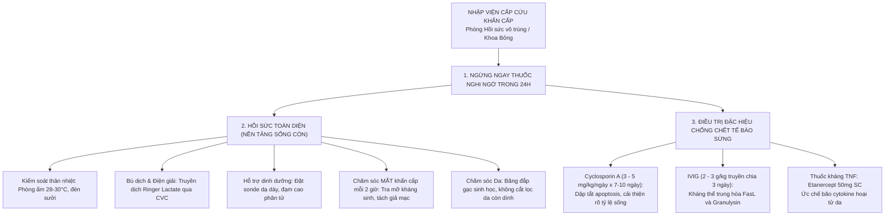

> [!CAUTION]
> **Vấn đề Corticoid toàn thân liều cao trong TEN:**
> - Đây là vấn đề gây tranh cãi gay gắt suốt nửa thế kỷ trong y văn da liễu.
> - Nếu dùng trong **24 - 48 giờ đầu tiên** ở giai đoạn tiền triệu thì có thể giúp giảm bão viêm.
> - Nhưng nếu bệnh nhân đã bị **trợt da diện rộng trên 30% BSA**: Việc dùng Corticoid liều cao kéo dài làm tăng vọt nguy cơ **Nhiễm trùng huyết do Tụ cầu và Trực khuẩn mủ xanh**, ức chế sự biểu mô hóa và làm **TĂNG TỶ LỆ TỬ VONG**! Do đó, đa số các trung tâm bỏng quốc tế hiện nay ưu tiên dùng **Cyclosporin A** hoặc **Etanercept / IVIG** hơn là Corticoid liều cao.

---

# PHẦN 7: CÁC HÌNH THÁI PHÁT BAN DA ĐẶC BIỆT KHÁC DO THUỐC (SLIDE 51 - 60)

## SLIDE 51 & 52: HOẠI TỬ DA DO THUỐC CHỐNG ĐÔNG (ANTICOAGULANT-INDUCED SKIN NECROSIS)


### 1. Nội dung nguyên bản trên Slide
- Tiêu đề: HOẠI TỬ DA DO THUỐC CHỐNG ĐÔNG (Warfarin / Coumarin-induced skin necrosis).
- Hình ảnh mảng bầm máu xuất huyết nhanh chóng chuyển thành hoại tử đen ở vùng giàu mô mỡ.

### 2. Giảng giải chuyên sâu của Giảng viên lâm sàng (BSCKII)
- **Cơ chế sinh lý bệnh độc đáo: "Nghịch lý đông máu do Warfarin":**
  - Warfarin ức chế enzym Vitamin K Epoxide Reductase, ngăn cản quá trình carboxyl hóa các yếu tố đông máu phụ thuộc vitamin K: Yếu tố II, VII, IX, X và **hai protein chống đông tự nhiên nội sinh: Protein C và Protein S**.
  - **Mấu chốt vấn đề:** Thời gian bán thải ($t_{1/2}$) của Protein C rất ngắn (chỉ khoảng **6 - 8 giờ**), trong khi thời gian bán thải của Yếu tố II (Prothrombin) và Yếu tố X kéo dài tới **40 - 72 giờ**.
  - Do đó, trong **2 đến 5 ngày đầu tiên** sau khi bắt đầu dùng Warfarin (đặc biệt khi dùng liều nạp quá cao mà không có gối Heparin), nồng độ Protein C trong máu bị sụt giảm chạm đáy trước khi các yếu tố đông máu kịp giảm $\rightarrow$ Tạo ra một **trạng thái tăng đông kịch phát thoáng qua (Hypercoagulable state)**!
  - Hậu quả: Hình thành huyết khối tắc nghẽn toàn bộ các tiểu động mạch và mao mạch ở vùng mô mỡ dưới da, dẫn đến hoại tử thiếu máu cục bộ cấp tính toàn bộ vùng da bên trên.
- **Vị trí ưa chuộng:** Các vùng giàu mô mỡ: **Vú (ở phụ nữ), Mông, Đùi, Bụng**.
- **Biểu hiện lâm sàng:** Bắt đầu bằng cảm giác đau buốt dữ dội, sau đó xuất hiện mảng hồng ban phù nề, chuyển nhanh sang chấm bầm máu xuất huyết, bóng nước xuất huyết và cuối cùng đóng thành **vảy hoại tử đen kịt, khô cứng, lở loét sâu**.
- **Xử trí cấp cứu:**
  - Ngừng ngay Warfarin.
  - Tiêm **Vitamin K1 tĩnh mạch** và truyền **Huyết tương tươi đông lạnh (FFP)** hoặc phức hợp Prothrombin cô đặc (PCC) để bổ sung ngay Protein C.
  - Sử dụng **Heparin không phân đoạn hoặc Heparin trọng lượng phân tử thấp (LMWH)** để duy trì chống đông.
  - Chăm sóc phẫu thuật cắt lọc mô hoại tử khi vết thương ổn định.

---

## SLIDE 53: PHÁT BAN DẠNG LIKEN DO THUỐC (LICHENOID DRUG ERUPTION)


### 1. Nội dung nguyên bản trên Slide
- Tiêu đề: PHÁT BAN DẠNG LICHEN DO THUỐC
- Hình ảnh các sẩn dẹt màu tím hoa cà phân bố đối xứng ở thân mình và cẳng tay.

### 2. Giảng giải chuyên sâu của Giảng viên lâm sàng (BSCKII)
- **Thuốc nguyên nhân thường gặp:** Thuốc chẹn beta (Beta-blockers), Ức chế men chuyển (ACEi), Thuốc kháng sốt rét tổng hợp, Thuốc lợi tiểu Thiazide, Thuốc kháng giáp tổng hợp (Methimazole), Thuốc chống lao.
- **Phân biệt Liken phẳng vô căn (Lichen planus) và Liken do thuốc:**
  - *Liken do thuốc:* Thời gian khởi phát rất muộn (thường sau vài tháng đến hơn 1 năm dùng thuốc liên tục); Tổn thương có xu hướng lan tỏa rộng toàn thân, có nhiều vảy bong hơn, có thể kèm theo viêm da tróc vảy; **Thường KHÔNG có tổn thương niêm mạc miệng và KHÔNG thấy mạng lưới Wickham striae điển hình**.
  - Khi ngừng thuốc thủ phạm, tổn thương dạng liken thoái lui rất chậm, có thể mất từ vài tháng đến cả năm trời mới lặn hết hoàn toàn.

---

## SLIDE 54 & 55: PHẢN ỨNG NHẠY CẢM ÁNH SÁNG DO THUỐC (PHOTOSENSITIVITY)


### 1. Nội dung nguyên bản trên Slide
- Trích dẫn trường hợp: Cô gái 17 tuổi điều trị mụn trứng cá bằng Demethylchlortetracycline bị phù nề và hồng ban dữ dội vùng mặt sau khi phơi nắng.
- Dát đỏ sẫm màu kèm bóng nước mu bàn tay.
- Tổn thương khu trú nghiêm ngặt ở **vùng da hở phơi bày ra ánh sáng mặt trời**.

### 2. Giảng giải chuyên sâu của Giảng viên lâm sàng (BSCKII)
- **Phân biệt 2 cơ chế nhạy cảm ánh sáng: Độc tính ánh sáng (Phototoxicity) vs Dị ứng ánh sáng (Photoallergy):**

| Đặc điểm phân biệt | Độc tính ánh sáng (Phototoxicity) | Dị ứng ánh sáng (Photoallergy) |
| :--- | :--- | :--- |
| **Cơ chế bệnh sinh** | **Phi miễn dịch:** Thuốc hấp thụ tia UV (chủ yếu là UVA), giải phóng các gốc oxy hóa tự do (ROS) làm tổn hại trực tiếp màng tế bào | **Miễn dịch (Quá mẫn Type IV):** Tia UV làm biến đổi phân tử thuốc thành dạng hapten kích hoạt phản ứng miễn dịch qua tế bào T |
| **Tần suất mắc** | **Rất phổ biến**, xảy ra ở bất kỳ ai nếu dùng đủ liều thuốc và phơi đủ lượng tia UV | Hiếm gặp hơn, chỉ xảy ra ở cơ địa đã bị nhạy cảm hóa |
| **Khởi phát** | **Nhanh chóng (vài phút đến vài giờ sau khi phơi nắng)** | Chậm (sau 24 - 72 giờ sau khi phơi nắng) |
| **Biểu hiện lâm sàng** | Giống như một đợt **Bỏng nắng dữ dội (Exaggerated sunburn)**: Hồng ban đỏ rực rát bỏng, phù nề, bóng nước rỉ dịch | Giống như **Viêm da tiếp xúc chàm hóa (Eczematous rash)**: Sẩn đỏ, mụn nước ngứa nhiều |
| **Phạm vi tổn thương** | **Khu trú nghiêm ngặt ở vùng hở:** Mặt, cổ (chữ V trước ngực), gáy, mu bàn tay, cẳng tay | Có thể lan rộng ra cả các **vùng da được che chắn** bởi quần áo |
| **Thuốc thủ phạm kinh điển** | **Tetracycline (Doxycycline, Demethylchlortetracycline)**, Amiodarone, Kháng sinh Quinolone, Voriconazole, Thiazide | Thuốc thoa chống nắng (oxybenzone), NSAIDs thoa ngoài (Ketoprofen gel), Phenothiazine |

---

## SLIDE 56: RỐI LOẠN SẮC TỐ DA DO THUỐC (DRUG-INDUCED PIGMENTATION)


### 1. Nội dung nguyên bản trên Slide
- Tiêu đề: RỐI LOẠN SẮC TỐ DO THUỐC
- Hình ảnh lâm sàng đổi màu da bất thường: Da màu xám xanh chì do Amiodarone; Sắc tố xanh đen ở cẳng chân do Minocycline.

### 2. Giảng giải chuyên sâu của Giảng viên lâm sàng (BSCKII)
- **Các kiểu đổi màu da kinh điển cần nhận diện:**
  1. **Amiodarone (Thuốc chống loạn nhịp tim):**
     - Ở bệnh nhân dùng Amiodarone liều cao kéo dài (> 1 - 2 năm), có khoảng 1 - 2% trường hợp da ở vùng mặt và tay chuyển sang màu **Xanh xám như da người chết hoặc màu chì (Blue-gray / Slate-gray pigmentation)**.
     - *Cơ chế:* Amiodarone tích tụ trong các lysosome của đại thực bào da kết hợp với hiện tượng lắng đọng sắc tố lipofuscin dưới tác động của ánh sáng mặt trời.
  2. **Minocycline (Kháng sinh điều trị mụn trứng cá kéo dài):**
     - Gây lắng đọng phức hợp Minocycline-Sắt tạo thành màu xanh đen (Blue-black) ở 3 kiểu hình thái:
       - *Type 1:* Đốm xanh đen tại các vết sẹo mụn trứng cá cũ trên mặt.
       - *Type 2:* Mảng sắc tố xanh đen ở mặt trước cẳng chân (như vết bầm tím không bao giờ tan).
       - *Type 3:* Da toàn thân chuyển màu nâu xám xịt do tăng sắc tố melanin.
  3. **Thuốc kháng sốt rét tổng hợp (Chloroquine / Hydroxychloroquine):** Gây đổi màu xanh xám ở cẳng chân và niêm mạc khẩu cái cứng.

---

## SLIDE 57: PHÁT BAN DẠNG MỤN TRỨNG CÁ DO THUỐC (ACNEIFORM DRUG ERUPTION)


### 1. Nội dung nguyên bản trên Slide
- **Đặc điểm phân biệt với Mụn trứng cá thông thường (Acne vulgaris):**
  - **Phát ban dạng mụn trứng cá do thuốc:** Cùng một lứa tuổi (Monomorphic), mọc đồng loạt toàn bộ mặt, ngực, lưng.
  - **Mụn trứng cá thông thường:** Đa lứa tuổi (Polymorphic: có cả mụn đầu đen, đầu trắng, sẩn, mụn mủ, nang cục), khu trú từng vùng.

### 2. Giảng giải chuyên sâu của Giảng viên lâm sàng (BSCKII)
- **Dấu hiệu nhận biết "Mụn do Corticoid" (Steroid Acne):**
  - Bệnh nhân (thường là nữ giới) sau khi bôi kem trộn chứa Corticoid hoặc uống Dexamethasone/Medrol khoảng 2 - 4 tuần, đột ngột bùng phát hàng trăm nốt sẩn đỏ và sẩn mủ nhỏ kích thước 1 - 2mm mọc chi chít ở mặt, ngực, lưng và hai vai.
  - **3 đặc điểm mấu chốt để phân biệt:**
    1. **Đồng dạng một lứa tuổi (Monomorphic):** Tất cả các nốt sẩn đều giống nhau như đúc từ một khuôn, cùng xuất hiện một lúc và cùng thoái lui một lúc.
    2. **TUYỆT ĐỐI KHÔNG CÓ CỒI MỤN (ABSENCE OF COMEDONES):** Không có nhân đầu đen hay nhân đầu trắng.
    3. **Vị trí bất thường:** Có thể mọc lan xuống cả cẳng tay, bụng (nơi mụn trứng cá thông thường hiếm khi xuất hiện).
- **Các thuốc khác gây phát ban dạng trứng cá:** **Isoniazid (INH), Lithium, Phenytoin, Vitamin B12 liều cao, Thuốc ức chế EGFR**.

---

## SLIDE 58: BỆNH BÓNG NƯỚC TỰ MIỄN DO THUỐC (DRUG-INDUCED BULLOUS DISEASES)


### 1. Nội dung nguyên bản trên Slide
- Tiêu đề: BỆNH BÓNG NƯỚC DO THUỐC
- Hình ảnh bóng nước căng vòm trong Pemphigoid bóng nước và bóng nước mềm dễ vỡ trong Pemphigus.

### 2. Giảng giải chuyên sâu của Giảng viên lâm sàng (BSCKII)
- **1. Pemphigoid bóng nước do thuốc hạ đường huyết nhóm Gliptin (DPP-4 Inhibitors):**
  - Đây là phát hiện cảnh báo dược thư lớn nhất trong thập kỷ qua: Bệnh nhân đái tháo đường type 2 lớn tuổi sử dụng các thuốc ức chế enzym Dipeptidyl Peptidase-4 (**Vildagliptin, Linagliptin, Sitagliptin**) có nguy cơ bùng phát bệnh **Pemphigoid bóng nước (Bullous Pemphigoid)** cao gấp **3 đến 10 lần** so với người không dùng!
  - *Đặc điểm:* Bóng nước to, căng vòm, mọc trên nền da bình thường hoặc hồng ban, ngứa dữ dội, xét nghiệm miễn dịch huỳnh quang trực tiếp (DIF) thấy lắng đọng IgG và C3 thẳng hàng dọc theo màng đáy. Bệnh nhân có kháng thể kháng BP180.
  - *Xử trí:* Ngừng ngay thuốc Gliptin, chuyển sang Insulin hoặc Metformin.
- **2. Pemphigus do thuốc (Drug-induced Pemphigus):**
  - Thường liên quan đến các thuốc chứa **gốc Thiol (-SH)** tự do như **D-Penicillamine, Captopril**. Nhóm thiol trực tiếp bẻ gãy các cầu nối disulfid của phân tử desmoglein 1 và 3 giữa các tế bào sừng, gây hiện tượng ly gai (*Acantholysis*) tạo bóng nước mềm nhẽo, rách vỡ để lại vết trợt lở đau đớn.

---

## SLIDE 59: LUPUS BAN ĐỎ BÁN CẤP DO THUỐC (DRUG-INDUCED SCLE - DI-SCLE)


### 1. Nội dung nguyên bản trên Slide
- Trích dẫn nghiên cứu về bệnh nhân Lupus ban đỏ bán cấp ở da do thuốc (Drug-induced subacute cutaneous lupus erythematosus - DI-SCLE):
  - Hình A: Sang thương dạng hồng ban đa dạng do thuốc ức chế bơm proton **Lansoprazole**.
  - Hình B: Ban vảy tiết trợt da xuất huyết do thuốc kháng nấm **Terbinafine**.
  - Hình C: Dát sẩn dạng vòng tróc vảy ở vùng hở.

### 2. Giảng giải chuyên sâu của Giảng viên lâm sàng (BSCKII)
- **Đặc trưng miễn dịch & Lâm sàng của DI-SCLE:**
  - Khác với Lupus hệ thống do thuốc kinh điển (DI-SLE do Procainamide, Hydralazine có kháng thể Anti-Histone), thể **DI-SCLE** biểu hiện chủ yếu ở da:
    - Tổn thương gồm các mảng hồng ban dạng vòng (Annular) hoặc dạng vảy nến (Psoriasiform), bờ nổi gờ nhẹ, có vảy mỏng, tập trung ưu thế ở **vùng da phơi bày ánh sáng** (cổ chữ V, lưng trên, mặt ngoài cánh tay). Khi lành không để lại sẹo teo da.
    - **Xét nghiệm miễn dịch:** Kháng thể **Anti-Ro/SSA dương tính mạnh ở hơn 80% bệnh nhân!**
  - **Thuốc thủ phạm hàng đầu hiện nay:**
    1. Thuốc ức chế bơm proton (**PPIs: Lansoprazole, Omeprazole, Esomeprazole**).
    2. Thuốc kháng nấm đường uống (**Terbinafine**).
    3. Thuốc lợi tiểu Thiazide (**Hydrochlorothiazide**).
    4. Thuốc chẹn kênh Canxi (**Diltiazem, Nifedipine**).
  - *Tiên lượng:* Khi ngừng thuốc thủ phạm, tổn thương da sẽ thoái lui hoàn toàn sau vài tuần đến vài tháng, kháng thể Anti-Ro/SSA sẽ giảm dần hiệu giá.

---

## SLIDE 60: PHÁT BAN DẠNG VẢY NẾN DO THUỐC (DRUG-INDUCED PSORIASIS)


### 1. Nội dung nguyên bản trên Slide
- Tiêu đề: PHÁT BAN DẠNG VẢY NẾN DO THUỐC
- Hình ảnh mảng đỏ phủ vảy trắng bạc dày cộm bùng phát sau khi dùng thuốc.

### 2. Giảng giải chuyên sâu của Giảng viên lâm sàng (BSCKII)
- **Hai hình thức biểu hiện:**
  - *Vảy nến khởi phát mới do thuốc (Drug-induced):* Người bệnh trước đó chưa từng bị vảy nến bao giờ, sau khi uống thuốc mới xuất hiện sang thương.
  - *Vảy nến trở nặng do thuốc (Drug-aggravated):* Người bệnh có sẵn tiền sử vảy nến mảng nhẹ, sau khi dùng thuốc thì bệnh bùng phát dữ dội hoặc chuyển sang thể mủ/đỏ da toàn thân.
- **Các thủ phạm kinh điển:** Thuốc chẹn beta (**Beta-blockers**), **Lithium**, **Kháng sốt rét tổng hợp**, và hiện tượng nghịch lý của **Thuốc kháng TNF-alpha**.

---

## SLIDE 61 & 62: TÀI LIỆU THAM KHẢO & LỜI CẢM ƠN
### 1. Nội dung nguyên bản trên Slide
1. Laurence Valeyrie-Allanore, Grace Obeid and Jean Revuz. Chapter 21: Drug Reactions. Jean L. Bolognia. *Dermatology*. 4th ed. Elsevier; 2017. 348-375.
2. Kara Heelan, Cathryn Sibbald, & Neil H. Shear. *Fitzpatrick’s Dermatology* 9th edition.
- **Slide 62: Thank You!**

---

## TỔNG KẾT BÀI GIẢNG: BẢNG SO SÁNH 4 THỂ SCARs KINH ĐIỂN

| Tiêu chí | Hội chứng SJS / TEN | Hội chứng DRESS / DIHS | Mụn mủ cấp tính AGEP | Hồng ban cố định GBFDE |
| :--- | :--- | :--- | :--- | :--- |
| **Cơ chế Type IV** | **Type IVc** (CD8+ CTL, NK) | **Type IVb** (Th2, Eosinophils) | **Type IVd** (IL-8, Neutrophils) | **Type IVc tại chỗ** (CD8+ TRM) |
| **Vũ khí gây bệnh** | **Granulysin**, Perforin, FasL | **IL-5**, Eotaxin, Tái hoạt virus HHV-6 | **IL-8 (CXCL8)** hút Neutrophil | Granulysin, IFN-γ cục bộ |
| **Thời gian ủ bệnh** | **1 - 4 tuần** (7 - 21 ngày) | **2 - 8 tuần** (Khởi phát rất muộn) | **24 - 48 giờ** (Khởi phát tối cấp) | **< 24 giờ** (sau tái tiếp xúc) |
| **Triệu chứng da** | Dát sẫm màu, bóng nước nhẽo, **trợt tuột da mảng lớn** | Dát sẩn phù nề, **PHÙ NỀ MẶT nặng**, đỏ da toàn thân | Hàng ngàn **mụn mủ nhỏ vô trùng** trên nền hồng ban | Mảng tím tròn, **bóng nước trợt rộng trên nền thâm cũ** |
| **Dấu Nikolsky** | **Dương tính rõ rệt (+++)** | Âm tính | Dương tính nhẹ trợt bề mặt | Dương tính tại mảng tổn thương |
| **Tổn thương niêm mạc** | **RẤT NẶNG ($\ge 2$ niêm mạc)**: Mắt, miệng mài máu đen | Nhẹ hoặc không có | Rất hiếm gặp (< 20%, nhẹ ở môi) | Thường nhẹ hoặc chỉ bị 1 vị trí |
| **Tổn thương nội tạng** | Suy thận cấp, mất nước, phổi | **RẤT NẶNG (Gan hoại tử, Thận, Tim)** | Hiếm gặp, thoáng qua | **HOÀN TOÀN KHÔNG CÓ** |
| **Xét nghiệm máu** | Giảm bạch cầu (tiên lượng nặng), tăng Ure | **Tăng Eosinophil, Lympho không điển hình, Tăng AST/ALT** | **Tăng vọt Neutrophils ($> 7.000/\mu\text{L}$)** | Bình thường |
| **Tỷ lệ tử vong** | **RẤT CAO: 10% (SJS) - 50% (TEN)** | **5 - 10%** (do suy gan, viêm cơ tim) | **Thấp: 1 - 2%** | **Thấp: < 5%** |
| **Điều trị then chốt** | Hồi sức bỏng, Cyclosporin, IVIG, Etanercept | **Corticoid toàn thân giảm liều rất chậm (2-3 tháng)** | Ngừng thuốc, tự thoái lui sau 1-2 tuần | Ngừng thuốc, chăm sóc trợt loét |

---

## 10 NGUYÊN LÝ "VÀNG" CỦA BSCKII KHI ĐI BUỒNG CẤP CỨU DỊ ỨNG THUỐC

1. **Nguyên tắc thời gian vàng:** Phát ban xuất hiện sau 1-2 ngày nghĩ ngay đến AGEP; sau 1-3 tuần nghĩ đến EDE hoặc SJS/TEN; sau 3-6 tuần nghĩ ngay đến DRESS.
2. **Quy tắc ngừng thuốc:** Bệnh nhân đang có ban da nghi do thuốc + bất kỳ dấu hiệu nặng nào $\rightarrow$ **NGỪNG TẤT CẢ CÁC THUỐC NGHI NGỜ TRONG VÒNG 24 GIỜ ĐẦU TIÊN!**
3. **Phù nề mặt (Facial edema):** Là dấu hiệu chỉ điểm lâm sàng giá trị nhất của **Hội chứng DRESS**.
4. **Đau da tự nhiên + Trợt niêm mạc:** Là dấu hiệu chỉ điểm hoại tử thượng bì sắp diễn ra trong **SJS / TEN**.
5. **Cấp cứu Sốc phản vệ:** Thuốc hàng đầu duy nhất là **ADRENALINE TIÊM BẮP (IM)**, tiêm càng sớm càng tốt; Corticoid và Kháng Histamin chỉ là thuốc hàng hai.
6. **Corticoid trong DRESS:** Phải dùng đủ liều và **giảm liều cực kỳ chậm trong 2 - 3 tháng** để phòng ngừa tái hoạt virus HHV-6 và bùng phát bão viêm đợt hai.
7. **Bảo vệ mắt trong SJS/TEN:** Phải mời Bác sĩ Mắt khám tại giường mỗi ngày, tra mỡ kháng sinh và tách dính mi cầu liên tục để cứu lấy thị lực bệnh nhân.
8. **Phù mạch do thuốc ức chế men chuyển (ACEi):** Do tích tụ Bradykinin, không có mày đay đi kèm, không đáp ứng với Adrenaline/Corticoid; có thể xuất hiện sau nhiều tháng dùng thuốc êm đẹp.
9. **Sàng lọc gen HLA:** Bắt buộc test **HLA-B\*15:02** trước khi kê Carbamazepine và **HLA-B\*58:01** trước khi kê Allopurinol cho người Việt Nam.
10. **Tấm bùa hộ mệnh:** Luôn cấp **Thẻ dị ứng thuốc** ghi rõ hoạt chất cấm dùng và các thuốc dị ứng chéo cho bệnh nhân trước khi xuất viện.

---

## 3 TÌNH HUỐNG LÂM SÀNG CẤP CỨU THỰC TẾ (MINI-CASES)

### Tình huống lâm sàng 1 (Case 1 - Bệnh cảnh DRESS):
> **Bệnh sử:** Bệnh nhân nam, 62 tuổi, có tiền sử tăng acid uric máu và Gout mạn tính, được phòng khám tư kê đơn uống Allopurinol 300mg/ngày cách đây 5 tuần. Cách đây 4 ngày, bệnh nhân bắt đầu sốt cao $39^\circ\text{C}$ liên tục, mệt mỏi, mắt và hai má sưng húp híp lại. Sau đó xuất hiện ban đỏ nổi gờ cộm ngứa nhiều lan từ mặt xuống ngực, lưng và tứ chi.
> 
> **Thăm khám:** Bệnh nhân tỉnh nhưng đừ, sốt $39.2^\circ\text{C}$, mạch 105 lần/phút, HA 130/80 mmHg. Mặt phù nề biến dạng rõ rệt. Toàn thân phủ kín bởi các dát sẩn hồng ban thâm nhiễm gờ cao ($BSA \approx 65\%$). Sờ thấy hạch cổ 2 bên và hạch bẹn to mềm đường kính 1.5 - 2cm, hơi đau. Niêm mạc môi miệng và mắt bình thường.
> 
> **Cận lâm sàng:**
> - Công thức máu: Bạch cầu $16.500/\mu\text{L}$, trong đó **Bạch cầu ái toan (Eosinophil) chiếm 18% ($2.970/\mu\text{L}$)**. Tiêu bản máu ngoại vi ghi nhận có tế bào lympho không điển hình.
> - Sinh hóa: **AST 345 U/L, ALT 480 U/L** (tăng gấp hơn 8 lần bình thường), **Creatinine 185 $\mu\text{mol/L}$** (eGFR giảm còn $34\text{ mL/phút}$).
> 
> **Câu hỏi:**
> 1. Chẩn đoán xác định thể lâm sàng của bệnh nhân? Tính điểm RegiSCAR?
> 2. Thuốc thủ phạm gây bệnh là gì?
> 3. Phác đồ điều trị cụ thể cho bệnh nhân này?
> 
> **Phân tích & Hướng dẫn xử trí của BSCKII:**
> - **Chẩn đoán:** Hội chứng DRESS (Drug Reaction with Eosinophilia and Systemic Symptoms) thể nặng có tổn thương gan thận cấp tính do **Allopurinol**.
> - **Đánh giá điểm RegiSCAR:**
>   - Sốt $\ge 38.5^\circ\text{C}$ (0đ).
>   - Hạch to $\ge 2$ vị trí (cổ, bẹn) (+1đ).
>   - Eosinophil $\ge 1.500/\mu\text{L}$ (+2đ).
>   - Lympho không điển hình (+1đ).
>   - Ban da $> 50\%$ BSA có phù mặt (+2đ).
>   - Tổn thương nội tạng $\ge 2$ tạng (Viêm gan cấp + Suy thận cấp) (+2đ).
>   - Loại trừ nguyên nhân khác (+1đ).
>   $\rightarrow$ **Tổng điểm RegiSCAR = 9 điểm $\rightarrow$ XÁC CHẨN HOÀN TOÀN DRESS (*Definite DRESS*)!**
> - **Hướng xử trí:**
>   1. Ngừng vĩnh viễn Allopurinol (và không bao giờ được dùng lại).
>   2. Nhập viện khoa Hồi sức / Da liễu theo dõi sát men gan, bilirubin, chức năng thận và làm thêm ECG, Troponin I tầm soát viêm cơ tim.
>   3. **Corticosteroid toàn thân:** Khởi đầu **Methylprednisolone 1 mg/kg/ngày (tương đương 60mg tiêm tĩnh mạch)**. Theo dõi đáp ứng men gan và bạch cầu ái toan mỗi 3 - 5 ngày.
>   4. Khi triệu chứng ổn định, chuyển sang dạng uống và **giảm liều cực kỳ chậm rãi trong vòng 8 đến 12 tuần** để tránh bùng phát bão viêm đợt hai do tái hoạt virus HHV-6.
>   5. Sau này để hạ acid uric điều trị Gout, bệnh nhân có thể thay thế bằng **Febuxostat** (nhưng phải khởi đầu liều thấp và theo dõi sát). Cấp thẻ dị ứng thuốc cấm dùng Allopurinol suốt đời.

---

### Tình huống lâm sàng 2 (Case 2 - Bệnh cảnh SJS/TEN):
> **Bệnh sử:** Bệnh nhân nữ, 24 tuổi, sinh viên, người Kinh, được chẩn đoán động kinh cục bộ cách đây 2 tuần và được bác sĩ Thần kinh kê đơn uống **Carbamazepine (Tegretol) 200mg x 2 viên/ngày**. Cách đây 3 ngày, bệnh nhân bắt đầu sốt, mệt mỏi, mắt cộm xót sợ ánh sáng, môi đau rát rỉ máu khi ăn uống. Hôm qua, bệnh nhân xuất hiện các mảng dát đỏ sẫm màu ở mặt và ngực, da chạm vào thấy đau buốt. Sáng nay da bắt đầu phồng rộp nổi các bóng nước mềm rồi tuột da thành mảng lớn.
> 
> **Thăm khám:** Bệnh nhân sốt $38.8^\circ\text{C}$, mạch 115 lần/phút, HA 105/65 mmHg.
> - **Niêm mạc:** Cả 3 niêm mạc bị tổn thương nặng nề:
>   - Mắt: Hai mắt sưng đỏ, viêm kết mạc mủ có giả mạc, sợ ánh sáng.
>   - Miệng: Hai môi đóng mài máu đen dày cộm, niêm mạc má và vòm họng trợt loét chảy máu, đau không nuốt được.
>   - Sinh dục: Âm hộ trợt loét rát buốt.
> - **Da:** Nhiều mảng dát hồng ban sẫm màu dạng bia bắn không điển hình hợp lưu toàn bộ thân mình và tứ chi. Các bóng nước mềm chùng nhẽo vỡ ra để lại các mảng trợt da trơ đáy trung bì đỏ rực rỉ dịch lầy lội. **Dấu hiệu Nikolsky dương tính rõ rệt**. Diện tích da đã trợt và có thể trợt ước tính khoảng **$22\%$ BSA**.
> 
> **Câu hỏi:**
> 1. Chẩn đoán xác định thể lâm sàng hiện tại?
> 2. Đánh giá tiên lượng tử vong bằng thang điểm SCORTEN?
> 3. Cần làm gì ngay trong 24 giờ đầu để cứu tính mạng và bảo vệ thị lực cho bệnh nhân?
> 
> **Phân tích & Hướng dẫn xử trí của BSCKII:**
> - **Chẩn đoán:** **Hội chứng chồng lấp SJS/TEN (SJS/TEN Overlap)** do Carbamazepine (diện tích bong tróc thượng bì $22\%$ nằm trong khoảng 10 - 30% BSA).
> - **Cơ sở dược lý di truyền:** Bệnh nhân là người Kinh, có nguy cơ rất cao mang alen **HLA-B\*15:02** (yếu tố thúc đẩy tế bào T CD8+ phóng thích Granulysin hoại tử thượng bì).
> - **Đánh giá điểm SCORTEN:**
>   - Tuổi 24 (< 40t) = 0đ.
>   - Không ung thư = 0đ.
>   - Nhịp tim 115 (< 120) = 0đ.
>   - Diện tích bong tróc ban đầu $> 10\%$ BSA (hiện tại 22%) = **1 điểm**.
>   - Chờ xét nghiệm BUN, Glucose, Bicarbonate để tính tổng điểm (nếu có thêm toan chuyển hóa hoặc suy thận thì điểm sẽ tăng lên).
> - **Xử trí cấp cứu khẩn cấp:**
>   1. Ngừng ngay lập tức Carbamazepine. Chuyển khoa Chăm sóc tích cực (ICU) hoặc Đơn vị Bỏng chuyên sâu.
>   2. Nằm phòng cách ly vô trùng, nhiệt độ phòng 28 - 30°C để tránh hạ thân nhiệt.
>   3. Đặt catheter tĩnh mạch trung tâm bù dịch Ringer Lactate và Albumin. Đặt sonde dạ dày nuôi ăn sớm.
>   4. **CẤP CỨU MẮT:** Mời Bác sĩ Nhãn khoa khám ngay tại giường: Nhỏ nước mắt nhân tạo không chất bảo quản mỗi 1 - 2 giờ, tra mỡ kháng sinh Erythromycin, dùng que thủy tinh bọc gạc tách dính mi cầu 2 lần/ngày để chống dính mi cầu gây mù lòa.
>   5. **Thuốc ức chế hoại tử thượng bì đặc hiệu:**
>      - Ưu tiên chỉ định sớm **Cyclosporin A (3 - 5 mg/kg/ngày)** truyền tĩnh mạch hoặc uống chia 2 lần trong 7 - 10 ngày (giúp chặn đứng sự tiết Granulysin và giảm rõ rệt tỷ lệ tử vong).
>      - Hoặc phối hợp **Etanercept 50mg tiêm dưới da** liều duy nhất.
>   6. Chăm sóc tổn thương da: Đắp gạc sinh học (Acticoat hoặc Aquacel Ag), không cắt lọc phần da hoại tử còn dính vì lớp biểu bì chết hoạt động như một lớp băng sinh học tự nhiên bảo vệ trung bì bên dưới.

---

### Tình huống lâm sàng 3 (Case 3 - Phù mạch do thuốc):
> **Bệnh sử:** Bệnh nhân nam, 58 tuổi, tiền sử tăng huyết áp 2 năm nay đang được điều trị đều đặn bằng **Enalapril 10mg/ngày**. Sáng nay ngủ dậy, bệnh nhân thấy môi trên và môi dưới sưng vều to tướng biến dạng, cảm giác căng tức nặng trĩu khó chịu nhưng hoàn toàn không ngứa. Bệnh nhân không sốt, không nổi bất kỳ sẩn mày đay nào trên người. Tuy nhiên, sau đó bệnh nhân bắt đầu thấy khàn tiếng, nuốt vướng và cảm giác nghẹn ở cổ họng. Bệnh nhân hốt hoảng đến phòng cấp cứu.
> 
> **Câu hỏi:**
> 1. Chẩn đoán lâm sàng nghĩ đến nhiều nhất?
> 2. Cơ chế bệnh sinh của trường hợp này khác gì so với phù mạch do dị ứng thức ăn/penicillin?
> 3. Việc tiêm Adrenaline, Kháng Histamin và Solu-Medrol trong trường hợp này có mang lại hiệu quả như mong đợi không? Bước xử trí ưu tiên số một là gì?
> 
> **Phân tích & Hướng dẫn xử trí của BSCKII:**
> - **Chẩn đoán:** **Phù mạch do thuốc ức chế men chuyển (ACEi-induced Angioedema)** có dấu hiệu đe dọa bít tắc đường thở trên.
> - **Bản chất cơ chế bệnh sinh:**
>   - Đây là phản ứng **PHI DỊ ỨNG (Non-allergic)** qua trung gian **BRADYKININ**, hoàn toàn không liên quan đến kháng thể IgE hay Histamine!
>   - Enalapril ức chế men Kininase II làm tích tụ Bradykinin nội sinh, gắn vào thụ thể B2 gây dãn mạch phù nề mô sâu và niêm mạc.
>   - Do không qua Histamine nên bệnh nhân **HOÀN TOÀN KHÔNG CÓ MÀY ĐAY VÀ KHÔNG NGỨA**.
> - **Hiệu quả của thuốc dị ứng thông thường:**
>   - Adrenaline, Corticoid và Kháng Histamin H1 **TÁC DỤNG RẤT KÉM HOẶC THẬM CHÍ KHÔNG CÓ TÁC DỤNG** trong phù mạch do Bradykinin!
> - **Bước xử trí ưu tiên số một:**
>   1. **BẢO VỆ ĐƯỜNG THỞ (AIRWAY FIRST):** Chuẩn bị sẵn bộ dụng cụ đặt nội khí quản và mở khí quản cấp cứu bên cạnh giường bệnh. Nếu có dấu hiệu thở rít thanh quản hoặc SpO2 tụt $\rightarrow$ Phải đặt nội khí quản qua nội soi phế quản ống mềm ngay trước khi thanh môn bị phù nề bít kín hoàn toàn!
>   2. **Ngừng vĩnh viễn Enalapril** (và cả nhóm ức chế men chuyển ACEi nói chung).
>   3. Thuốc đối kháng đặc hiệu nếu có điều kiện: Thuốc ức chế thụ thể Bradykinin B2 (**Icatibant 30mg tiêm dưới da**) hoặc chất ức chế C1-esterase cô đặc.
>   4. Sau này điều trị tăng huyết áp cho bệnh nhân: Tuyệt đối không dùng lại nhóm ACEi, ưu tiên chuyển sang nhóm **Chẹn kênh Canxi (Amlodipine)** hoặc **Chẹn beta giao cảm**.

---
*(Hết giáo trình bài giảng Trúng độc da do thuốc & SCARs - Slide 1 đến Slide 62)*


<!-- === VIRTUAL_FILE: 03_Viem_Da_Co_Dia_Atopic_Dermatitis.md === -->

# GIÁO TRÌNH BÀI GIẢNG CHUYÊN SÂU: VIÊM DA CƠ ĐỊA (ATOPIC DERMATITIS)

**Đối tượng đào tạo:** Bác sĩ Y khoa (Y5) – Định hướng Sau đại học (BSNT, CKI, CKII Da liễu, Dị ứng – Miễn dịch lâm sàng, Nhi khoa)  
**Bộ môn:** Da liễu – Trường Đại học Khoa học Sức khỏe, Đại học Quốc gia TP. Hồ Chí Minh (UHS - VNUHCM)  
**Giảng viên biên soạn slide gốc:** ThS. BS. Nguyễn Thành Đạt  
**Phân tích & Giảng giải lâm sàng chuyên sâu:** Bác sĩ Chuyên khoa II Da liễu (Giảng viên lâm sàng)  
**Tài liệu tham khảo chính:** Bolognia Dermatology 5th Ed (2024), Harper’s Textbook of Pediatric Dermatology (2020), Fitzpatrick’s Dermatology 9th Ed, Hướng dẫn Chẩn đoán và Điều trị Viêm da cơ địa – Bộ Y tế, Đồng thuận Quốc tế EuroGuiDerm 2022.

---

## LỜI MỞ ĐẦU CỦA GIẢNG VIÊN LÂM SÀNG (BSCKII)

> *"Chào các em sinh viên Y5 và các bác sĩ đồng nghiệp!*  
> *Nếu như Bệnh Vảy nến là đại diện kinh điển cho mô hình viêm qua trung gian Th17/IL-23, thì **Viêm da cơ địa (Atopic Dermatitis - AD)** chính là mô hình nguyên mẫu, phức tạp và hấp dẫn nhất của phản ứng viêm dị ứng qua trung gian **Th2/Th22 kết hợp khiếm khuyết hàng rào biểu mô**.*
>
> *Viêm da cơ địa là bệnh lý da mạn tính phổ biến nhất ở trẻ em và ngày càng gia tăng ở người trưởng thành. Căn bệnh này gắn liền với triệu chứng **'NGỨA'** – một cơn ngứa dữ dội, cồn cào, bứt rứt, hành hạ giấc ngủ của đứa trẻ và làm đảo lộn hoàn toàn cuộc sống của cả gia đình. Vòng xoắn bệnh lý **'Ngứa – Cào gãi – Tổn thương hàng rào da – Nhiễm trùng – Ngứa nhiều hơn' (Itch-Scratch Cycle)** chính là cái bẫy luẩn quẩn giam cầm người bệnh suốt nhiều năm tháng.*
>
> *Trước đây, chúng ta thường điều trị viêm da cơ địa theo kiểu 'chữa cháy': khi nào bùng phát thì thoa corticoid, hết thì thôi. Nhưng tư duy hiện đại ngày nay đã thay đổi hoàn toàn: Chúng ta tiếp cận bệnh theo **Chiến lược Chủ động Duy trì (Proactive Therapy)**, phục hồi toàn diện hàng rào da bằng dưỡng ẩm, kiểm soát sự mất cân bằng vi hệ tụ cầu vàng (*Staphylococcus aureus*), và đặc biệt là sự xuất hiện của các **Thuốc sinh học trúng đích (Kháng IL-4/IL-13 - Dupilumab)** cùng các **Thuốc ức chế JAK đường uống (Upadacitinib, Abrocitinib)** đang mở ra một kỷ nguyên mới – kỷ nguyên cắt đứt cơn ngứa thần tốc và trả lại làn da mịn màng cho người bệnh.*
>
> *Bài giảng này của ThS. BS Nguyễn Thành Đạt là bài giảng đồ sộ nhất trong chương trình với **78 slide**. Tôi sẽ cùng các em phân tích cặn kẽ từng slide một, đi từ sinh học phân tử của gen Filaggrin, cơ chế chuyển dịch miễn dịch 2 pha, nhận diện tổn thương theo từng lứa tuổi (từ chàm sữa nhũ nhi đến chàm bàn tay người lớn), các dấu hiệu cờ đỏ nhiễm trùng cấp cứu (**Eczema herpeticum**), cho đến nghệ thuật kê đơn dưỡng ẩm và thuốc sinh học. Hãy cùng bắt đầu!"*

---

## MỤC LỤC BÀI HỌC

1. [Phần 1: Đại cương, Dịch tễ học toàn cầu & Tiến trình Dị ứng (Slide 1 - 10)](#phan-1-dai-cuong-dich-te-hoc-toan-cau--tien-trinh-di-ung-slide-1---10)
2. [Phần 2: Sinh bệnh học chuyên sâu: Gen Filaggrin, Mất cân bằng Vi hệ & Miễn dịch 2 pha (Slide 11 - 18)](#phan-2-sinh-benh-hoc-chuyen-sau-gen-filaggrin-mat-can-bang-vi-he--mien-dich-2-pha-slide-11---18)
3. [Phần 3: Đặc điểm lâm sàng theo 3 lứa tuổi & Các dấu ấn cơ địa Atopy (Slide 19 - 31)](#phan-3-dac-diem-lam-sang-theo-3-lua-tuoi--cac-dau-an-co-dia-atopy-slide-19---31)
4. [Phần 4: Đánh giá độ nặng (SCORAD, EASI, POEM) & Cận lâm sàng, Mô bệnh học (Slide 32 - 38)](#phan-4-danh-gia-do-nang-scorad-easi-poem--can-lam-sang-mo-benh-hoc-slide-32---38)
5. [Phần 5: Tiêu chuẩn chẩn đoán (Hanifin & Rajka, UK Working Party) & Chẩn đoán phân biệt (Slide 39 - 45)](#phan-5-tieu-chuan-chan-doan-hanifin--rajka-uk-working-party--chan-doan-phan-biet-slide-39---45)
6. [Phần 6: Các biến chứng nhiễm trùng nguy hiểm: Eczema Herpeticum & Chốc hóa (Slide 46 - 49)](#phan-6-cac-bien-chung-nhiem-trung-nguy-hiem-eczema-herpeticum--choc-hoa-slide-46---49)
7. [Phần 7: Điều trị tại chỗ & Nghệ thuật phục hồi hàng rào da (Slide 50 - 60)](#phan-7-dieu-tri-tai-cho--nghe-thuat-phuc-hoi-hang-rao-da-slide-50---60)
8. [Phần 8: Điều trị toàn thân, Kỷ nguyên Thuốc sinh học & Ức chế JAK (Slide 61 - 71)](#phan-8-dieu-tri-toan-than-ky-nguyen-thuoc-sinh-hoc--uc-che-jak-slide-61---71)
9. [Phần 9: Chăm sóc tắm rửa, Quản lý thai kỳ, 10 Nguyên lý Vàng & 3 Tình huống lâm sàng thực tế (Slide 72 - 78)](#phan-9-cham-soc-tam-rua-quan-ly-thai-ky-10-nguyen-ly-vang--3-tinh-huong-lam-sang-thuc-te-slide-72---78)

---

# PHẦN 1: ĐẠI CƯƠNG, DỊCH TỄ HỌC TOÀN CẦU & TIẾN TRÌNH DỊ ỨNG (SLIDE 1 - 10)

## SLIDE 1 & 2: TIÊU ĐỀ VÀ CẤU TRÚC BÀI GIẢNG


### 1. Nội dung nguyên bản trên Slide
- **Tiêu đề:** VIÊM DA CƠ ĐỊA
- **Đơn vị:** Bộ môn Da liễu – Trường Đại học Khoa học Sức khỏe, ĐHQG – HCM
- **Giảng viên:** ThS. BS. NGUYỄN THÀNH ĐẠT
- **Cấu trúc nội dung:**
  1. Đại cương
  2. Dịch tễ
  3. Sinh bệnh học
  4. Lâm sàng
  5. Cận lâm sàng
  6. Điều trị
  7. Quản lý

### 2. Giảng giải chuyên sâu của Giảng viên lâm sàng (BSCKII)
- **Thuật ngữ & Lịch sử danh xưng:**
  - Thuật ngữ *"Atopy"* bắt nguồn từ tiếng Hy Lạp (*"a-topos"* có nghĩa là "lạ lùng, khác thường, không đúng chỗ"), được đưa ra lần đầu tiên vào năm 1923 bởi Coca và Cooke để mô tả khuynh hướng di truyền gia đình sản xuất quá mức kháng thể IgE chống lại các dị nguyên môi trường thông thường.
  - Thuật ngữ *"Atopic Dermatitis"* được Hill và Sulzberger chính thức đặt ra năm 1933.
  - Trong dân gian Việt Nam, bệnh thường được gọi là **"Chàm thể tạng"**, **"Chàm sữa"** (ở trẻ nhũ nhi), hoặc **"Lác sữa"**.

---

## SLIDE 3 & 4: ĐẠI CƯƠNG & TIẾN TRÌNH DỊ ỨNG (THE ATOPIC MARCH)


### 1. Nội dung nguyên bản trên Slide
- Viêm da cơ địa (AD) là bệnh da mãn tính phổ biến nhất và tỉ lệ mắc bệnh ngày càng tăng là một vấn đề lớn đối với sức khỏe cộng đồng trên toàn thế giới.
- Đặc điểm đặc trưng của AD là **ngứa, diễn tiến mạn tính và hay tái phát**, thường xuất hiện ở trẻ nhỏ và có mối liên hệ mật thiết với các bệnh lý cơ địa dị ứng khác.
- Trích dẫn: *Bolognia Dermatology 5th Ed (2024); Ring, J. Atopic Dermatitis. Springer, Cham 2016.*

### 2. Giảng giải chuyên sâu của Giảng viên lâm sàng (BSCKII)
- **Khái niệm kinh điển: "Tiến trình Atopy" (The Atopic March):**
  - Đây là một trong những quy luật dịch tễ học và miễn dịch học quan trọng nhất của nhi khoa và da liễu:

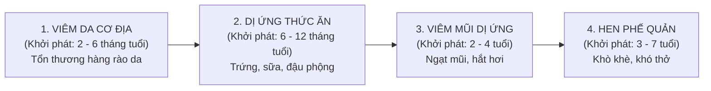

- **Cơ chế tại sao tổn thương da lại mở đường cho Hen phế quản?**
  - Giả thuyết *"Da là cửa ngõ dị ứng toàn thân"* (*Skin as the route of allergic sensitization*):
    - Khi hàng rào thượng bì da bị phá vỡ (do đột biến Filaggrin), các dị nguyên trong không khí (mạt bụi nhà *Dermatophagoides*, lông chó mèo, phấn hoa) và dị nguyên thức ăn xâm nhập sâu qua biểu bì.
    - Tế bào sừng bị tổn thương tiết ra các "alarmin" báo động: **TSLP (Thymic Stromal Lymphopoietin), IL-33 và IL-25**.
    - TSLP kích hoạt các tế bào tua (Dendritic cells), di chuyển về hạch lympho và huấn luyện các tế bào lympho T ngây thơ biệt hóa thành dòng **Th2 lưu hành toàn thân**.
    - Các tế bào Th2 này sau đó di chuyển đến niêm mạc đường hô hấp và đường tiêu hóa. Khi đứa trẻ hít phải mạt bụi nhà hoặc ăn phải protein lạ, phản ứng co thắt phế quản và viêm mũi dị ứng sẽ lập tức bùng nổ!
  > [!TIP]
  > **Ý nghĩa dự phòng sớm:** Việc phục hồi và bảo vệ hàng rào da bằng kem dưỡng ẩm tích cực ngay từ những tháng đầu đời không chỉ đơn thuần là điều trị chàm da, mà chính là **biện pháp can thiệp sớm giúp chặn đứng Tiến trình Atopy, ngăn ngừa nguy cơ phát triển Hen suyễn cho đứa trẻ trong tương lai!**

---

## SLIDE 5 & 6: DỊCH TỄ HỌC TOÀN CẦU (GLOBAL EPIDEMIOLOGY)


### 1. Nội dung nguyên bản trên Slide
- Tỷ lệ hiện tại của AD ở hầu hết các quốc gia có thu nhập cao và một số quốc gia thu nhập thấp là khoảng **10 - 30% ở trẻ em** và **2 - 10% ở người lớn** $\rightarrow$ Tăng gấp 2 đến 3 lần trong vài thập kỷ qua.
- Nhìn chung, tỷ lệ mắc bệnh AD ở các vùng nông thôn thấp hơn thành thị.
- Trích dẫn: *Tian J, Zhang D, Yang Y, et al. Global epidemiology of atopic dermatitis: a comprehensive systematic analysis and modelling study. Br J Dermatol. 2023;190(1):55-61.*

### 2. Giảng giải chuyên sâu của Giảng viên lâm sàng (BSCKII)
- **Sự bùng nổ dịch tễ học và "Giả thuyết Vệ sinh" (The Hygiene Hypothesis):**
  - Tại sao tỷ lệ viêm da cơ địa lại tăng vọt ở các quốc gia phát triển và các đô thị lớn?
  - Năm 1989, David Strachan đề xuất **Giả thuyết Vệ sinh**:
    - Trong môi trường sống quá sạch sẽ, hiện đại, ít tiếp xúc với đất cát, vi sinh vật tự nhiên và gia súc, kèm theo việc lạm dụng xà phòng khử khuẩn và kháng sinh sớm ở trẻ nhỏ $\rightarrow$ Hệ miễn dịch bẩm sinh của đứa trẻ bị "thiếu rèn luyện".
    - Thiếu sự kích thích từ các thụ thể Toll-like receptor (TLR) của vi khuẩn khiến hệ miễn dịch **bị lệch pha nghiêm trọng về hướng đáp ứng Th2 (dị ứng)** thay vì đáp ứng cân bằng Th1/Treg.
  - Ngược lại, trẻ em lớn lên ở các vùng nông thôn, gia đình đông con, uống sữa bò tươi chưa tiệt trùng công nghiệp lại có tỷ lệ mắc viêm da cơ địa và hen suyễn thấp hơn rõ rệt.

---

## SLIDE 7 & 8: CÁC YẾU TỐ TIÊN LƯỢNG BỆNH DAI DẲNG & PHÂN NHÓM TUỔI
### 1. Nội dung nguyên bản trên Slide
- **Các yếu tố dự báo bệnh dai dẳng đến tuổi trưởng thành:**
  - Tuổi khởi phát bệnh rất sớm.
  - Mắc hen đồng thời và/hoặc viêm mũi dị ứng.
  - Tình trạng kinh tế xã hội thấp.
  - Dân tộc không phải người da trắng (châu Á, người Mỹ gốc Phi).
  - Có đột biến gen **Filaggrin (FLG)**.
- **Phân nhóm dịch tễ học theo tuổi khởi phát:**
  - **Khởi phát sớm (< 2 tuổi):** Chiếm đa số. Khoảng 45% xuất hiện trong 6 tháng đầu đời, 60% trong năm đầu và 85% xuất hiện trước 5 tuổi. Khoảng 60 - 70% trẻ sẽ tự thuyên giảm hoặc khỏi hẳn khi đến tuổi dậy thì.
  - **Khởi phát muộn (Sau dậy thì / Trưởng thành):** Chiếm ~10 - 20%, bệnh thường dai dẳng và khó điều trị hơn.
  - **Khởi phát ở người cao tuổi (> 60 tuổi):** Nhóm mới được công nhận, đặc trưng bởi tình trạng khô da dữ dội.

### 2. Giảng giải chuyên sâu của Giảng viên lâm sàng (BSCKII)
- **Tư vấn tiên lượng cho phụ huynh:**
  - Cha mẹ có con bị chàm sữa luôn luôn hỏi bác sĩ: *"Bác sĩ ơi, bệnh này của con tôi có hết hẳn được không?"*.
  - Bác sĩ cần cung cấp bức tranh thực tế đầy hy vọng nhưng trung thực:
    - Khoảng **2/3 số trẻ** bị chàm sữa sẽ cải thiện rõ rệt hoặc khỏi hẳn khi lên 5 - 7 tuổi hoặc khi bước vào tuổi dậy thì.
    - Tuy nhiên, nếu đứa trẻ có mang đột biến Filaggrin, bị chàm diện rộng kèm hen suyễn, hoặc gia đình có cả bố lẫn mẹ bị dị ứng $\rightarrow$ Bệnh có xu hướng kéo dài âm ỉ đến tuổi trưởng thành dưới dạng chàm bàn tay hoặc viêm da vùng đầu cổ.

---

## SLIDE 9 & 10: YẾU TỐ NGUY CƠ - BẢO VỆ & 3 TRỤ CỘT BỆNH SINH


### 1. Nội dung nguyên bản trên Slide
- Trích dẫn: 
  - *Hülpüsch C. A new era of atopic eczema research: Advances and highlights. Allergy. 2021;76(11):3408-3421.*
  - *Sayaseng KY. Pathophysiology and Management of Mild to Moderate Pediatric Atopic Dermatitis. J Pediatr Health Care. 2018.*
- **3 Trụ cột sinh bệnh học chính của Viêm da cơ địa:**
  1. Khiếm khuyết hàng rào biểu mô thượng bì (Skin Barrier Dysfunction).
  2. Rối loạn đáp ứng miễn dịch thích ứng và bẩm sinh (Immune Dysregulation).
  3. Mất cân bằng hệ vi sinh vật trên da (Microbiome Dysbiosis – Ưu thế của *Staphylococcus aureus*).

### 2. Giảng giải chuyên sâu của Giảng viên lâm sàng (BSCKII)
- **Tam giác tương tác bệnh học (The Pathophysiological Triangle):**

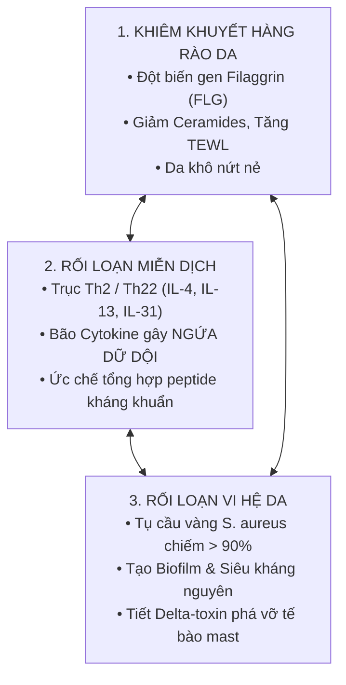

- **Sự chuyển dịch từ "Bên ngoài vào" hay "Bên trong ra"? (Outside-in vs Inside-out Hypothesis):**
  - *Thuyết Outside-in (Từ ngoài vào trong):* Khiếm khuyết hàng rào thượng bì là khởi đầu. Hàng rào hỏng làm dị nguyên lọt vào, kích hoạt hệ miễn dịch viêm bên dưới.
  - *Thuyết Inside-out (Từ trong ra ngoài):* Rối loạn miễn dịch Th2 nguyên phát tiết ra IL-4 và IL-13. Chính 2 cytokine này quay ngược lại **ức chế trực tiếp sự biểu hiện của gen Filaggrin và Loricrin**, làm cho hàng rào da bị phá hủy thứ phát!
  - *Kết luận hiện đại:* Cả hai cơ chế này cùng tồn tại và tạo thành một **vòng xoắn bệnh lý tự duy trì (Vicious cycle)**. Điều trị thành công bắt buộc phải đánh đồng thời vào cả hai vế: vừa phục hồi hàng rào da bên ngoài, vừa dập tắt phản ứng viêm miễn dịch bên trong!

---

# PHẦN 2: SINH BỆNH HỌC CHUYÊN SÂU: GEN FILAGGRIN, VI HỆ & MIỄN DỊCH 2 PHA (SLIDE 11 - 18)

## SLIDE 11 & 12: YẾU TỐ DI TRUYỀN & TƯƠNG TÁC GEN - MÔI TRƯỜNG


### 1. Nội dung nguyên bản trên Slide
- Yếu tố di truyền chiếm tỉ lệ lớn trong khả năng mắc AD khởi phát sớm.
- **Tiền sử cha mẹ mắc AD là yếu tố nguy cơ mạnh nhất** (so với tiền sử hen, viêm mũi dị ứng) để phát triển AD ở trẻ nhỏ.
- Một số gen mã hóa protein quan trọng đối với hàng rào biểu bì và chức năng miễn dịch.
- Trích dẫn: *Bieber, T. Atopic Dermatitis. New England Journal of Medicine. 2008;358(14):1483–1494.*

### 2. Giảng giải chuyên sâu của Giảng viên lâm sàng (BSCKII)
- **Xác suất di truyền theo phả hệ:**
  - Nếu **cả cha và mẹ đều mắc viêm da cơ địa**: Nguy cơ con sinh ra bị bệnh lên tới **60 - 80% (tăng gấp 3 - 5 lần)**.
  - Nếu chỉ có **cha HOẶC mẹ mắc bệnh**: Nguy cơ ở trẻ khoảng **30 - 50% (tăng gấp 2 - 3 lần)**.
  - Đáng chú ý: Mẹ mắc bệnh truyền nguy cơ cho con cao hơn so với cha mắc bệnh (khuynh hướng di truyền theo dòng mẹ - *Maternal imprinting*).
- **Phức hợp Biệt hóa Biểu bì (Epidermal Differentiation Complex - EDC):**
  - Nằm trên nhánh dài nhiễm sắc thể số 1 (vị trí **1q21**). Đây là một cụm gen khổng lồ mã hóa cho hơn 50 protein cấu trúc then chốt của lớp sừng: **Filaggrin (FLG), Loricrin (LOR), Involucrin (IVL)** và các protein thuộc họ S100.
  - Bất kỳ đột biến nào trong vùng EDC này đều làm suy yếu "bức tường gạch" bảo vệ của làn da.

---

## SLIDE 13, 14 & 15: PROTEIN FILAGGRIN & ĐỘT BIẾN GEN FLG


### 1. Nội dung nguyên bản trên Slide
- Khiếm khuyết hàng rào thượng bì là một đặc điểm của AD thấy rõ ở cả vùng da tổn thương và da lành chưa tổn thương.
- Biểu hiện của rối loạn chức năng hàng rào biểu bì gồm:
  - Tình trạng **mất nước qua thượng bì (TEWL) tăng cao**.
  - **Độ pH da bị kiềm hóa**.
  - Tính thấm tăng, thành phần lipid lớp sừng thay đổi.
- **Filaggrin (Filament-Aggregating Protein):**
  - FLG là protein cấu trúc chính trong lớp sừng được tạo từ tiền chất là **Profilaggrin** (nằm trong các hạt Keratohyalin của lớp hạt).
  - Quá trình biệt hóa: Profilaggrin bị khử phosphoryl hóa giải phóng các monome Filaggrin.
  - Filaggrin gắn kết các sợi vi sợi Keratin thành các bó sợi song song bền vững, nén phẳng tế bào sừng (*Corneocytes*).
  - Ở lớp sừng trên cùng, Filaggrin bị phân hủy thành các amino acid tự do tạo nên **Yếu tố Dưỡng ẩm Tự nhiên (Natural Moisturizing Factor - NMF)** gồm PCA (Pyrrolidone Carboxylic Acid) và UCA (Urocanic Acid).
- **Đột biến gen FLG (Loss-of-function mutations):**
  - Đột biến FLG là nguyên nhân gây ra **Bệnh da vảy cá thông thường (Ichthyosis vulgaris)**.
  - Khoảng **20 - 50% bệnh nhân AD mức độ trung bình - nặng** có mang ít nhất một đột biến vô nghĩa (*null mutation*) của gen FLG (kinh điển nhất là R501X và 2282del4).

### 2. Giảng giải chuyên sâu của Giảng viên lâm sàng (BSCKII)
- **Mô hình "Bức tường gạch và vữa" (Bricks and Mortar Model):**
  - Hãy hình dung lớp sừng thượng bì (Stratum corneum) giống như một bức tường thành kiên cố bảo vệ cơ thể:
    - **Những viên gạch (Bricks):** Chính là các tế bào sừng chết đã được nén dẹt (*Corneocytes*), bên trong chứa đầy các bó sợi keratin được "buộc chặt" lại bởi **Filaggrin**.
    - **Lớp vữa liên kết (Mortar):** Chính là các phiến lipid gian bào gồm: **Ceramides (chiếm 50%), Cholesterol (25%) và Acid béo tự do (15%)**.
  - **Hậu quả thảm khốc khi thiếu Filaggrin:**
    1. **Sập đổ cấu trúc "viên gạch":** Tế bào sừng bị lỏng lẻo, teo tóp, dễ bị nứt toác.
    2. **Mất yếu tố giữ ẩm tự nhiên (NMF):** NMF có nhiệm vụ hút và giữ nước lại bên trong tế bào sừng. Thiếu NMF, nước trong da bốc hơi ồ ạt ra ngoài $\rightarrow$ Hiện tượng **Mất nước qua thượng bì (Transepidermal Water Loss - TEWL)** tăng vọt gấp 3 - 5 lần $\rightarrow$ Da trở nên **khô ráp, căng nẻ và nứt toác**.
    3. **Kiềm hóa pH bề mặt da:** Bình thường màng acid của da có $pH \approx 4.5 - 5.5$. Chất chuyển hóa UCA của Filaggrin giúp duy trì tính acid này. Khi thiếu Filaggrin, pH da tăng lên mức kiềm ($pH > 6.0$). Độ pH kiềm sẽ:
       - Kích hoạt các enzym tiêu protein (Kallikreins KLK5, KLK7) phá hủy thêm các cầu nối tế bào sừng desmosome.
       - Tạo môi trường lý tưởng cho **Tụ cầu vàng (*Staphylococcus aureus*)** bám dính và phát triển bùng nổ!

---

## SLIDE 16: MẤT CÂN BẰNG HỆ VI HỆ (STAPHYLOCOCCUS AUREUS DYSBIOSIS)


### 1. Nội dung nguyên bản trên Slide
- Phá vỡ cấu trúc chức năng hàng rào thượng bì dẫn đến khiếm khuyết các thể phiến (Lamellar bodies).
- Phá vỡ màng acid của da dẫn đến giảm hoạt động của các enzyme xử lý lipid như $\beta$-glucocerebrosidase và acid sphingomyelinase.
- **Sự xâm nhập của S. aureus vào da:** Tụ cầu vàng cư trú áp đảo trên da bệnh nhân viêm da cơ địa và làm nặng thêm tình trạng viêm.

### 2. Giảng giải chuyên sâu của Giảng viên lâm sàng (BSCKII)
- **Con số chấn động về Tụ cầu vàng (*Staphylococcus aureus*):**
  - Ở người có làn da bình thường: Tỷ lệ mang *S. aureus* trên da chỉ dưới **5%** (hệ vi sinh vật cân bằng với *Staphylococcus epidermidis, Cutibacterium acnes*).
  - Ở bệnh nhân Viêm da cơ địa: Tỷ lệ tìm thấy *S. aureus* lên tới **trên 90% tại vùng da tổn thương** và khoảng **70% ngay cả tại vùng da lành lặn**!
- **Cơ chế 4 mũi giáp công của S. aureus làm nặng bệnh:**
  1. **Tạo màng Biofilm:** Tụ cầu vàng tiết chất nhầy polysaccharide bao bọc thành các màng sinh học (Biofilm) bít kín các lỗ chân lông và tuyến mồ hôi, kháng lại các kháng sinh thông thường.
  2. **Tiết Siêu kháng nguyên (Superantigens):** Tiết độc tố ruột Enterotoxin A, B (SEA, SEB) và độc tố gây sốc nhiễm độc (TSST-1). Siêu kháng nguyên kích hoạt ồ ạt tế bào T, kháng lại tác dụng của Corticoid tại chỗ (*Corticosteroid resistance*).
  3. **Tiết Delta-Toxin (Ngoại độc tố Delta):** Nghiên cứu của Nakamura (Nature 2013) phát hiện Delta-toxin của tụ cầu vàng trực tiếp đục thủng màng tế bào Mast, gây **vỡ tế bào mast giải phóng Histamine và Tryptase mà không cần có kháng thể IgE**, kích thích cơn ngứa điên cuồng!
  4. **Tiết enzym Protease:** Tụ cầu tiết enzyme cắt vụn các protein liên kết tế bào sừng, tiếp tục phá nát hàng rào bảo vệ da từ bên ngoài.

---

## SLIDE 17 & 18: RỐI LOẠN MIỄN DỊCH – MÔ HÌNH CHUYỂN DỊCH MIỄN DỊCH 2 PHA


### 1. Nội dung nguyên bản trên Slide
- Trích dẫn: 
  - *Kim J, Kim BE, Leung DYM. Pathophysiology of atopic dermatitis: Clinical implications. Allergy Asthma Proc. 2019;40(2):84-92.*
  - *Bolognia Dermatology 5th Ed (2024).*
- Phân tích chi tiết sự tham gia của tế bào sừng, tế bào tua (Langerhans và IDEC), tế bào lympho T và các trục cytokine dị ứng.

### 2. Giảng giải chuyên sâu của Giảng viên lâm sàng (BSCKII)
- **Mô hình miễn dịch 2 pha (The Biphasic Immune Model):**
  - Đây là nền tảng lý thuyết cốt lõi để các em hiểu tại sao sang thương lúc thì ướt át rỉ dịch, lúc thì khô khốc dày sừng liken hóa:

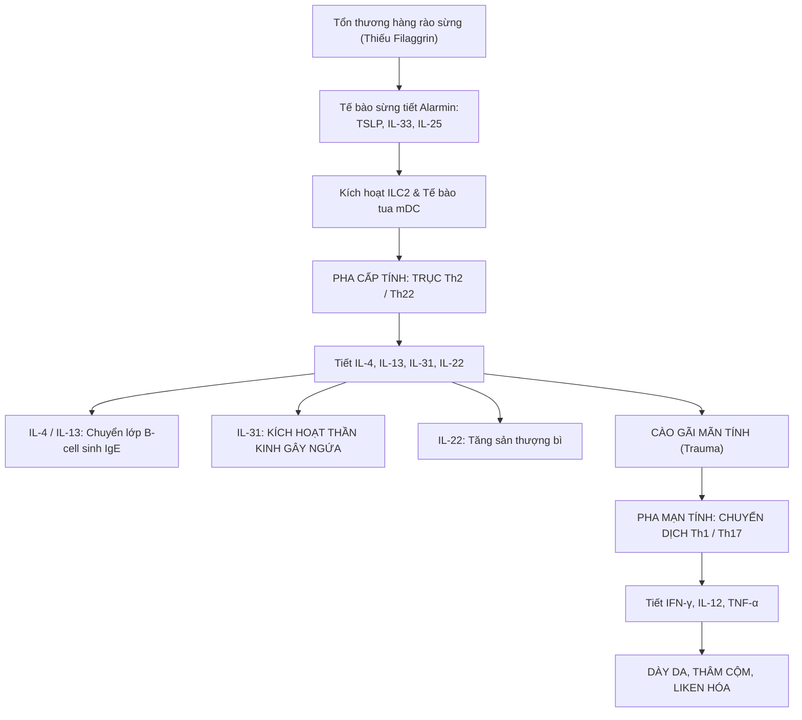

- **Phân tích chi tiết vai trò của từng Cytokine then chốt:**
  1. **IL-4 và IL-13 (Cặp đôi thủ lĩnh Th2):**
     - Kích thích tế bào lympho B chuyển đổi lớp globulin miễn dịch sang sản xuất **IgE đặc hiệu**.
     - Ức chế tế bào sừng sản xuất các **Peptide kháng khuẩn tự nhiên (AMPs: LL-37, Beta-defensins)** $\rightarrow$ Giải thích tại sao bệnh nhân viêm da cơ địa rất dễ bị nhiễm trùng tụ cầu và virus Herpes lan tỏa!
     - Ức chế ngược lại sự biểu hiện của gen Filaggrin và Loricrin.
  2. **IL-31 – "Cytokine Ngứa" (The Master Pruritogen):**
     - Được tiết ra chủ yếu bởi tế bào Th2.
     - Thụ thể **IL-31RA** nằm trực tiếp trên các đầu tận cùng sợi thần kinh cảm giác không myelin (Sợi C - *C-fibers*) ở trung bì và hạch rễ sau tủy sống.
     - Khi IL-31 gắn vào thụ thể, nó kích hoạt kênh ion **TRPV1 và TRPA1**, truyền tín hiệu ngứa mãnh liệt lên vỏ não, khởi động phản xạ cào gãi không thể cưỡng lại được. Thuốc kháng thể đơn dòng **Nemolizumab** nhắm trúng đích thụ thể IL-31RA hiện nay đang là cứu cánh cắt cơn ngứa cho bệnh nhân.
  3. **IL-22 (Trục Th22):** Ức chế sự biệt hóa cuối cùng của tế bào sừng, gây phù nề gian bào và tăng sản thượng bì.
  4. **IFN-gamma (Pha mạn tính Th1):** Thúc đẩy quá trình chết theo chương trình của tế bào sừng, kích thích nguyên bào sợi tăng sinh collagen gây dày da, thâm cộm và **liken hóa (*Lichenification*)**.

---

# PHẦN 3: ĐẶC ĐIỂM LÂM SÀNG THEO 3 LỨA TUỔI & CÁC DẤU ẤN CƠ ĐỊA ATOPY (SLIDE 19 - 31)

## SLIDE 19 & 20: BA HÌNH THÁI TỔN THƯƠNG LÂM SÀNG KINH ĐIỂN


### 1. Nội dung nguyên bản trên Slide
- Trích dẫn: *Langan SM, Irvine AD, Weidinger S. Atopic dermatitis. Lancet. 2020;396(10247):345-360.*
- Viêm da cơ địa có phổ lâm sàng rất rộng và thay đổi liên tục tùy theo lứa tuổi.
- Ở bất kỳ lứa tuổi nào, tổn thương cũng tiến triển qua 3 giai đoạn:
  - **Giai đoạn Cấp tính (Acute):** Mảng hồng ban, mụn nước nhỏ li ti, rịn nước ướt (*Oozing*), đóng mài.
  - **Giai đoạn Bán cấp (Subacute):** Hồng ban nhạt màu hơn, sẩn cộm, vảy da, vết trầy xước do cào gãi.
  - **Giai đoạn Mạn tính (Chronic):** Da dày sừng, tăng sắc tố thâm xỉn, các nếp lằn da hằn sâu ngoằn ngoèo (**Hiện tượng Liken hóa - *Lichenification***).

### 2. Giảng giải chuyên sâu của Giảng viên lâm sàng (BSCKII)
- **Đặc trưng bán học của từng giai đoạn:**
  1. **Giai đoạn Cấp tính (Hình thái "Chàm ướt"):**
     - Nền da hồng ban viêm đỏ rực, phù nề.
     - Trên bề mặt nổi chi chít các **mụn nước nhỏ li ti bằng đầu tăm (Vesicles)** nằm nông ở thượng bì.
     - Mụn nước rất dễ vỡ do cọ xát hoặc cào gãi, làm chảy dịch huyết thanh vàng trong liên tục (**Rịn nước / Oozing** – dân gian gọi là "chàm chảy nước").
     - Khi dịch khô lại, tạo thành các **vảy tiết (Crusts)** màu vàng nâu hoặc vảy máu. Giai đoạn này ngứa buốt dữ dội và rất dễ bội nhiễm vi khuẩn.
  2. **Giai đoạn Bán cấp:**
     - Dịch rỉ ngừng chảy, nền đỏ nhạt dần. Bề mặt da xuất hiện các sẩn nhỏ và các phiến vảy da khô bong tróc (*Scaling*), nhiều vết cào xước rướm máu (*Excoriations*).
  3. **Giai đoạn Mạn tính (Hình thái "Chàm khô & Liken hóa"):**
     - Hậu quả trực tiếp của việc **cào gãi và chà xát liên tục qua nhiều tháng, nhiều năm**.
     - Vùng da bệnh trở nên **dày cộm, cứng chắc, thâm xỉn sẫm màu**.
     - Các nếp lằn da tự nhiên bị đào sâu và nổi gờ cao rõ rệt tạo thành các ô đa giác trông giống hệt như **vỏ thân cây sần sùi hoặc đám rêu bám trên đá (Liken hóa - *Lichenification*)**.

---

## SLIDE 21, 22, 23 & 24: GIAI ĐOẠN SƠ SINH & NHŨ NHI (< 2 TUỔI) – BỆNH CẢNH "CHÀM SỮA"


### 1. Nội dung nguyên bản trên Slide
- **Thời điểm khởi phát:** Thường khởi phát lúc **2 đến 3 tháng tuổi** (hiếm khi xuất hiện ngay lúc mới sinh).
- **Hình thái sang thương:** Ưu thế cấp tính: Mảng hồng ban, mụn nước, rịn nước, đóng mài ở mặt.
- **Vị trí phân bố kinh điển:**
  - Bắt đầu ở **hai bên má, trán, cằm, da đầu**.
  - **ĐẶC ĐIỂM QUAN TRỌNG: VÙNG MŨI VÀ QUANH MIỆNG THƯỜNG ĐƯỢC THA BỔNG (SPARED CENTROFACIAL AREA).**
  - Khi trẻ bắt đầu biết trườn, bò (khoảng 6 - 9 tháng): Sang thương lan ra **mặt duỗi của các khớp lớn (mặt trước đầu gối, mặt ngoài cùi chỏ)** do cọ xát cơ học với mặt sàn.
  - Vùng quấn tã lót (Diaper area) thường hoàn toàn lành lặn.

### 2. Giảng giải chuyên sâu của Giảng viên lâm sàng (BSCKII)
- **Hình ảnh "Móng ngựa" kinh điển trên mặt trẻ sơ sinh:**
  - Hai má đỏ rực, căng bóng, nổi chi chít mụn nước li ti rồi vỡ rỉ dịch đóng mài vàng nâu (dân gian gọi là "lác sữa" vì trùng vào giai đoạn trẻ đang bú sữa mẹ).
  - Vùng tổn thương bao quanh trán, hai má và cằm tạo thành hình móng ngựa, trong khi **chóp mũi và vùng da xung quanh môi hoàn toàn bình thường, trắng trẻo**.
- **Tại sao vùng quấn tã lót (Diaper area) lại không bị viêm da cơ địa?**
  - Đây là một câu hỏi thi lâm sàng rất thú vị!
  - Môi trường bên trong tã lót luôn có độ ẩm cực kỳ cao, ngăn chặn hoàn toàn hiện tượng mất nước qua thượng bì (TEWL = 0). Do đó, vùng da này không bị khô nứt nẻ và hiếm khi bị viêm da cơ địa tấn công.
  > [!TIP]
  > Nếu một đứa trẻ nhũ nhi bị đỏ da rầm rộ tập trung chủ yếu ở vùng quấn tã lót và các nếp bẹn, hãy nghĩ ngay đến **Viêm da tã lót (Diaper dermatitis)**, **Nhiễm nấm Candida** hoặc **Viêm da tiết bã (Seborrheic dermatitis)** chứ không phải Viêm da cơ địa!

---

## SLIDE 25: GIAI ĐOẠN TRẺ EM (2 - 12 TUỔI) – BƯỚC CHUYỂN DỊCH SANG CÁC NẾP GẤP


### 1. Nội dung nguyên bản trên Slide
- Thường gặp nhất ở lứa tuổi **2 đến 5 tuổi**.
- **Bước chuyển dịch vị trí giải phẫu ngoạn mục:**
  - Tổn thương rút khỏi hai má và chuyển dịch vào các **VÙNG NẾP GẤP (FLEXURAL AREAS)**: **Nếp lằn khoeo chân, nếp gấp khuỷu tay, cổ tay, mắt cá chân, nếp lằn cổ**.
  - Sang thương vùng mặt: Di chuyển từ má/cằm về vùng **quanh miệng và quanh mắt**.
- **Hình thái:** Tổn thương đối xứng hai bên, gồm các sẩn cộm, mảng hồng ban bán cấp, vết cào xước rướm máu và bắt đầu xuất hiện **dày da liken hóa**.

### 2. Giảng giải chuyên sâu của Giảng viên lâm sàng (BSCKII)
- **Quy luật chuyển dịch từ "Mặt duỗi" sang "Mặt gấp" (Extensor to Flexural Switch):**
  - Ở tuổi nhũ nhi, đứa trẻ vận động bằng cách bò trườn $\rightarrow$ Mặt duỗi (đầu gối, cùi chỏ) chịu ma sát nhiều nhất.
  - Khi trẻ lên 2 - 3 tuổi, trẻ biết đi đứng và chạy nhảy $\rightarrow$ Các nếp gấp lớn (nếp khoeo chân, nếp khuỷu) trở thành nơi **tích tụ mồ hôi, ẩm ướt, nhiệt độ cao và ma sát da kề da liên tục**.
  - Mồ hôi chứa muối và các kháng nguyên vi sinh vật kích ứng trực tiếp lên làn da bị khiếm khuyết hàng rào, gây ngứa dữ dội. Trẻ gãi liên tục ở nếp gấp dẫn đến hiện tượng dày da liken hóa hằn sâu.

---

## SLIDE 26, 27 & 28: CÁC THỂ LÂM SÀNG KHU TRÚ ĐẶC BIỆT


### 1. Nội dung nguyên bản trên Slide
- **Các thể lâm sàng khu trú thường gặp:**
  - Chàm đầu và cổ (Head and neck dermatitis)
  - Chàm tai & Nứt kẽ dưới dái tai (Infra-auricular fissuring)
  - Chàm mi mắt
  - Chàm môi, khô môi (Cheilitis)
  - Chàm núm vú (Nipple eczema)
  - Chàm tổ đỉa (Dyshidrotic eczema / Pompholyx)
  - Viêm da cơ địa bàn tay (Hand eczema)
  - Viêm da bàn chân trẻ em (Juvenile plantar dermatosis)

### 2. Giảng giải chuyên sâu của Giảng viên lâm sàng (BSCKII)
- **Phân tích chi tiết từng thể bệnh:**
  1. **Dấu hiệu nứt kẽ dưới dái tai (Infra-auricular fissuring):**
     - Nếp gấp ngay dưới dái tai hoặc sau tai bị nứt toác một đường rãnh sâu, rỉ dịch đau rát. Đây là một trong những **dấu hiệu phụ có giá trị chẩn đoán rất cao** của viêm da cơ địa ở trẻ em.
  2. **Chàm mi mắt (Eyelid dermatitis):**
     - Mi mắt trên và dưới sưng đỏ, phù nề nhẹ, tróc vảy mịn. Trẻ dụi mắt liên tục làm rụng lông mi.
     > [!WARNING]
     > Vùng mi mắt da cực kỳ mỏng, nếu lạm dụng thoa Corticoid mạnh kéo dài sẽ gây biến chứng teo da mi mắt, đục thủy tinh thể và tăng nhãn áp (Glaucoma) dẫn đến mù lòa! **Chỉ định vàng vùng này là Thuốc ức chế Calcineurin bôi (Tacrolimus 0.03% hoặc Pimecrolimus 1%)**.
  3. **Chàm môi (Atopic cheilitis):**
     - Môi khô nứt nẻ, bong tróc từng mảng da môi, viền môi đỏ rát. Bệnh nhân có thói quen liếm môi liên tục (*Lip-licking habit*), enzym trong nước bọt càng làm môi khô nứt sâu hơn.
  4. **Chàm núm vú (Nipple eczema):**
     - Rất thường gặp ở nữ thiếu niên dậy thì và phụ nữ trẻ có cơ địa atopy. Núm vú và quầng vú hai bên đỏ rực, ngứa ngáy dữ dội, rỉ dịch ướt hoặc đóng vảy tiết đau rát. (Cần phân biệt với Bệnh Paget vú – Paget thường chỉ bị 1 bên vú, diễn tiến chậm ở phụ nữ lớn tuổi).
  5. **Viêm da bàn chân trẻ em (Juvenile plantar dermatosis - "Hội chứng tất ướt"):**
     - Vùng da nửa trước lòng bàn chân và mặt dưới các ngón chân bị đỏ bóng loáng như bôi dầu (*Glazed appearance*), khô ráp và nứt nẻ thành các rãnh sâu đau đớn khi bước đi. Bệnh khởi phát do chu kỳ thay đổi độ ẩm liên tục khi mang tất và giày bít bùng ra mồ hôi.

---

## SLIDE 29 & 30: GIAI ĐOẠN TRẺ LỚN, NGƯỜI LỚN & CÁC DẤU ẤN CƠ ĐỊA ATOPY


### 1. Nội dung nguyên bản trên Slide
- **Giai đoạn trẻ lớn và người lớn (> 12 tuổi):**
  - Là giai đoạn tiếp theo của AD trẻ em hoặc khởi phát muộn.
  - Tổn thương bán cấp và mạn tính ưu thế. Vị trí: Các nếp gấp, mặt, cổ, mu bàn tay, bàn chân, mặt duỗi chi.
  - Ngứa dữ dội: Nhiều nhất vào buổi tối, lúc ra mồ hôi, mặc quần áo chật, stress.
  - Vòng xoắn cào gãi $\rightarrow$ Tổn thương liken hóa thâm cộm lan rộng.
- **Các dấu ấn cơ địa Atopy kinh điển:**
  - Đường nếp gấp mi dưới đôi Dennie-Morgan.
  - Tăng quầng thâm quanh mắt (Allergic shiners).
  - Dày sừng nang lông (Keratosis pilaris).
  - Vảy phấn trắng Alba (Pityriasis alba).
  - Tăng nếp chỉ lòng bàn tay/bàn chân (Palmar hyperlinearity).
  - Khô da toàn thân (Xerosis).
  - Da vảy cá thông thường (Ichthyosis vulgaris).

### 2. Giảng giải chuyên sâu của Giảng viên lâm sàng (BSCKII)
- **Kỹ năng nhận diện các "Dấu ấn cơ địa Atopy" (Stigmata of Atopy):**
  - Khi một bệnh nhân đến khám vì một vấn đề da khác hoặc khi tổn thương chàm đang lặn, người bác sĩ da liễu giàu kinh nghiệm chỉ cần nhìn lướt qua các dấu hiệu này là biết ngay bệnh nhân mang "Cơ địa dị ứng Atopy":
    1. **Nếp Dennie-Morgan (Dennie-Morgan infraorbital fold):** Một hoặc hai nếp gấp da hằn sâu nằm đối xứng ngay dưới bờ mi mắt dưới. Cơ chế do hiện tượng phù nề tái diễn liên tục của cơ vòng mi mắt.
    2. **Quầng thâm dị ứng (Allergic shiners):** Vùng da quanh hốc mắt thâm quầng sẫm màu như mắt gấu trúc, do ứ trệ tuần hoàn tĩnh mạch xoang mũi và phù nề mô quanh mắt.
    3. **Dấu hiệu Hertoghe (Hertoghe’s sign):** Rụng hoặc thưa thớt lông mày ở **1/3 ngoài hai bên**, do bệnh nhân liên tục lấy tay chà xát và cào gãi vì ngứa vùng cung mày.
    4. **Vảy phấn trắng Alba (Pityriasis alba):** Các dát giảm sắc tố màu trắng nhạt hình tròn hoặc bầu dục kích thước 1 - 3cm, bề mặt phủ vảy mịn như phấn, ranh giới không sắc nét, hay gặp ở hai má của trẻ em vào mùa hè. (Bản chất là phản ứng chàm bán cấp nhẹ làm gián đoạn vận chuyển hạt melanin lên tế bào sừng; thường bị phụ huynh nhầm thành nấm lang ben).
    5. **Dày sừng nang lông (Keratosis pilaris):** Các sẩn sừng nhọn nhỏ như gai ốc nút chặt miệng nang lông ở mặt ngoài cánh tay và mặt trước đùi, sờ vào thấy ráp như da gà (*Nutmeg-grater skin*).
    6. **Tăng nếp chỉ lòng bàn tay (Palmar hyperlinearity):** Lòng bàn tay có hàng trăm nếp nhăn chằng chịt sâu hoắm, đi kèm với đột biến gen Filaggrin.
    7. **Dấu vẽ nổi da trắng (White dermatographism):** Dùng một đầu tù vạch một đường lên vùng da đỏ của bệnh nhân. Ở người bình thường sẽ xuất hiện lằn đỏ (dãn mạch). Ở bệnh nhân viêm da cơ địa, sau 10 - 15 giây đường vạch lại chuyển sang **MÀU TRẮNG BỢT BAO QUANH BỞI VIỀN ĐỎ** do phản ứng co mạch nghịch thường.

---

## SLIDE 31: VIÊM DA CƠ ĐỊA Ở NGƯỜI CAO TUỔI (> 60 TUỔI)
### 1. Nội dung nguyên bản trên Slide
- AD ở người cao tuổi (> 60 tuổi) là một phân nhóm dịch tễ mới được công nhận.
- Đặc trưng bởi **tình trạng khô da rõ rệt (Severe Xerosis)**.
- Hầu hết những bệnh nhân này **không có tổn thương dạng liken hóa điển hình** do cào gãi của AD ở trẻ em và người lớn trẻ tuổi.

### 2. Giảng giải chuyên sâu của Giảng viên lâm sàng (BSCKII)
- **Cạm bẫy chẩn đoán ở người già:**
  - Ở người trên 60 tuổi, chức năng tuyến bã nhờn và tuyến mồ hôi suy giảm nghiêm trọng, lượng ceramide tự nhiên giảm sút $\rightarrow$ Da khô cằn như đất nẻ mùa hạn hán.
  - Khi người già bị ngứa dữ dội và đỏ da toàn thân, bác sĩ bắt buộc phải loại trừ các bệnh lý nguy hiểm trước khi kết luận là Viêm da cơ địa:
    1. **Pemphigoid bóng nước giai đoạn tiền bóng nước (Pre-bullous BP):** Người già ngứa dữ dội, nổi ban mày đay vài tháng trước khi nổi bóng nước thật sự. Phải làm sinh thiết da miễn dịch huỳnh quang trực tiếp (DIF).
    2. **Hội chứng cận ung thư (Paraneoplastic pruritus):** Ngứa do ung thư nội tạng (Lymphoma, ung thư phổi, ung thư gan mật).
    3. **Ghẻ Na Uy (Crusted scabies):** Bệnh nhân già yếu suy giảm miễn dịch bị ghẻ đóng mài toàn thân tróc vảy dày, rất dễ nhầm với chàm khô người già.

---

# PHẦN 4: ĐÁNH GIÁ ĐỘ NẶNG, CẬN LÂM SÀNG & TIÊU CHUẨN CHẨN ĐOÁN (SLIDE 32 - 42)

## SLIDE 32, 33 & 34: CÁC THANG ĐIỂM ĐÁNH GIÁ ĐỘ NẶNG (SCORAD, EASI, POEM)


### 1. Nội dung nguyên bản trên Slide
- Trích dẫn: *Harper’s Textbook of Pediatric Dermatology (2020); Charman CR. Arch Dermatol 2004.*
- Giới thiệu các công cụ chuẩn hóa quốc tế: **SCORAD (Scoring Atopic Dermatitis)** và **POEM (Patient-Oriented Eczema Measure)**.

### 2. Giảng giải chuyên sâu của Giảng viên lâm sàng (BSCKII)
- **1. Thang điểm SCORAD (Scoring Atopic Dermatitis) – Chuẩn vàng Châu Âu:**
  - Được phát triển bởi Nhóm Đặc trách Viêm da cơ địa Châu Âu (ETFAD).
  - Điểm dao động từ **0 đến 103 điểm**, tính theo công thức:
    $$\text{SCORAD} = \frac{A}{5} + \frac{7B}{2} + C$$
  - Trong đó:
    - **$A$ (Diện tích tổn thương - Area):** Đánh giá theo quy tắc số 9 (tối đa 100%).
    - **$B$ (Cường độ tổn thương - Intensity):** Đánh giá **6 dấu hiệu lâm sàng** tại một vùng da đại diện, mỗi dấu hiệu chấm từ thang điểm 0 đến 3 (0 = Không có, 1 = Nhẹ, 2 = Vừa, 3 = Nặng), tổng điểm $B$ tối đa là 18:
      1. Độ đỏ (Erythema).
      2. Độ phù nề / sẩn cộm (Edema / Papulation).
      3. Rỉ dịch ướt / đóng mài (Oozing / Crusting).
      4. Vết cào xước rướm máu (Excoriations).
      5. Dày da liken hóa (Lichenification).
      6. Độ khô da ở vùng da lành (Dryness).
    - **$C$ (Triệu chứng chủ quan - Subjective symptoms):** Đánh giá bằng thang điểm thị giác tương tự (VAS 0 - 10) về trung bình 3 đêm gần nhất, tổng điểm $C$ tối đa là 20:
      - Mức độ Ngứa (Pruritus: 0 - 10 điểm).
      - Mức độ Mất ngủ (Sleep loss: 0 - 10 điểm).
  - **Phân loại mức độ nặng theo SCORAD:**
    - **Mức độ Nhẹ (Mild):** $\text{SCORAD} < 25$ điểm.
    - **Mức độ Trung bình (Moderate):** $25 \le \text{SCORAD} \le 50$ điểm.
    - **Mức độ Nặng (Severe):** $\text{SCORAD} > 50$ điểm.

- **2. Thang điểm EASI (Eczema Area and Severity Index) – Chuẩn mực nghiên cứu Thuốc sinh học:**
  - Tương tự như thang điểm PASI trong vảy nến, EASI dao động từ **0 đến 72 điểm**, chỉ đánh giá thuần túy các triệu chứng thực thể khách quan của người thầy thuốc trên 4 vùng cơ thể (Đầu cổ, Chi trên, Thân mình, Chi dưới) gồm: Đỏ, Cộm, Cào xước, Liken hóa.
  - *Mục tiêu điều trị hiện đại:* Đạt được **EASI-75** (giảm 75% điểm EASI) hoặc **EASI-90** sau khi điều trị bằng Dupilumab hoặc thuốc ức chế JAK.

- **3. Thang điểm POEM (Patient-Oriented Eczema Measure):**
  - Công cụ tự đánh giá của chính người bệnh (hoặc cha mẹ trả lời thay cho trẻ nhỏ) dựa trên tần suất xuất hiện 7 triệu chứng trong vòng 1 tuần qua: Ngứa, mất ngủ, chảy máu, rỉ dịch, nứt nẻ, bong vảy, khô ráp. Điểm từ 0 đến 28 điểm.

---

## SLIDE 35 & 36: CẬN LÂM SÀNG TRONG VIÊM DA CƠ ĐỊA


### 1. Nội dung nguyên bản trên Slide
- Trích dẫn: *Katoh N. J Dermatol. 2019;46(12):1053-1101.*
- Xét nghiệm cận lâm sàng không có tính chất đặc hiệu tuyệt đối để chẩn đoán xác định AD, nhưng rất có giá trị hỗ trợ và phân loại thể bệnh:
  - **Đo nồng độ IgE toàn phần trong máu:** Tăng cao ở **70 - 80% bệnh nhân**.
  - **Mô bệnh học da (Sinh thiết):** Khi tổn thương không điển hình hoặc cần phân biệt.
  - **Test áp da (Patch test / Atopy patch test):** Xác định dị ứng tiếp xúc phối hợp.

### 2. Giảng giải chuyên sâu của Giảng viên lâm sàng (BSCKII)
- **Phân biệt 2 thể bệnh dựa vào nồng độ IgE: "Extrinsic AD" vs "Intrinsic AD":**

| Đặc điểm phân biệt | Thể Ngoại sinh (Extrinsic AD / Allergic) | Thể Nội sinh (Intrinsic AD / Non-allergic) |
| :--- | :--- | :--- |
| **Tỷ lệ trong quần thể** | **Chiếm đa số (~70 - 80%)** | **Chiếm thiểu số (~20 - 30%)** |
| **Nồng độ IgE huyết thanh** | **Tăng rất cao** (thường $> 1.000 - 10.000\text{ IU/mL}$)| **Hoàn toàn bình thường** ($< 100\text{ IU/mL}$) |
| **Bạch cầu ái toan máu** | Tăng cao rõ rệt | Bình thường hoặc chỉ tăng nhẹ |
| **Tiền sử dị ứng Atopy** | Rất rõ (bản thân/gia đình có hen, viêm mũi, dị ứng thức ăn) | Thường không có tiền sử bệnh atopy đi kèm |
| **Đột biến gen Filaggrin** | Tỷ lệ đột biến FLG cao | Rất hiếm khi có đột biến FLG |
| **Hàng rào da** | Hàng rào da tổn thương nặng nề, TEWL tăng vọt | Hàng rào da ít bị tổn thương hơn |
| **Giới tính ưu thế** | Nam = Nữ | Nữ giới chiếm ưu thế hơn |

- **Ý nghĩa định lượng IgE đặc hiệu (ImmunoCAP / Phadiatop):**
  - Giúp phát hiện các dị nguyên cụ thể kích hoạt đợt bùng phát:
    - Ở trẻ nhũ nhi: Thường là **Dị nguyên thức ăn** (Lòng trắng trứng gà, sữa bò, đậu phộng, đậu nành, lúa mì, hải sản).
    - Ở trẻ lớn và người lớn: Thường là **Dị nguyên đường hô hấp** (Mạt bụi nhà *Dermatophagoides pteronyssinus / farinae*, lông chó mèo, nấm mốc *Alternaria*, phấn hoa).
  > [!CAUTION]
  > **Bẫy kiêng cữ thức ăn bừa bãi:** Rất nhiều phụ huynh khi thấy con bị chàm sữa đã bắt đứa trẻ (và cả người mẹ đang cho con bú) kiêng khem ngặt nghèo: không ăn thịt gà, thịt bò, cá, tôm, trứng... dẫn đến đứa trẻ bị **suy dinh dưỡng còi xương nặng nề**! Bác sĩ phải giải thích rõ: Chỉ cho trẻ kiêng một loại thức ăn khi **vừa có xét nghiệm IgE đặc hiệu dương tính VÀ vừa có mối liên hệ lâm sàng thực tế** (cứ mỗi lần ăn món đó là trong vòng vài giờ da ngứa rộ lên). Tuyệt đối không kiêng ăn diện rộng theo phong trào!

---

## SLIDE 37 & 38: MÔ BỆNH HỌC KINH ĐIỂN CỦA CHÀM (HISTOPATHOLOGY)


### 1. Nội dung nguyên bản trên Slide
- Trích dẫn: *Fitzpatrick’s Dermatology 9th edition.*
- **Đặc trưng vi thể nền tảng:**
  - **Hiện tượng Xốp bào (Spongiosis):** Phù nề dịch gian bào ở lớp tế bào gai thượng bì.
  - **Thoát dịch:** Dịch huyết thanh từ các mao mạch dãn ở trung bì nhú thoát ra, len lỏi vào các khoảng gian bào thượng bì.
  - **Thoát bào (Exocytosis):** Các tế bào lympho T từ trung bì di chuyển xuyên màng đáy, xâm nhập vào thượng bì.

### 2. Giảng giải chuyên sâu của Giảng viên lâm sàng (BSCKII)
- **Hiểu sâu về "Hiện tượng Xốp bào" (Spongiosis) – Dấu ấn bản quyền của Chàm:**
  - Dưới kính hiển vi quang học nhuộm H&E:
    - Dịch phù viêm thoát ra làm các tế bào gai (Keratinocytes) bị đẩy tách xa nhau ra.
    - Các cầu nối gian bào (Desmosomes) bị kéo căng ra trông giống như các **chiếc gai nhỏ tua tủa nối giữa các tế bào**, tạo nên hình ảnh lớp biểu bì rỗng xốp như một miếng **bọt biển (Spongiform appearance)**.
    - Khi áp lực dịch phù gian bào tăng lên, các cầu gai bị đứt toạc, dịch hòa lẫn lại tạo thành các khoang chứa dịch nhỏ $\rightarrow$ Chính là các **Mụn nước xốp bào vi thể (Intraepidermal Spongiotic Vesicles)** mà mắt thường ta nhìn thấy trên lâm sàng là các mụn nước li ti!
- **Biến đổi mô bệnh học qua 3 giai đoạn:**
  1. **Chàm cấp tính (Acute eczema):** Hiện tượng xốp bào chiếm ưu thế tuyệt đối, tạo các bọng nước chứa đầy huyết thanh trong thượng bì; thâm nhiễm dày đặc tế bào lympho quanh mạch máu trung bì nông; á sừng thành ổ.
  2. **Chàm bán cấp (Subacute eczema):** Xốp bào giảm bớt; thượng bì bắt đầu tăng sản dày lên (**Tăng gai - *Acanthosis***); lớp sừng có á sừng và các vảy tiết chứa bạch cầu trung tính thoái hóa.
  3. **Chàm mạn tính (Chronic eczema):**
     - Hiện tượng xốp bào gần như biến mất hoàn toàn.
     - **Tăng sản thượng bì dạng vảy nến không đều đặn (Irregular Psoriasiform Acanthosis):** Các mào thượng bì kéo dài xuống trung bì nhưng dài ngắn không đồng đều (khác với vảy nến là dài đồng đều như cọc hàng rào).
     - **Tăng sừng dày đặc (Hyperkeratosis)** kèm dày lớp hạt.
     - Trung bì nhú có hiện tượng **Tăng sinh các bó sợi collagen xếp theo chiều dọc (Vertical streaking of collagen fibers)** – bằng chứng mô học không thể chối cãi của việc bệnh nhân đã cào gãi chà xát dữ dội suốt nhiều năm!

---

## SLIDE 39, 40, 41 & 42: TIÊU CHUẨN CHẨN ĐOÁN QUỐC TẾ


### 1. Nội dung nguyên bản trên Slide
- Giới thiệu 4 hệ thống tiêu chuẩn chẩn đoán:
  1. **Tiêu chuẩn Hanifin và Rajka (1980):** Chuẩn mực kinh điển quốc tế (Cần ít nhất 3/4 tiêu chuẩn chính + 3/23 tiêu chuẩn phụ).
  2. **Tiêu chuẩn UK Working Party (1994):** Chuẩn mực tinh giản rút gọn áp dụng trong dịch tễ học và phòng khám.
  3. **Tiêu chuẩn Viện Hàn lâm Da liễu Hoa Kỳ (AAD 2003).**
  4. **Tiêu chuẩn Hiệp hội Da liễu Nhật Bản (JDA 2017).**

### 2. Giảng giải chuyên sâu của Giảng viên lâm sàng (BSCKII)
- **1. Tiêu chuẩn kinh điển Hanifin & Rajka (1980):**
  - **4 TIÊU CHUẨN CHÍNH (MAJOR CRITERIA) – Bắt buộc phải thỏa mãn $\ge 3$ tiêu chuẩn:**
    1. **Ngứa (Pruritus)** – Dấu hiệu sống còn, "không ngứa không phải là chàm".
    2. **Hình thái và vị trí phân bố điển hình:**
       - Trẻ nhũ nhi: Chàm mặt (hai má), mặt duỗi các chi.
       - Trẻ lớn và người lớn: Dày da liken hóa ở các nếp gấp (nếp khoeo, nếp khuỷu).
    3. **Viêm da mạn tính hoặc tái phát từng đợt.**
    4. **Tiền sử bản thân hoặc gia đình mắc các bệnh cơ địa dị ứng Atopy** (Hen suyễn, Viêm mũi dị ứng, Viêm da cơ địa).
  - **23 TIÊU CHUẨN PHỤ (MINOR CRITERIA) – Bắt buộc phải có $\ge 3$ tiêu chuẩn:**
    - Khô da toàn thân (Xerosis).
    - Da vảy cá, tăng nếp chỉ lòng bàn tay, dày sừng nang lông.
    - Phản ứng da tức thì Type I (dương tính với test lẩy da).
    - Tăng nồng độ IgE huyết thanh.
    - Khởi phát bệnh lúc nhỏ tuổi (< 2 tuổi).
    - Khuynh hướng dễ nhiễm trùng da (Tụ cầu vàng, Herpes simplex) và suy giảm miễn dịch qua trung gian tế bào.
    - Khuynh hướng viêm da bàn tay / bàn chân không đặc hiệu.
    - Chàm núm vú.
    - Viêm môi (Cheilitis).
    - Viêm kết mạc mắt tái diễn.
    - Nếp gấp mi dưới đôi Dennie-Morgan.
    - Giác mạc hình chóp (Keratoconus).
    - Đục thủy tinh thể dưới bao trước.
    - Quầng thâm quanh mắt (Allergic shiners).
    - Vảy phấn trắng Alba.
    - Ngứa khi đổ mồ hôi.
    - Không dung nạp với đồ len dạ hoặc các dung môi hòa tan chất béo.
    - Dấu vẽ nổi da trắng (White dermatographism).
    - Dị ứng thức ăn...

- **2. Tiêu chuẩn tinh giản UK Working Party (1994) – Công cụ lâm sàng thực chiến:**
  - Để tránh việc phải nhớ 23 tiêu chuẩn phụ phức tạp của Hanifin & Rajka, các bác sĩ lâm sàng Anh quốc đã đưa ra bộ tiêu chuẩn cô đọng với độ nhạy 85% và độ đặc hiệu 96%:
  > [!IMPORTANT]
  > **BẮT BUỘC PHẢI CÓ:**
  > - **Tình trạng Da ngứa (Pruritic skin condition)** (hoặc cha mẹ quan sát thấy trẻ liên tục cào gãi, chà xát).
  > 
  > **KÈM THEO ÍT NHẤT 3 TRONG 5 TIÊU CHÍ SAU:**
  > 1. **Tiền sử tổn thương nếp gấp:** Tiền sử có tổn thương ở nếp gấp khuỷu tay, nếp khoeo chân, mắt cá chân, cổ (hoặc ở má đối với trẻ $< 10$ tuổi).
  > 2. **Tiền sử bản thân mắc Hen phế quản hoặc Viêm mũi dị ứng** (đối với trẻ $< 4$ tuổi: có tiền sử cha mẹ hoặc anh chị em ruột mắc bệnh atopy).
  > 3. **Tiền sử da khô toàn thân** trong vòng 1 năm qua.
  > 4. **Khám thấy tổn thương chàm ở các nếp gấp** (hoặc chàm ở má/trán và mặt duỗi chi đối với trẻ $< 4$ tuổi).
  > 5. **Khởi phát bệnh sớm trước 2 tuổi** (không áp dụng tiêu chí này nếu trẻ đến khám dưới 4 tuổi).

---

# PHẦN 5: CHẨN ĐOÁN PHÂN BIỆT & CÁC BIẾN CHỨNG NGUY HIỂM (SLIDE 43 - 49)

## SLIDE 43, 44 & 45: CHẨN ĐOÁN PHÂN BIỆT TOÀN DIỆN


### 1. Nội dung nguyên bản trên Slide
- Trích dẫn: *Langan SM. Lancet 2020; Atopic Dermatitis. Springer, Cham. 2016.*
- Phân tích chẩn đoán phân biệt theo từng nhóm tuổi và từng bệnh cảnh đặc thù.

### 2. Giảng giải chuyên sâu của Giảng viên lâm sàng (BSCKII)
- **1. Phân biệt ở lứa tuổi Nhũ nhi (< 2 tuổi):**

| Bệnh lý | Triệu chứng tương tự AD | Đặc điểm mấu chốt để phân biệt |
| :--- | :--- | :--- |
| **Viêm da tiết bã (Seborrheic dermatitis)** | Đỏ da ở đầu và mặt trẻ sơ sinh | • Khởi phát rất sớm (**ngay trong 2 - 4 tuần đầu sau sinh**)<br>• **VẢY MỠ MÀU VÀNG DẦU ẨM DÍNH** ở đỉnh đầu ("Cứt trâu" - *Cradle cap*), cung mày, rãnh mũi má<br>• Tổn thương nặng ở **vùng nếp bẹn và vùng quấn tã lót**<br>• **HOÀN TOÀN KHÔNG NGỨA** hoặc chỉ ngứa rất nhẹ, đứa trẻ vẫn ăn ngủ ngoan ngoãn |
| **Bệnh Ghẻ (Scabies)** | Trẻ ngứa dữ dội, bứt rứt, quấy khóc ban đêm | • Tổn thương đặc hiệu: **Mụn nước nhỏ ở lòng bàn tay, lòng bàn chân, kẽ ngón tay**, sẩn cục ở nách và vùng sinh dục (bìu)<br>• **Tìm thấy Luống ghẻ (Burrows)**<br>• **YẾU TỐ DỊCH TỄ GIA ĐÌNH:** Cả nhà (bố, mẹ, ông bà, người trông trẻ) đều bị ngứa về đêm<br>• Soi tươi tìm thấy cái ghẻ (*Sarcoptes scabiei*), trứng hoặc phân ghẻ |
| **Bệnh suy giảm miễn dịch Wiskott-Aldrich** | Chàm da nặng kháng trị | • Hội chứng di truyền liên kết NST X (chỉ gặp ở bé trai)<br>• **Tam chứng kinh điển:** Chàm da nặng + **Giảm tiểu cầu gây xuất huyết dưới da/chảy máu chân răng/đi cầu phân máu** + **Nhiễm trùng tái diễn liên tục** |
| **Hội chứng tăng IgE (Job syndrome)** | Chàm da toàn thân kèm nồng độ IgE tăng vọt | • **Nồng độ IgE cực cao** ($> 2.000 - 50.000\text{ IU/mL}$)<br>• Đặc trưng bởi các **Ổ áp xe "lạnh" tái phát do tụ cầu** (áp xe không sưng nóng đỏ đau), viêm phổi tái diễn tạo kén khí, dị hình khuôn mặt thô, gãy xương tự nhiên |
| **Bệnh mô bào Langerhans (Letterer-Siwe)** | Ban đỏ tróc vảy da đầu và vùng tã lót | • Các sẩn màu nâu đỏ, vàng cam kèm chấm xuất huyết ở vùng da đầu, sau tai, ngực và vùng tã lót<br>• Kèm theo gan lách to, hạch to, suy tủy, tổn thương tiêu xương trên X-quang |

- **2. Phân biệt ở lứa tuổi Trẻ lớn và Người lớn:**
  - **Viêm da tiếp xúc dị ứng (Allergic Contact Dermatitis - ACD):** Tổn thương chỉ khu trú nghiêm ngặt tại vùng tiếp xúc với dị nguyên (ví dụ: ngứa quanh cổ do dây chuyền chứa Niken, ngứa quanh rốn do cúc quần kim loại, ngứa mặt do mỹ phẩm). Làm **Test áp da (Patch test)** dương tính với dị nguyên nghi ngờ.
  - **Vảy nến (Psoriasis):** Ranh giới sắc nét như dao cắt, tổn thương ở **mặt duỗi** (khuỷu tay, đầu gối), vảy trắng đục ánh bạc xếp nhiều tầng, dấu Auspitz (+), tổn thương móng kiểu rỗ móng và vết giọt dầu.
  - **Liken đơn mạn tính (Lichen Simplex Chronicus / Neurodermatitis):** Một mảng liken hóa đơn độc do thói quen cào gãi khu trú (gáy, cổ chân, cẳng chân), không có tiền sử atopy gia đình.
  - **U lympho tế bào T ở da (Mycosis Fungoides):** Mảng đỏ thâm nhiễm cứng chắc, ngứa kháng trị ở người lớn tuổi, teo da loang lổ, sinh thiết thấy tế bào T ác tính bò vào thượng bì (*Pautrier microabscesses*).

---

## SLIDE 46, 47, 48 & 49: CÁC BIẾN CHỨNG NHIỄM TRÙNG NGUY HIỂM ĐE DỌA TÍNH MẠNG


### 1. Nội dung nguyên bản trên Slide
- **Nhiễm trùng do vi khuẩn và virus là những biến chứng phổ biến nhất của AD:**
  - Nhiễm trùng do vi khuẩn: Thường do *Staphylococcus aureus* hoặc *Streptococcus pyogenes* gây **Chốc hóa (Impetiginization)**.
  - **Eczema herpeticum (Kaposi’s varicelliform eruption):** Nhiễm virus Herpes simplex (HSV-1, HSV-2) lan tỏa trên nền da viêm da cơ địa – **ĐÂY LÀ MỘT CẤP CỨU DA LIỄU!**
  - Eczema coxsackium (do Coxsackievirus A6).
  - Eczema vaccinatum (khi tiêm vaccine đậu mùa).
  - U mềm lây lan tỏa (*Molluscum contagiosum*).
  - Biến chứng Đỏ da toàn thân (*Erythroderma*).

### 2. Giảng giải chuyên sâu của Giảng viên lâm sàng (BSCKII)
- **1. CẤP CỨU DA LIỄU: ECZEMA HERPETICUM (HỘI CHỨNG KAPOSI):**
  - **Tại sao bệnh nhân viêm da cơ địa lại dễ bị nhiễm virus Herpes lan tỏa?**
    - Do hai khiếm khuyết song hành:
      1. Hàng rào thượng bì bị nứt toác, mất lớp bảo vệ cơ học.
      2. Tế bào sừng bị suy giảm nghiêm trọng khả năng tổng hợp các peptide kháng virus tự nhiên (**Cathelicidin LL-37 và Defensins**) do bị ức chế bởi cytokine Th2 (IL-4, IL-13).
    - Khi tiếp xúc với một người thân bị mụn rộp ở môi (Herpes labialis) qua một nụ hôn âu yếm, virus HSV sẽ tràn ngập và bùng phát cấp tính toàn bộ vùng da chàm của đứa trẻ!
  - **Dấu hiệu nhận diện lâm sàng kinh điển (Slide 47):**
    - Đứa trẻ đột ngột sốt cao $39 - 40^\circ\text{C}$, rét run, mệt lả, hạch cổ sưng to đau buốt.
    - Trên nền da chàm cũ ở mặt, cổ, ngực xuất hiện hàng trăm **mụn nước nhỏ kích thước 1 - 3mm mọc đồng loạt cùng một lứa tuổi (Monomorphic)**.
    - **DẤU ẤN ĐẶC TRƯNG NHẤT: MỤN NƯỚC CÓ VẾT LÕM Ở TRUNG TÂM (UMBILICATED VESICLES - HÌNH RỐN LÕM)!**
    - Sau 24 - 48 giờ, các mụn nước vỡ ra tạo thành các **vết trợt tròn nhỏ như bị đục lỗ (*Punched-out erosions*)**, sau đó đóng mài máu màu nâu đen.
  - **Mối nguy hiểm chết người:**
    - Nếu tổn thương ở gần mắt: Nguy cơ viêm giác mạc do Herpes, thủng giác mạc gây mù lòa vĩnh viễn.
    - Virus có thể xâm nhập vào máu gây viêm màng não, viêm não do Herpes và suy đa tạng tử vong (tỷ lệ tử vong có thể lên tới 10% nếu điều trị muộn).
  - **Thái độ xử trí cấp cứu sống còn:**
    > [!IMPORTANT]
    > **PHÁC ĐỒ CẤP CỨU ECZEMA HERPETICUM:**
    > 1. **TUYỆT ĐỐI NGỪNG NGAY LẬP TỨC CÁC THUỐC ỨC CHẾ MIỄN DỊCH:** Ngừng thoa Corticoid, ngừng thoa Tacrolimus/Pimecrolimus, ngừng Cyclosporin (vì thuốc ức chế miễn dịch sẽ làm virus nhân đôi bùng phát nhanh hơn).
    > 2. **DÙNG KHÁNG VIRUS ĐẶC HIỆU CÀNG SỚM CÀNG TỐT TRONG VÒNG 24 - 48H:**
    >    - Trẻ nhỏ hoặc ca nặng: **Acyclovir truyền tĩnh mạch** ($5 - 10\text{ mg/kg}$ mỗi 8 giờ trong 7 - 10 ngày).
    >    - Ca nhẹ ở người lớn/trẻ lớn: **Valacyclovir uống** ($1.000\text{ mg} \times 2 - 3\text{ lần/ngày}$) hoặc Acyclovir uống ($200 - 400\text{ mg} \times 5\text{ lần/ngày}$).
    > 3. Kháng sinh toàn thân phối hợp (Oxacillin, Cefazolin hoặc Vancomycin) để chống bội nhiễm tụ cầu vàng.
    > 4. Khám chuyên khoa Mắt khẩn cấp nếu có mụn nước quanh hốc mắt.

- **2. Biến chứng Chốc hóa thứ phát (Impetiginization - Slide 48):**
  - Sang thương chàm rỉ dịch mủ nhầy, bề mặt phủ kín bởi các lớp **vảy tiết dày cộm màu vàng óng như mật ong (Honey-colored crusts)**.
  - *Xử trí:* Cần bổ sung kháng sinh kháng tụ cầu đường uống (Cefalexin, Amoxicillin/Clavulanate, Cefuroxime; hoặc Clindamycin/Cotrimoxazole nếu nghi ngờ tụ cầu kháng Methicillin - MRSA) trong 7 - 10 ngày kết hợp tắm dung dịch sát khuẩn nhẹ.

---

# PHẦN 6: ĐIỀU TRỊ TẠI CHỖ & NGHỆ THUẬT PHỤC HỒI HÀNG RÀO DA (SLIDE 50 - 60)

## SLIDE 50: TỔNG QUAN CHIẾN LƯỢC ĐIỀU TRỊ VIÊM DA CƠ ĐỊA
### 1. Nội dung nguyên bản trên Slide
- **Điều trị tại chỗ:**
  - Dưỡng ẩm (Emollients)
  - Corticoid tại chỗ (Topical Corticosteroids - TCS)
  - Ức chế Calcineurin tại chỗ (Topical Calcineurin Inhibitors - TCI)
  - Crisaborole (Thuốc ức chế PDE4 bôi)
  - Quang liệu pháp (Narrowband UVB, UVA1)
- **Điều trị hệ thống:**
  - Thuốc sinh học (Dupilumab, Tralokinumab, Lebrikizumab, Nemolizumab)
  - Thuốc ức chế JAK đường uống (Upadacitinib, Abrocitinib, Baricitinib)
  - Thuốc ức chế miễn dịch cổ điển (Cyclosporin A, Methotrexate, Azathioprine)

### 2. Giảng giải chuyên sâu của Giảng viên lâm sàng (BSCKII)
- **Mô hình bậc thang kim tự tháp (The Stepwise Pyramid):**

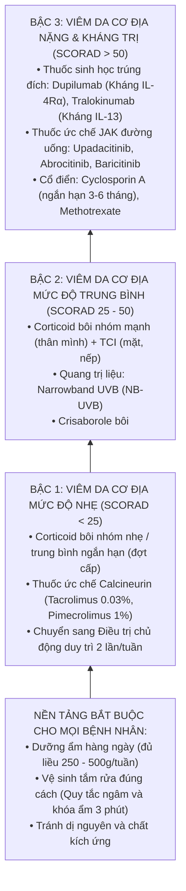

---

## SLIDE 51, 52, 53 & 54: NGHỆ THUẬT SỬ DỤNG DƯỠNG ẨM (EMOLLIENTS)


### 1. Nội dung nguyên bản trên Slide
- Trích dẫn: *Zhong Y. Allergy. 2022; Eichenfield, LF. Pediatrics. 2015.*
- Dưỡng ẩm làm giảm triệu chứng và hiện tượng viêm, cải thiện độ nặng và kéo dài thời gian lui bệnh giữa các đợt bùng phát.
- **Liều lượng khuyến cáo hàng tuần:**
  - Trẻ nhỏ: **150 – 200 gam / tuần**.
  - Trẻ lớn và Người lớn: **250 – 500 gam / tuần**.
- Thoa thường xuyên và rộng rãi trên toàn bộ diện tích da (cả vùng da bệnh và da lành).
- **Khuyến cáo thoa dưỡng ẩm NGAY LẬP TỨC SAU KHI TẮM.**

### 2. Giảng giải chuyên sâu của Giảng viên lâm sàng (BSCKII)
- **Quy tắc vàng sống còn: "NGÂM VÀ KHÓA ẨM TRONG 3 PHÚT" (The 3-Minute Soak and Seal Rule):**
  - Đây là kỹ thuật chăm sóc da quan trọng nhất mà mọi bác sĩ phải hướng dẫn tỉ mỉ cho bệnh nhân và phụ huynh:
    1. Cho trẻ tắm trong nước ấm ($32 - 36^\circ\text{C}$) trong khoảng **5 đến 10 phút**. Nước tắm sẽ thấm đẫm vào các tế bào sừng khô cằn, bù lại lượng nước đã mất (*Soak*).
    2. Bước ra khỏi bồn tắm, dùng khăn bông mềm **thấm nhẹ nhàng** cho ráo bớt nước, không chà xát mạnh.
    3. **TRONG VÒNG 3 PHÚT ĐẦU TIÊN KHI DA VẪN CÒN ĐANG HƠI ẨM:** Thoa ngay lập tức một lớp kem dưỡng ẩm dày lên toàn bộ cơ thể (*Seal*). Lớp lipid của kem dưỡng ẩm sẽ đóng vai trò như một chiếc màng bọc nilon nhân tạo, khóa chặt toàn bộ lượng nước vừa hấp thu lại bên trong lớp sừng, ngăn không cho nước bốc hơi ra ngoài!
- **Tại sao bệnh nhân thoa dưỡng ẩm mãi không đỡ? – LỖI THIẾU LIỀU LƯỢNG:**
  - Đa số bệnh nhân chỉ mua 1 tuýp kem dưỡng ẩm 50 gam về bôi tí tách... trong 2 tháng! Lượng thuốc đó hoàn toàn như "muối bỏ biển".
  - Một người lớn mắc viêm da cơ địa cần thoa từ **250g đến 500g kem dưỡng ẩm mỗi tuần** (tương đương 1 hũ kem lớn 500g dùng trong 1 đến 2 tuần). Thoa hào phóng 2 - 3 lần mỗi ngày.

---

## SLIDE 55, 56 & 57: CORTICOSTEROID TẠI CHỖ (TCS) & CHIẾN LƯỢC CHỦ ĐỘNG DUY TRÌ


### 1. Nội dung nguyên bản trên Slide
- Trích dẫn: *Bolognia Dermatology 5th Ed; Aung T, Aung ST. Aust J Gen Pract. 2021.*
- Corticoid bôi tại chỗ là liệu pháp dược lý hàng đầu trong điều trị đợt bùng phát AD.
- Hiệu quả nhanh chóng trong việc giảm viêm và cắt cơn ngứa.
- Sử dụng **2 lần/ngày trong giai đoạn cấp (1 - 2 tuần)** và giảm xuống **2 lần/tuần trong giai đoạn duy trì**.
- Lựa chọn hoạt lực dựa trên lứa tuổi, vị trí giải phẫu và độ dày của tổn thương.
- Hướng dẫn định lượng thuốc bằng **Đơn vị đốt ngón tay (Fingertip Unit - FTU)**.

### 2. Giảng giải chuyên sâu của Giảng viên lâm sàng (BSCKII)
- **1. Phân loại thang bậc hoạt lực (Potency) thực tế:**
  - **Nhóm 1 (Siêu mạnh):** Clobetasol propionate 0.05%. Chỉ dùng cho mảng liken hóa dày ở người lớn tại vùng da dày (lòng bàn tay chân, cùi chỏ, đầu gối). Tối đa 2 tuần.
  - **Nhóm 2 & 3 (Mạnh):** Betamethasone dipropionate 0.05%, Mometasone furoate 0.1%. Dùng cho thân mình và chi ở người lớn và trẻ lớn.
  - **Nhóm 4 & 5 (Trung bình):** Hydrocortisone butyrate 0.1%, Desonide 0.05%, Triamcinolone acetonide 0.1%. Lựa chọn an toàn cho thân mình trẻ em.
  - **Nhóm 6 & 7 (Nhẹ):** Hydrocortisone acetate 1%. Lựa chọn duy nhất an toàn thoa vùng mặt, nếp bẹn ở trẻ nhũ nhi.
- **2. Chiến lược Điều trị Chủ động Duy trì (Proactive Therapy) – Bí quyết chống tái phát:**
  - Trước đây: Điều trị phản ứng (*Reactive therapy*) – chờ da bùng phát đỏ rực mới bôi thuốc, khi da lành thì ngừng bôi. Hậu quả là da cứ bùng phát tái phát liên tục mỗi 2 tuần!
  - **Chiến lược Proactive hiện đại:**
    - *Giai đoạn 1 (Tấn công dập tắt đợt cấp):* Thoa Corticoid (hoặc Tacrolimus) 1 - 2 lần/ngày trong 1 - 2 tuần cho đến khi mảng chàm lặn hoàn toàn, bề mặt da nhẵn mịn.
    - *Giai đoạn 2 (Chủ động duy trì):* **KHÔNG DỪNG HẲN THUỐC!** Tiếp tục thoa Corticoid hoạt lực trung bình hoặc Tacrolimus **2 LẦN/TUẦN (VÀO CỐ ĐỊNH THỨ BẢY VÀ CHỦ NHẬT)** ngay trên vùng da từng bị tổn thương cũ, 5 ngày còn lại chỉ thoa dưỡng ẩm.
    - Duy trì liên tục chế độ này trong **3 đến 6 tháng**. Nghiên cứu chứng minh phương pháp này giúp **giảm tới 80% nguy cơ bùng phát tái phát**, không gây tác dụng phụ teo da và giảm tổng lượng corticoid bệnh nhân phải sử dụng trong năm!

---

## SLIDE 58 & 59: THUỐC ỨC CHẾ CALCINEURIN TẠI CHỖ (TCI: TACROLIMUS & PIMECROLIMUS)


### 1. Nội dung nguyên bản trên Slide
- Hai hoạt chất TCI được FDA chấp thuận: **Tacrolimus 0.03% (cho trẻ 2 - 15 tuổi), Tacrolimus 0.1% (cho người $\ge 16$ tuổi)** và **Pimecrolimus 1%**.
- TCI ức chế chọn lọc sự hoạt hóa tế bào lympho T, ức chế giải phóng các cytokine gây viêm (IL-2, IL-4, IL-13, TNF-α).
- Tác dụng phụ thường gặp: Cảm giác nóng rát, châm chích tại chỗ thoa trong vài ngày đầu.
- **Giải mã Cảnh báo Hộp đen của FDA (Black Box Warning 2006):** Sau hơn 15 năm theo dõi diện rộng trên hàng triệu bệnh nhân, **KHÔNG CÓ BẰNG CHỨNG NÀO CHO THẤY TCI LÀM TĂNG NGUY CƠ UNG THƯ HAY ỨC CHẾ MIỄN DỊCH TOÀN THÂN**.

### 2. Giảng giải chuyên sâu của Giảng viên lâm sàng (BSCKII)
- **Ưu điểm vô song của TCI so với Corticoid:**
  - Corticoid ức chế sự tổng hợp collagen của nguyên bào sợi $\rightarrow$ Gây teo da, rạn da, giãn mạch và mỏng da.
  - **Tacrolimus và Pimecrolimus KHÔNG HỀ ỨC CHẾ NGUYÊN BÀO SỢI:** Thuốc **tuyệt đối không gây teo da, không làm mỏng da, không gây giãn mạch và không làm tăng nhãn áp**!
  - Do đó, TCI chính là **"Vũ khí số một thay thế Corticoid"** tại các vùng da nhạy cảm: **Mặt, Mi mắt, Nếp gấp cổ, Nách, Nếp bẹn và Vùng sinh dục**.
- **Kỹ thuật tư vấn vượt qua cảm giác châm chích bỏng rát:**
  - Khoảng 30 - 50% bệnh nhân trong 3 - 5 ngày đầu thoa Tacrolimus sẽ có cảm giác chao đảo, nóng bừng rát buốt hoặc châm chích như kim châm tại vị trí thoa. Nếu bác sĩ không dặn trước, bệnh nhân sẽ nghĩ mình bị "dị ứng thuốc" và vứt bỏ tuýp thuốc ngay lập tức!
  - *Mẹo lâm sàng của BSCKII:*
    - Dặn bệnh nhân: Cảm giác nóng rát này là hoàn toàn bình thường, sẽ tự biến mất sau 3 - 5 ngày khi hàng rào da bắt đầu hồi phục.
    - Để giảm nóng rát: Trong 3 - 5 ngày đầu đợt cấp, cho thoa Corticoid nhẹ trước để dập bớt phản ứng viêm, hoặc thoa kem dưỡng ẩm trước rồi mới thoa một lớp mỏng Tacrolimus lên trên, hoặc để tuýp thuốc vào ngăn mát tủ lạnh trước khi thoa.

---

## SLIDE 60: THUỐC ỨC CHẾ PDE4 BÔI TẠI CHỖ (CRISABOROLE)


### 1. Nội dung nguyên bản trên Slide
- Trích dẫn: *Argenziano G, Cusano F, Corazza M, et al. Ital J Dermatol Venerol. 2024;159(3):251-278.*
- Giới thiệu thuốc bôi không steroid thế hệ mới: **Crisaborole mỡ 2% (Eucrisa)** được chỉ định cho bệnh nhân viêm da cơ địa nhẹ đến trung bình từ **3 tháng tuổi trở lên**.

### 2. Giảng giải chuyên sâu của Giảng viên lâm sàng (BSCKII)
- **Cơ chế tác động:**
  - Crisaborole là phân tử nhỏ ức chế chọn lọc enzym Phosphodiesterase 4 (PDE4) ở da, làm tăng nồng độ cAMP nội bào, từ đó ức chế sự giải phóng các cytokine gây viêm của trục Th2 (IL-4, IL-13, IL-31) và TNF-α.
  - Ưu điểm: Thuốc bôi không chứa steroid, không gây teo da, dung nạp tốt cho trẻ nhũ nhi từ 3 tháng tuổi.

---

# PHẦN 7: ĐIỀU TRỊ TOÀN THÂN, KỶ NGUYÊN THUỐC SINH HỌC & ỨC CHẾ JAK (SLIDE 61 - 71)

## SLIDE 61, 62, 63 & 64: HƯỚNG DẪN ĐỒNG THUẬN QUỐC TẾ EUROGUIDERM 2022


### 1. Nội dung nguyên bản trên Slide
- Trích dẫn: *Wollenberg A, Kinberger M, Arents B, et al. European guideline (EuroGuiDerm) on atopic eczema: part 1 - systemic therapy. J Eur Acad Dermatol Venereol. 2022;36(9):1409-1431.*
- Phác đồ bậc thang phân tầng điều trị toàn diện cho người lớn và trẻ em theo 4 mức độ: Cơ bản $\rightarrow$ Nhẹ $\rightarrow$ Trung bình $\rightarrow$ Nặng.

### 2. Giảng giải chuyên sâu của Giảng viên lâm sàng (BSCKII)
- **Sơ đồ phân tầng điều trị theo EuroGuiDerm 2022:**
  - **Mức độ Cơ bản (Mọi mức độ độ nặng):**
    - Thoa kem dưỡng ẩm đầy đủ hàng ngày ($250 - 500\text{g/tuần}$).
    - Tắm nước ấm ngắn với dung dịch làm sạch không xà phòng (Syndet).
    - Tránh các yếu tố kích ứng cơ học (vải len dạ, đồ thô ráp) và các dị nguyên đã xác định.
    - Giáo dục bệnh nhân (*Eczema school*).
  - **Mức độ Nhẹ (SCORAD < 25 / EASI < 7):**
    - Corticoid bôi nhóm trung bình (hoặc TCI) thoa ngắt quãng trong các đợt bùng phát cấp tính.
    - Chuyển sang thoa chủ động duy trì (*Proactive therapy*) 2 lần/tuần tại các vị trí hay tái phát.
  - **Mức độ Trung bình (SCORAD 25 - 50 / EASI 7 - 21):**
    - Corticoid bôi nhóm mạnh + TCI (Tacrolimus 0.1% cho vùng mặt, nếp gấp).
    - **Quang trị liệu dải hẹp (Narrowband UVB - NB-UVB)** 3 lần/tuần (hiệu quả cao, an toàn cho trẻ em $> 7$ tuổi và người lớn).
  - **Mức độ Nặng & Kháng trị (SCORAD > 50 / EASI > 21):**
    - **Chỉ định điều trị toàn thân nhắm trúng đích:**
      - **Thuốc sinh học:** **Dupilumab** (Kháng IL-4Rα), **Tralokinumab** (Kháng IL-13).
      - **Thuốc ức chế JAK đường uống:** **Upadacitinib**, **Abrocitinib**, **Baricitinib**.
    - **Thuốc cổ điển:** **Cyclosporin A** (dùng ngắn hạn 3 - 6 tháng để dập đợt bùng phát dữ dội), **Methotrexate**.

---

## SLIDE 65, 66, 67 & 68: BƯỚC NGOẶT THUỐC SINH HỌC & THUỐC ỨC CHẾ JAK ĐƯỜNG UỐNG


### 1. Nội dung nguyên bản trên Slide
- Trích dẫn: *Davis DMR, Drucker AM, Alikhan A. American Academy of Dermatology Guidelines: Management of Atopic Dermatitis with Systemic Therapies. J Am Acad Dermatol. 2024;90(2):e43-e56.*
- Bảng phân loại các liệu pháp nhắm trúng đích thế hệ mới:
  - **Thuốc sinh học (Biologics):** Dupilumab, Tralokinumab, Lebrikizumab, Nemolizumab.
  - **Thuốc ức chế JAK (JAK Inhibitors):** Upadacitinib, Abrocitinib, Baricitinib.

### 2. Giảng giải chuyên sâu của Giảng viên lâm sàng (BSCKII)
- **1. DUPILUMAB (Biệt dược: Dupixent) – "Cuộc cách mạng Biologics":**
  - **Cơ chế tác động:** Là kháng thể đơn dòng người hoàn toàn (IgG4) gắn đặc hiệu vào **tiểu đơn vị chung IL-4Rα**. Tiểu đơn vị này có mặt ở cả thụ thể Type I (gắn IL-4) và Type II (gắn cả IL-4 và IL-13). Do đó, Dupilumab **khóa đồng thời cả 2 con đường dẫn truyền tín hiệu then chốt của IL-4 và IL-13**!
  - **Chỉ định đột phá:** Được FDA và Bộ Y tế phê duyệt điều trị cho bệnh nhân viêm da cơ địa mức độ trung bình - nặng từ **6 THÁNG TUỔI TRỞ LÊN**!
  - **Phác đồ liều dùng người lớn:**
    - Liều nạp ban đầu: **600 mg tiêm dưới da (SC)** (tiêm 2 mũi 300mg tại 2 vị trí khác nhau).
    - Liều duy trì: **300 mg tiêm dưới da mỗi 2 tuần tiêm một lần (Q2W)**.
  - **Hồ sơ an toàn xuất sắc:** Dupilumab không gây độc tế bào, không ức chế miễn dịch diện rộng, **KHÔNG CẦN LÀM XÉT NGHIỆM MÁU ĐỊNH KỲ THEO DÕI ĐỘC TÍNH GAN THẬN HAY TỦY XƯƠNG**.
  - **Tác dụng phụ đặc thù cần lưu ý:**
    - **Viêm kết mạc mắt (Dupilumab-associated conjunctivitis):** Gặp ở khoảng **10 - 20% bệnh nhân** (mắt đỏ, xót, cộm, khô mắt). Cơ chế do giảm IL-13 làm giảm mật độ tế bào đài tiết chất nhầy ở kết mạc. *Xử trí:* Nhỏ nước mắt nhân tạo, nhỏ mắt kháng viêm Fluorometholone hoặc Ciclosporin 0.05%; rất hiếm khi phải ngừng Dupilumab.
    - Phản ứng đỏ da vùng mặt cổ (*Head and neck erythema*) do hiện tượng tăng sinh nấm men *Malassezia*.

- **2. TRALOKINUMAB (Biệt dược: Adbry):**
  - Kháng thể đơn dòng gắn chọn lọc trực tiếp vào phân tử **IL-13** hòa tan, ngăn không cho IL-13 gắn vào thụ thể IL-13Rα1 và IL-13Rα2. Tỷ lệ gây viêm kết mạc mắt thấp hơn so với Dupilumab.

- **3. THUỐC ỨC CHẾ JAK ĐƯỜNG UỐNG (ORAL JAK INHIBITORS) – TỐC ĐỘ CẮT CƠN NGỨA THẦN TỐC:**
  - **Cơ chế phân tử:** Các thụ thể của IL-4, IL-13, IL-31 và TSLP đều dẫn truyền tín hiệu nội bào qua enzym **Janus Kinase (JAK1, JAK2, TYK2)**. Ức chế JAK sẽ cắt đứt tín hiệu của toàn bộ các cytokine gây ngứa và viêm cùng một lúc!
  - **3 thuốc ức chế JAK được phê duyệt:**
    1. **Upadacitinib (Rinvoq - ức chế chọn lọc JAK1):** Viên uống 15mg hoặc 30mg x 1 lần/ngày.
    2. **Abrocitinib (Cibinqo - ức chế chọn lọc JAK1):** Viên uống 100mg hoặc 200mg x 1 lần/ngày.
    3. **Baricitinib (Olumiant - ức chế JAK1/JAK2):** Viên uống 2mg hoặc 4mg x 1 lần/ngày.
  - **Ưu điểm vượt trội của nhóm JAKi:**
    - **Cắt đứt cơn ngứa thần tốc chỉ sau 24 - 48 giờ** sau khi uống viên thuốc đầu tiên (nhanh hơn nhiều so với Dupilumab cần 2 - 4 tuần).
    - Tỷ lệ đạt sạch da **EASI-90 và EASI-100 cao hơn** trong các nghiên cứu thử nghiệm đối đầu trực tiếp (*Head-to-head trials: Heads Up, JADE COMPARE*).
    - Dạng viên uống tiện lợi, không phải tiêm kim.
  - **Lưu ý an toàn & Theo dõi (Black Box Warnings):**
    - Cần tầm soát trước điều trị: Lao tiềm ẩn (IGRA QuantiFERON), Viêm gan B, C, HIV, Bilan lipid máu.
    - Xét nghiệm định kỳ: Công thức máu (theo dõi giảm tiểu cầu, bạch cầu lympho), Men gan, Lipid máu (tăng nhẹ cholesterol và triglyceride), Nồng độ men cơ CK.
    - Cảnh báo nguy cơ tái hoạt virus **Herpes Zoster (Zona thần kinh)** $\rightarrow$ Khuyến cáo tiêm ngừa vaccine Shingrix trước khi bắt đầu dùng JAKi.

---

## SLIDE 69, 70 & 71: ĐIỀU TRỊ TOÀN THÂN CỔ ĐIỂN


### 1. Nội dung nguyên bản trên Slide
- Trích dẫn: *Harper’s Textbook of Pediatric Dermatology (2020).*
- Bảng tổng hợp các thuốc ức chế miễn dịch cổ điển: **Cyclosporin A (CsA), Methotrexate (MTX), Azathioprine (AZA), Mycophenolate Mofetil (MMF)**.
- Nguyên tắc sử dụng và theo dõi độc tính.

### 2. Giảng giải chuyên sâu của Giảng viên lâm sàng (BSCKII)
- **1. Cyclosporin A (CsA) – Thuốc dập lửa cấp tính hàng đầu:**
  - Liều dùng: **$2.5 - 5\text{ mg/kg/ngày}$**, chia làm 2 lần uống.
  - *Chỉ định tối ưu:* Bệnh nhân viêm da cơ địa nặng đang trong đợt bùng phát dữ dội, không ngủ được, cào gãi rách da toàn thân. CsA cho đáp ứng lâm sàng cực kỳ nhanh chỉ sau **1 đến 2 tuần**.
  - *Thời gian dùng:* **Chỉ dùng ngắn hạn trong 3 đến 6 tháng** để kiểm soát đợt cấp, sau đó chuyển giao sang phác đồ an toàn hơn (Dupilumab, MTX hoặc thoa duy trì). Không bao giờ dùng kéo dài quá 1 - 2 năm vì độc tính suy thận mạn và tăng huyết áp.
- **2. Methotrexate (MTX):**
  - Liều dùng: **$10 - 15\text{ mg/tuần}$** (uống 1 lần duy nhất trong tuần) + bổ sung **Acid Folic 5mg** sau 24 giờ.
  - Thuốc tác dụng chậm (cần 8 - 12 tuần), thích hợp cho điều trị duy trì dài hạn ở người lớn khi không có điều kiện tiếp cận thuốc sinh học.
- **3. CẢNH BÁO QUAN TRỌNG VỀ CORTICOID ĐƯỜNG UỐNG (ORAL STEROIDS):**
  > [!CAUTION]
  > **TỐI KỴ DÙNG CORTICOID TOÀN THÂN KÉO DÀI TRONG VIÊM DA CƠ ĐỊA!**
  > - Uống Medrol hoặc Prednisolone có thể làm da lặn đỏ rất nhanh trong vài ngày, nhưng ngay khi ngừng thuốc, bệnh nhân sẽ bị **Hiện tượng bùng phát hồi ứng cực kỳ dữ dội (Severe rebound flare)**, da đỏ rực, trợt loét toàn thân nặng gấp nhiều lần trước khi uống thuốc!
  > - Hơn nữa, việc lạm dụng corticoid đường uống ở trẻ nhỏ gây biến chứng suy tuyến thượng thận cấp, hội chứng Cushing, loãng xương và **chậm phát triển chiều cao vĩnh viễn**. Bác sĩ tuyệt đối không được lạm dụng!

---

## SLIDE 72, 73, 74 & 75: VỆ SINH TẮM RỬA, ĐIỀU TRỊ NHIỄM TRÙNG & CHĂM SÓC DA


### 1. Nội dung nguyên bản trên Slide
- Trích dẫn: *Schachner LA, Blume-Peytavi U. Ital J Dermatol Venerol. 2023; Wollenberg A. J Eur Acad Dermatol Venereol. 2022.*
- **Nguyên tắc làm sạch da và tắm rửa:**
  - Loại bỏ nhẹ nhàng các lớp vảy mài, làm giảm mật độ vi khuẩn bề mặt mà không làm tổn thương thêm hàng rào sừng.
  - Nước tắm ấm nhiệt độ **$27 - 30^\circ\text{C}$** (hoặc $32 - 34^\circ\text{C}$).
  - Thời gian tắm ngắn: **Trong vòng 5 đến 10 phút**.
  - Sử dụng dung dịch làm sạch không chứa xà phòng, pH cân bằng acid nhẹ ($pH \approx 5.5$).
- **Liệu pháp Tắm bồn pha thuốc tẩy loãng (Dilute Bleach Baths):** Biện pháp vàng kiểm soát tụ cầu vàng.

### 2. Giảng giải chuyên sâu của Giảng viên lâm sàng (BSCKII)
- **Công thức "Tắm thuốc tẩy loãng" (Bleach Baths) – Khắc tinh của Tụ cầu vàng:**
  - Đây là liệu pháp kinh điển được Viện Hàn lâm Da liễu Hoa Kỳ (AAD) và Hội Nhi khoa Quốc tế khuyến cáo cho bệnh nhân viêm da cơ địa hay bị nhiễm trùng tái diễn:
    - **Pha chế:** Dùng nước tẩy gia dụng thông thường chứa Natri Hypoclorit (**Javel / Clorox $6\%$**). Đổ **$\frac{1}{2}$ tách (khoảng 120 ml)** nước tẩy vào một bồn tắm đầy nước ấm khoảng **150 lít** (nồng độ dung dịch thu được khoảng **$0.005\%$**, tương đương với nồng độ clo trong nước hồ bơi tiêu chuẩn).
    - **Cách tắm:** Cho trẻ ngâm mình trong bồn từ cổ trở xuống trong **10 phút**, 2 lần mỗi tuần. Sau đó tráng lại bằng nước sạch và thoa ngay dưỡng ẩm.
    - **Hiệu quả diệu kỳ:** Nồng độ clo loãng này có khả năng **phá hủy màng Biofilm và tiêu diệt tụ cầu vàng *S. aureus* cực mạnh**, làm giảm rõ rệt mức độ viêm da mà **HOÀN TOÀN KHÔNG GÂY RA HIỆN TƯỢNG KHÁNG THUỐC KHÁNG SINH**!

---

## SLIDE 76: QUẢN LÝ VIÊM DA CƠ ĐỊA Ở PHỤ NỮ MANG THAI
### 1. Nội dung nguyên bản trên Slide
- Viêm da cơ địa là bệnh lý da thường gặp nhất ở phụ nữ mang thai (chiếm khoảng 1/3 các trường hợp bệnh da thai kỳ).
- **3 tình huống lâm sàng:**
  1. AD trở nặng trên nền bệnh mạn tính có sẵn (chiếm 20%).
  2. Bệnh tái hoạt trở lại sau nhiều năm lui bệnh ổn định.
  3. Xuất hiện lần đầu tiên ở phụ nữ chưa từng có tiền căn AD (**Phát ban Atopy trong thai kỳ - Atopic Eruption of Pregnancy - AEP**, chiếm tới 80%).

### 2. Giảng giải chuyên sâu của Giảng viên lâm sàng (BSCKII)
- **Nguyên tắc kê đơn an toàn trong thai kỳ:**
  - **Lựa chọn an toàn tuyệt đối:**
    - Kem dưỡng ẩm (Emollients): Thoa tự do không giới hạn.
    - **Corticoid bôi nhóm nhẹ đến trung bình (Hydrocortisone butyrate 0.1%):** An toàn cho cả mẹ và thai nhi khi bôi ngắt quãng.
    - **Quang trị liệu Narrowband UVB (NB-UVB):** Liệu pháp toàn thân **AN TOÀN NHẤT TRONG THAI KỲ** (tia UVB dải hẹp không đi xuyên qua được tử cung, không gây dị tật thai nhi).
    - Kháng Histamin H1 thế hệ 2 an toàn: **Loratadine, Cetirizine**.
  - **Trường hợp nặng đe dọa sinh non:** Có thể cân nhắc **Cyclosporin A** (thuốc ức chế miễn dịch được nghiên cứu nhiều nhất và an toàn nhất ở phụ nữ mang thai ghép tạng).
  - **Chống chỉ định tuyệt đối:** Methotrexate, Mycophenolate Mofetil, Thuốc ức chế JAK đường uống.

---

## SLIDE 77 & 78: KẾT LUẬN & LỜI CẢM ƠN
### 1. Nội dung nguyên bản trên Slide
- Viêm da cơ địa là bệnh da liễu phổ biến, mãn tính, tiến triển từng đợt tái phát.
- Đặc điểm lâm sàng và vị trí sang thương thay đổi ngoạn mục theo từng lứa tuổi.
- Dưỡng ẩm là nền tảng điều trị bắt buộc và lâu dài.
- Tiếp cận điều trị hiện đại theo hướng cá thể hóa, kết hợp giữa phục hồi hàng rào da và kiểm soát miễn dịch trúng đích.
- **Slide 78: Thank you!**

---

## TỔNG KẾT BÀI GIẢNG: 10 NGUYÊN LÝ "VÀNG" ĐIỀU TRỊ VIÊM DA CƠ ĐỊA

1. **Bản chất bệnh:** Tam giác bệnh học gồm Khiếm khuyết hàng rào biểu bì (đột biến FLG), Rối loạn miễn dịch Th2/Th22 và Mất cân bằng vi hệ da (*Staphylococcus aureus* chiếm $> 90\%$).
2. **Triệu chứng then chốt:** "Ngứa" là triệu chứng bắt buộc sống còn. Vòng xoắn "Ngứa – Cào gãi" là động lực duy trì bệnh.
3. **Quy luật vị trí lứa tuổi:** Trẻ nhũ nhi bị ở hai má (chàm sữa tha bổng vùng mũi quanh miệng) và mặt duỗi; Trẻ em và người lớn chuyển dịch vào các nếp gấp (nếp khoeo chân, nếp khuỷu tay).
4. **Quy tắc 3 phút (Soak and Seal):** Luôn thoa kem dưỡng ẩm ngay lập tức trong vòng 3 phút sau khi tắm khi da còn hơi ẩm để khóa nước vào lớp sừng.
5. **Đủ liều lượng dưỡng ẩm:** Phải dùng đủ $150 - 200\text{g/tuần}$ ở trẻ nhỏ và $250 - 500\text{g/tuần}$ ở người lớn.
6. **Chiến lược Proactive (Chủ động duy trì):** Sau khi dập tắt đợt cấp, duy trì thoa Corticoid hoặc Tacrolimus 2 lần/tuần vào thứ Bảy và Chủ nhật để ngăn ngừa tái phát.
7. **Thuốc ức chế Calcineurin (Tacrolimus/Pimecrolimus):** Là lựa chọn vàng cho vùng da mỏng (mặt, mi mắt, nếp gấp) vì tuyệt đối không gây teo da và giãn mạch.
8. **Cấp cứu Eczema Herpeticum:** Khi thấy mụn nước rốn lõm đồng dạng mọc trên nền da chàm kèm sốt cao $\rightarrow$ Ngừng ngay thuốc ức chế miễn dịch, tiêm truyền **Acyclovir** khẩn cấp!
9. **Tối kỵ Corticoid đường uống:** Không dùng Corticoid uống kéo dài vì nguy cơ bùng phát dội ngược kịch phát (*Severe rebound*) và suy tuyến thượng thận ở trẻ nhỏ.
10. **Kỷ nguyên mới:** **Dupilumab (Kháng IL-4Rα)** an toàn cho trẻ từ 6 tháng tuổi; **Thuốc ức chế JAK (Upadacitinib, Abrocitinib)** cắt đứt cơn ngứa thần tốc trong 24 - 48 giờ.

---

## 3 TÌNH HUỐNG LÂM SÀNG THỰC TẾ (MINI-CASES)

### Tình huống lâm sàng 1 (Case 1 - Chàm sữa nhũ nhi bội nhiễm):
> **Bệnh sử:** Bé trai, 4 tháng tuổi, được mẹ đưa đến khám vì hai má đỏ rực, nổi nhiều mụn nước rỉ dịch vàng và đóng mài dày. Trẻ quấy khóc liên tục suốt đêm, hay lấy hai tay cọ xát vào má và dụi mặt vào vai mẹ. Mẹ bé cho biết bệnh xuất hiện lúc 2 tháng tuổi, gia đình có bố bị viêm mũi dị ứng. Mẹ nghe người quen mách bảo đã tự mua lá chè xanh và lá trầu không đun nước đặc để rửa mặt cho bé, sau đó tổn thương càng đỏ rực và chảy mủ nhiều hơn.
> 
> **Thăm khám:**
> - Hai má và cằm của trẻ có các mảng hồng ban viêm đỏ rực, phù nề, rỉ dịch huyết thanh nhầy ướt át.
> - Bề mặt có nhiều vảy tiết màu vàng óng như mật ong (dấu hiệu chốc hóa). Vùng chóp mũi và quanh miệng hoàn toàn trắng trẻo, lành lặn.
> - Vùng quấn tã lót da bình thường.
> 
> **Câu hỏi:**
> 1. Chẩn đoán xác định bệnh và biến chứng hiện tại của bé?
> 2. Sai lầm trong chăm sóc của người mẹ là gì?
> 3. Kê đơn điều trị toàn diện cho bé trong 7 ngày đầu?
> 
> **Phân tích & Hướng dẫn xử trí của BSCKII:**
> - **Chẩn đoán:** Viêm da cơ địa giai đoạn nhũ nhi (Chàm sữa) mức độ trung bình - nặng, **biến chứng Chốc hóa thứ phát do Tụ cầu vàng (*Staphylococcus aureus*)**.
> - **Sai lầm của mẹ:** Rửa nước lá chè xanh, trầu không đậm đặc chứa nhiều tanin gây khô rát, kích ứng da nặng nề và làm tổn thương thêm hàng rào biểu bì, tạo điều kiện cho vi khuẩn xâm nhập gây chốc hóa.
> - **Kế hoạch điều trị 7 ngày đầu:**
>   1. **Xử trí chốc hóa:** Kháng sinh đường uống kháng tụ cầu: **Cefalexin hỗn dịch uống** ($50\text{ mg/kg/ngày}$ chia 3 lần) hoặc Amoxicillin/Clavulanate trong 7 ngày.
>   2. **Chăm sóc tổn thương rỉ dịch tại chỗ:**
>      - Đắp gạc thấm dung dịch nước muối sinh lý $0.9\%$ hoặc dung dịch Jarish ấm lên hai má ngày 2 - 3 lần, mỗi lần 10 phút để làm mềm và bong nhẹ nhàng các lớp vảy tiết vàng mật ong.
>      - Thoa mỡ kháng sinh **Mupirocin 2%** hoặc Acid Fusidic 2 lần/ngày lên các vết trợt trong 5 ngày.
>   3. **Kháng viêm dập tắt đợt chàm:** Sau 2 ngày khi vảy mài đã khô và sạch mủ, thoa **Hydrocortisone acetate 1%** (corticoid nhóm nhẹ an toàn cho mặt trẻ nhũ nhi) 1 lần/ngày vào buổi tối trong 5 ngày.
>   4. **Phục hồi hàng rào da:** Hướng dẫn mẹ thoa kem dưỡng ẩm dịu nhẹ dành riêng cho trẻ sơ sinh (không hương liệu, không paraben) toàn thân 2 - 3 lần/ngày, tuân thủ quy tắc 3 phút sau khi tắm. Cắt ngắn móng tay cho bé và đeo bao tay vải mềm để tránh cào rách da.

---

### Tình huống lâm sàng 2 (Case 2 - Cấp cứu Eczema Herpeticum):
> **Bệnh sử:** Bệnh nhân nam, 18 tuổi, có tiền sử viêm da cơ địa nặng từ nhỏ đang được điều trị ngoại trú bằng mỡ thoa Tacrolimus 0.1% và Corticoid bôi. Cách đây 2 ngày, bệnh nhân đột ngột sốt cao $39.5^\circ\text{C}$, rét run, đau rát dữ dội vùng mặt và cổ. Khai thác bệnh sử ghi nhận 4 ngày trước bệnh nhân có gặp và hôn bạn gái đang bị vết mụn rộp ở mép môi.
> 
> **Thăm khám:**
> - Bệnh nhân tỉnh nhưng vẻ mặt nhiễm độc mệt mỏi, sốt $39.2^\circ\text{C}$, hạch dưới hàm và hạch cổ hai bên sưng to, đau buốt.
> - Trên nền da chàm cũ ở toàn bộ khuôn mặt, vùng trán, quanh mắt và cổ xuất hiện hàng trăm **mụn nước nhỏ kích thước 2 - 3mm mọc thành chùm chi chít**.
> - **Các mụn nước đều có hình tròn, nông, ở giữa lõm xuống hình rốn (Umbilicated vesicles)**. Một số mụn nước đã vỡ tạo thành các vết trợt nông hình tròn như bị bấm lỗ đục (*Punched-out erosions*) rỉ dịch mủ máu và đóng vảy tiết nâu đen.
> - Hai mi mắt sưng húp, mắt phải đỏ và cộm xót.
> 
> **Câu hỏi:**
> 1. Chẩn đoán xác định cấp cứu của bệnh nhân này?
> 2. Hai xử trí ban đầu quan trọng nhất cần thực hiện ngay lập tức?
> 3. Phác đồ dùng thuốc đặc hiệu để cứu tính mạng và thị lực bệnh nhân?
> 
> **Phân tích & Hướng dẫn xử trí của BSCKII:**
> - **Chẩn đoán:** **Cấp cứu Eczema herpeticum (Kaposi’s varicelliform eruption) do nhiễm virus Herpes simplex (HSV-1)** bùng phát trên nền Viêm da cơ địa, có nguy cơ tổn thương giác mạc mắt phải.
> - **Hai xử trí ban đầu sống còn:**
>   1. **NGỪNG NGAY LẬP TỨC MỠ THOA TACROLIMUS VÀ CORTICOID:** Tuyệt đối không được tiếp tục bôi thuốc ức chế miễn dịch lên vùng da đang nhiễm virus.
>   2. **CHO BỆNH NHÂN NHẬP VIỆN KHẨN CẤP** tại khoa Da liễu / Truyền nhiễm, nằm phòng cách ly.
> - **Phác đồ điều trị đặc hiệu:**
>   1. **Thuốc kháng virus đường tĩnh mạch:** **Acyclovir truyền tĩnh mạch** với liều **$5 - 10\text{ mg/kg}$ mỗi 8 giờ (truyền tĩnh mạch chậm trong 1 giờ)** trong vòng 7 đến 10 ngày (theo dõi chức năng thận và bù đủ dịch khi truyền Acyclovir).
>   2. **Kháng sinh toàn thân phối hợp:** Tiêm tĩnh mạch **Cefazolin 1g mỗi 8 giờ** hoặc Cefuroxime để phòng ngừa và điều trị bội nhiễm tụ cầu vàng thứ phát.
>   3. **HỘI CHẨN CHUYÊN KHOA MẮT TẠI GIƯỜNG NGAY LẬP TỨC:** Bác sĩ Nhãn khoa soi đèn khe nhuộm Fluorescein kiểm tra tổn thương giác mạc (tìm vết loét hình cành cây do HSV). Nhỏ mắt dung dịch nước muối sinh lý và tra mỡ mắt **Ganciclovir 0.15% hoặc Acyclovir 3%** cho mắt phải để bảo vệ giác mạc, chống thủng giác mạc gây mù lòa.
>   4. Giảm đau, hạ sốt bằng Paracetamol. Chăm sóc vết trợt da bằng đắp gạc dung dịch sát khuẩn nhẹ (Eosin $2\%$ hoặc Chlorhexidine loãng).

---

### Tình huống lâm sàng 3 (Case 3 - Viêm da cơ địa người lớn kháng trị & Khởi động Thuốc sinh học):
> **Bệnh sử:** Bệnh nhân nữ, 28 tuổi, nhân viên văn phòng, mắc viêm da cơ địa dai dẳng từ thuở nhỏ. Gần 1 năm nay bệnh trở nên mất kiểm soát, ngứa dữ dội cả ngày lẫn đêm (điểm VAS ngứa 9/10), mất ngủ triền miên dẫn đến stress và trầm cảm. Bệnh nhân đã điều trị qua nhiều đợt Corticoid bôi nhóm mạnh, Tacrolimus 0.1% và từng uống Cyclosporin A trong 6 tháng nhưng cứ ngưng thuốc là bệnh lại bùng phát đỏ da toàn thân.
> 
> **Thăm khám:**
> - Da toàn thân khô ráp, tróc vảy mịn.
> - Các mảng dày da liken hóa sẫm màu, nếp da hằn sâu ngoằn ngoèo phủ kín vùng mặt, cổ ("Head and neck dermatitis"), nếp gấp hai khuỷu tay, nếp khoeo chân, mu bàn tay và cổ chân hai bên. Rất nhiều vết cào xước rướm máu tươi và vảy máu do bệnh nhân gãi liên tục trong lúc khám.
> - Đánh giá độ nặng: **$\text{EASI} = 32$ điểm (Mức độ Nặng)**, **$\text{SCORAD} = 68$ điểm**, **$\text{DLQI} = 22$ điểm** (bệnh phá hủy hoàn toàn chất lượng cuộc sống).
> - Tiền sử: Viêm mũi dị ứng mạn tính. Xét nghiệm IgE huyết thanh toàn phần tăng vọt: $4.500\text{ IU/mL}$.
> 
> **Câu hỏi:**
> 1. Chỉ định điều trị toàn thân nào là tối ưu và an toàn nhất hiện nay cho bệnh nhân này?
> 2. Phân tích ưu nhược điểm giữa Thuốc sinh học (Dupilumab) và Thuốc ức chế JAK đường uống (Upadacitinib)?
> 3. Hướng dẫn phác đồ dùng thuốc cụ thể cho bệnh nhân?
> 
> **Phân tích & Hướng dẫn xử trí của BSCKII:**
> - **Chỉ định:** Bệnh nhân mắc Viêm da cơ địa người lớn mức độ nặng ($EASI > 21, SCORAD > 50, DLQI > 10$), thất bại và lệ thuộc vào các liệu pháp điều trị tại chỗ và Cyclosporin $\rightarrow$ **Có chỉ định tuyệt đối điều trị bằng Thuốc sinh học (Biologics) hoặc Thuốc ức chế JAK (Targeted Oral Small Molecules)**.
> - **Biện luận lựa chọn giữa Dupilumab và Upadacitinib:**
>   - **Nếu chọn DUPILUMAB (Kháng IL-4Rα):**
>     - *Ưu điểm:* Hồ sơ an toàn dài hạn tuyệt hảo (đã có dữ liệu an toàn trên 7 năm), không độc tế bào gan thận, **không cần làm xét nghiệm máu định kỳ theo dõi**, an toàn cho phụ nữ nếu có kế hoạch mang thai trong tương lai gần; điều trị tốt đồng thời cả bệnh Viêm mũi dị ứng đi kèm của bệnh nhân.
>     - *Nhược điểm:* Tác dụng giảm ngứa chậm hơn JAKi (cần 2 - 4 tuần); nguy cơ viêm kết mạc mắt (~10%).
>   - **Nếu chọn UPADACITINIB (Ức chế chọn lọc JAK1):**
>     - *Ưu điểm:* **Cắt đứt cơn ngứa thần tốc chỉ sau 24 - 48 giờ**, tỷ lệ sạch da EASI-90 cao hơn, dạng viên uống tiện lợi.
>     - *Nhược điểm:* Cần làm bilan tầm soát lao tiềm ẩn (IGRA), men gan, lipid máu định kỳ; chi phí và cảnh báo an toàn tim mạch.
> - **Quyết định phác đồ tối ưu với DUPILUMAB:**
>   - Sau khi bàn bạc kỹ lưỡng với bệnh nhân về hiệu quả và tính an toàn dài hạn, bác sĩ quyết định chọn **Dupilumab (Dupixent)**:
>     - **Liều khởi đầu (Tuần 0):** Tiêm dưới da **600 mg** (tiêm 2 ống 300mg tại hai vị trí đùi hoặc bụng).
>     - **Liều duy trì:** Tiêm dưới da **300 mg mỗi 2 tuần một lần (Q2W)**.
>   - **Phối hợp tại chỗ:** Tiếp tục thoa kem dưỡng ẩm hàng ngày ($250 - 500\text{g/tuần}$) và thoa Tacrolimus 0.1% vùng mặt cổ trong 4 tuần đầu để hỗ trợ.
>   - **Theo dõi:** Đánh giá đáp ứng sau 16 tuần (mục tiêu đạt EASI-75 và điểm ngứa giảm $\ge 4$ điểm). Kê sẵn nước mắt nhân tạo để nhỏ mắt dự phòng khô mắt.

---
*(Hết giáo trình bài giảng Viêm da cơ địa - Slide 1 đến Slide 78)*


<!-- === VIRTUAL_FILE: 04_Benh_Giang_Mai_Syphilis.md === -->

# GIÁO TRÌNH BÀI GIẢNG CHUYÊN SÂU: BỆNH GIANG MAI (SYPHILIS)

**Đối tượng đào tạo:** Bác sĩ Y khoa (Y5) – Định hướng Sau đại học (BSNT, CKI, CKII Da liễu, Truyền nhiễm, Sản phụ khoa, Nam học)  
**Bộ môn:** Da liễu – Trường Đại học Khoa học Sức khỏe, Đại học Quốc gia TP. Hồ Chí Minh (UHS - VNUHCM)  
**Giảng viên biên soạn slide gốc:** BS. CKII. Nguyễn Thị Thanh Thơ (Khoa Lâm sàng 3 – Bệnh viện Da liễu TP.HCM)  
**Phân tích & Giảng giải lâm sàng chuyên sâu:** Bác sĩ Chuyên khoa II Da liễu (Giảng viên lâm sàng)  
**Tài liệu tham khảo chính:** Hướng dẫn Chẩn đoán và Điều trị Bệnh Giang mai – Bộ Y tế Việt Nam, Hướng dẫn Điều trị Bệnh lây truyền qua đường tình dục – CDC Hoa Kỳ (CDC STI Treatment Guidelines 2021), Bolognia Dermatology 5th Ed (2024), Fitzpatrick’s Dermatology 9th Ed.

---

## LỜI MỞ ĐẦU CỦA GIẢNG VIÊN LÂM SÀNG (BSCKII)

> *"Chào các em sinh viên Y5 và các bác sĩ đồng nghiệp!*  
> *Trong lịch sử y học nhân loại, không có một căn bệnh nào được mệnh danh với nhiều mỹ từ đầy vẻ e sợ như Bệnh Giang mai (Syphilis). Đại danh y Sir William Osler từng có câu nói bất hủ: **'He who knows syphilis knows medicine'** (Ai hiểu thấu đáo bệnh giang mai, người đó hiểu toàn bộ nền y học). Giang mai được mệnh danh là **'KẺ BẮT CHƯỚC VĨ ĐẠI' (The Great Imitator)** bởi vì tổn thương của nó có thể giả dạng hầu như mọi bệnh lý da liễu và nội khoa khác: từ một mảng sẩn giống vảy nến, một đào ban giống phát ban siêu vi, một vết trợt loét giống ung thư tế bào gai, cho đến phình động mạch chủ, viêm màng não và đột quỵ.*
>
> *Những năm gần đây, chúng ta đang chứng kiến sự **bùng phát trở lại khủng khiếp của bệnh giang mai trên toàn cầu và tại Việt Nam**, đặc biệt là trong nhóm nam quan hệ tình dục đồng giới (MSM) và những người nhiễm HIV. Giang mai không chỉ phá hủy sức khỏe sinh sản mà còn làm tăng nguy cơ lây truyền HIV lên gấp 3 đến 5 lần, đồng thời để lại hậu quả tàn khốc cho thế hệ sau qua bệnh cảnh Giang mai bẩm sinh.*
>
> *Bài giảng này của BS. CKII Nguyễn Thị Thanh Thơ (chuyên gia hàng đầu của Bệnh viện Da liễu TP.HCM) với **48 slide** sẽ cung cấp cho các em cái nhìn toàn diện từ hình thái học săng giang mai thời kỳ I, các thể ban phong phú thời kỳ II, cách phân biệt săng giang mai với các vết loét sinh dục khác, biện luận các xét nghiệm huyết thanh học RPR/VDRL và TPHA, cho đến việc sử dụng vũ khí kinh điển **Benzathine Penicillin G** – loại kháng sinh ra đời gần một thế kỷ nay nhưng xoắn khuẩn giang mai vẫn chưa từng phát triển đột biến kháng thuốc! Hãy cùng nhau đào sâu từng chi tiết lâm sàng."*

---

## MỤC LỤC BÀI HỌC

1. [Phần 1: Đại cương, Tác nhân Vi sinh, Dịch tễ học & Sơ đồ Diễn tiến tự nhiên (Slide 1 - 5)](#phan-1-dai-cuong-tac-nhan-vi-sinh-dich-te-hoc--so-do-dien-tien-tu-nhien-slide-1---5)
2. [Phần 2: Giang mai thời kỳ I (Primary Syphilis) & Chẩn đoán phân biệt Săng loét sinh dục (Slide 6 - 22)](#phan-2-giang-mai-thoi-ky-i-primary-syphilis--chan-doan-phan-biet-sang-loet-sinh-duc-slide-6---22)
3. [Phần 3: Giang mai thời kỳ II (Secondary Syphilis) – "Kẻ bắt chước vĩ đại" (Slide 23 - 37)](#phan-3-giang-mai-thoi-ky-ii-secondary-syphilis--ke-bat-chuoc-vi-dai-slide-23---37)
4. [Phần 4: Giang mai thời kỳ III & Giang mai tiềm tàng (Slide 38 - 41)](#phan-4-giang-mai-thoi-ky-iii--giang-mai-tiem-tang-slide-38---41)
5. [Phần 5: Chẩn đoán Huyết thanh học chuyên sâu & Thuật toán Sàng lọc (Non-treponemal vs Treponemal)](#phan-5-chan-doan-huyet-thanh-hoc-chuyen-sau--thuat-toan-sang-loc)
6. [Phần 6: Phác đồ Điều trị toàn diện, Phản ứng Jarisch-Herxheimer & Theo dõi khỏi bệnh (Slide 42 - 48)](#phan-6-phac-do-dieu-tri-toan-dien-phan-ung-jarisch-herxheimer--theo-doi-khoi-benh-slide-42---48)
7. [Phần 7: Tổng kết bài giảng: 10 Nguyên lý Vàng & 3 Tình huống lâm sàng thực tế (Mini-cases)](#phan-7-tong-ket-bai-giang-10-nguyen-ly-vang--3-tinh-huong-lam-sang-thuc-te-mini-cases)

---

# PHẦN 1: ĐẠI CƯƠNG, TÁC NHÂN VI SINH & SƠ ĐỒ DIỄN TIẾN TỰ NHIÊN (SLIDE 1 - 5)

## SLIDE 1 & 2: TIÊU ĐỀ BÀI GIẢNG & MỤC TIÊU HỌC TẬP


### 1. Nội dung nguyên bản trên Slide
- **Tiêu đề:** BỆNH GIANG MAI
- **Giảng viên:** BS. CK2 Nguyễn Thị Thanh Thơ (Khoa Lâm sàng 3 – Bệnh viện Da liễu TP.HCM).
- **Mục tiêu học tập:**
  1. Nắm được diễn tiến bệnh giang mai và phân loại của bệnh.
  2. Nắm vững triệu chứng lâm sàng của bệnh.
  3. Biết chẩn đoán giang mai thời kỳ I, thời kỳ II và huyết thanh học giang mai.
  4. Biết điều trị bệnh giang mai theo phác đồ chuẩn.

### 2. Giảng giải chuyên sâu của Giảng viên lâm sàng (BSCKII)
- **Vị trí bài học trong chương trình:**
  - Khoa Lâm sàng 3 của Bệnh viện Da liễu TP.HCM là khoa chuyên trách điều trị các Bệnh lây truyền qua đường tình dục (STIs / STDs) và nhiễm trùng da nặng. Bài giảng này đúc kết toàn bộ tinh hoa lâm sàng từ hàng ngàn ca bệnh giang mai thực tế.
  - Mục tiêu sống còn đối với sinh viên Y5 là: **Không được bỏ sót săng giang mai thời kỳ I** (vì đây là cơ hội vàng duy nhất để chữa khỏi dứt điểm bệnh chỉ bằng một liều tiêm duy nhất), **nhận diện chính xác ban giang mai thời kỳ II** (tránh chẩn đoán nhầm thành dị ứng thuốc hay vảy nến), và **biết biện luận kết quả RPR/VDRL định lượng** để theo dõi hiệu quả điều trị.

---

## SLIDE 3: ĐẠI CƯƠNG & ĐẶC TÍNH TÁC NHÂN VI SINH


### 1. Nội dung nguyên bản trên Slide
- Giang mai (GM) là một bệnh lây truyền qua đường tình dục, do xoắn khuẩn **Treponema pallidum**.
- Có thể lây qua đường máu, từ mẹ bị giang mai sang thai nhi.
- Là một nhiễm trùng hệ thống, chủ yếu tổn thương ở da, niêm mạc và tất cả các cơ quan nội tạng khác trong cơ thể.

### 2. Giảng giải chuyên sâu của Giảng viên lâm sàng (BSCKII)
- **Đặc điểm vi sinh học của Treponema pallidum subspecies pallidum:**
  - Được Fritz Schaudinn và Erich Hoffmann phát hiện vào năm 1905.
  - **Hình thái học:** Là vi khuẩn hình xoắn lò xo đều đặn, kích thước dài khoảng $6 - 20\ \mu\text{m}$, đường kính rất mảnh chỉ $0.1 - 0.2\ \mu\text{m}$ (không thể nhìn thấy dưới kính hiển vi quang học thông thường, bắt buộc phải soi dưới **Kính hiển vi nền đen** hoặc nhuộm thấm bạc Fontana-Tribondeau).
  - Có từ **6 đến 14 vòng xoắn** đều đặn, bước sóng ngắn ($1\ \mu\text{m}$).
  - **Khả năng di động 3 chiều đặc trưng:**
    1. Di động xoay tròn quanh trục dọc như một chiếc mũi khoan.
    2. Di động uốn khúc lượn sóng như một con rắn.
    3. Di động tiến lùi.
  - **Khả năng đề kháng:** Xoắn khuẩn giang mai là vi khuẩn kỵ khí, **cực kỳ yếu ớt khi ra khỏi cơ thể người**: Chết nhanh chóng khi khô ráo, chết ở nhiệt độ $42^\circ\text{C}$ sau 30 phút, bất hoạt ngay lập tức bởi xà phòng và các chất sát khuẩn thông thường. Do đó, **giang mai KHÔNG lây qua việc dùng chung bồn cầu, khăn tắm hay bắt tay thông thường**!
  - **Đặc tính nuôi cấy:** Cho đến nay, y học **VẪN CHƯA THỂ NUÔI CẤY ĐƯỢC xoắn khuẩn giang mai trên môi trường nhân tạo in-vitro**. Muốn duy trì chủng chỉ có thể cấy truyền trên tinh hoàn thỏ.

---

## SLIDE 4: DỊCH TỄ HỌC & ĐƯỜNG LÂY TRUYỀN
### 1. Nội dung nguyên bản trên Slide
- **Tuổi mắc bệnh:** 20 - 49 tuổi (độ tuổi hoạt động tình dục mạnh nhất).
- Gặp ở mọi chủng tộc.
- **Nam giới > Nữ giới (gấp 2 - 4 lần)**.
- **Lây truyền mạnh nhất trong thời kỳ I và thời kỳ II**, khoảng **30 - 50%** có khả năng bị lây nhiễm sau một lần quan hệ tình dục với người đang mắc bệnh.
- **Không lây nhiễm qua đường tình dục sau 2 năm.**

### 2. Giảng giải chuyên sâu của Giảng viên lâm sàng (BSCKII)
- **Tại sao nam giới lại mắc bệnh cao gấp 2 - 4 lần nữ giới?**
  - Số liệu giám sát dịch tễ học tại Việt Nam và CDC Hoa Kỳ cho thấy: Hơn **70% các ca giang mai mới phát hiện nằm trong nhóm nam quan hệ tình dục đồng giới (MSM - Men who have sex with men)**. Hành vi quan hệ tình dục qua đường hậu môn không sử dụng bao cao su làm tăng nguy cơ tổn thương vi thể niêm mạc trực tràng, tạo cửa ngõ xâm nhập lý tưởng cho xoắn khuẩn.
- **3 Đường lây truyền chính của Giang mai:**
  1. **Đường tình dục (Chiếm > 95%):** Xoắn khuẩn xâm nhập trực tiếp qua các vết trầy xước vi thể của niêm mạc và da trong lúc giao hợp (qua đường âm đạo, hậu môn hoặc đường miệng).
  2. **Đường mẹ truyền sang con (Giang mai bẩm sinh - Congenital Syphilis):** Xoắn khuẩn đi qua hàng rào nhau thai từ **tuần thứ 9 - 10 của thai kỳ**, gây sảy thai muộn, thai chết lưu, đẻ non hoặc sinh ra trẻ bị dị tật bẩm sinh nặng nề.
  3. **Đường máu:** Lây qua truyền máu tươi hoặc dùng chung bơm kim tiêm (hiếm gặp ngày nay do máu hiến luôn được sàng lọc RPR/TPHA).
- **Quy luật dịch tễ "Mốc thời gian 2 năm":**
  - Trong **2 năm đầu tiên** (Giang mai sớm: Thời kỳ I, II, Tiềm tàng sớm), xoắn khuẩn hiện diện với số lượng khổng lồ tại các tổn thương săng, mảng niêm mạc, sẩn ướt $\rightarrow$ Tính lây nhiễm cộng đồng cực kỳ cao!
  - **Sau 2 năm (Giang mai muộn):** Xoắn khuẩn rút lui khỏi bề mặt da niêm, khu trú sâu vào các tạng phủ nội mô $\rightarrow$ **Bệnh nhân hầu như không còn khả năng lây truyền qua đường tình dục nữa**, tuy nhiên **VẪN CÒN NGUY CƠ LÂY TRUYỀN TỪ MẸ SANG THAI NHI**!

---

## SLIDE 5: SƠ ĐỒ DIỄN TIẾN TỰ NHIÊN CỦA BỆNH GIANG MAI (NATURAL HISTORY)


### 1. Nội dung nguyên bản trên Slide
- Phân chia trục thời gian giữa **Giang mai sớm (Early Syphilis)** và **Giang mai muộn (Late Syphilis)**:
  - **Giang mai thời kỳ I (GM I):** Xuất hiện săng và hạch sau thời gian ủ bệnh trung bình 21 ngày (3 tuần).
  - **Giang mai thời kỳ II (GM II):** Bùng phát tổn thương da niêm lan tỏa sau săng khoảng 45 - 60 ngày (6 - 8 tuần).
  - **Giang mai tiềm tàng (Latent Syphilis):** Giai đoạn hoàn toàn KHÔNG CÓ TRIỆU CHỨNG LÂM SÀNG, chỉ có xét nghiệm huyết thanh dương tính:
    - *Tiềm tàng sớm:* $< 1 - 2$ năm.
    - *Tiềm tàng muộn:* $> 1 - 2$ năm.
  - **Giang mai thời kỳ III (GM III):** Giai đoạn phá hủy sâu (Gôm, Tim mạch, Thần kinh), xuất hiện sau 3 đến 20 năm.

### 2. Giảng giải chuyên sâu của Giảng viên lâm sàng (BSCKII)
- **Bản chất của các giai đoạn diễn tiến tự nhiên:**
  - Nếu một người bị nhiễm xoắn khuẩn giang mai mà **HOÀN TOÀN KHÔNG ĐƯỢC ĐIỀU TRỊ**, bệnh sẽ tự động tiến triển theo quy luật sau:

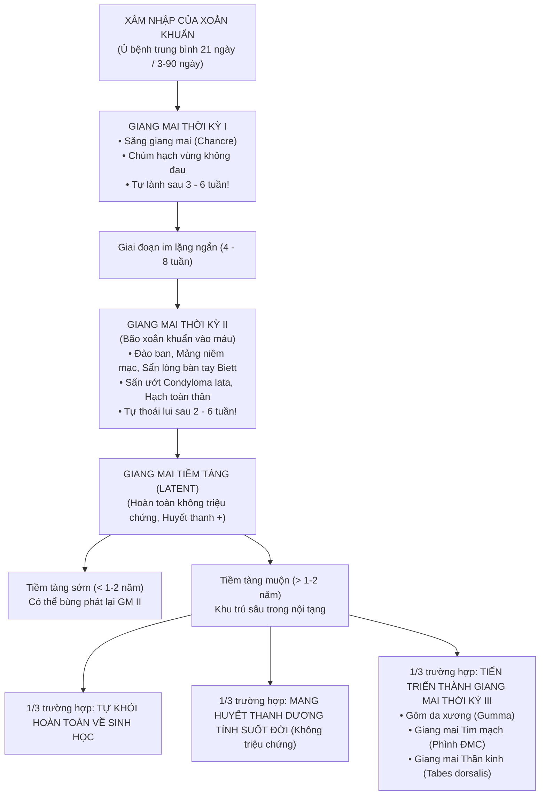

> [!IMPORTANT]
> **Đặc điểm "Lừa dối" của bệnh giang mai:**
> - Cả tổn thương Săng thời kỳ I và Ban thời kỳ II **ĐỀU CÓ KHẢ NĂNG TỰ LÀNH VÀ TỰ BIẾN MẤT HOÀN TOÀN DÙ KHÔNG CẦN ĐIỀU TRỊ GÌ CẢ**!
> - Điều này khiến người bệnh tưởng lầm là mình "đã khỏi bệnh", nhưng thực chất xoắn khuẩn không hề chết đi mà đang âm thầm chui sâu vào mạch máu, hệ thần kinh trung ương và các cơ quan nội tạng để chuẩn bị cho những đợt tàn phá khủng khiếp nhiều năm sau đó.

---

# PHẦN 2: GIANG MAI THỜI KỲ I & CHẨN ĐOÁN PHÂN BIỆT SĂNG LOÉT SINH DỤC (SLIDE 6 - 22)

## SLIDE 6 & 7: ĐẶC TÍNH LÂM SÀNG CỦA SĂNG GIANG MAI & HẠCH VÙNG
### 1. Nội dung nguyên bản trên Slide
- **Đặc tính kinh điển:** Săng (Chancre) và Hạch (Bubo).
- **Thời gian ủ bệnh:** Trung bình là **3 tuần (21 ngày)**, dao động từ 9 đến 90 ngày.
- **Đặc điểm của Săng giang mai (GM I):**
  - **Nền cứng:** Cộm cứng chắc như một mảnh bìa hoặc miếng sụn.
  - **Bề mặt bằng phẳng:** Không có bờ gờ đứng thành vách hay lõm sâu.
  - **Màu sắc:** Đỏ tươi như màu thịt tươi cá hồi, sạch sẽ, không có mủ.
  - **Cơ năng:** **HOÀN TOÀN KHÔNG NGỨA, HOÀN TOÀN KHÔNG ĐAU!**
- **Vị trí xuất hiện:**
  - *Đàn ông:* Mặt trong bao quy đầu, rãnh quy đầu, quy đầu, lỗ tiểu, thân dương vật.
  - *Đàn bà:* Môi lớn, môi nhỏ, âm hộ, âm đạo, cổ tử cung.
  - *Vị trí ngoài sinh dục:* Môi, lưỡi, amidan, vú, ngón tay, hậu môn và trực tràng (do quan hệ tình dục đường miệng hoặc hậu môn).
- **Số lượng:** Điển hình là **đơn độc 1 săng duy nhất** (chiếm 80%), đôi khi có thể có nhiều săng.

### 2. Giảng giải chuyên sâu của Giảng viên lâm sàng (BSCKII)
- **5 Đặc tính "Vàng" của Săng giang mai (Chancre) bắt buộc phải thuộc lòng:**
  1. **Hình dạng:** Tròn hoặc bầu dục, kích thước $0.5 - 2\text{ cm}$, ranh giới cực kỳ rõ nét.
  2. **Bề mặt:** Là một vết trợt nông (chỉ mất lớp biểu mô thượng bì), đáy phẳng nhẵn, màu đỏ thịt tươi bóng loáng, **tiết một lớp dịch huyết thanh trong suốt (chứa hàng triệu xoắn khuẩn)**, tuyệt đối không có dịch mủ bẩn bám đáy.
  3. **Bờ:** Nằm ngang bằng với mặt da xung quanh, mép gọn gàng, không nham nhở, không có gờ cao hình hang hốc.
  4. **Nền (Độ cứng):** Khi dùng ngón tay cái và ngón trỏ kẹp nhẹ vào đáy vết loét, ta cảm nhận rõ một **khối cộm cứng chắc như sụn khớp hoặc như một tấm bìa carton mỏng chèn dưới da** (hiện tượng xơ hóa và viêm nội mạc mạch máu thâm nhiễm tế bào tương bào - *Plasmacytic endarteritis*).
  5. **Triệu chứng cơ năng:** **KHÔNG ĐAU, KHÔNG RÁT, KHÔNG NGỨA**! Bệnh nhân vẫn sinh hoạt bình thường mà không hề hay biết (nhất là khi săng nằm khuất ở cổ tử cung phụ nữ hoặc trong lòng trực tràng).
- **Đặc điểm của Hạch giang mai (Satellite Bubo):**
  - Xuất hiện sau khi có săng từ **5 đến 7 ngày**.
  - Là chùm hạch ở vùng dẫn lưu bạch huyết tương ứng (thường là **hạch bẹn một hoặc hai bên**).
  - **Bộ 4 tính chất của hạch giang mai:**
    1. Hạch sưng to nhưng **HOÀN TOÀN KHÔNG ĐAU, KHÔNG NÓNG ĐỎ**.
    2. Hạch cứng chắc như hòn bi ve, mật độ đồng đều.
    3. Hạch di động tự do dưới da, không dính vào nhau và không dính vào mô xung quanh.
    4. **Không bao giờ hóa mủ và không bao giờ tự vỡ rò mủ** (trừ khi có bội nhiễm vi khuẩn khác).
    5. Trong chùm hạch luôn có một **"Hạch chúa" (Hạch thủ lĩnh - Leader ganglion)** to vượt trội hơn các hạch xung quanh.

---

## SLIDE 8, 9, 10 & 11: CHÙM HÌNH ẢNH LÂM SÀNG SĂNG GIANG MAI THỰC TẾ


### 1. Nội dung nguyên bản trên Slide
- Bộ sưu tập các hình ảnh lâm sàng đặc sắc của săng giang mai thời kỳ I tại các vị trí giải phẫu khác nhau.

### 2. Giảng giải chuyên sâu của Giảng viên lâm sàng (BSCKII)
- **Kỹ năng nhận diện các vị trí "Hiểm hóc":**
  - **Săng ở rãnh quy đầu và bao quy đầu (Slide 8 & 10):** Hình tròn sắc nét, đáy đỏ tươi như thịt nạc, bề mặt rỉ thanh dịch ướt bóng. Khi lộn bao quy đầu thấy mảng cộm cứng di động theo nếp da.
  - **Săng ở miệng sáo / lỗ tiểu (Slide 9):** Gây sưng nề nhẹ một bên miệng sáo, có thể tiết một ít dịch nhầy trong, dễ nhầm với viêm niệu đạo bán cấp.
  - **Săng ở Môi và Lưỡi (Slide 9 & 11):** Gặp sau khi quan hệ tình dục đường miệng (Oral sex). Môi trên hoặc môi dưới xuất hiện một vết trợt cứng, không đau, kèm theo chùm **hạch dưới hàm một bên sưng rất to** (rất hay bị bác sĩ tai mũi họng hoặc răng hàm mặt chẩn đoán nhầm thành nhiệt miệng aphthe hoại tử hoặc ung thư tế bào gai của môi!).
  - **Săng ở Hậu môn và Trực tràng (Slide 9):** Thường gặp ở nhóm MSM. Vết nứt hoặc vết trợt ở rìa hậu môn, không đau hoặc chỉ đau tức nhẹ khi đại tiện, kèm theo chùm hạch bẹn sưng to (dễ nhầm thành nứt kẽ hậu môn do trĩ).
  - **Săng ở Cổ tử cung (Slide 11):** Bệnh nhân nữ hoàn toàn không có triệu chứng, chỉ phát hiện khi bác sĩ sản phụ khoa đặt mỏ vịt khám phụ khoa thấy một vết loét tròn đỏ sạch ở mép cổ tử cung.

---

## SLIDE 12: TIẾN TRIỂN TỰ NHIÊN CỦA SĂNG GIANG MAI
### 1. Nội dung nguyên bản trên Slide
- **Nếu được điều trị đúng phác đồ Penicillin:**
  - Xoắn khuẩn giang mai biến mất hoàn toàn khỏi săng sau **24 đến 48 giờ**.
  - Săng giang mai lành sẹo hoàn toàn sau **1 đến 2 tuần**.
- **Nếu KHÔNG ĐIỀU TRỊ:**
  - Săng **tự lành tự nhiên một cách chậm chạp sau 3 đến 6 tuần**, có thể để lại một vết sẹo tăng sắc tố nhẹ hoặc không để lại dấu vết gì.
  - Xoắn khuẩn đã kịp xâm nhập vào hệ tuần hoàn máu và hệ bạch huyết toàn thân, chuẩn bị bùng phát sang **Giang mai thời kỳ II** sau 6 - 8 tuần.

### 2. Giảng giải chuyên sâu của Giảng viên lâm sàng (BSCKII)
- **Ý nghĩa sinh học:** Hiện tượng săng tự lành là do phản ứng miễn dịch tế bào tại chỗ bước đầu khống chế được số lượng xoắn khuẩn tại ổ loét nguyên phát. Tuy nhiên, khả năng miễn dịch này không đủ để tiêu diệt các xoắn khuẩn đã theo dòng máu đi khắp cơ thể.

---

## SLIDE 13 & 14: CHẨN ĐOÁN XÁC ĐỊNH GIANG MAI I BẰNG KÍNH HIỂN VI NỀN ĐEN


### 1. Nội dung nguyên bản trên Slide
- **Chẩn đoán xác định Giang mai I:**
  1. Dựa vào lâm sàng: Thời gian ủ bệnh, tính chất săng cứng không đau, tính chất hạch bẹn.
  2. **Vi trùng học (Tiêu chuẩn vàng thời kỳ I):** Cạo nhẹ bờ săng để lấy dịch thanh dịch (tránh làm chảy máu) $\rightarrow$ Đặt bệnh phẩm lên lam kính $\rightarrow$ Nhỏ 1 giọt nước muối sinh lý, đậy lamen $\rightarrow$ **Soi ngay lập tức dưới Kính hiển vi nền đen (Darkfield Microscopy)**.
  - Thấy xoắn khuẩn *Treponema pallidum* phát sáng bạc, hình lò xo di động 3 chiều uốn lượn trên nền đen tối.

### 2. Giảng giải chuyên sâu của Giảng viên lâm sàng (BSCKII)
- **Tại sao Kính hiển vi nền đen là "Tiêu chuẩn vàng" ở thời kỳ I?**
  - Trong **2 đến 3 tuần đầu tiên sau khi săng xuất hiện**, cơ thể chưa kịp sản sinh đủ lượng kháng thể chống lại xoắn khuẩn $\rightarrow$ **Xét nghiệm máu RPR / VDRL thường ÂM TÍNH (Hiện tượng âm tính huyết thanh học - Seronegative Primary Syphilis)!**
  - Do đó, nếu bác sĩ chỉ dựa vào xét nghiệm máu mà thấy RPR âm tính rồi kết luận bệnh nhân "không bị giang mai" là một SAI LẦM CHẾT NGƯỜI!
  - Lúc này, phương pháp duy nhất để xác chẩn ngay lập tức là **tìm trực tiếp xoắn khuẩn từ dịch săng bằng kính hiển vi nền đen** hoặc xét nghiệm **PCR Treponema pallidum**.

---

## SLIDE 15 ĐẾN 22: CHẨN ĐOÁN PHÂN BIỆT SĂNG GIANG MAI VỚI CÁC BỆNH LOÉT SINH DỤC KHÁC


### 1. Nội dung nguyên bản trên Slide
- **Danh mục các bệnh lý cần chẩn đoán phân biệt:**
  - Bệnh Hạ cam mềm (Chancroid do *Haemophilus ducreyi*) (Slide 16 - 17).
  - Bệnh Hột xoài sinh dục (Lymphogranuloma Venereum - LGV do *Chlamydia trachomatis*) (Slide 18 - 19).
  - Mụn rộp sinh dục (Genital Herpes do HSV-2) (Slide 20).
  - Ghẻ ở quy đầu và thân dương vật (Scabies) (Slide 21 - 22).
  - Bệnh Behcet, Hội chứng Stevens-Johnson, Loét do chấn thương cơ học.

### 2. Giảng giải chuyên sâu của Giảng viên lâm sàng (BSCKII)
- **Bảng phân tích đối chiếu 4 bệnh loét sinh dục kinh điển nhất của chuyên ngành Da liễu:**

| Tiêu chí | Săng Giang mai (Chancre) | Săng Hạ cam mềm (Chancroid) | Herpes sinh dục (Genital Herpes) | Hột xoài sinh dục (LGV) |
| :--- | :--- | :--- | :--- | :--- |
| **Tác nhân gây bệnh** | Xoắn khuẩn *Treponema pallidum* | Trực khuẩn gram âm *Haemophilus ducreyi* | Virus *Herpes simplex* (HSV-2 > HSV-1) | *Chlamydia trachomatis* chủng L1, L2, L3 |
| **Thời gian ủ bệnh** | **Dài: 3 tuần** (9 - 90 ngày) | **Ngắn: 3 - 7 ngày** (nhanh chóng) | **Rất ngắn: 2 - 7 ngày** | **1 - 4 tuần** |
| **Số lượng tổn thương** | Thường **ĐƠN ĐỘC 1 vết duy nhất** | **Nhiều ổ loét** (do tự lây nhiễm nhảy cóc - *Autoinoculation*) | **Nhiều mụn nước mọc thành chùm** rồi vỡ tạo vết trợt nông | Vết trợt nhỏ, thoáng qua, thường không được chú ý |
| **Tính chất bờ & đáy** | Bờ sắc gọn đều đặn; **Đáy sạch màu đỏ thịt tươi, nhẵn bóng** | **Bờ nham nhở, đục khoét hàm ếch**; **Đáy bẩn phủ đầy mủ vàng hoại tử** | Bờ đa cung viền đỏ; Đáy nông màu đỏ hoặc phủ vảy tiết mỏng | Vết trợt nông tự lành rất nhanh |
| **Độ cứng của nền** | **NỀN CỨNG NHƯ SỤN (Indurated)** | **NỀN HOÀN TOÀN MỀM (Soft chancre)** | Nền mềm, hơi phù nề | Nền mềm |
| **Cảm giác cơ năng** | **HOÀN TOÀN KHÔNG ĐAU!** | **ĐAU RÁT DỮ DỘI, buốt nhức** | **ĐAU RÁT BỎNG, châm chích** | Không đau hoặc đau nhẹ |
| **Đặc tính của Hạch vùng** | Chùm hạch bẹn **CỨNG, KHÔNG ĐAU, KHÔNG HÓA MỦ**, di động | Hạch bẹn **SƯNG TO ĐỎ RÁT, DÍNH CHÙM, HÓA MỦ VỠ RÒ RA DA** (*Bubo*) | Hạch bẹn nhỏ, hơi đau khi đợt cấp | **Khối hạch bẹn khổng lồ chia đôi bởi dây chằng bẹn (*Dấu rãnh rạch Groove sign*), vỡ nhiều lỗ rò mủ** |
| **Xét nghiệm xác chẩn** | Soi kính hiển vi nền đen (+), PCR, RPR/TPHA | Nhuộm Gram thấy trực khuẩn xếp hàng như "đàn cá bơi", nuôi cấy, PCR | Tzanck test thấy tế bào khổng lồ đa nhân, PCR HSV, test nhanh | Huyết thanh học Chlamydia, PCR |

---

# PHẦN 3: GIANG MAI THỜI KỲ II – "KẺ BẮT CHƯỚC VĨ ĐẠI" (SLIDE 23 - 37)

## SLIDE 23 & 24: ĐẶC TÍNH LÂM SÀNG & GIAI ĐOẠN TIỀN TRIỆU
### 1. Nội dung nguyên bản trên Slide
- **Đặc tính của Giang mai thời kỳ II (GM II):**
  - Sang thương vô cùng đa dạng: Tổn thương da, niêm mạc, hạch toàn thân, có thể kèm theo tổn thương nội tạng nhẹ (viêm gan, viêm thận, viêm màng bồ đào, viêm màng não).
  - **RẤT LÂY LAN:** Xoắn khuẩn giang mai nhân lên bùng nổ, tràn ngập trong máu và trong các tổn thương da niêm.
  - **Phản ứng huyết thanh LUÔN LUÔN DƯƠNG TÍNH 100%**, hiệu giá kháng thể cực kỳ cao.
  - Ban giang mai (Syphilids) luôn có nền hồng ban thâm nhiễm, màu đỏ đồng, không ngứa, khi lành để lại dát thâm sắc tố.
- **Thời kỳ tiền triệu trước khi phát ban (Khoảng 45 ngày sau khi có săng):**
  - Biểu hiện của tình trạng xoắn khuẩn lan tràn khắp cơ thể (*Spirochetemia*): Bệnh nhân da xanh xao, thiếu máu nhẹ, mệt mỏi toàn thân, đau nhức xương khớp nhiều về đêm, nhức đầu liên tục (do kích thích màng não), sốt nhẹ chiều tối ($37.5 - 38^\circ\text{C}$); đôi khi có đau dây thần kinh tọa.

### 2. Giảng giải chuyên sâu của Giảng viên lâm sàng (BSCKII)
- **Bản chất bệnh học của Thời kỳ II: "Cơn bão Xoắn khuẩn vào máu" (The Bacteremic Stage):**
  - Xuất hiện sau khi săng giang mai khởi phát khoảng **6 đến 8 tuần** (trung bình 45 ngày). Đôi khi săng thời kỳ I vẫn chưa kịp lành hẳn thì ban thời kỳ II đã bắt đầu bùng nổ.
  - Xoắn khuẩn giang mai phá vỡ hàng rào hạch bạch huyết vùng, ồ ạt tràn vào dòng đại tuần hoàn máu đi khắp mọi ngõ ngách cơ thể.
- **Tại sao gọi là "Kẻ bắt chước vĩ đại"?**
  - Vì ban giang mai thời kỳ II có thể bắt chước hình ảnh của: Vảy nến mảng, Vảy phấn hồng Gibert, Phát ban dị ứng thuốc, Liken phẳng, Nhiễm nấm da, Mụn trứng cá, Thủy đậu, Sùi mào gà HPV, Sốt phát ban siêu vi...
  - Tuy nhiên, dù biến hóa thiên hình vạn trạng đến đâu, ban giang mai thời kỳ II vẫn luôn mang **3 ĐẶC TÍNH ĐỘC NHẤT VÔ NHỊ CỦA BỆNH GIANG MAI**:
    1. **HOÀN TOÀN KHÔNG NGỨA (HOẶC NGỨA RẤT NHẸ):** Một phát ban đỏ rực khắp người nhưng bệnh nhân vẫn tỉnh bơ, không hề cào gãi!
    2. **MÀU ĐỎ ĐỒNG HOẶC ĐỎ GẠCH NUNG (COPPER-COLORED ERYTHEMA):** Màu sắc thâm sẫm đặc trưng do hiện tượng thâm nhiễm dày đặc tế bào tương bào (Plasma cells) và hồng cầu thoát mạch.
    3. **ƯU CHUỘNG LÒNG BÀN TAY VÀ LÒNG BÀN CHÂN:** Đây là vị trí "vàng" mà hầu hết các bệnh phát ban dị ứng hay virus đều bỏ qua!

---

## SLIDE 25, 27 & 28: MẢNG NIÊM MẠC (MUCOUS PATCHES)


### 1. Nội dung nguyên bản trên Slide
- **Đặc điểm Mảng niêm mạc (Mucous patches):**
  - Giới hạn rõ, bờ đều đặn, không đau.
  - Diễn tiến qua 3 giai đoạn: **Đỏ $\rightarrow$ Trắng đục men sứ $\rightarrow$ Sướt trợt nông**.
  - **Vị trí:** Ở mép miệng (thường bị một bên), niêm mạc má, lưỡi, vòm hầu, khẩu cái, amidan, bộ phận sinh dục và hậu môn.
  - Tiến triển: Tự biến mất sau 2 - 3 tuần dù không điều trị, nhưng rất hay tái phát.

### 2. Giảng giải chuyên sâu của Giảng viên lâm sàng (BSCKII)
- **Tổn thương lây nhiễm nguy hiểm nhất của Bệnh Giang mai:**
  - Mảng niêm mạc là nơi tập trung mật độ xoắn khuẩn giang mai sống cao nhất trên cơ thể.
  - Dưới kính hiển vi nền đen: Dịch quệt từ mảng niêm mạc chứa lúc nhúc hàng ngàn xoắn khuẩn đang uốn lượn di động.
  - **Chỉ cần một nụ hôn sâu, quan hệ tình dục đường miệng (Oral sex) hoặc dùng chung dụng cụ ăn uống/son môi** với người đang có mảng niêm mạc giang mai ở miệng là gần như **chắc chắn 100% bị lây nhiễm bệnh**!
- **Hình ảnh "Mảng xám men sứ" (Opaline plaques):**
  - Tổn thương ban đầu là một dát đỏ, sau đó lớp biểu mô niêm mạc bị thoái hóa đục ngầu lại trông giống như một vết giọt sữa đọng trên lưỡi hoặc một mảng men sứ màu trắng xám.
  - Khi lớp màng trắng này bong ra, để lại một vết trợt nông màu đỏ tươi, nhẵn bóng, không đau, rất dễ bị chẩn đoán nhầm thành nhiệt miệng Aphthe hay nấm Candida miệng.

---

## SLIDE 26: BAN ĐÀO GIANG MAI (ROSEOLA SYPHILITICA)


### 1. Nội dung nguyên bản trên Slide
- Tiêu đề: BAN ĐÀO (ROSEOLA SYPHILITICA)
- Hình ảnh các dát hồng ban màu hoa đào rải rác đối xứng ở thân mình và hai bên mạn sườn.

### 2. Giảng giải chuyên sâu của Giảng viên lâm sàng (BSCKII)
- **Đặc điểm bán học của Ban đào giang mai:**
  - Là biểu hiện sớm nhất và phổ biến nhất của giang mai thời kỳ II.
  - Gồm các dát hình tròn hoặc bầu dục kích thước $0.5 - 1.5\text{ cm}$.
  - **Màu sắc:** Màu hồng tươi nhạt như cánh hoa đào nở vào mùa xuân (*Rose-petal pink*).
  - **Ranh giới:** Ranh giới mờ nhạt, thoái biến dần hòa vào da lành.
  - Bề mặt phẳng lì ngang bằng mặt da, không cộm, không tróc vảy.
  - **Dấu hiệu ấn kính:** Khi lấy ngón tay hoặc lam kính ấn lên, **màu đỏ hoa đào biến mất hoàn toàn**; khi nhấc tay ra màu đỏ xuất hiện trở lại (chứng tỏ đây là hiện tượng dãn mao mạch trung bì đơn thuần).
- **Vị trí phân bố:**
  - Tập trung dày đặc ở **hai bên mạn sườn, vùng ngực, bụng và mặt trong cánh tay**.
  - **ĐẶC BIỆT THA BỔNG VÙNG MẶT** (rất hiếm khi xuất hiện ở mặt).
- **Tiến triển:** Ban đào tồn tại trong khoảng 2 đến 6 tuần rồi tự động nhạt dần và biến mất hoàn toàn không để lại sẹo.

---

## SLIDE 29 & 30: HẠCH TOÀN THÂN & RỤNG TÓC GIANG MAI (MOTH-EATEN ALOPECIA)


### 1. Nội dung nguyên bản trên Slide
- **Hạch giang mai II:** Luôn luôn xuất hiện, phân bố đối xứng hai bên cơ thể. Vị trí: Vùng cổ, sau tai, nách, bẹn và **khuỷu tay (Hạch ròng rọc)**. Hạch cứng chắc, di động, không đau, không bao giờ hóa mủ.
- **Rụng tóc giang mai (Alopecia syphilitica):** Rụng tóc lơ thơ, không đều, từng mảng nhỏ lởm chởm trông giống như **"Bộ lông thú bị mọt/gián gặm"** hoặc hình ảnh **"Rừng thưa"**.
- Triệu chứng toàn thân: Sốt nhẹ, mệt mỏi, sụt cân.

### 2. Giảng giải chuyên sâu của Giảng viên lâm sàng (BSCKII)
- **1. Giá trị chẩn đoán của "Hạch ròng rọc" (Epitrochlear Lymphadenopathy):**
  - Bình thường hạch ròng rọc (nằm ở rãnh trong trên khớp khuỷu tay khoảng $2 - 3\text{ cm}$) không bao giờ sờ thấy được.
  - Nếu khám thấy **hạch ròng rọc hai bên sưng to cứng chắc như hạt đỗ**, 90% gợi ý hai bệnh lý: **Giang mai thời kỳ II** hoặc **Nhiễm trùng HIV giai đoạn cấp**!
- **2. Rụng tóc kiểu "Rừng thưa / Gián gặm" (Moth-eaten Alopecia):**
  - Gặp ở khoảng 5 - 10% bệnh nhân giang mai II.
  - Tóc rụng không thành từng mảng tròn trơn nhẵn như trong Rụng tóc từng mảng (Alopecia areata), cũng không rụng đều toàn bộ như rụng tóc telogen.
  - Tóc rụng nham nhở từng lỗ chỗ nhỏ đường kính $1 - 2\text{ cm}$ tập trung nhiều ở vùng thái dương và chẩm gáy, trông nham nhở lơ thơ như một khu rừng bị đốn hạ loang lổ hoặc như một chiếc áo len bị gián gặm rách rưới.
  - Lông mày và lông mi cũng có thể rụng theo kiểu tương tự.
  - *Ý nghĩa điều trị:* **Rụng tóc giang mai KHÔNG PHẢI LÀ RỤNG TÓC SẸO**. Sau khi tiêm đủ liều Penicillin, nang tóc sẽ hồi phục hoàn toàn và tóc mọc lại dày đẹp bình thường sau 2 - 3 tháng.

---

## SLIDE 31 ĐẾN 34: BAN GIANG MAI DẠNG SẨN & DẤU ẤN LÒNG BÀN TAY BÀN CHÂN (VIỀN VẢY BIETT)


### 1. Nội dung nguyên bản trên Slide
- Tiêu đề: BAN GIANG MAI DẠNG SẨN (PAPULAR SYPHILIDS)
- Hình ảnh các sẩn màu đỏ đồng cộm chắc xuất hiện ở thân mình, mặt và đặc biệt là **Lòng bàn tay, Lòng bàn chân**.

### 2. Giảng giải chuyên sâu của Giảng viên lâm sàng (BSCKII)
- **DẤU ẤN CHẨN ĐOÁN VÀNG: VIỀN VẢY BIETT (BIETT’S COLLARETTE):**
  - Đây là triệu chứng lâm sàng đắt giá nhất của toàn bộ bài học giang mai mà mọi bác sĩ phải khắc cốt ghi tâm:
    - Khi các sẩn giang mai mọc ở vùng da dày sừng như **Lòng bàn tay và Lòng bàn chân (Palmar and Plantar Syphilids)**:
    - Sẩn có kích thước $0.5 - 1\text{ cm}$, màu **đỏ đồng, đỏ gạch hoặc nâu xỉn**, sờ vào thấy cộm cứng sâu dưới da.
    - Phần trung tâm của sẩn khô lại và tróc đi, để lại **MỘT ĐƯỜNG VIỀN VẢY TRẮNG MỎNG BAO QUANH CHÂN SẨN NHƯ MỘT CHIẾC CỔ ÁO (VIỀN VẢY BIETT - *Collarette of Biett*)**.
    - **HOÀN TOÀN KHÔNG NGỨA!**
  > [!TIP]
  > Bất kỳ một bệnh nhân trưởng thành nào bước vào phòng khám với **các nốt sẩn đỏ cộm tróc vảy ở lòng bàn tay hoặc lòng bàn chân mà KHÔNG NGỨA**, chẩn đoán số một phải nghĩ đến ngay lập tức là **GIANG MAI THỜI KỲ II** cho đến khi có bằng chứng ngược lại! Hãy cho làm xét nghiệm máu RPR và TPHA ngay lập tức.

---

## SLIDE 35, 36 & 37: CÁC THỂ ĐẶC BIỆT: CONDYLOMA LATA & GIANG MAI ÁC TÍNH (LUES MALIGNA)


### 1. Nội dung nguyên bản trên Slide
- **Các thể lâm sàng đặc biệt của Giang mai II:**
  - Ban giang mai nang lông (dạng liken, dạng mụn trứng cá).
  - Ban sắc tố: Thâm nhiễm loang lổ ở vùng cổ gáy gọi là **"Vòng cổ thần Vệ nữ" (*Collar of Venus*)**.
  - **Sẩn sùi giang mai / Sẩn ướt phì đại (Condyloma lata):** Xuất hiện ở niêm mạc và bán niêm mạc vùng nếp gấp ẩm ướt.
  - **Giang mai ác tính (Malignant Syphilis / Lues maligna):** Loét hoại tử nặng nề.

### 2. Giảng giải chuyên sâu của Giảng viên lâm sàng (BSCKII)
- **1. Sẩn ướt phì đại (Condyloma lata) – Cạm bẫy nhầm lẫn với Sùi mào gà:**
  - Ở các vùng da có độ ẩm cao và ma sát liên tục (Quanh hậu môn, nếp kẽ mông, âm hộ, bìu, bẹn), các sẩn giang mai bị ngấm dịch phì đại to ra, liên kết lại thành các **mảng sẩn sùi rộng, gờ cao**.
  - **Phân biệt sống còn giữa Condyloma Lata (Giang mai) và Condyloma Acuminata (Sùi mào gà do HPV):**

| Tiêu chí | Condyloma Lata (Sẩn sùi Giang mai II) | Condyloma Acuminata (Sùi mào gà do HPV) |
| :--- | :--- | :--- |
| **Bề mặt tổn thương** | **BỀ MẶT PHẲNG LÌ HOẶC HƠI NHẴN BÓNG, ẩm ướt rỉ dịch** | **BỀ MẶT SẦN SÙI, LỞM CHỞM GAI NHỌN NHƯ HOA SÚP LƠ / MÀO GÀ** |
| **Chân tổn thương** | **Chân đế rộng, dính chặt vào nền da cộm cứng** | **Có cuống nhỏ hoặc chân thắt hẹp** |
| **Mật độ xoắn khuẩn** | **CHỨA HÀNG TỶ XOẮN KHUẨN GIANG MAI (Cực kỳ lây lan)** | Không có xoắn khuẩn, chứa virus HPV |
| **Phản ứng huyết thanh** | **RPR và TPHA dương tính 100% với hiệu giá cực cao** | RPR âm tính (trừ khi đồng nhiễm) |

- **2. Giang mai ác tính (Lues Maligna / Malignant Syphilis - Slide 37):**
  - Là thể giang mai II tối cấp, cực kỳ nặng nề, hầu như **chỉ gặp ở bệnh nhân đồng nhiễm HIV có lượng CD4 suy giảm nghiêm trọng ($CD4 < 200/\mu\text{L}$)** hoặc người suy dinh dưỡng kiệt quệ.
  - Sang thương là các nốt sẩn cục nhanh chóng bị hoại tử loét sâu, chảy máu rỉ mủ hôi thối, bên trên đóng các lớp **vảy tiết dày cộm màu đen nhiều tầng xếp chồng lên nhau giống như vỏ hàu (*Rupioid crusts*)**. Bệnh nhân sốt cao, rét run, suy kiệt toàn thân.

---

# PHẦN 4: GIANG MAI THỜI KỲ III & GIANG MAI TIỀM TÀNG (SLIDE 38 - 41)

## SLIDE 38, 39 & 40: GIANG MAI THỜI KỲ III (TERTIARY SYPHILIS)


### 1. Nội dung nguyên bản trên Slide
- Xuất hiện rất trễ, khoảng **5 đến 20 năm sau khi mắc bệnh** ở những bệnh nhân hoàn toàn không được điều trị hoặc điều trị không đúng phác đồ.
- Ngày nay rất hiếm gặp nhờ sự phổ cập của kháng sinh Penicillin.
- Tổn thương ăn sâu xuống lớp dưới da, cơ, màng xương; tính chất phá hủy tàn khốc, không tự lành, để lại sẹo xấu co kéo dị dạng.
- Sang thương ở da, niêm mạc (Giang mai củ, Gôm), tim mạch và thần kinh.

### 2. Giảng giải chuyên sâu của Giảng viên lâm sàng (BSCKII)
- **1. Gôm giang mai (Gummas):**
  - Là tổn thương u hạt viêm mạn tính đặc trưng của thời kỳ III.
  - **Tiến triển qua 4 giai đoạn kinh điển:**
    1. *Giai đoạn cục cứng:* Xuất hiện một cục tròn cứng chắc ở dưới da hoặc niêm mạc, kích thước bằng hạt nhãn đến quả táo, không đau, da bên trên bình thường.
    2. *Giai đoạn mềm:* Sau vài tuần đến vài tháng, cục cứng mềm dần từ trung tâm lan ra ngoài, dính vào da, da bên trên chuyển màu đỏ tím.
    3. *Giai đoạn loét:* Cục mềm vỡ ra, tháo ra một chất **dịch nhầy quánh, dính, trong suốt kéo thành sợi giống như nhựa cao su hay lòng trắng trứng (Gôm)**. Lộ ra một ổ loét sâu hoắm, đáy bẩn phủ mô hoại tử màu bã đậu, bờ dựng đứng thành vách như giếng đào.
    4. *Giai đoạn sẹo:* Vết loét lành rất chậm chạp, để lại một **vết sẹo lõm dúm dó, co kéo hình ngôi sao (*Stellate scar*)**, dính chặt vào màng xương bên dưới.
  - **Hậu quả tàn phá:** Gôm ở vòm miệng ăn thủng xương khẩu cái tạo lỗ thông giữa miệng và mũi (bệnh nhân ăn uống sặc lên mũi); Gôm ở xương mũi làm tiêu hủy vách ngăn mũi, khiến sống mũi bị sập gãy hoàn toàn tạo nên hình ảnh **"Mũi yên ngựa" (Saddle nose)**.

- **2. Giang mai Tim mạch (Cardiovascular Syphilis):**
  - Xoắn khuẩn xâm nhập phá hủy các mạch máu nuôi thành động mạch chủ (*Vasa vasorum*), làm thoái hóa lớp áo giữa đàn hồi của mạch máu $\rightarrow$ Dẫn đến biến chứng chết người: **Phình động mạch chủ ngực lên (Ascending Aortic Aneurysm)** (nguy cơ vỡ phình gây tràn máu màng tim tử vong trong vài giây), Hở van động mạch chủ và Hẹp lỗ động mạch vành.

- **3. Giang mai Thần kinh (Neurosyphilis):**
  - Có thể xuất hiện ở bất kỳ giai đoạn nào, nhưng thời kỳ III biểu hiện dưới 2 bệnh cảnh thoái hóa thần kinh nặng nề:
    - **Bại liệt toàn thể (General Paresis):** Xoắn khuẩn phá hủy tế bào vỏ não gây mất trí nhớ, rối loạn nhân cách, hoang tưởng tự cao (*Megalomania*), mê sảng và sa sút trí tuệ trầm trọng.
    - **Bệnh Tabes Dorsalis (Bệnh gai tủy):** Xoắn khuẩn phá hủy các rễ sau và cột sau tủy sống $\rightarrow$ Mất cảm giác bản thể và cảm giác rung $\rightarrow$ Bệnh nhân đi đứng loạng choạng dập mạnh gót chân xuống sàn (*Sensory ataxia*); Xuất hiện các cơn đau nhói buốt như điện giật (*Lightning pains*); Phá hủy biến dạng các khớp lớn không đau (**Khớp Charcot**); và **Dấu hiệu đồng tử Argyll Robertson (Đồng tử mất hoàn toàn phản xạ co lại với ánh sáng, nhưng vẫn co lại bình thường khi nhìn vật ở gần/điều tiết quy tụ)**.

---

## SLIDE 41: GIANG MAI TIỀM TÀNG (LATENT SYPHILIS)
### 1. Nội dung nguyên bản trên Slide
- Tiêu đề: GIANG MAI TIỀM TÀNG (LATENT SYPHILIS)
- Giữa các thời kỳ I, II, III, bệnh nhân hoàn toàn không có triệu chứng lâm sàng, chỉ có phản ứng huyết thanh dương tính.
- **Chia làm 2 giai đoạn:**
  - **Giang mai tiềm tàng sớm (Early Latent Syphilis):** Nhiễm $< 1 - 2$ năm. Điều trị huyết thanh dễ trở lại âm tính.
  - **Giang mai tiềm tàng muộn (Late Latent Syphilis):** Nhiễm $> 1 - 2$ năm hoặc không xác định được thời gian nhiễm.

### 2. Giảng giải chuyên sâu của Giảng viên lâm sàng (BSCKII)
- **Tầm quan trọng của phân loại Giang mai tiềm tàng:**
  - Đây là thể bệnh chiếm số lượng đông đảo nhất tại các phòng khám da liễu hiện nay: Bệnh nhân hoàn toàn khỏe mạnh, đi khám sức khỏe tiền hôn nhân, đi hiến máu hoặc đi khám phụ khoa định kỳ tình cờ phát hiện RPR và TPHA dương tính.
  - Bác sĩ bắt buộc phải xác định bệnh nhân thuộc nhóm **Sớm** hay **Muộn** vì:
    - **Tiềm tàng sớm ($< 1$ năm theo CDC, hoặc $< 2$ năm theo WHO):** Vẫn còn nguy cơ xoắn khuẩn tái hoạt bùng phát trở lại các đợt phát ban thời kỳ II; Vẫn có khả năng lây truyền qua quan hệ tình dục; **Phác đồ điều trị chỉ cần 1 LIỀU TIÊM DUY NHẤT**.
    - **Tiềm tàng muộn ($> 1$ năm hoặc không rõ thời gian):** Hầu như không còn lây qua đường tình dục; **Phác đồ điều trị bắt buộc phải tiêm 3 LIỀU LIÊN TỤC TRONG 3 TUẦN**!

---

# PHẦN 5: CHẨN ĐOÁN HUYẾT THANH HỌC CHUYÊN SÂU & THUẬT TOÁN SÀNG LỌC

## 1. HAI NHÓM XÉT NGHIỆM HUYẾT THANH HỌC GIANG MAI (SEROLOGY)
- Xoắn khuẩn *Treponema pallidum* kích thích cơ thể sinh ra hai loại kháng thể hoàn toàn khác nhau:

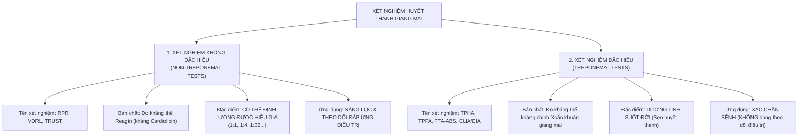

---

## 2. SO SÁNH CHI TIẾT & CÁC CẠM BẪY KỸ THUẬT (PITFALLS)

| Tiêu chí so sánh | Nhóm Không đặc hiệu (RPR / VDRL) | Nhóm Đặc hiệu (TPHA / TPPA / FTA-ABS) |
| :--- | :--- | :--- |
| **Bản chất kháng nguyên** | Kháng nguyên nhân tạo: Hỗn hợp **Cardiolipin - Lecithin - Cholesterol** | Kháng nguyên chiết xuất từ **Chính xoắn khuẩn *Treponema pallidum*** |
| **Kháng thể được đo** | Kháng thể IgM và IgG kháng Cardiolipin (sinh ra do mô tế bào bị hoại tử kết hợp vỏ xoắn khuẩn) | Kháng thể IgM và IgG kháng trực tiếp các protein bề mặt của xoắn khuẩn |
| **Độ nhạy & Độ đặc hiệu** | Độ nhạy cao trong thời kỳ II (100%), thấp hơn ở thời kỳ I (70-80%) và thời kỳ muộn | **Độ nhạy và độ đặc hiệu cực kỳ cao (> 98 - 99%)** ở mọi giai đoạn |
| **Khả năng định lượng** | **ĐỊNH LƯỢNG CHÍNH XÁC HIỆU GIÁ (Titer):** Pha loãng bậc 2 ($1:1, 1:2, 1:4, 1:8, 1:16, 1:32, 1:64, 1:128...$) | Chủ yếu trả lời Định tính (Dương tính / Âm tính) |
| **Biến thiên sau điều trị** | **HIỆU GIÁ GIẢM DẦN VÀ TRỞ VỀ ÂM TÍNH** sau khi điều trị khỏi bệnh | **DƯƠNG TÍNH SUỐT ĐỜI** ở hơn 85-90% bệnh nhân dù đã chữa khỏi 20 năm |
| **Ứng dụng lâm sàng chính** | **Đánh giá hoạt tính bệnh, theo dõi hiệu quả điều trị, phát hiện tái nhiễm** | **Xác chẩn chắc chắn bệnh nhân đã từng hoặc đang nhiễm xoắn khuẩn** |
| **Hiện tượng "Bẫy" cần nhớ** | **1. Hiện tượng tiền vùng (Prozone phenomenon)**<br>**2. Dương tính giả sinh học (BFP)** | Không dùng để phân biệt bệnh nhân đang mắc bệnh hay đã được chữa khỏi từ xưa |

---

## 3. GIẢI MÃ HAI CẠM BẪY LÂM SÀNG CỦA XÉT NGHIỆM RPR:
- **1. Hiện tượng Tiền vùng (Prozone Phenomenon) – Âm tính giả chết người:**
  - Ở bệnh nhân Giang mai thời kỳ II bùng phát rầm rộ hoặc bệnh nhân giang mai đồng nhiễm HIV, nồng độ kháng thể trong máu tăng vọt lên mức cực độ khổng lồ.
  - Khi tỷ lệ kháng thể quá thừa mứa so với lượng kháng nguyên trong giếng thử nghiệm, các phức hợp miễn dịch không thể tạo mạng lưới ngưng kết nhìn thấy được $\rightarrow$ **Máy hoặc kỹ thuật viên đọc kết quả là: "RPR ÂM TÍNH"!**
  - Trong khi đó trên lâm sàng, bệnh nhân đầy người mụn sẩn đỏ thâm và sẩn ướt lở loét!
  > [!WARNING]
  > Nếu lâm sàng nghi ngờ giang mai thời kỳ II mà xét nghiệm RPR ban đầu trả về âm tính, bác sĩ BẮT BUỘC phải yêu cầu phòng xét nghiệm: **"YÊU CẦU PHA LOÃNG HUYẾT THANH (SERUM DILUTION) ĐỂ LOẠI TRỪ HIỆN TƯỢNG PROZONE"**. Khi pha loãng mẫu máu ra $1:10$ hoặc $1:100$, kết quả sẽ lập tức ngưng kết dương tính rực rỡ với hiệu giá lên tới $1:128$ hoặc $1:256$!
- **2. Hiện tượng Dương tính giả sinh học (Biological False Positive - BFP):**
  - RPR dương tính nhưng TPHA âm tính hoàn toàn. Do cơ thể sản sinh kháng thể kháng cardiolipin trong các tình trạng bệnh lý khác:
    - *BFP cấp tính (< 6 tháng):* Phụ nữ mang thai, sau tiêm phòng vaccine, nhiễm siêu vi cấp (sởi, thủy đậu, cúm), sốt rét.
    - *BFP mạn tính (> 6 tháng):* Bệnh tự miễn (Lupus ban đỏ hệ thống SLE, Hội chứng kháng Phospholipid - APS), Bệnh Phong (Hansen), Xơ gan, Nghiện ma túy tiêm chích, Người cao tuổi (> 70 tuổi).

---

## 4. HAI THUẬT TOÁN SÀNG LỌC QUỐC TẾ (SCREENING ALGORITHMS)

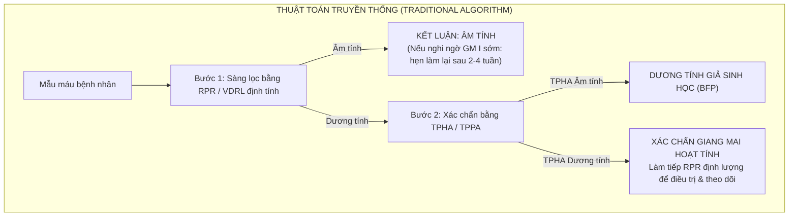

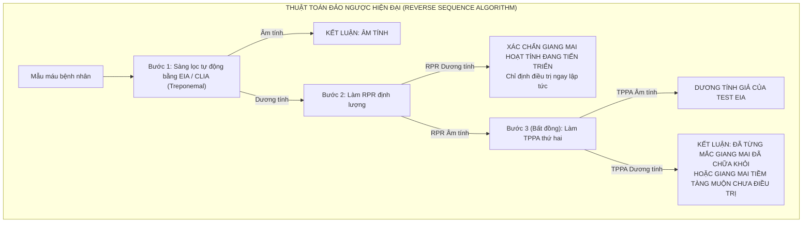

---

# PHẦN 6: PHÁC ĐỒ ĐIỀU TRỊ TOÀN DIỆN, PHẢN ỨNG JARISCH-HERXHEIMER & THEO DÕI KHỎI BỆNH (SLIDE 42 - 48)

## SLIDE 42, 43 & 44: ĐIỀU TRỊ GIANG MAI SỚM (THỜI KỲ I, II, TIỀM TÀNG SỚM)


### 1. Nội dung nguyên bản trên Slide
- **1. Điều trị tại chỗ:** Rửa và bôi thuốc sát trùng ở săng để tránh bội nhiễm (Rửa thuốc tím $1/10.000$, bôi dung dịch Milian, Xanh Methylen).
- **2. Toàn thân: GIANG MAI SỚM (GM I, GM II, GM Tiềm tàng sớm < 2 năm):**
  - **Khuyến cáo số 1 của WHO và Bộ Y tế:** **BENZATHINE PENICILLIN G: 2.4 triệu đơn vị, TIÊM BẮP SÂU 1 LIỀU DUY NHẤT (chia 2 bên mông, mỗi bên 1.2 triệu đơn vị)**.
  - Phác đồ thay thế nếu dùng Procaine Penicillin: Procaine Penicillin G 1.2 triệu đơn vị/ngày tiêm bắp liên tục trong 10 - 14 ngày.
- **Nếu DỊ ỨNG PENICILLIN (ở người không mang thai):**
  - **Doxycycline:** $100\text{ mg}$ uống 2 lần/ngày trong **14 ngày**, HOẶC
  - **Tetracycline:** $500\text{ mg}$ uống 4 lần/ngày trong 14 ngày.
- **PHỤ NỮ CÓ THAI HOẶC CHO CON BÚ:**
  - Khuyến cáo dùng **Erythromycin $500\text{ mg}$ uống 4 lần/ngày trong 14 ngày** (Tuy nhiên y văn hiện đại nhấn mạnh Erythromycin không qua được nhau thai, cần giải mẫn cảm Penicillin!).

### 2. Giảng giải chuyên sâu của Giảng viên lâm sàng (BSCKII)
- **Kỳ tích của Penicillin trong điều trị Giang mai:**
  - Hơn 80 năm kể từ ngày Fleming tìm ra Penicillin và Mahoney áp dụng điều trị giang mai lần đầu năm 1943, trong khi hàng trăm loại vi khuẩn khác đều đã kháng kháng sinh, thì **xoắn khuẩn *Treponema pallidum* VẪN NHẠY CẢM TUYỆT ĐỐI 100% VỚI PENICILLIN**!
  - Chưa từng có một ca bệnh giang mai nào trên thế giới bị kháng Penicillin.
- **Tại sao bắt buộc phải dùng BENZATHINE PENICILLIN G dạng tiêm bắp sâu?**
  - Xoắn khuẩn giang mai phân chia tế bào cực kỳ chậm chạp: **Chu kỳ phân chia kéo dài tới 30 đến 33 giờ** (trong khi tụ cầu khuẩn phân chia mỗi 20 phút).
  - Thuốc kháng sinh nhóm Beta-lactam chỉ tiêu diệt được vi khuẩn khi chúng đang trong giai đoạn phân chia vách tế bào.
  - Do đó, nguyên tắc vàng điều trị giang mai là: **Phải duy trì nồng độ Penicillin trong máu liên tục trên ngưỡng diệt khuẩn ($\ge 0.018\ \mu\text{g/mL}$) kéo dài suốt ít nhất 7 đến 10 ngày**.
  - **Benzathine Penicillin G** là dạng muối tan rất chậm. Sau khi tiêm bắp sâu, thuốc giải phóng từ từ vào máu và duy trì nồng độ diệt khuẩn ổn định kéo dài suốt **3 đến 4 tuần liên tục** chỉ bằng một mũi tiêm duy nhất!
- **Cập nhật Hướng dẫn CDC Hoa Kỳ & Bộ Y tế về Phụ nữ mang thai mắc giang mai:**
  > [!IMPORTANT]
  > **NGUYÊN TẮC BẤT DI BẤT DỊCH VỚI PHỤ NỮ MANG THAI:**
  > - **PENICILLIN LÀ THUỐC DUY NHẤT ĐƯỢC CHẤP NHẬN ĐIỀU TRỊ CHO PHỤ NỮ CÓ THAI!**
  > - Thuốc Erythromycin trong slide là phác đồ cũ của thế kỷ trước. Ngày nay các hướng dẫn quốc tế **CHỐNG CHỈ ĐỊNH DÙNG ERYTHROMYCIN** vì Erythromycin không đi qua được hàng rào nhau thai đầy đủ, mẹ có thể khỏi săng nhưng **THAI NHI VẪN BỊ GIANG MAI BẨM SINH VÀ TỬ VONG**!
  > - Tuyệt đối không dùng Doxycycline (gây đổi màu vàng vĩnh viễn men răng và ức chế phát triển xương thai nhi).
  > - **Nếu thai phụ có tiền sử dị ứng Penicillin:** Bắt buộc phải chuyển vào bệnh viện chuyên khoa để thực hiện quy trình **GIẢI MẪN CẢM PENICILLIN (Desensitization) bằng đường uống hoặc tĩnh mạch**, sau đó tiêm đủ liều Benzathine Penicillin G cho thai phụ!

---

## SLIDE 45 & 46: ĐIỀU TRỊ GIANG MAI MUỘN (TIỀM TÀNG MUỘN & THỜI KỲ III)


### 1. Nội dung nguyên bản trên Slide
- **GIANG MAI MUỘN (Tiềm tàng muộn, Giang mai III ngoại trừ thần kinh):**
  - **Khuyến cáo của WHO:** **BENZATHINE PENICILLIN G: 2.4 triệu đơn vị TIÊM BẮP MỖI TUẦN 1 LẦN $\times$ 3 TUẦN LIÊN TIẾP (Tổng liều = 7.2 triệu đơn vị)**.
  - Hoặc Procaine Penicillin G: 1.2 triệu đơn vị/ngày tiêm bắp trong 15 - 20 ngày.
- **Nếu dị ứng Penicillin (người không mang thai):**
  - **Doxycycline:** $100\text{ mg}$ uống 2 lần/ngày trong **30 ngày**, HOẶC
  - **Tetracycline:** $500\text{ mg}$ uống 4 lần/ngày trong 30 ngày.

### 2. Giảng giải chuyên sâu của Giảng viên lâm sàng (BSCKII)
- **Quy tắc tiêm nhắc lại và Bỏ liều (Missed Dose Rule):**
  - Ba mũi tiêm Benzathine Penicillin G phải được tiêm vào các mốc: **Ngày 1, Ngày 8 và Ngày 15**.
  > [!CAUTION]
  > - Ở bệnh nhân thông thường: Khoảng cách giữa 2 mũi tiêm **tối đa không được vượt quá 14 ngày**.
  > - Ở phụ nữ mang thai: Khoảng cách giữa các mũi tiêm **tối đa không được vượt quá 7 đến 9 ngày**.
  > - **Nếu bệnh nhân trễ hẹn quá thời gian trên:** Nồng độ Penicillin trong máu đã bị tụt xuống dưới ngưỡng diệt khuẩn $\rightarrow$ **TOÀN BỘ PHÁC ĐỒ BỊ HỎNG VÀ PHẢI TIÊM LẠI TỪ ĐẦU ĐỦ 3 MŨI!**

---

## SLIDE 47: ĐIỀU TRỊ GIANG MAI THẦN KINH (NEUROSYPHILIS)
### 1. Nội dung nguyên bản trên Slide
- Tiêu đề: ĐIỀU TRỊ GIANG MAI THẦN KINH
- **Phác đồ chuẩn đầu tay:**
  - **Aqueous Crystalline Penicillin G:** **18 – 24 triệu đơn vị / ngày**, chia làm $3 - 4$ triệu đơn vị tiêm tĩnh mạch mỗi 4 giờ một lần (hoặc truyền tĩnh mạch liên tục) trong **10 đến 14 ngày**.
- **Phác đồ thay thế:**
  - Procaine Penicillin G 2.4 triệu đơn vị tiêm bắp 1 lần/ngày KÈM THEO **Probenecid $500\text{ mg}$ uống 4 lần/ngày** trong 10 - 14 ngày.

### 2. Giảng giải chuyên sâu của Giảng viên lâm sàng (BSCKII)
- **Tại sao không thể dùng Benzathine Penicillin G tiêm bắp để trị Giang mai Thần kinh?**
  - Đây là câu hỏi kinh điển của các kỳ thi sau đại học!
  - Benzathine Penicillin G tiêm bắp chỉ tạo được nồng độ rất thấp trong huyết tương kéo dài, thuốc **HOÀN TOÀN KHÔNG THẤM QUA ĐƯỢC HÀNG RÀO MÁU NÃO** vào dịch não tủy!
  - Để tiêu diệt xoắn khuẩn đang ẩn náu trong nhu mô não và màng não tủy, bắt buộc phải dùng **Penicillin G tinh thể tan trong nước (Aqueous Crystalline Penicillin G)** đường tĩnh mạch liều cực cao ($18 - 24$ triệu đơn vị/ngày).
  - Vai trò của **Probenecid**: Probenecid ức chế sự bài tiết Penicillin qua ống thận, giúp giữ nồng độ Penicillin trong máu và dịch não tủy tăng vọt lên gấp nhiều lần.

---

## SLIDE 48: THEO DÕI SAU ĐIỀU TRỊ & HIỆN TƯỢNG SẸO HUYẾT THANH (SEROFAST)
### 1. Nội dung nguyên bản trên Slide
- Sau khi điều trị đủ liều, bệnh nhân bắt buộc phải tái khám lâm sàng và làm **xét nghiệm huyết thanh học định kỳ mỗi 3 tháng một lần (RPR hoặc VDRL định lượng)**.
- **Đáp ứng điều trị tốt:** Lượng kháng thể giảm dần và âm tính hóa sau **6 đến 12 tháng**.
- Nhiều trường hợp để lại **"Sẹo huyết thanh" (Serofast)**: Hiệu giá kháng thể dừng lại ở mức rất thấp (1:1, 1:2, 1:4) mà không âm tính hoàn toàn.

### 2. Giảng giải chuyên sâu của Giảng viên lâm sàng (BSCKII)
- **1. Tiêu chuẩn thành công điều trị theo CDC & Bộ Y tế (The 4-Fold Drop Rule):**
  - Thế nào là điều trị khỏi bệnh giang mai?
  - Do kháng thể đặc hiệu TPHA sẽ dương tính suốt đời, ta **CHỈ DỰA VÀO HIỆU GIÁ RPR ĐỊNH LƯỢNG**:
  > [!IMPORTANT]
  > **TIÊU CHUẨN ĐÁP ỨNG ĐIỀU TRỊ THÀNH CÔNG:**
  > - Hiệu giá kháng thể RPR định lượng phải **GIẢM ÍT NHẤT 4 LẦN (TƯƠNG ĐƯƠNG GIẢM 2 BẬC ĐỘ PHA LOÃNG)** trong vòng 6 đến 12 tháng sau điều trị.
  > - *Ví dụ minh họa:*
  >   - Trước điều trị: $\text{RPR} = 1:32$.
  >   - Sau 6 tháng: $\text{RPR}$ giảm xuống $1:8$ (giảm 4 lần = thành công), hoặc xuống $1:4$ (giảm 8 lần), hoặc âm tính hoàn toàn.
  >   - Nếu sau 6 - 12 tháng mà RPR vẫn giữ nguyên ở mức $1:32$ hoặc chỉ giảm xuống $1:16$ $\rightarrow$ **Thất bại điều trị (Treatment failure)**, cần chọc dò dịch não tủy loại trừ giang mai thần kinh và điều trị lại bằng phác đồ 3 tuần!
- **2. Hiện tượng Tái nhiễm (Reinfection):**
  - Nếu sau một thời gian đã điều trị khỏi và RPR đã giảm về mức thấp, nay xét nghiệm lại thấy **Hiệu giá RPR TĂNG VỌT TRỞ LẠI TỪ 4 LẦN TRỞ LÊN** (ví dụ từ $1:2$ tăng vọt lên $1:8$ hoặc $1:16$) $\rightarrow$ **BỆNH NHÂN ĐÃ BỊ TÁI NHIỄM XOẮN KHUẨN MỚI TỪ BẠN TÌNH**, bắt buộc phải điều trị lại từ đầu!
- **3. PHẢN ỨNG JARISCH-HERXHEIMER – CƠN BÃO NỘI ĐỘC TỐ CẦN PHÂN BIỆT VỚI DỊ ỨNG:**
  - Xảy ra ở khoảng **50 - 75% bệnh nhân giang mai thời kỳ II** và khoảng 30% giang mai thời kỳ I.
  - **Triệu chứng:** Xuất hiện đột ngột trong vòng **2 đến 8 giờ sau mũi tiêm Penicillin đầu tiên**: Bệnh nhân sốt cao rét run ($39 - 40^\circ\text{C}$), nhức đầu dữ dội, đau nhức cơ khớp, tim đập nhanh, hạ huyết áp nhẹ, và các nốt ban đỏ trên người đột nhiên nổi gồ lên rực rỡ hơn.
  - **Cơ chế:** Khi tiêm một lượng lớn Penicillin, hàng triệu xoắn khuẩn giang mai bị tiêu diệt đồng loạt, màng tế bào của chúng vỡ vụn giải phóng ồ ạt các **Lipoprotein và Nội độc tố (Endotoxin)** vào dòng máu, kích hoạt đại thực bào tiết ra cơn bão cytokine **TNF-$\alpha$, IL-6 và IL-8**.
  - **Thái độ xử trí:**
    - Cơn sốt thường tự thoái lui êm dịu sau **12 đến 24 giờ**.
    - Cho bệnh nhân nằm nghỉ ngơi, uống nhiều nước, hạ sốt bằng Paracetamol.
    - **PHẢI GIẢI THÍCH TRƯỚC CHO BỆNH NHÂN ĐỂ TRÁNH HOẢNG LOẠN:** Đây là phản ứng lành tính chứng tỏ thuốc đang tiêu diệt xoắn khuẩn rất tốt, **TUYỆT ĐỐI KHÔNG PHẢI LÀ DỊ ỨNG THUỐC PENICILLIN**!

---

# PHẦN 7: TỔNG KẾT BÀI GIẢNG: 10 NGUYÊN LÝ VÀNG & 3 TÌNH HUỐNG THỰC TẾ

## 10 NGUYÊN LÝ "VÀNG" ĐIỀU TRỊ BỆNH GIANG MAI CỦA BSCKII

1. **Bản chất săng giang mai I:** Săng tròn/oval, bờ gọn, đáy sạch màu đỏ thịt tươi, **nền cứng như sụn và HOÀN TOÀN KHÔNG ĐAU**, tự lành sau 3-6 tuần dù không chữa.
2. **Kính hiển vi nền đen:** Là tiêu chuẩn vàng chẩn đoán săng GM I trong những tuần đầu khi xét nghiệm máu RPR còn âm tính.
3. **Dấu ấn giang mai II:** Sẩn màu đỏ đồng ở **LÒNG BÀN TAY, LÒNG BÀN CHÂN với viền vảy BIETT bao quanh** và hoàn toàn không ngứa.
4. **Phân biệt Condyloma Lata:** Sẩn sùi giang mai II ở vùng hậu môn sinh dục có bề mặt phẳng, ướt át rỉ dịch và chứa đầy xoắn khuẩn; khác với Sùi mào gà do HPV có bề mặt sần sùi gai nhọn hình hoa súp lơ.
5. **Cạm bẫy Prozone:** Ở giang mai II, nồng độ kháng thể quá cao có thể gây âm tính giả RPR $\rightarrow$ Luôn yêu cầu pha loãng huyết thanh nếu lâm sàng nghi ngờ cao.
6. **Giá trị của 2 nhóm xét nghiệm:** RPR/VDRL định lượng dùng để đánh giá hoạt tính và theo dõi khỏi bệnh; TPHA/TPPA dương tính suốt đời chỉ dùng để xác chẩn.
7. **Thuốc vàng duy nhất:** **Benzathine Penicillin G** là thuốc số một; chưa từng có xoắn khuẩn giang mai nào kháng Penicillin suốt 80 năm qua.
8. **Quy tắc liều dùng:** Giang mai sớm dùng **1 liều duy nhất 2.4 triệu đơn vị tiêm bắp**; Giang mai muộn bắt buộc tiêm **3 liều liên tục trong 3 tuần** (mỗi tuần 1 liều).
9. **Cứu mạng thai nhi:** Phụ nữ mang thai mắc giang mai **bắt buộc phải điều trị bằng Penicillin**; nếu dị ứng phải giải mẫn cảm, không dùng Doxycycline hay Erythromycin.
10. **Điều trị đồng thời bạn tình:** Bắt buộc phải mời tất cả bạn tình trong vòng 90 ngày qua đến khám, làm xét nghiệm và điều trị dịch tễ đồng thời để cắt đứt chuỗi lây truyền.

---

## 3 TÌNH HUỐNG LÂM SÀNG THỰC TẾ (MINI-CASES)

### Tình huống lâm sàng 1 (Case 1 - Săng loét sinh dục thời kỳ I):
> **Bệnh sử:** Bệnh nhân nam, 26 tuổi, độc thân, đến khám vì phát hiện một vết loét ở rãnh quy đầu cách đây 1 tuần. Bệnh nhân hoàn toàn không thấy đau rát, không ngứa, tiểu tiện bình thường. Bệnh nhân thừa nhận có quan hệ tình dục không sử dụng bao cao su với bạn gái mới quen cách đây gần 1 tháng.
> 
> **Thăm khám:**
> - Rãnh quy đầu dương vật có một vết trợt hình tròn đường kính $1.2\text{ cm}$, bờ sắc gọn ngang bằng mặt da.
> - Đáy vết loét rất sạch, màu đỏ tươi như thịt nạc, rỉ thanh dịch trong, không có mủ.
> - Dùng hai ngón tay kẹp đáy vết loét thấy cộm cứng chắc như một miếng sụn nhỏ.
> - Hạch bẹn hai bên sưng to bằng hạt táo, di động tốt, sờ cứng chắc, không đau, không nóng đỏ.
> 
> **Cận lâm sàng tại chỗ:**
> - Lấy dịch thanh dịch cạo từ bờ vết loét soi dưới **Kính hiển vi nền đen**: Thấy hình ảnh nhiều xoắn khuẩn hình lò xo mảnh mai, di động xoay tròn và uốn khúc 3 chiều.
> - Xét nghiệm máu tĩnh mạch: **RPR Âm tính**, **TPHA Dương tính nhẹ**.
> 
> **Câu hỏi:**
> 1. Chẩn đoán xác định bệnh và giai đoạn của bệnh nhân?
> 2. Tại sao xét nghiệm RPR lại âm tính trong khi xoắn khuẩn đã tìm thấy trên kính hiển vi?
> 3. Phác đồ điều trị và tư vấn cụ thể cho bệnh nhân?
> 
> **Phân tích & Hướng dẫn xử trí của BSCKII:**
> - **Chẩn đoán:** **Giang mai thời kỳ I (Primary Syphilis - Săng giang mai điển hình)**.
> - **Giải thích RPR âm tính:** Đây là hiện tượng **Âm tính huyết thanh học thời kỳ đầu (Seronegative Primary Syphilis)** rất thường gặp. Săng mới xuất hiện được 1 tuần, cơ thể chưa kịp sinh đủ lượng kháng thể Reagin kháng Cardiolipin để xét nghiệm RPR kết tủa. Tuy nhiên, TPHA (kháng thể đặc hiệu) đã bắt đầu xuất hiện và soi kính hiển vi nền đen đã bắt được trực tiếp thủ phạm.
> - **Kế hoạch xử trí:**
>   1. **Tiêm bắp sâu một liều duy nhất: Benzathine Penicillin G 2.4 triệu đơn vị** (chia làm 2 ống tiêm bắp sâu hai bên mông, mỗi bên 1.2 triệu đơn vị sau khi đã thử test âm tính).
>   2. **Cảnh báo trước về Phản ứng Jarisch-Herxheimer:** Dặn bệnh nhân sau tiêm $2 - 8$ giờ có thể bị sốt cao, rét run, nhức đầu; uống Paracetamol hạ sốt và nghỉ ngơi, không phải dị ứng thuốc.
>   3. Sát trùng vết săng bằng bôi dung dịch Milian hoặc nước muối sinh lý hàng ngày. Săng sẽ lành sẹo sau 1 - 2 tuần.
>   4. **Xử trí bạn tình:** Mời bạn gái đến xét nghiệm RPR/TPHA và điều trị đồng thời.
>   5. Kiêng quan hệ tình dục cho đến khi vết săng lành hẳn và ít nhất 7 ngày sau khi tiêm thuốc.
>   6. Hẹn tái khám làm lại xét nghiệm RPR định lượng vào các tháng thứ 3, 6, 9, 12 để theo dõi.

---

### Tình huống lâm sàng 2 (Case 2 - Giang mai thời kỳ II thể sẩn lòng bàn tay):
> **Bệnh sử:** Bệnh nhân nam, 32 tuổi, đến khám tại phòng khám Da liễu vì nổi nhiều nốt sẩn đỏ ở hai lòng bàn tay và hai lòng bàn chân xuất hiện cách đây 3 tuần. Bệnh nhân than phiền ban ngày càng đỏ thâm hơn nhưng **HOÀN TOÀN KHÔNG NGỨA**. Trước đó bệnh nhân đã đi khám ở tuyến dưới, được chẩn đoán là "Viêm da tiếp xúc dị ứng" và kê đơn uống Medrol cùng thuốc bôi Corticoid nhưng không đỡ. Khai thác bệnh sử kỹ lưỡng ghi nhận cách đây khoảng 2 tháng bệnh nhân từng bị một vết trợt ở thân dương vật không đau, sau đó tự biến mất nên bệnh nhân không đi khám.
> 
> **Thăm khám:**
> - Hai lòng bàn tay và hai lòng bàn chân nổi rải rác hàng chục nốt sẩn hình tròn kích thước $0.5 - 1\text{ cm}$, màu đỏ đồng thâm cộm, sờ chắc sâu dưới da.
> - **Chính giữa các nốt sẩn có một đường viền vảy mỏng bao quanh chân sẩn (Viền vảy Biett điển hình)**.
> - Khám toàn thân thấy rải rác một vài dát đào ban mờ nhạt ở hai bên mạn sườn.
> - Khám hạch: Sờ thấy **hạch ròng rọc ở mặt trong trên cùi chỏ hai bên sưng to cứng chắc**, hạch bẹn và hạch cổ sưng đối xứng, không đau.
> 
> **Cận lâm sàng:**
> - **RPR định lượng: Dương tính mạnh với hiệu giá 1:64.**
> - **TPHA: Dương tính mạnh ($++++$).**
> - Xét nghiệm tầm soát HIV: Âm tính.
> 
> **Câu hỏi:**
> 1. Chẩn đoán xác định bệnh của bệnh nhân này?
> 2. Phân tích các đặc điểm lâm sàng kinh điển giúp bác sĩ khẳng định chẩn đoán?
> 3. Phác đồ điều trị và tiêu chuẩn theo dõi khỏi bệnh sau 6 tháng?
> 
> **Phân tích & Hướng dẫn xử trí của BSCKII:**
> - **Chẩn đoán:** **Giang mai thời kỳ II (Secondary Syphilis - Thể ban giang mai dạng sẩn ở lòng bàn tay bàn chân)**.
> - **Biện luận lâm sàng:**
>   - Tiền sử có vết loét tự lành cách đây 2 tháng $\rightarrow$ Chính là săng giang mai thời kỳ I.
>   - Sẩn màu đỏ đồng ở lòng bàn tay bàn chân kèm **Viền vảy Biett** và **HOÀN TOÀN KHÔNG NGỨA** $\rightarrow$ Dấu ấn độc quyền của Giang mai II.
>   - Hạch ròng rọc sưng to cứng không đau hai bên $\rightarrow$ Dấu hiệu chỉ điểm nhiễm trùng xoắn khuẩn toàn thân.
>   - Xét nghiệm RPR dương tính với hiệu giá rất cao ($1:64$) và TPHA dương tính mạnh giúp xác chẩn tuyệt đối 100%.
> - **Kế hoạch xử trí:**
>   1. **Điều trị đặc hiệu:** **Benzathine Penicillin G 2.4 triệu đơn vị tiêm bắp sâu liều duy nhất** (chia 2 mông).
>   2. Tư vấn phản ứng Jarisch-Herxheimer có thể xảy ra trong đêm đầu sau tiêm.
>   3. **Kế hoạch theo dõi huyết thanh học:**
>      - Hẹn bệnh nhân tái khám và xét nghiệm lại RPR định lượng sau 3 tháng, 6 tháng và 12 tháng.
>      - **Tiêu chuẩn khỏi bệnh tại mốc 6 tháng:** Hiệu giá RPR phải **giảm ít nhất 4 lần (giảm 2 bậc pha loãng)**, nghĩa là từ $1:64$ ban đầu phải **giảm xuống $\le 1:16$** (ví dụ $1:16, 1:8, 1:4$).
>      - Nếu sau 6 tháng RPR vẫn giữ ở mức $1:64$ hoặc tăng lên $\rightarrow$ Đánh giá thất bại điều trị hoặc tái nhiễm, cần chọc dò tủy sống loại trừ giang mai thần kinh.

---

### Tình huống lâm sàng 3 (Case 3 - Giang mai thai kỳ & Thách thức dị ứng Penicillin):
> **Bệnh sử:** Thai phụ, 22 tuổi, mang thai con so tuần thứ 16, đi khám thai định kỳ tại bệnh viện phụ sản. Xét nghiệm sàng lọc máu thường quy phát hiện: **RPR Dương tính với hiệu giá 1:32**, **TPHA Dương tính**. Thai phụ hoàn toàn không có triệu chứng lâm sàng ở da hay sinh dục. Khai thác tiền sử dị ứng thuốc ghi nhận: Cách đây 3 năm, sau khi tiêm bắp một mũi kháng sinh Ampicillin tại trạm y tế, thai phụ bị nổi mày đay ngứa toàn thân, sưng vều môi mắt và tụt huyết áp ngất xỉu phải tiêm Adrenaline cấp cứu (tiền sử phản vệ độ 3 với nhóm Penicillin rõ ràng).
> 
> **Câu hỏi:**
> 1. Chẩn đoán xác định bệnh và giai đoạn của thai phụ? Mối nguy hiểm cho thai nhi nếu không điều trị?
> 2. Có thể dùng Doxycycline hoặc Erythromycin để điều trị thay thế cho thai phụ này không? Tại sao?
> 3. Chiến lược xử trí tối ưu nhất để cứu cả mẹ và thai nhi là gì?
> 
> **Phân tích & Hướng dẫn xử trí của BSCKII:**
> - **Chẩn đoán:** **Giang mai tiềm tàng sớm trong thai kỳ (Early Latent Syphilis in Pregnancy)** ở thai phụ có tiền sử phản vệ với Penicillin.
> - **Nguy cơ cho thai nhi:** Xoắn khuẩn giang mai đi qua nhau thai từ tuần thứ 9 - 10, nếu không được điều trị, nguy cơ dẫn đến sảy thai muộn, thai chết lưu trong tử cung, đẻ non hoặc đứa trẻ sinh ra mắc **Giang mai bẩm sinh nặng nề** (viêm gan lách to, bọng nước lòng bàn tay chân, biến dạng xương sọ mặt) lên tới **50 - 80%**!
> - **Bác bỏ các kháng sinh thay thế:**
>   - **TUYỆT ĐỐI KHÔNG DÙNG DOXYCYCLINE:** Vì Doxycycline gây độc cho thai nhi (hỏng men răng vĩnh viễn, lắng đọng làm chậm phát triển xương dài).
>   - **KHÔNG DÙNG ERYTHROMYCIN:** Vì nồng độ Erythromycin qua hàng rào nhau thai rất kém ($< 10\%$), không thể tiêu diệt được xoắn khuẩn trong máu thai nhi.
> - **Chiến lược xử trí tối ưu duy nhất: GIẢI MẪN CẢM PENICILLIN (PENICILLIN DESENSITIZATION):**
>   1. Cho thai phụ nhập viện tại khoa Hồi sức cấp cứu / Khoa Dị ứng Miễn dịch lâm sàng phối hợp Da liễu và Sản khoa.
>   2. Chuẩn bị sẵn sàng hộp chống sốc phản vệ (Adrenaline, bóng Ambu, bộ đặt nội khí quản).
>   3. Tiến hành quy trình **Giải mẫn cảm Penicillin đường uống (Oral Desensitization Protocol)** theo phác đồ chuẩn của CDC: Cho thai phụ uống dung dịch Phenoxymethylpenicillin (Penicillin V) với các liều tăng dần gấp đôi sau mỗi 15 phút, bắt đầu từ liều cực nhỏ (100 đơn vị $\rightarrow$ 200 $\rightarrow$ 400 $\rightarrow$ ... đến khi dung nạp được tổng liều điều trị).
>   4. Ngay sau khi giải mẫn cảm thành công, tiến hành tiêm bắp ngay **Benzathine Penicillin G 2.4 triệu đơn vị** (tiêm 1 liều duy nhất cho giang mai sớm). Penicillin sẽ đi xuyên qua nhau thai và chữa khỏi hoàn toàn bệnh cho cả mẹ và thai nhi!
>   5. Theo dõi sát tim thai và cơn co tử cung trong 24 giờ đầu sau tiêm vì phản ứng Jarisch-Herxheimer có thể kích hoạt cơn co tử cung gây dọa sảy thai.

---
*(Hết giáo trình bài giảng Bệnh Giang mai - Slide 1 đến Slide 48)*


<!-- === VIRTUAL_FILE: 05_Lau_Va_Viem_Nieu_Dao_Khong_Do_Lau.md === -->

# BÀI GIẢNG CHUYÊN SÂU: LẬU VÀ VIÊM NIỆU ĐẠO KHÔNG DO LẬU
## (GONORRHEA & NON-GONOCOCCAL URETHRITIS - NGU)

**Giảng viên biên soạn & Giảng dạy lâm sàng:** Bác sĩ Chuyên khoa II Da liễu & Hoa liễu  
**Đối tượng đào tạo:** Bác sĩ Đa khoa, Học viên Sau đại học (BSNT, CKI, CKII, ThS), Bác sĩ Thực hành Lâm sàng Da liễu – Tiết niệu – Phụ sản  
**Đơn vị đào tạo:** Bộ môn Da liễu – Đại học Khoa học Sức khỏe, Đại học Quốc gia TP. Hồ Chí Minh  
**Giảng viên tài liệu nguồn:** TS.BS Phạm Văn Bắc – ThS.BS Nguyễn Thành Đạt  
**Tài liệu tham khảo đối chiếu chuẩn:**
1. *CDC Sexually Transmitted Infections Treatment Guidelines, 2021 (MMWR Recommendations and Reports)*.
2. *Fitzpatrick's Dermatology in General Medicine, 9th Edition (McGraw-Hill)*.
3. *Bolognia Dermatology, 5th Edition, 2024 (Elsevier)*.
4. *Clinical Dermatology: A Color Guide to Diagnosis and Therapy, 6th Edition (Habif)*.
5. *UpToDate: Treatment of Neisseria gonorrhoeae infection and Nongonococcal urethritis (Updated 2023–2024)*.
6. *Hướng dẫn Chẩn đoán và Điều trị các Bệnh lây truyền qua đường tình dục (STIs) – Bộ Y tế Việt Nam*.

---

## LỜI MỞ ĐẦU CỦA GIẢNG VIÊN LÂM SÀNG (BSCKII)

> *"Kính thưa các đồng nghiệp và các bạn học viên,*
>
> *Hội chứng viêm niệu đạo (Urethritis syndrome) là một trong những lý do khám bệnh phổ biến nhất tại các phòng khám Da liễu - Hoa liễu, Nam khoa và Tiết niệu trên toàn thế giới. Đứng trước một bệnh nhân nam ôm vùng hạ vị, bước đi khép nép vì đau đớn, than phiền về dòng mủ vàng ươm chảy ướt quần lót mỗi sáng sớm cùng cảm giác buốt rát như 'bỏng lửa cào xé dọc đường tiểu', người bác sĩ lâm sàng có thể chẩn đoán ngay trong vòng 30 giây: **Viêm niệu đạo cấp do Lậu cầu (Gonorrhea)**.*
>
> *Thế nhưng, bức tranh hoa liễu hiện đại không chỉ dừng lại ở những ca bệnh rầm rộ kinh điển ấy. Chúng ta đang phải đối mặt với hai thách thức dịch tễ học và điều trị to lớn:*
> 1. ***Sự trỗi dậy của 'Siêu vi khuẩn lậu' (Superbug / XDR Neisseria gonorrhoeae):*** *Xoắn xuýt trong ma trận đề kháng kháng sinh, vi khuẩn lậu đã lần lượt vô hiệu hóa Sulfamide, Penicillin, Tetracycline, Fluoroquinolone (Ciprofloxacin), và hiện nay đang thách thức thành trì Cephalosporin thế hệ 3 cũng như Macrolide (Azithromycin). Chính vì lý do này, hướng dẫn CDC 2021 đã tạo ra một 'cuộc cách mạng' khi loại bỏ hoàn toàn Azithromycin ra khỏi phác đồ đầu tay phối hợp, nâng gấp đôi liều Ceftriaxone đơn trị liệu lên 500 mg (hoặc 1g).*
> 2. ***Kẻ hủy diệt âm thầm của hệ sinh sản - Viêm niệu đạo không do lậu (NGU):*** *Chủ yếu do Chlamydia trachomatis và Mycoplasma genitalium. Nguy hiểm hơn lậu gấp bội phần ở chỗ: chúng tiến triển âm ỉ, 'lặng lẽ như một cái bóng', trên 50% ở nam và tới 80% ở nữ hoàn toàn KHÔNG CÓ TRIỆU CHỨNG. Hậu quả là người bệnh không hề hay biết để điều trị, dẫn đến thảm họa viêm vùng chậu (PID), thai ngoài tử cung, vô sinh vĩnh viễn do tắc vòi trứng ở phụ nữ, hoặc viêm mào tinh hoàn, vô sinh tắc nghẽn ở nam giới.*
>
> *Bài giảng này được thiết kế theo chuẩn mực sư phạm lâm sàng chuyên sâu nhất, đi từ từng slide bài giảng của Bộ môn, phân tích sâu cơ chế vi sinh - miễn dịch, đối chiếu hình ảnh lâm sàng vi thể thực tế, bóc tách các cạm bẫy chẩn đoán và cập nhật phác đồ kháng sinh chuẩn quốc tế CDC 2021. Chúc các đồng nghiệp có một buổi học thực sự bổ ích và làm chủ hoàn toàn mặt bệnh này trên lâm sàng!"*

---

## MỤC LỤC TỔNG QUAN BÀI HỌC

```
├── PHẦN MỞ ĐẦU: ĐẠI CƯƠNG VỀ HỘI CHỨNG TIẾT DỊCH NIỆU ĐẠO (SLIDE 1 - 2)
│   ├── Khái niệm & Định nghĩa Hội chứng Viêm niệu đạo
│   └── Phân loại nguyên nhân: Do nhiễm trùng (GU vs NGU) & Không do nhiễm trùng
│
├── PHẦN I: BỆNH LẬU (GONORRHEA) (SLIDE 3 - 17)
│   ├── Slide 3 & 4: Đặc điểm Vi sinh học & Độc lực của Neisseria gonorrhoeae
│   ├── Slide 5 & 6: Dịch tễ học, Cơ chế lây truyền & Yếu tố nguy cơ
│   ├── Slide 7 & 8: Bệnh cảnh lâm sàng ở Nam giới & Bộ ảnh tổn thương thực tế
│   ├── Slide 9: Bệnh cảnh lâm sàng ở Nữ giới - "Cạm bẫy không triệu chứng" & Viêm vùng chậu (PID)
│   ├── Slide 10, 11, 12, 13: Tiếp cận Cận lâm sàng (Soi Gram, Nuôi cấy chọn lọc, NAATs)
│   ├── Slide 14: Biến chứng toàn thân (DGI), Lậu mắt sơ sinh & Tiên lượng
│   └── Slide 15, 16, 17: Phác đồ Điều trị Chuẩn CDC 2021 & Nguyên tắc quản lý bạn tình
│
├── PHẦN II: VIÊM NIỆU ĐẠO KHÔNG DO LẬU (NGU) (SLIDE 18 - 26)
│   ├── Slide 18 & 19: Định nghĩa NGU & Ma trận căn nguyên vi sinh
│   ├── Slide 20: Vi sinh học & Chu kỳ nội bào của Chlamydia trachomatis
│   ├── Slide 21: Bệnh cảnh lâm sàng NGU & Khai thác tiền sử tình dục chuyên sâu
│   ├── Slide 22 & 23: Cận lâm sàng & Bảng so sánh giá trị các xét nghiệm chẩn đoán Chlamydia
│   ├── Slide 24: Bảng chẩn đoán phân biệt kinh điển GU vs NGU
│   ├── Slide 25: Phác đồ Điều trị NGU chuẩn CDC 2021 (Doxycycline vs Azithromycin & Kháng thuốc)
│   └── Slide 26: Quản lý bạn tình & Chiến lược Điều trị bạn tình cấp tốc (EPT)
│
├── PHẦN III: TỔNG KẾT & MỞ RỘNG ĐÀO TẠO BSCKII
│   ├── 10 Nguyên lý "Vàng" thực hành lâm sàng Viêm niệu đạo
│   └── 3 Tình huống lâm sàng thực tế (Mini-Cases) có lời giải chi tiết
```

---

## PHẦN MỞ ĐẦU: ĐẠI CƯƠNG HỘI CHỨNG VIÊM NIỆU ĐẠO (SLIDE 1 & 2)

### SLIDE 1: TIÊU ĐỀ BÀI GIẢNG


*   **Tên bài giảng:** LẬU VÀ VIÊM NIỆU ĐẠO KHÔNG DO LẬU (Gonorrhea and Non-Gonococcal Urethritis).
*   **Giảng viên biên soạn:** TS.BS Phạm Văn Bắc – ThS.BS Nguyễn Thành Đạt.
*   **Đơn vị:** Bộ môn Da liễu – Đại học Khoa học Sức khỏe, Đại học Quốc gia TP. Hồ Chí Minh.

---

### SLIDE 2: ĐẠI CƯƠNG HỘI CHỨNG TIẾT DỊCH NIỆU ĐẠO


#### 1. Nội dung nguyên văn trên Slide:
*   Viêm niệu đạo đặc trưng bởi **hội chứng tiết dịch niệu đạo**, triệu chứng gồm: tiết dịch niệu đạo, tiểu khó, ngứa ở lỗ tiểu.
*   **Nguyên nhân:** Nhiễm trùng hoặc không do nhiễm trùng.
*   Viêm niệu đạo do nhiễm trùng gồm:
    *   Do lậu: **GU** (*Gonococcal Urethritis*).
    *   Không do lậu: **NGU** (*Non-Gonococcal Urethritis*).

#### 2. Phân tích & Giảng giải chuyên sâu của BSCKII:
*   **Bản chất sinh lý bệnh của Viêm niệu đạo (Urethritis):**
    *   Niệu đạo là ống dẫn nước tiểu từ bàng quang ra ngoài cơ thể, ở nam giới còn là đường dẫn tinh dịch. Lớp niêm mạc niệu đạo gồm biểu mô chuyển tiếp (vùng niệu đạo tiền liệt tuyến), biểu mô trụ giả tầng có lông chuyển (niệu đạo màng và niệu đạo xốp), và biểu mô lát tầng không sừng hóa (vùng hố thuyền và miệng sáo).
    *   Khi tác nhân gây bệnh (vi khuẩn, ký sinh trùng hoặc kích thích vật lý/hóa học) xâm nhập và bám dính vào lớp biểu mô này, phản ứng viêm miễn dịch bùng phát: giãn mạch máu dưới niêm mạc, tăng tính thấm thành mạch, thu hút bạch cầu đa nhân trung tính (PMNs) ồ ạt xuyên mạch vào lòng niệu đạo. Quá trình thực bào, ly giải tế bào biểu mô và hoại tử tạo nên **dịch tiết niệu đạo (urethral discharge)**.
*   **Tam chứng lâm sàng kinh điển của Viêm niệu đạo:**
    1.  **Tiết dịch niệu đạo (Discharge):** Mức độ có thể từ mủ đặc ồ ạt, vàng xanh (trong lậu cấp) đến dịch nhầy trong, ít ỏi hoặc chỉ là một giọt đục dính miệng sáo buổi sáng (trong NGU).
    2.  **Tiểu khó / Tiểu buốt (Dysuria):** Cảm giác nóng rát, xót, đau buốt như dao cứa dọc thân dương vật khi dòng nước tiểu có nồng độ muối khoáng và pH toan tiếp xúc với bề mặt niêm mạc đang bị viêm loét trợt.
    3.  **Kích ứng / Ngứa ngáy lỗ sáo (Meatal pruritus):** Cảm giác ngứa ngáy, khó chịu sâu trong niệu đạo hoặc quanh miệng sáo, kích thích phản xạ muốn đi tiểu liên tục.
*   **Phân loại nguyên nhân toàn diện theo Y học thực chứng:**
    *   **Nhóm Nhiễm trùng (Infectious):**
        *   *Do lậu cầu (GU):* Do duy nhất một tác nhân là vi khuẩn *Neisseria gonorrhoeae*.
        *   *Không do lậu (NGU):* Đa tác nhân vi sinh, phổ biến nhất là *Chlamydia trachomatis* ($15 - 40\%$), *Mycoplasma genitalium* ($15 - 25\%$), *Ureaplasma urealyticum*, *Trichomonas vaginalis*, virus Herpes simplex (HSV), Adenovirus.
    *   **Nhóm Không nhiễm trùng (Non-infectious):**
        *   *Kích ứng hóa học:* Sử dụng xà phòng tắm có tính kiềm mạnh thụt rửa niệu đạo, chất bôi trơn, dung dịch diệt tinh trùng chứa Nonoxynol-9, thuốc sát trùng đưa vào đường tiểu.
        *   *Chấn thương cơ học:* Đặt ống thông tiểu (Foley catheter), tán sỏi nội soi ngược dòng, thủ dâm thô bạo, nhét dị vật vào niệu đạo (hành vi tình dục dị thường).
        *   *Bệnh tự miễn hệ thống:* Hội chứng viêm khớp phản ứng (Reactive Arthritis), bệnh Behcet, bệnh vảy nến niêm mạc.

---

## PHẦN I: BỆNH LẬU (GONORRHEA) (SLIDE 3 – 17)

### SLIDE 3: BỆNH LẬU (GONORRHEA)


---

### SLIDE 4: ĐẠI CƯƠNG VỀ TÁC NHÂN LẬU CẦU (NEISSERIA GONORRHOEAE)


#### 1. Nội dung nguyên văn trên Slide:
*   Lậu cầu (*Neisseria gonorrhoeae*): Song cầu hình hạt cà phê.
*   Bắt màu Gram (-).
*   Vi khuẩn nội bào.
*   Sức đề kháng yếu: Tồn tại 1 vài giờ khi ra khỏi cơ thể.

#### 2. Phân tích & Giảng giải chuyên sâu của BSCKII:
*   **Đặc điểm Vi sinh học & Hình thái học:**
    *   *Neisseria gonorrhoeae* là vi khuẩn hình cầu, luôn đi thành từng đôi áp sát vào nhau, mặt lõm quay vào nhau tạo thành hình ảnh đặc trưng: **Song cầu hình hạt cà phê (kidney-bean shaped diplococci)**, kích thước $0.6 - 1.0 \ \mu\text{m}$.
    *   Bắt màu thuốc nhuộm Gram âm (màu hồng hoặc đỏ), phản ứng Oxidase dương tính, Catalase dương tính.
    *   **Bản chất vi khuẩn nội bào (Intracellular pathogen):** Trên tiêu bản nhuộm Gram dịch mủ niệu đạo cấp tính, lậu cầu nằm chen chúc bên trong tế bào chất của bạch cầu đa nhân trung tính (PMNs). Một tế bào bạch cầu có thể chứa từ vài chục đến hàng trăm song cầu khuẩn. Đây là tiêu chuẩn vàng định hướng chẩn đoán tức thì.
*   **Vũ khí Độc lực học (Virulence Factors) – Cơ chế xâm lăng:**
    1.  **Pili (Nhung mao / Tua lông):** Cấu trúc sợi protein nhô ra từ bề mặt màng ngoài. Pili giúp lậu cầu bám chặt vào thụ thể CD46 trên bề mặt tế bào biểu mô niêm mạc người, chống lại phản xạ tống xuất tự nhiên của dòng nước tiểu. Đồng thời, Pili có khả năng biến đổi kháng nguyên liên tục (antigenic variation), giúp lậu cầu lẩn tránh đáp ứng miễn dịch của cơ thể (lý do cơ thể không bao giờ tạo được miễn dịch bền vững sau khi khỏi bệnh).
    2.  **PorB (Protein màng ngoài Porin):** Kênh protein xuyên màng giúp vi khuẩn xâm nhập vào tế bào biểu mô, đồng thời ức chế sự hợp nhất giữa phagosome và lysosome trong bạch cầu, ngăn cản quá trình tiêu diệt vi khuẩn của hệ miễn dịch.
    3.  **Opa (Opacity-associated proteins):** Giúp vi khuẩn gắn kết chặt chẽ vào bạch cầu và tế bào biểu mô, điều hòa quá trình thực bào và tạo điều kiện cho vi khuẩn xâm lấn sâu xuống lớp dưới niêm mạc.
    4.  **LOS (Lipooligosaccharide):** Tương tự như nội độc tố LPS ở vi khuẩn Gram âm khác nhưng chuỗi polysaccharid ngắn hơn. LOS kích hoạt thụ thể TLR4 trên đại thực bào và tế bào nội mô, phóng thích cơn bão cytokine tiền viêm ($\text{TNF}-\alpha, \text{IL}-1\beta, \text{IL}-6, \text{IL}-8$), gây hoại tử niêm mạc, kích hoạt dòng thác bổ thể và thu hút ồ ạt bạch cầu trung tính, tạo nên lượng mủ vàng ươm khổng lồ đặc trưng của bệnh lậu.
    5.  **IgA1 Protease:** Enzyme cắt đứt kháng thể tiết sIgA tại bề mặt niêm mạc sinh dục, vô hiệu hóa hàng rào bảo vệ tự nhiên tại chỗ của vật chủ.
*   **Đặc tính Đề kháng môi trường:**
    *   Lậu cầu là loại vi khuẩn cực kỳ "nhạy cảm và yếu ớt" ngoài môi trường tự nhiên. Chúng chết nhanh chóng khi tiếp xúc với không khí khô hanh, ánh nắng mặt trời, nhiệt độ $> 42^\circ\text{C}$ sau vài phút, hoặc các dung dịch sát khuẩn thông thường (cồn $70^\circ$, xà phòng, Chlorhexidine).
    *   *Ý nghĩa lâm sàng thực tế:* **Bệnh lậu gần như KHÔNG THỂ lây truyền qua các vật dụng trung gian gián tiếp** (như bồn cầu nhà vệ sinh, khăn tắm, ga trải giường, bồn tắm công cộng) trừ khi dịch mủ tươi vừa dính vào niêm mạc ngay lập tức. Bác sĩ cần giải thích rõ điều này để tránh việc bệnh nhân đổ lỗi cho việc "ngồi nhầm bồn cầu" để che giấu hành vi quan hệ tình dục không an toàn!

---

### SLIDE 5 & 6: ĐƯỜNG LÂY TRUYỀN & YẾU TỐ NGUY CƠ


#### 1. Nội dung nguyên văn trên Slide:
*   **Đường lây truyền:**
    *   **Quan hệ tình dục:**
        *   Sinh dục – Sinh dục:
            *   Nam sang nữ: $50 - 70\%$
            *   Nữ sang nam: $20\%$ (sau 1 lần QH), tăng lên $60 - 80\%$ (sau 4 lần QH).
        *   Sinh dục – Miệng.
        *   Sinh dục – Hậu môn.
    *   **Mẹ sang con:** Lây truyền trong quá trình chuyển dạ đẻ thường qua ngả âm đạo.
    *   **Vật dụng trung gian:** Cực kỳ hiếm gặp.
    *   *Nghiên cứu nhóm MSM (Sexually Transmitted Diseases, 2017):* Đánh giá mô hình lây truyền theo từng vị trí giải phẫu.
*   **Yếu tố nguy cơ (Fitzpatrick’s Dermatology, 9th edition):**
    *   QHTD với người mới hoặc có nhiều bạn tình.
    *   Hành nghề mại dâm (mại dâm nam và nữ).
    *   Nghiện rượu, lạm dụng chất ma túy / chất kích thích (Chemsex).
    *   Trình độ học vấn và điều kiện kinh tế xã hội thấp.
    *   QHTD không được bảo vệ (không dùng bao cao su nhất quán và đúng cách).
    *   QHTD với người có tiền sử mắc các bệnh STIs trước đó.

#### 2. Phân tích & Giảng giải chuyên sâu của BSCKII:
*   **Động học Dịch tễ & Xác suất lây truyền:**
    *   *Tại sao Nam sang Nữ lại dễ lây hơn ($50 - 70\%$) so với Nữ sang Nam ($20\%$ ở lần quan hệ đầu tiên)?*
        *   Về mặt giải phẫu học: Niêm mạc âm đạo và cổ tử cung có diện tích tiếp xúc rộng lớn, dịch tinh dịch chứa nồng độ lậu cầu cực cao được lưu giữ trong túi cùng âm đạo suốt nhiều giờ sau khi xuất tinh.
        *   Ở chiều ngược lại, niệu đạo nam giới chỉ tiếp xúc với dịch tiết âm đạo trong thời gian giao hợp, và phản xạ đi tiểu ngay sau khi quan hệ có tác dụng tống xuất một phần vi khuẩn ra ngoài. Tuy nhiên, nếu quan hệ lặp lại từ 4 lần trở lên với bạn tình nhiễm bệnh, nguy cơ lây truyền ở nam giới tăng vọt lên $60 - 80\%$.
*   **Các vị trí giải phẫu ngoài sinh dục – Những "ổ chứa vi khuẩn thầm lặng":**
    1.  **Lậu hầu họng (Pharyngeal Gonorrhea):**
        *   Lây truyền qua hành vi quan hệ tình dục đường miệng (Oral sex / Fellatio / Cunnilingus).
        *   **Cực kỳ nguy hiểm:** Trên $90\%$ các trường hợp lậu hầu họng **hoàn toàn không có triệu chứng** hoặc chỉ biểu hiện như viêm họng thông thường (họng hơi đỏ, đau rát nhẹ nuốt vướng). Bệnh nhân không hề biết mình mang bệnh.
        *   Họng là môi trường giàu các loài *Neisseria* hội sinh (như *N. meningitidis, N. lactamica*). Tại đây, lậu cầu thực hiện hiện tượng trao đổi gen (horizontal gene transfer) với các vi khuẩn hội sinh, tiếp nhận các gen kháng thuốc (đặc biệt là gen *penA* đột biến kháng Cephalosporin). Do đó, lậu hầu họng chính là "cái nôi sản sinh ra các chủng lậu siêu kháng thuốc"!
    2.  **Lậu trực tràng (Anorectal Gonorrhea):**
        *   Lây truyền qua quan hệ tình dục đường hậu môn (Anal sex), đặc biệt phổ biến ở nhóm MSM (nam quan hệ tình dục đồng giới).
        *   Triệu chứng: Mót rặn (tenesmus), đau rát khi đại tiện, chảy dịch mủ nhầy lẫn máu từ lỗ hậu môn, hoặc ngứa ngáy vùng quanh hậu môn. Khoảng $50\%$ ca lậu trực tràng không có triệu chứng rõ rệt.
*   **Lây truyền Mẹ sang Con – Lậu mắt trẻ sơ sinh (Ophthalmia Neonatorum):**
    *   Xảy ra khi thai nhi đi qua ống đẻ của người mẹ bị nhiễm lậu cầu chưa được điều trị. Vi khuẩn xâm nhập trực tiếp vào túi kết mạc mắt trẻ.
    *   Thời gian khởi phát rất sớm: Ngày thứ 2 đến ngày thứ 5 sau sinh. Mắt trẻ sưng húp, mi mắt phù nề căng bóng, mủ đặc vàng xanh trào ra liên tục. Nếu không xử trí khẩn cấp, enzyme của lậu cầu sẽ làm loét hoại tử giác mạc, thủng nhãn cầu và dẫn đến **mù lòa vĩnh viễn** chỉ trong vài ngày!

---

### SLIDE 7 & 8: BIỂU HIỆN LÂM SÀNG Ở NAM GIỚI & BỘ ẢNH TỔN THƯƠNG THỰC TẾ


#### 1. Nội dung nguyên văn trên Slide:
*   **Thời gian ủ bệnh:** 2 – 8 ngày (trung bình 3 – 5 ngày).
*   **Tỷ lệ không triệu chứng:** Chỉ khoảng $10\%$ (đa số $90\%$ nam giới đều có triệu chứng rầm rộ).
*   **Biểu hiện chủ yếu là viêm niệu đạo cấp:**
    *   Dịch mủ vàng xanh, loãng sau đặc dần, số lượng nhiều chảy tự nhiên ra từ lỗ tiểu.
    *   Niệu đạo đau buốt, rát bỏng dữ dội khi đi tiểu.
    *   Lỗ sáo sưng to, tấy đỏ, phù nề.
    *   Dấu hiệu **“Bull head clap”**: Toàn bộ quy đầu và dương vật sưng to, phù nề, đau đớn.
*   **Triệu chứng trong những đợt tái phát hoặc bán cấp:** Cảm giác nhột như có kiến bò trong niệu đạo, tiểu mủ nhẹ, **dấu hiệu giọt đục buổi sáng (Morning drop)** ở miệng sáo.
*   **Biểu hiện ngoài niệu đạo:** Sưng đau tinh hoàn / mào tinh hoàn, viêm trực tràng, viêm hầu họng.

#### 2. Phân tích & Giảng giải chuyên sâu của BSCKII:
*   **Bán chứng học Viêm niệu đạo Lậu cấp ở Nam giới:**
    *   *Khởi phát:* Rất đột ngột. Sau một cuộc "quan hệ trăng hoa" không an toàn khoảng 3 – 5 ngày, bệnh nhân thức dậy với cảm giác nóng rát, châm chích ở đầu dương vật.
    *   *Dòng mủ kinh điển:* Mủ lậu cấp tính ở nam giới có đặc tính vô cùng độc đáo: số lượng cực kỳ nhiều, chảy tràn trề ra miệng sáo làm bẩn quần lót. Mủ có màu vàng hoặc vàng xanh đục, đặc quánh như sữa đặc hoặc kem, mùi tanh nồng. Bệnh nhân thường phải dùng bông gạc hoặc giấy vệ sinh bịt đầu dương vật.
    *   *Tiểu buốt rát (Dysuria):* Bệnh nhân mô tả mỗi lần đi tiểu là một "cực hình", đau buốt như có "mảnh chai hay dao cạo rạch dọc theo niệu đạo". Tia nước tiểu yếu, ngắt quãng vì phản xạ co thắt cơ vòng do đau.
    *   *Hình ảnh "Bull head clap":* Viêm nhiễm lan tỏa ra vùng rãnh quy đầu và bao quy đầu gây phù nề mọng nước, đỏ rực, dương vật sưng to biến dạng giống như đầu con bò mộng.
*   **Dấu hiệu "Giọt đục buổi sáng" (Morning Drop / Goutte Militaire):**
    *   Khi bệnh nhân không được điều trị đúng cách hoặc dùng kháng sinh liều thấp không đủ diệt khuẩn, bệnh chuyển sang giai đoạn bán cấp hoặc mạn tính.
    *   Lượng mủ ban ngày giảm đi do dòng nước tiểu rửa trôi. Tuy nhiên, sau một đêm dài ngủ từ 6 – 8 tiếng không đi tiểu, dịch tiết viêm và xác bạch cầu tích tụ lại dọc niệu đạo, đọng lại tại hố thuyền. Sáng sớm thức dậy, trước khi đi tiểu bãi đầu tiên, bệnh nhân thấy một giọt mủ màu trắng đục dính chặt làm bít tắc hai mép miệng sáo.
*   **Biến chứng sinh dục nam nguy hiểm:**
    1.  **Viêm mào tinh hoàn – Tinh hoàn (Epididymo-orchitis):**
        *   Xảy ra khi vi khuẩn lậu đi ngược dòng từ niệu đạo sau qua ống dẫn tinh đến mào tinh hoàn.
        *   Lâm sàng: Bệnh nhân sốt cao, rét run, một bên bìu sưng to gấp 2 – 3 lần bình thường, da bìu đỏ rực, căng bóng mất nếp nhăn. Sờ vào mào tinh hoàn bệnh nhân đau chói nảy người.
        *   *Nghiệm pháp Prehn dương tính:* Khi bác sĩ dùng tay nâng nhẹ tinh hoàn bên đau lên trên hướng về phía khớp háng, bệnh nhân cảm thấy **đỡ đau hơn** (giúp phân biệt với tình trạng **Xoắn tinh hoàn** - trong xoắn tinh hoàn, nghiệm pháp Prehn âm tính, nâng lên càng đau dữ dội hơn).
        *   Di chứng: Xơ hóa và tắc nghẽn ống dẫn tinh hai bên $\rightarrow$ Vô sinh nam do bế tắc đường dẫn tinh.
    2.  **Viêm tuyến tiền liệt cấp (Acute Prostatitis):**
        *   Sốt cao, đau buốt vùng tầng sinh môn (đáy chậu), đau tăng khi ngồi ghế cứng hoặc khi đại tiện. Thăm trực tràng thấy tuyến tiền liệt sưng to, nóng, mềm và cực kỳ đau đớn (chống chỉ định xoa bóp tuyến tiền liệt vì nguy cơ gây nhiễm trùng huyết).
    3.  **Hẹp niệu đạo (Urethral stricture):**
        *   Biến chứng muộn sau nhiều năm. Quá trình viêm loét sâu phá hủy thể xốp niệu đạo, tạo thành mô sẹo xơ co rút. Bệnh nhân tiểu khó mạn tính, tia tiểu nhỏ như sợi chỉ, rặn tiểu mệt mỏi, dẫn đến ứ nước thận và suy thận mạn.

---

### SLIDE 9: BIỂU HIỆN LÂM SÀNG Ở NỮ GIỚI – "CẠM BẪY KHÔNG TRIỆU CHỨNG"


#### 1. Nội dung nguyên văn trên Slide:
*   **Thời gian ủ bệnh:** Khoảng 10 ngày (dao động từ 5 – 14 ngày).
*   **Đặc điểm dịch tễ nguy hiểm:** **$50\%$ phụ nữ nhiễm lậu cầu hoàn toàn KHÔNG CÓ TRIỆU CHỨNG** (theo nhiều y văn quốc tế, con số này có thể lên tới $70 - 80\%$).
*   **Biểu hiện lâm sàng:**
    *   Tiết dịch âm đạo bất thường: dịch mủ nhầy màu vàng xanh, hôi.
    *   Ngứa rát âm hộ, tầng sinh môn.
    *   Tiểu gắt, tiểu buốt, tiểu nhiều lần.
*   **Viêm các tuyến phụ trợ sinh dục:**
    *   Viêm tuyến Bartholin: Tuyến sưng to, đau nhức dữ dội ở môi lớn.
    *   Viêm tuyến Skene: Miệng tuyến sưng đỏ, ấn vào thấy mủ chảy ra.
*   **Viêm vùng chậu (PID - Pelvic Inflammatory Disease) chiếm $10 - 40\%$:**
    *   Sốt, đau âm ỉ hoặc dữ dội vùng bụng dưới (hạ vị).
    *   Đau lưng, nôn ói.
    *   Xuất huyết âm đạo bất thường (đặc biệt sau khi giao hợp).
    *   Khám phụ khoa: Đau nhức dữ dội khi lắc cổ tử cung và sờ nắn hai phần phụ.
*   **Biểu hiện ngoài sinh dục:** Viêm trực tràng, viêm hầu họng.
*   **Cảnh báo:** Nếu không được phát hiện và điều trị kịp thời, nguy cơ biến chứng để lại di chứng vĩnh viễn là cực kỳ cao.

#### 2. Phân tích & Giảng giải chuyên sâu của BSCKII:
*   **Giải mã "Cạm bẫy không triệu chứng" ở Nữ giới:**
    *   Vị trí nhiễm trùng ban đầu chủ yếu của lậu cầu ở phụ nữ là **biểu mô trụ của ống cổ tử cung (Endocervix)** và **biểu mô niệu đạo**.
    *   Ống cổ tử cung không có nhiều sợi thần kinh cảm giác đau thể thể (somatic sensory nerves) như niệu đạo nam giới, do đó quá trình viêm mủ tại đây thường chỉ gây tiết dịch nhầy mủ mà không gây đau đớn rõ rệt. Phụ nữ thường nhầm lẫn dịch tiết bệnh lý này với "huyết trắng sinh lý" hoặc viêm âm đạo do nấm thông thường, dẫn đến việc bỏ sót chẩn đoán suốt nhiều tuần hoặc nhiều tháng.
*   **Khám lâm sàng Cổ tử cung & Dấu hiệu chỉ điểm:**
    *   Đặt mỏ vịt quan sát: Cổ tử cung phù nề, xung huyết đỏ rực, dễ bở và rất dễ chảy máu khi quệt tăm bông (cervical friability).
    *   Từ lỗ cổ tử cung chảy ra một dòng dịch mủ nhầy màu vàng đặc hoặc vàng xanh (Mucopurulent cervicitis).
*   **Áp-xe Tuyến Bartholin do Lậu:**
    *   Tuyến Bartholin nằm ở vị trí 4 giờ và 8 giờ ở 1/3 dưới môi lớn. Khi lậu cầu làm bít tắc ống tuyến, dịch mủ ứ đọng tạo thành khối áp xe to bằng quả trứng chim cút hoặc quả mận. Khối này căng bóng, cực kỳ đau nhức, bệnh nhân đau đến mức không thể khép chân hay ngồi được, phải đi lại dạng chân. Xử trí bắt buộc phải rạch dẫn lưu mủ và mở thông túi tuyến (marsupialization) kết hợp kháng sinh toàn thân.
*   **Thảm họa Viêm Vùng Chậu (PID) & Di chứng:**
    *   Vi khuẩn lậu di chuyển ngược dòng qua buồng tử cung lên vòi trứng và buồng trứng, gây viêm vòi trứng mủ cấp (Salpingitis), áp-xe phần phụ (Tubo-ovarian abscess) và viêm phúc mạc tiểu khung.
    *   **Dấu hiệu "Lắc cổ tử cung đau" (Cervical Motion Tenderness - Chandelier Sign):** Khi bác sĩ đưa hai ngón tay vào âm đạo và đẩy nhẹ cổ tử cung sang hai bên, bệnh nhân đau chói dữ dội đến mức muốn "nhảy dựng lên bám vào chùm đèn trần nhà" (*Chandelier sign*).
    *   **Hậu quả lâu dài của PID:**
        1.  *Thai ngoài tử cung:* Quá trình viêm làm rụng lớp lông chuyển biểu mô vòi trứng và tạo các dải xơ dính làm hẹp lòng vòi trứng. Trứng sau khi thụ tinh không thể di chuyển về buồng tử cung mà làm tổ ngay tại vòi trứng $\rightarrow$ Nguy cơ vỡ vòi trứng xuất huyết nội đe dọa tính mạng tăng gấp 6 – 10 lần!
        2.  *Vô sinh do tắc vòi trứng (Tubal factor infertility):* Tỷ lệ vô sinh sau 1 đợt PID là khoảng $12\%$, sau 2 đợt tăng lên $23\%$, và sau 3 đợt lên tới trên $50\%$!
        3.  *Hội chứng Fitz-Hugh-Curtis (Viêm quanh gan):* Vi khuẩn lậu hoặc Chlamydia theo rãnh đại tràng phải lan lên tầng trên ổ bụng, gây viêm bao gan (Perihepatitis). Bệnh nhân đau nhói hạ sườn phải tăng khi hít sâu (rất dễ chẩn đoán nhầm với viêm túi mật cấp hoặc viêm gan cấp). Khi nội soi ổ bụng quan sát thấy hình ảnh đặc trưng: **Các dải dính xơ giữa mặt trước gan và thành bụng trước trông như những sợi dây đàn violin (Violin-string adhesions)**.

---

### SLIDE 10, 11, 12 & 13: TIẾP CẬN CẬN LÂM SÀNG & CHẨN ĐOÁN VI SINH


#### 1. Nội dung nguyên văn trên Slide:
*   **Ba trụ cột cận lâm sàng:**
    1.  Nhuộm Gram dịch niệu đạo.
    2.  Cấy vi khuẩn.
    3.  Kỹ thuật khuếch đại axit nucleic (NAATs).
*   **Nhuộm Gram (Bolognia 5th, 2024):**
    *   Giúp chẩn đoán ngay lập tức, đặc biệt ở người có triệu chứng.
    *   Dịch tiết niệu đạo nhuộm Gram phát hiện từ **$95\%$ đến $98\%$** ở nam giới; phết tế bào cổ tử cung có độ nhạy khoảng **$50\%$**.
    *   Nhuộm Gram âm tính không thể loại trừ nhiễm trùng ở bệnh nhân không có triệu chứng.
*   **Nuôi cấy (Bolognia 5th, 2024):**
    *   Được coi là **tiêu chuẩn vàng** để chẩn đoán nhiễm trùng lậu cầu.
    *   Độ nhạy $80 - 95\%$ đối với mẫu bộ phận sinh dục; ngoài vùng sinh dục độ nhạy thấp hơn như vùng trực tràng ($< 50\%$).
    *   Độ đặc hiệu của nuôi cấy $\sim 95 - 100\%$ khi phân lập từ vùng sinh dục.
*   **Kỹ thuật khuếch đại axit nucleic (NAATs - Bolognia 5th, 2024):**
    *   Độ nhạy, độ đặc hiệu rất cao ($> 95 - 99\%$), nhạy hơn nhiều so với nuôi cấy đối với vị trí ngoài sinh dục và khi nhiễm trùng không triệu chứng; không cần vi khuẩn sống.
    *   Có thể phát hiện đồng thời nhiễm trùng *Chlamydia trachomatis* mà không cần lấy thêm mẫu.
    *   Bất lợi: Không khảo sát được độ nhạy cảm kháng sinh (kháng sinh đồ), chi phí đắt tiền.

#### 2. Phân tích & Giảng giải chuyên sâu của BSCKII:
*   **Kỹ thuật Nhuộm Gram – Đọc tiêu bản dưới lăng kính Chuyên gia:**
    *   *Quy trình lấy mẫu chuẩn:* Ở nam giới, dùng tăm bông chuyên dụng đưa sâu vào niệu đạo trước khoảng 1 – 2 cm, xoay nhẹ để thu thập tế bào biểu mô và mủ. Tốt nhất lấy mẫu trước khi bệnh nhân đi tiểu ít nhất 2 giờ.
    *   *Tiêu chuẩn chẩn đoán dương tính:* Quan sát dưới kính hiển vi quang học độ phóng đại $1000\times$ (vật kính dầu), thấy **song cầu hình hạt cà phê bắt màu hồng Gram âm nằm BÊN TRONG bào tương của bạch cầu đa nhân trung tính (Intracellular Gram-negative diplococci - IC-GND)**.
    *   *Bẫy lâm sàng:* Nếu chỉ thấy song cầu Gram âm nằm NGOÀI tế bào bạch cầu (extracellular diplococci) $\rightarrow$ Chưa đủ tiêu chuẩn khẳng định lậu, kết quả được đọc là "Nghi ngờ" (Equivocal), có thể do vi khuẩn hội sinh khác thuộc chi *Moraxella* hoặc *Acinetobacter*. Bắt buộc phải làm thêm NAATs hoặc nuôi cấy.
    *   *Tại sao độ nhạy ở cổ tử cung chỉ đạt $50\%$?* Do cổ tử cung có rất nhiều vi khuẩn Gram âm hội sinh khác và vi khuẩn kỵ khí tạo hình ảnh đa tạp; đồng thời nồng độ lậu cầu ở cổ tử cung có thể thấp hơn nhiều so với mủ niệu đạo nam. Vì vậy, **ở phụ nữ nghi ngờ nhiễm lậu, KHÔNG BAO GIỜ được phép dựa vào nhuộm Gram âm tính để kết luận bệnh nhân không mắc bệnh**!
*   **Nuôi cấy vi khuẩn & Vai trò độc tôn của Kháng sinh đồ:**
    *   *Môi trường chọn lọc:* Môi trường Thayer-Martin cải tiến hoặc New York City (NYC) medium. Đây là môi trường thạch sô-cô-la có bổ sung hỗn hợp kháng sinh ức chế tạp khuẩn (Vancomycin diệt Gram dương, Colistin diệt Gram âm đường ruột, Nystatin diệt vi nấm, Trimethoprim diệt *Proteus*).
    *   *Khí trường nuôi cấy:* Vi khuẩn lậu là loại vi khuẩn hiếu khí nghiêm ngặt nhưng đòi hỏi tăng cường $3 - 5\% \ \text{CO}_2$ và độ ẩm cao ở $35 - 37^\circ\text{C}$.
    *   *Giá trị không thể thay thế:* Dù NAATs rất nhanh và nhạy, nhưng **nuôi cấy là phương pháp DUY NHẤT giúp phân lập được vi khuẩn sống để làm Kháng sinh đồ (Antimicrobial Susceptibility Testing - AST)**. Trong kỷ nguyên vi khuẩn lậu kháng Cephalosporin và Azithromycin lan rộng, nuôi cấy đóng vai trò sống còn trong việc giám sát dịch tễ học kháng thuốc của quốc gia và điều trị các ca lậu kháng thuốc thất bại với phác đồ chuẩn.
*   **NAATs (Nucleic Acid Amplification Tests) – Tiêu chuẩn vàng hiện đại:**
    *   Nguyên lý: Sử dụng kỹ thuật PCR (Polymerase Chain Reaction) hoặc TMA (Transcription-Mediated Amplification) để khuếch đại các đoạn gen đặc hiệu của *N. gonorrhoeae* (như gen *porA, 16S rRNA*).
    *   *Ưu thế vượt trội:*
        1.  Có thể lấy bệnh phẩm không xâm lấn: **Nước tiểu đầu dòng (First-catch urine - FCU)** ở nam giới (bệnh nhân chỉ cần đi tiểu 10 – 20 ml nước tiểu đầu tiên vào lọ vô trùng mà không cần ngoáy tăm bông vào niệu đạo gây đau đớn).
        2.  Cực kỳ nhạy bén tại các vị trí ngoài sinh dục (phết họng, phết trực tràng).
        3.  Độ nhạy $> 98\%$ ngay cả trên bệnh nhân hoàn toàn không có triệu chứng.

---

### SLIDE 14: BIẾN CHỨNG, TIÊN LƯỢNG & NHIỄM LẬU LAN TỎA (DGI)


#### 1. Nội dung nguyên văn trên Slide:
*   Vô sinh, thai ngoài tử cung.
*   Lậu mắt ở trẻ sơ sinh nếu không điều trị sớm dẫn tới mù mắt.
*   **Nhiễm lậu lan tỏa (DGI - Disseminated Gonococcal Infection):** Tổn thương khớp, viêm màng não, viêm nội tâm mạc.
*   **Tiên lượng:** Kết quả rất tốt nếu được chẩn đoán và điều trị kịp thời với kháng sinh phù hợp.

#### 2. Phân tích & Giảng giải chuyên sâu của BSCKII:
*   **Cơ chế bệnh sinh của Nhiễm lậu lan tỏa (DGI):**
    *   Chiếm khoảng $0.5 - 3\%$ tổng số bệnh nhân nhiễm lậu. Xảy ra khi các chủng lậu cầu mang kiểu hình đề kháng với tác dụng diệt khuẩn của huyết thanh người (thường liên quan đến biến thể protein màng ngoài PorB1a và đột biến gen tổng hợp LOS) xâm nhập trực tiếp vào dòng máu.
    *   Yếu tố nguy cơ cao: Nữ giới (đặc biệt trong giai đoạn hành kinh hoặc mang thai do thay đổi nội tiết và mạch máu), người suy giảm miễn dịch, đặc biệt là người **thiếu hụt các thành phần bổ thể giai đoạn cuối (C5, C6, C7, C8, C9)**.
*   **Lâm sàng Hội chứng DGI – Hai thể bệnh kinh điển:**
    1.  **Thể Viêm bao gân - Viêm da - Đa đau khớp (Tenosynovitis - Dermatitis - Polyarthralgia syndrome):**
        *   *Viêm bao gân (Tenosynovitis):* Rất đặc trưng, thường viêm đồng thời nhiều bao gân ở mu bàn tay, ngón tay, cổ tay, cổ chân và gân gót Achilles. Bệnh nhân đau nhức dữ dội, sưng đỏ dọc theo đường đi của gân.
        *   *Tổn thương da (Dermatitis):* Xuất hiện các dát hồng ban nhanh chóng tiến triển thành **mụn nước, mụn mủ có trung tâm hoại tử xuất huyết trên nền da đỏ (hemorrhagic pustules on an erythematous base)**. Số lượng thường ít (dưới 30 thương tổn), phân bố rải rác ở đầu chi (ngón tay, ngón chân, cẳng tay).
        *   *Đau đa khớp di chuyển:* Đau nhức các khớp nhỡ và lớn (cổ tay, khuỷu tay, khớp gối, cổ chân) nhưng không tràn dịch mủ khớp.
    2.  **Thể Viêm một khớp sinh mủ (Purulent Septic Arthritis):**
        *   Thường xảy ra sau thể viêm bao gân vài ngày hoặc khởi phát độc lập.
        *   Thường khu trú ở **một khớp lớn duy nhất** (phổ biến nhất là khớp gối, chiếm $> 50\%$, tiếp đến là khớp cổ chân, cổ tay). Khớp sưng to căng mọng, nóng rực, tràn dịch mủ lượng nhiều, bệnh nhân đau đớn mất hoàn toàn vận động. Chọc dò dịch khớp thấy dịch mủ đục ngầu, lượng bạch cầu cực cao ($> 50.000 / \text{mm}^3$).
*   **Biến chứng ác tính đe dọa sinh mạng:**
    *   *Viêm nội tâm mạc do lậu (Gonococcal Endocarditis):* Thường phá hủy van động mạch chủ rất nhanh chóng, gây suy tim cấp và tử vong nếu không phẫu thuật thay van cấp cứu.
    *   *Viêm màng não mủ do lậu (Gonococcal Meningitis):* Biểu hiện hội chứng màng não cấp tính, hôn mê.

---

### SLIDE 15, 16 & 17: PHÁC ĐỒ ĐIỀU TRỊ CHUẨN CDC 2021 & NGUYÊN TẮC QUẢN LÝ


#### 1. Nội dung nguyên văn trên Slide:
*   **Điều trị đầu tay viêm niệu đạo do lậu (CDC 2021):**
    *   Áp dụng cho nhiễm lậu không biến chứng ở niêm mạc cổ tử cung, niệu đạo, trực tràng.
*   **Điều trị thay thế (CDC 2021):**
    *   Khi không có sẵn thuốc tiêm Ceftriaxone hoặc bệnh nhân dị ứng kháng sinh.
*   **Nguyên tắc điều trị (Slide 17):**
    *   Người mắc bệnh lậu cần **kiêng quan hệ tình dục ít nhất 7 ngày sau điều trị** và cho đến khi bạn tình cũng được điều trị đầy đủ và hết triệu chứng.
    *   Xét nghiệm tầm soát các bệnh lây truyền qua đường tình dục khác (HIV, Giang mai, Viêm gan B/C).
    *   **Bạn tình nên được điều trị đồng thời**.

#### 2. Phân tích & Bóc tách Bảng Phác đồ CDC 2021 của BSCKII:

##### BẢNG 1: PHÁC ĐỒ ĐIỀU TRỊ LẬU KHÔNG BIẾN CHỨNG (NIỆU ĐẠO, CỔ TỬ CUNG, TRỰC TRÀNG) - CDC 2021

| Phân loại phác đồ | Thuốc & Liều lượng chi tiết | Hướng dẫn lâm sàng & Phối hợp thuốc |
| :--- | :--- | :--- |
| **LỰA CHỌN ĐẦU TAY**<br>*(Recommended Regimen)* | **Ceftriaxone 500 mg** tiêm bắp sâu (IM) **1 liều duy nhất**.<br>*(Đối với bệnh nhân có cân nặng $\ge 150 \ \text{kg}$: Dùng liều **Ceftriaxone 1 g IM** 1 liều duy nhất)*. | **QUY TẮC PHỐI HỢP CHLAMYDIA:**<br>Nếu **chưa loại trừ** được đồng nhiễm *Chlamydia trachomatis* (chưa có kết quả xét nghiệm âm tính) $\rightarrow$ **Bắt buộc phối hợp thêm:**<br>👉 **Doxycycline 100 mg uống 2 lần/ngày trong 7 ngày**.<br>*(Nếu bệnh nhân có thai: Thay Doxycycline bằng Azithromycin 1 g uống 1 liều duy nhất)*. |
| **THAY THẾ (Khi không có Ceftriaxone)**<br>*(Alternative if Ceftriaxone unavailable)* | **Cefixime 800 mg** đường uống **1 liều duy nhất**.<br>*(Uống 2 viên 400 mg cùng lúc)*. | Phải uống kèm **Doxycycline 100 mg x 2 lần/ngày x 7 ngày** nếu chưa loại trừ Chlamydia.<br>*Lưu ý:* Cefixime hiệu quả kém hơn Ceftriaxone trên lậu hầu họng. |
| **DỊ ỨNG NẶNG CEPHALOSPORIN**<br>*(Phản vệ, phù mạch, hoại tử SCARs)* | **Gentamicin 240 mg** tiêm bắp sâu (IM) 1 liều duy nhất<br>***PLUS***<br>**Azithromycin 2 g** đường uống 1 liều duy nhất. | Phác đồ cứu cánh duy nhất khi dị ứng Cephalosporin. Bệnh nhân có thể buồn nôn, nôn nhiều do uống liều cao Azithromycin 2g (nên cho uống thuốc chống nôn trước 30 phút). |

> [!IMPORTANT]
> **BƯỚC NGOẶT LỊCH SỬ CỦA PHÁC ĐỒ CDC 2021 – TẠI SAO BỎ AZITHROMYCIN 1G?**
> *   Trước năm 2020, phác đồ kinh điển của CDC là liệu pháp kép: *Ceftriaxone 250 mg IM + Azithromycin 1 g uống*.
> *   Tuy nhiên, các dữ liệu giám sát vi sinh toàn cầu (GISP) cho thấy:
>     1.  Tỷ lệ vi khuẩn lậu đề kháng với Azithromycin tăng vọt từ $0.6\%$ lên gần $5\%$ chỉ trong vài năm.
>     2.  Nghiêm trọng hơn, việc lạm dụng Azithromycin 1g liều duy nhất đã thúc đẩy chủng *Mycoplasma genitalium* đồng nhiễm đột biến kháng nhóm Macrolide với tốc độ chóng mặt ($> 60 - 80\%$).
>     3.  Đồng thời, nồng độ ức chế tối thiểu (MIC) của Ceftriaxone đối với lậu cầu đang có xu hướng nhích dần lên.
> *   Do đó, CDC 2021 quyết định: **Nâng gấp đôi liều Ceftriaxone từ 250 mg lên 500 mg** (và 1g cho người béo phì) để đảm bảo nồng độ thuốc trong máu vượt xa ngưỡng MIC của các chủng lậu giảm nhạy cảm; đồng thời **loại bỏ Azithromycin** và thay thế bằng **Doxycycline 100 mg x 2 lần/ngày x 7 ngày** để kiểm soát Chlamydia!

##### BẢNG 2: ĐIỀU TRỊ LẬU TẠI CÁC VỊ TRÍ ĐẶC BIỆT

*   **Lậu Hầu Họng (Pharyngeal Gonorrhea):**
    *   *Khuyến cáo duy nhất:* **Ceftriaxone 500 mg IM 1 liều duy nhất** (+ Doxycycline 7 ngày nếu chưa loại trừ Chlamydia).
    *   *Lưu ý:* Cefixime đường uống thấm vào mô amidan và họng rất kém, tỷ lệ thất bại điều trị lậu hầu họng bằng Cefixime lên tới $20\%$. Nếu bệnh nhân dị ứng Cephalosporin mắc lậu họng, bắt buộc phải hội chẩn chuyên gia truyền nhiễm.
*   **Nhiễm Lậu Lan Tỏa (DGI):**
    *   **Ceftriaxone 1 g tiêm bắp hoặc tiêm tĩnh mạch mỗi 24 giờ**, điều trị kéo dài tối thiểu 7 ngày.
    *   Khi triệu chứng lâm sàng cải thiện sau 24 – 48 giờ, có thể chuyển sang kháng sinh đường uống dựa trên kết quả kháng sinh đồ.

---

## PHẦN II: VIÊM NIỆU ĐẠO KHÔNG DO LẬU (NGU) (SLIDE 18 – 26)

### SLIDE 18 & 19: ĐỊNH NGHĨA NGU & MA TRẬN CĂN NGUYÊN VI SINH


#### 1. Nội dung nguyên văn trên Slide:
*   **Nguyên nhân:**
    *   Biểu hiện lâm sàng rất giống viêm niệu đạo do lậu.
    *   Cần chẩn đoán phân biệt với GU vì **phác đồ điều trị hoàn toàn khác nhau**.
    *   ***Chlamydia trachomatis* là tác nhân thường gặp nhất**.

#### 2. Phân tích & Giảng giải chuyên sâu của BSCKII:
*   **Định nghĩa Viêm niệu đạo không do lậu (Nongonococcal Urethritis - NGU):**
    *   NGU là tình trạng viêm của niệu đạo được đặc trưng bởi sự xuất hiện của các tế bào bạch cầu đa nhân trung tính (tình trạng viêm) mà **hoàn toàn KHÔNG tìm thấy bằng chứng của vi khuẩn *Neisseria gonorrhoeae*** qua soi tươi, nhuộm Gram, nuôi cấy hay xét nghiệm phân tử.
*   **Ma trận Căn nguyên Vi sinh gây NGU (Etiology Matrix):**

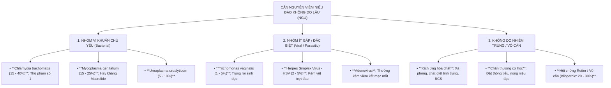


*   **Tại sao phân biệt GU và NGU là mệnh lệnh sống còn?**
    *   Kháng sinh điều trị lậu cầu hàng đầu là Cephalosporin (Ceftriaxone), loại kháng sinh này **hoàn toàn KHÔNG CÓ HIỆU QUẢ** đối với *Chlamydia trachomatis* và *Mycoplasma genitalium* (vì Chlamydia và Mycoplasma là vi khuẩn ký sinh nội bào, Mycoplasma thậm chí không có vách tế bào peptidoglycan để kháng sinh nhóm Beta-lactam tác dụng).
    *   Ngược lại, kháng sinh điều trị NGU (Doxycycline) lại không đủ mạnh và có tỷ lệ kháng thuốc rất cao nếu dùng đơn trị liệu đối với lậu cầu. Nếu chẩn đoán nhầm hoặc điều trị lệch hướng, bệnh nhân sẽ không khỏi, dẫn đến tái phát, biến chứng xơ hẹp niệu đạo và lây truyền lan rộng trong cộng đồng.

---

### SLIDE 20: VI SINH HỌC CHLAMYDIA TRACHOMATIS


#### 1. Nội dung nguyên văn trên Slide:
*   Tác nhân nhiễm khuẩn lây qua đường tình dục phổ biến hàng đầu.
*   Số ca mắc cao nhất ở lứa tuổi **thanh thiếu niên và người trẻ trưởng thành có hoạt động tình dục ($< 25$ tuổi)**.
*   **Mầm bệnh nội tế bào** $\rightarrow$ Xét nghiệm chẩn đoán khó khăn và đắt tiền.
*   Nhiều trường hợp **hoàn toàn không có triệu chứng**.

#### 2. Phân tích & Giảng giải chuyên sâu của BSCKII:
*   **Đặc tính Sinh học Độc đáo – Kẻ ký sinh nội bào bắt buộc:**
    *   *Chlamydia trachomatis* là vi khuẩn Gram âm có kích thước cực kỳ nhỏ bé ($0.25 - 1 \ \mu\text{m}$), nhỏ hơn hầu hết các vi khuẩn thông thường khác, trước đây từng bị nhầm là virus.
    *   Chúng là **vi khuẩn ký sinh nội bào tuyệt đối (Obligate intracellular bacteria)**. Do thiếu các enzyme chuyển hóa năng lượng chủ chốt, *C. trachomatis* không thể tự tổng hợp được ATP mà phải "ăn cắp" ATP của tế bào biểu mô vật chủ để sống sót và nhân đôi.
*   **Chu kỳ nhân lên hai giai đoạn kỳ diệu (Biphasic Life Cycle):**
    1.  **Thể cơ bản (Elementary Body - EB):** Kích thước nhỏ ($0.3 \ \mu\text{m}$), có vách tế bào liên kết chéo bằng cầu nối disulfide rất vững chắc, trơ về mặt chuyển hóa nhưng **có khả năng lây nhiễm**. EB tồn tại ngoài tế bào, gắn vào thụ thể trên bề mặt tế bào biểu mô trụ niêm mạc và được tế bào đưa vào trong qua cơ chế nhập bào (endocytosis).
    2.  **Thể lưới (Reticulate Body - RB):** Sau khi vào trong hốc bào tương (phagosome), EB biến đổi thành thể lưới (RB) có kích thước lớn hơn ($1 \ \mu\text{m}$). RB hoạt động chuyển hóa mạnh mẽ, sử dụng năng lượng của tế bào chủ để phân đôi liên tục tạo thành một bọc chứa hàng ngàn vi khuẩn (gọi là thể vùi - Chlamydial inclusion). Sau 48 – 72 giờ, các RB cô đặc lại để tái biến đổi thành thể cơ bản (EB), làm vỡ tung tế bào vật chủ để giải phóng hàng loạt EB ra ngoài tiếp tục xâm lấn các tế bào lân cận.
*   **Phân loại Serovars theo biểu hiện lâm sàng:**
    *   *Serovars A, B, Ba, C:* Gây bệnh **Mắt hột (Trachoma)** – nguyên nhân gây mù lòa hàng đầu ở các nước kém phát triển.
    *   *Serovars D đến K:* Gây **Nhiễm trùng đường sinh dục – tiết niệu (STIs)**: Viêm niệu đạo, viêm cổ tử cung, viêm mào tinh hoàn, viêm vùng chậu PID, viêm kết mạc vùi ở trẻ sơ sinh.
    *   *Serovars L1, L2, L3:* Gây bệnh **U lympho hạt sinh dục (Lymphogranuloma Venereum - LGV)**: Loét sinh dục kèm hội chứng sưng hạch bẹn rò mủ hình "hào nước bẹn" (Groove sign) và viêm trực tràng hoại tử.

---

### SLIDE 21: BỆNH CẢNH LÂM SÀNG NGU & KHAI THÁC TIỀN SỬ CHUYÊN SÂU


#### 1. Nội dung nguyên văn trên Slide:
*   **Hỏi bệnh sử chuyên sâu:**
    *   Biện pháp tránh thai đang áp dụng.
    *   Tuổi quan hệ tình dục lần đầu.
    *   Số lượng bạn tình trong quá khứ và hiện tại.
    *   Thói quen và hành vi giao hợp (miệng, âm đạo, hậu môn).
    *   Chu kỳ kinh nguyệt, ngày kinh cuối.
    *   Tiền sử đặt sonde tiểu, can thiệp thủ thuật đường niệu.
    *   Tiền sử các bệnh nhiễm khuẩn đường tình dục trước đây.
*   **Triệu chứng lâm sàng của viêm niệu đạo:**
    *   Thời gian ủ bệnh.
    *   Tiết dịch niệu đạo.
    *   Tiểu khó (tiểu buốt, tiểu rắt).
    *   Đau tinh hoàn / mào tinh hoàn.
*   **Triệu chứng toàn thân:** Hiếm gặp; có thể sốt, ớn lạnh, nôn ói... trong các trường hợp có biến chứng nặng lan tỏa.

#### 2. Phân tích & Giảng giải chuyên sâu của BSCKII:
*   **Bán chứng học Lâm sàng của NGU – Âm thầm nhưng dai dẳng:**
    *   *Thời gian ủ bệnh:* Kéo dài hơn lậu rất nhiều, thường từ **1 đến 3 tuần (7 – 21 ngày)**, thậm chí có thể kéo dài tới vài tháng.
    *   *Khởi phát:* Từ từ, âm thầm. Bệnh nhân không bị đau đớn dữ dội như lậu mà thường chỉ cảm thấy:
        *   Cảm giác nhột, ngứa ran hoặc buồn buồn khó tả như "có kiến bò sâu trong niệu đạo".
        *   Tiểu hơi rát buốt nhẹ, cảm giác xót khi nước tiểu đi qua miệng sáo vào buổi sáng.
    *   *Tính chất dịch tiết:* Khác hẳn dòng mủ ồ ạt của lậu, dịch trong NGU **số lượng rất ít, dịch nhầy, trong hoặc màu trắng đục như nước vo gạo**. Nhiều khi ban ngày bệnh nhân không thấy dịch chảy ra, chỉ thấy miệng sáo hơi bóng ướt, hoặc thấy hai mép miệng sáo bị dính lại vào buổi sáng thức dậy.
*   **Biến chứng Viêm khớp phản ứng (Reactive Arthritis / Hội chứng Reiter):**
    *   Xảy ra ở khoảng $1 - 2\%$ bệnh nhân mắc NGU do Chlamydia, có liên quan mật thiết với kháng nguyên bạch cầu **HLA-B27** (gặp ở $> 80\%$ bệnh nhân).
    *   **Tam chứng lâm sàng kinh điển:**
        1.  *Viêm niệu đạo không do lậu (Urethritis):* Khởi đầu đợt bệnh.
        2.  *Viêm kết mạc mắt (Conjunctivitis):* Đỏ mắt hai bên, đổ ghèn, không loét giác mạc.
        3.  *Viêm đa khớp không đối xứng (Arthritis):* Thường viêm các khớp lớn chịu lực ở chi dưới (khớp gối, cổ chân, ngón chân hình khúc dồi - Dactylitis), viêm điểm bám gân gót Achilles (Enthesitis).
    *   *Tổn thương da đặc hiệu của Hội chứng Reiter:*
        *   **Balanitis circinata (Viêm quy đầu hình vòng):** Các vết trợt nông hình tròn hoặc đa cung viền trắng trên quy đầu.
        *   **Keratoderma blennorrhagica:** Các sẩn và mụn mủ tăng sừng sùi dày màu vàng nâu ở lòng bàn tay, lòng bàn chân trông giống hệt như vảy nến thể mủ.

---

### SLIDE 22 & 23: CẬN LÂM SÀNG & BẢNG ĐÁNH GIÁ CÁC PHƯƠNG PHÁP XÉT NGHIỆM


#### 1. Nội dung nguyên văn trên Slide:
*   **Các kỹ thuật cận lâm sàng (Slide 22):**
    *   Soi tươi: Tìm *Trichomonas vaginalis* (trùng roi sinh dục di động), nấm *Candida albicans*, Amip (*E. histolytica*).
    *   Test nhanh kháng nguyên: *Chlamydia trachomatis*.
    *   PCR: *Chlamydia trachomatis, Mycoplasma genitalium, Ureaplasma urealyticum*.
    *   NAAT test: Phát hiện đồng thời *C. trachomatis* và *N. gonorrhoeae*.
*   **Bảng đánh giá giá trị các test chẩn đoán *Chlamydia trachomatis* (Slide 23):**
    *   *Trích dẫn nguồn:* UpToDate 2023 & CDC MMWR 2021.

| Phương pháp xét nghiệm | Độ nhạy (Sensitivity) | Độ đặc hiệu (Specificity) | Vai trò lâm sàng hiện nay |
| :--- | :--- | :--- | :--- |
| **NAATs** (PCR, TMA) | **$90 - 95\%$** | **$98 - 100\%$** | **Tiêu chuẩn vàng (Gold standard)** được khuyến cáo hàng đầu. |
| **Nuôi cấy tế bào** (Cell Culture) | $50 - 85\%$ | $\sim 100\%$ | Ít dùng trên lâm sàng, chủ yếu phục vụ nghiên cứu & giá trị pháp lý. |
| **DFA** (Miễn dịch huỳnh quang) | $50 - 85\%$ | $90 - 99\%$ | Hạn chế, chỉ dùng thay thế tạm thời khi không có hệ thống NAATs. |
| **EIA / Test nhanh kháng nguyên** | $40 - 70\%$ | $90 - 95\%$ | Hiện nay ít dùng do tỷ lệ âm tính giả quá cao. |
| **Soi tươi / Nhuộm Gram** | Rất thấp ($0\%$) | Rất thấp | Chỉ có giá trị khẳng định tình trạng viêm niệu đạo, không thể tìm thấy Chlamydia. |

#### 2. Phân tích & Giảng giải chuyên sâu của BSCKII:
*   **Tiêu chuẩn chẩn đoán xác định Hội chứng Viêm niệu đạo trên Cận lâm sàng:**
    *   Theo hướng dẫn chuẩn của CDC, để khẳng định một bệnh nhân có viêm niệu đạo (trước khi định danh vi khuẩn), bệnh nhân phải thỏa mãn **ít nhất 1 trong 4 tiêu chuẩn khách quan** sau:
        1.  Dịch tiết niệu đạo nhuộm Gram thấy **$\ge 2$ tế bào bạch cầu đa nhân trung tính (PMNs)** trên mỗi vi trường quang học dầu độ phóng đại cao ($1000\times$).
        2.  Mẫu nước tiểu đầu dòng ly tâm soi cặn thấy **$\ge 10$ tế bào bạch cầu đa nhân trung tính** trên mỗi vi trường ($400\times$).
        3.  Que thử nhanh nước tiểu đầu dòng dương tính với men **Leukocyte Esterase** (chứng tỏ có sự hiện diện của bạch cầu).
        4.  Dịch tiết niệu đạo có mủ hoặc nhầy mủ quan sát thấy rõ khi thăm khám lâm sàng.
*   **Tại sao Nhuộm Gram KHÔNG THỂ phát hiện được Chlamydia?**
    *   Vì *Chlamydia trachomatis* là vi khuẩn nội bào có kích thước cực nhỏ, lớp vách peptidoglycan rất mỏng hoặc thiếu hụt hoàn toàn các liên kết muramic acid thông thường, do đó chúng không bắt màu thuốc nhuộm Gram. Dưới kính hiển vi quang học, bạn chỉ thấy các cụm bạch cầu đa nhân mà không thấy bất kỳ vi khuẩn nào $\rightarrow$ Hình ảnh này gợi ý mạnh mẽ đến NGU!
*   **Kỹ thuật lấy mẫu Nước tiểu đầu dòng (First-Catch Urine - FCU) chuẩn xác:**
    *   Đây là bước cực kỳ quan trọng quyết định độ chính xác của xét nghiệm NAATs Chlamydia/Lậu:
        *   Bệnh nhân **phải nhịn tiểu ít nhất 1 đến 2 giờ** trước khi lấy mẫu (tốt nhất là nước tiểu đầu tiên vào buổi sáng).
        *   Thu thập chính xác **$10 - 20 \ \text{ml}$ dòng nước tiểu đầu tiên** vào lọ vô trùng (tuyệt đối không lấy nước tiểu giữa dòng như xét nghiệm cấy nước tiểu thông thường, vì mục đích của chúng ta là "rửa trôi" các tế bào biểu mô niệu đạo bị nhiễm vi khuẩn vào mẫu xét nghiệm).

---

### SLIDE 24: BẢNG SO SÁNH CHẨN ĐOÁN PHÂN BIỆT GU VÀ NGU


#### 1. Nội dung nguyên văn trên Slide:
*   *Trích dẫn nguồn:* Clinical Dermatology: A Color Guide to Diagnosis and Therapy 6th Edition, Chapter 10.

| Đặc tính lâm sàng | Viêm niệu đạo không do lậu (NGU) | Viêm niệu đạo do lậu (GU) |
| :--- | :--- | :--- |
| **Thời gian ủ bệnh** | Dài: **7 – 28 ngày** (trung bình 2 – 3 tuần) | Ngắn: **3 – 5 ngày** (dao động 2 – 8 ngày) |
| **Tính chất khởi phát** | Từ từ, âm thầm, mơ hồ | Đột ngột, rầm rộ, cấp tính |
| **Mức độ tiểu khó** | Hơi đau rát, ngứa buốt nhẹ | Rát bỏng dữ dội như dao rạch |
| **Tính chất dịch tiết** | Số lượng ít, chất nhầy trong hoặc trắng đục | Số lượng nhiều, mủ đặc vàng hoặc vàng xanh |
| **Nhuộm Gram dịch tiết** | Thấy nhiều bạch cầu đa nhân, **không thấy vi khuẩn** | **Song cầu Gram âm hình hạt cà phê nội bào** |

#### 2. Mở rộng Bảng Đối chiếu Đa chiều của BSCKII:

| Tiêu chí so sánh | Viêm niệu đạo do Lậu (GU) | Viêm niệu đạo không do Lậu (NGU) |
| :--- | :--- | :--- |
| **Tác nhân chính** | *Neisseria gonorrhoeae* | *Chlamydia trachomatis, M. genitalium, Ureaplasma* |
| **Thời gian ủ bệnh** | Ngắn (2 – 5 ngày) | Dài (1 – 3 tuần hoặc cả tháng) |
| **Khởi phát** | Đột ngột, dữ dội | Từ từ, âm ỉ |
| **Tiểu buốt** | Bỏng rát như thiêu đốt | Nhột buốt nhẹ, ngứa sâu niệu đạo |
| **Dịch tiết miệng sáo** | Mủ đặc vàng xanh, tràn trề | Dịch nhầy trong hoặc đục, ít giọt buổi sáng |
| **Khám lỗ sáo** | Sưng nề, đỏ rực như miệng cá chuối | Bình thường hoặc hơi đỏ nhẹ ở mép |
| **Tỷ lệ không triệu chứng** | Nam: $10\%$; Nữ: $50 - 70\%$ | Nam: $50\%$; Nữ: $> 80\%$ |
| **Soi nhuộm Gram** | Song cầu Gram (-) nội bào bạch cầu | Chỉ thấy $\ge 2$ bạch cầu/vi trường, không có vi khuẩn |
| **Biến chứng toàn thân** | DGI (viêm bao gân, mụn mủ hoại tử, viêm khớp) | Hội chứng Reiter (HLA-B27: viêm mắt, viêm khớp, sừng hóa) |
| **Kháng sinh đầu tay** | **Ceftriaxone 500 mg IM** 1 liều duy nhất | **Doxycycline 100 mg x 2 lần/ngày x 7 ngày** |

---

### SLIDE 25: PHÁC ĐỒ ĐIỀU TRỊ NGU CHUẨN CDC 2021


#### 1. Phân tích & Bóc tách Phác đồ NGU theo Khuyến cáo Mới nhất:

##### BẢNG 3: PHÁC ĐỒ ĐIỀU TRỊ VIÊM NIỆU ĐẠO KHÔNG DO LẬU (CDC 2021)

| Phân loại | Thuốc & Liều lượng chi tiết | Cơ chế tác dụng & Đánh giá lâm sàng |
| :--- | :--- | :--- |
| **PHÁC ĐỒ ƯU TIÊN**<br>*(Recommended Regimen)* | **Doxycycline 100 mg**<br>Uống **2 lần/ngày trong 7 ngày liên tục**.<br>*(Uống sau ăn no với một cốc nước đầy, giữ tư thế đứng/ngồi 30 phút)*. | **Hiệu quả diệt *Chlamydia trachomatis* đạt $95 - 98\%$** ở cả đường sinh dục và trực tràng. Ít gây đột biến kháng thuốc trên *M. genitalium* hơn Azithromycin. |
| **PHÁC ĐỒ THAY THẾ**<br>*(Alternative Regimens)* | **Azithromycin 1 g** uống 1 liều duy nhất.<br>*(HOẶC Azithromycin 500 mg ngày đầu, sau đó 250 mg x 1 lần/ngày x 4 ngày tiếp theo)*. | Chỉ dùng khi bệnh nhân không dung nạp Doxycycline hoặc không thể tuân thủ uống thuốc 7 ngày. **Hiệu quả kém hơn trên Chlamydia trực tràng** ($~80\%$). |

> [!CAUTION]
> **TẠI SAO AZITHROMYCIN 1G BỊ "GIÁNG CHỨC" XUỐNG HÀNG THAY THẾ TRONG NGU?**
> *   Trong các hướng dẫn trước năm 2015, *Azithromycin 1g liều duy nhất* là "vua" trong điều trị NGU nhờ tính tiện lợi (uống 1 lần duy nhất tại phòng khám).
> *   Tuy nhiên, các thử nghiệm lâm sàng ngẫu nhiên mù đôi (RCT) gần đây chỉ ra rằng:
>     1.  Đối với nhiễm *C. trachomatis* ở trực tràng (rất phổ biến ở MSM và phụ nữ có quan hệ ngả sau), tỷ lệ thất bại điều trị của Azithromycin 1g lên tới **$20 - 25\%$**, trong khi Doxycycline 7 ngày đạt hiệu quả khỏi bệnh $> 95\%$.
>     2.  Kinh hoàng hơn, với tác nhân **Mycoplasma genitalium** (chiếm 1/4 số ca NGU), việc sử dụng Azithromycin liều duy nhất 1g là nguyên nhân trực tiếp chọn lọc ra các chủng đột biến gen *23S rRNA*, khiến tỷ lệ kháng Macrolide của *M. genitalium* tăng vọt lên **$60 - 80\%$** tại nhiều nước!
> *   Vì vậy, CDC 2021 đã chính thức đưa **Doxycycline 100mg x 2 lần/ngày x 7 ngày trở thành LỰA CHỌN ĐẦU TAY DUY NHẤT**!

##### BẢNG 4: PHÁC ĐỒ ĐIỀU TRỊ NGU DAI DẲNG HOẶC TÁI PHÁT (RECURRENT / PERSISTENT NGU)

Nếu bệnh nhân đã uống hết phác đồ Doxycycline 7 ngày nhưng triệu chứng tiểu buốt hoặc tiết dịch niệu đạo vẫn còn trơ trơ (hoặc tái phát ngay sau khi ngưng thuốc):
1.  **Bước 1:** Đánh giá sự tuân thủ uống thuốc của bệnh nhân và kiểm tra xem bệnh nhân có quan hệ tình dục không bảo vệ với bạn tình chưa được điều trị không (tái nhiễm).
2.  **Bước 2:** Nếu đã tuân thủ tốt và không tái nhiễm $\rightarrow$ Thủ phạm hàng đầu là ***Mycoplasma genitalium*** hoặc ***Trichomonas vaginalis***:
    *   **Nếu có xét nghiệm định danh *Mycoplasma genitalium*:**
        *   *Chủng nhạy cảm với Macrolide:* Doxycycline 100 mg x 2 lần/ngày x 7 ngày, sau đó nối tiếp ngay bằng **Azithromycin 1 g ngày đầu, tiếp theo 500 mg x 1 lần/ngày x 3 ngày tiếp theo** (tổng liều Azithromycin 2.5g).
        *   *Chủng kháng Macrolide (hoặc không làm được test kháng thuốc):* Doxycycline 100 mg x 2 lần/ngày x 7 ngày, sau đó nối tiếp ngay bằng **Moxifloxacin 400 mg uống 1 lần/ngày trong 7 ngày**.
    *   **Nếu nghi ngờ hoặc phát hiện *Trichomonas vaginalis*:**
        *   **Metronidazole 500 mg uống 2 lần/ngày trong 7 ngày** (hoặc Tinidazole 2 g uống 1 liều duy nhất).

---

### SLIDE 26: QUẢN LÝ BẠN TÌNH & PHÒNG NGỪA TÁI NHIỄM


#### 1. Nội dung nguyên văn trên Slide:
*   **Nguyên tắc mốc thời gian 60 ngày:**
    *   Tất cả bạn tình có quan hệ tình dục trong vòng **$< 60$ ngày** trước khi người bệnh khởi phát triệu chứng hoặc trước khi được chẩn đoán $\rightarrow$ Cần được đánh giá lâm sàng, xét nghiệm và điều trị dự phòng ngay lập tức.
    *   Nếu lần quan hệ tình dục cuối cùng đã diễn ra **$> 60$ ngày** trước đó $\rightarrow$ Bạn tình gần nhất vẫn nên được điều trị.
*   **Phác đồ điều trị khuyến cáo cho bạn tình:**
    *   **Cefixime 800 mg** đường uống 1 liều duy nhất.
    *   Nếu không loại trừ nhiễm Chlamydia: Uống thêm **Doxycycline 100 mg x 2 lần/ngày trong 7 ngày**.
*   **Nguyên tắc kiêng cữ tình dục:**
    *   Để tránh tái nhiễm chéo kiểu "bóng bàn" (Ping-pong infection), người bệnh và bạn tình **bắt buộc phải kiêng quan hệ tình dục hoàn toàn trong vòng 7 ngày** sau khi cả hai đã hoàn tất đủ liều thuốc điều trị và toàn bộ triệu chứng lâm sàng đã biến mất hoàn toàn.

#### 2. Phân tích & Giảng giải chuyên sâu của BSCKII:
*   **Khái niệm "Hiệu ứng bóng bàn" (Ping-Pong Infection):**
    *   Đây là nguyên nhân phổ biến nhất khiến bệnh lậu và Chlamydia dai dẳng tái đi tái lại tại các phòng khám da liễu.
    *   Bệnh nhân nam điều trị khỏi hoàn toàn bằng Ceftriaxone, nhưng người vợ/bạn tình ở nhà không có triệu chứng nên từ chối uống thuốc. Khi bệnh nhân quan hệ trở lại với vợ, vi khuẩn lậu từ cổ tử cung người vợ lập tức xâm nhập ngược lại niệu đạo của người chồng. Người chồng lại xuất hiện mủ niệu đạo và lầm tưởng rằng "kháng sinh bị nhờn thuốc"! Bác sĩ lâm sàng phải luôn quán triệt: **"Điều trị STIs là điều trị một cặp đôi (hoặc chuỗi bạn tình), không bao giờ điều trị đơn độc một cá nhân!"**
*   **Chiến lược Điều trị Bạn tình Cấp tốc (EPT - Expedited Partner Therapy):**
    *   Tại nhiều quốc gia tiên tiến, khi bạn tình của người bệnh không chịu đến hoặc không thể đến phòng khám gặp bác sĩ, luật y tế cho phép bác sĩ kê đơn thuốc hoặc phát thuốc trực tiếp cho người bệnh mang về nhà đưa tận tay cho bạn tình uống (EPT) mà không cần thăm khám trực tiếp bạn tình đó. Đây là biện pháp can thiệp y tế công cộng mang lại hiệu quả cắt đứt nguồn lây cực kỳ to lớn.

---

### SLIDE 27: KẾT THÚC BÀI GIẢNG
*   Slide kết thúc bài giảng của Bộ môn Da liễu với lời cảm ơn (*"THANK YOU!"*).

---

## PHẦN III: TỔNG KẾT & MỞ RỘNG ĐÀO TẠO BSCKII

### 10 NGUYÊN LÝ "VÀNG" ĐIỀU TRỊ VIÊM NIỆU ĐẠO (GU & NGU) CỦA BSCKII:

> [!IMPORTANT]
> 1. **Nguyên lý 1 (Bản chất 2 trong 1):** Luôn nhớ rằng khoảng $20 - 40\%$ bệnh nhân nhiễm lậu cầu có **đồng nhiễm *Chlamydia trachomatis***. Nếu chưa có kết quả xét nghiệm khẳng định loại trừ Chlamydia, bắt buộc phải phối hợp thuốc điều trị cả hai tác nhân cùng lúc (Ceftriaxone + Doxycycline).
> 2. **Nguyên lý 2 (Liều lượng Ceftriaxone mới):** Đã qua rồi thời Ceftriaxone 250mg. Theo chuẩn CDC 2021, liều chuẩn hiện nay là **Ceftriaxone 500 mg tiêm bắp duy nhất** cho người $< 150 \ \text{kg}$, và **Ceftriaxone 1 g tiêm bắp** cho người $\ge 150 \ \text{kg}$.
> 3. **Nguyên lý 3 (Khai tử Azithromycin đơn trị):** Tuyệt đối không dùng Azithromycin 1g đơn liều để điều trị lậu, và hạn chế dùng trong NGU vì nguy cơ làm bùng phát chủng lậu và *Mycoplasma genitalium* kháng Macrolide.
> 4. **Nguyên lý 4 (Doxycycline là trụ cột NGU):** Lựa chọn số 1 hiện nay cho viêm niệu đạo không do lậu là **Doxycycline 100 mg x 2 lần/ngày uống liên tục trong 7 ngày**. Dặn dò bệnh nhân uống nhiều nước và không nằm ngay sau uống để tránh loét thực quản.
> 5. **Nguyên lý 5 (Nhuộm Gram có giá trị theo giới tính):** Nhuộm Gram dịch niệu đạo thấy song cầu Gram (-) nội bào có giá trị chẩn đoán xác định $> 95\%$ ở nam giới có triệu chứng; nhưng nhuộm Gram ở nữ giới âm tính **không có giá trị loại trừ lậu**, bắt buộc phải làm NAATs hoặc nuôi cấy.
> 6. **Nguyên lý 6 (Cổ tử cung là ổ chứa thầm lặng):** Luôn ghi nhớ trên $50 - 80\%$ phụ nữ nhiễm lậu và Chlamydia hoàn toàn không có triệu chứng. Đừng bao giờ đợi phụ nữ kêu đau hay sốt mới điều trị!
> 7. **Nguyên lý 7 (Nước tiểu đầu dòng trong NAATs):** Xét nghiệm PCR/NAATs tìm Lậu và Chlamydia qua nước tiểu chỉ chính xác khi lấy đúng **10 – 20 ml nước tiểu đầu dòng** và bệnh nhân đã **nhịn tiểu tối thiểu 1 – 2 giờ**.
> 8. **Nguyên lý 8 (Quy tắc 60 ngày & Hiệu ứng Ping-pong):** Bắt buộc tầm soát và điều trị đồng thời cho tất cả bạn tình có quan hệ trong vòng 60 ngày trước đó. Không điều trị bạn tình thì $100\%$ bệnh nhân sẽ bị tái nhiễm trở lại.
> 9. **Nguyên lý 9 (Kiêng cữ 7 ngày vàng):** Cả bệnh nhân và bạn tình phải kiêng quan hệ tình dục hoàn toàn trong suốt 7 ngày sau khi kết thúc liều kháng sinh cuối cùng và các triệu chứng lâm sàng đã biến mất hoàn toàn.
> 10. **Nguyên lý 10 (Tầm soát bộ tứ STIs):** Một bệnh nhân đã mắc lậu hoặc Chlamydia thì hàng rào biểu mô đã bị tổn thương, nguy cơ lây nhiễm các bệnh khác rất cao. Bắt buộc phải cho làm xét nghiệm tầm soát: **HIV, Giang mai (RPR/TPHA), Viêm gan B (HBsAg) và Viêm gan C (Anti-HCV)**.

---

### 3 TÌNH HUỐNG LÂM SÀNG THỰC TẾ (MINI-CASES) ĐIỂN HÌNH:

#### Tình huống lâm sàng 1 (Case 1 – Lậu niệu đạo cấp & Nguy cơ lậu hầu họng ở Nam giới):
> **Bệnh sử:** Bệnh nhân nam, 24 tuổi, độc thân, đến phòng khám Da liễu vì tiểu buốt dữ dội và chảy mủ ở đầu dương vật suốt 2 ngày nay. Khai thác bệnh sử ghi nhận: Cách đây 4 ngày, sau một buổi liên hoan công ty có uống nhiều rượu bia, bệnh nhân có đi mát-xa và có quan hệ tình dục đường miệng (bạn nữ dùng miệng kích thích dương vật cho bệnh nhân - fellatio) và sau đó có giao hợp ngả âm đạo không dùng bao cao su với một nữ tiếp viên. Sáng nay thức dậy, bệnh nhân thấy quần đùi dính đầy mủ vàng xanh, lỗ sáo sưng đỏ mọng, mỗi lần đi tiểu đau buốt như kim châm lửa đốt.
> 
> **Thăm khám:** Lỗ sáo phù nề, xung huyết đỏ rực, vuốt nhẹ dọc thân niệu đạo thấy một giọt mủ đặc màu vàng xanh đục chảy ra. Vùng bìu hai bên mềm, không sưng, không đau. Họng hơi đỏ nhẹ, không có giả mạc mủ.
> 
> **Câu hỏi lâm sàng:**
> 1. Cần chỉ định xét nghiệm cận lâm sàng nhanh nào ngay tại phòng khám để chẩn đoán xác định?
> 2. Thiết lập phác đồ điều trị chuẩn xác nhất theo khuyến cáo CDC 2021 cho bệnh nhân này?
> 3. Cần tư vấn gì về nguy cơ ở vùng hầu họng và các biện pháp dự phòng y tế công cộng?
> 
> **Phân tích & Hướng dẫn xử trí của BSCKII:**
> - **Chỉ định xét nghiệm nhanh:** Lấy tăm bông phết dịch mủ lỗ sáo làm xét nghiệm **Nhuộm Gram (Gram stain)** soi kính hiển vi quang học ngay tại chỗ. Kết quả sẽ thấy vô số tế bào bạch cầu đa nhân trung tính chứa đầy các **song cầu Gram âm hình hạt cà phê nằm bên trong tế bào (IC-GND)** $\rightarrow$ Đủ tiêu chuẩn chẩn đoán xác định: **Viêm niệu đạo cấp do Lậu cầu (*Neisseria gonorrhoeae*)**. Đồng thời cho lấy 10ml nước tiểu đầu dòng làm xét nghiệm **Multiplex Real-time PCR (NAATs)** để kiểm tra đồng nhiễm *Chlamydia trachomatis*.
> - **Phác đồ điều trị chuẩn CDC 2021:**
>   - Bệnh nhân nặng 65 kg ($< 150 \ \text{kg}$): Tiêm bắp sâu **Ceftriaxone 500 mg (IM) 1 liều duy nhất** (pha với Lidocaine 1% để giảm đau buốt khi tiêm bắp).
>   - Do chưa có kết quả PCR loại trừ Chlamydia, bắt buộc cho uống phối hợp: **Doxycycline 100 mg x 2 lần/ngày (sáng 1 viên, chiều 1 viên sau ăn no) trong 7 ngày liên tục**.
> - **Tư vấn & Quản lý lâm sàng:**
>   - Bệnh nhân có tiền sử quan hệ đường miệng (fellatio), vi khuẩn lậu từ miệng bạn tình đã lây vào niệu đạo bệnh nhân. Nếu bệnh nhân cũng có hành vi hôn sâu hoặc quan hệ miệng ngược lại, cần phết họng làm NAATs lậu họng. May mắn là phác đồ Ceftriaxone 500mg IM cũng có hiệu lực điều trị diệt lậu cầu ở vùng hầu họng.
>   - Dặn bệnh nhân kiêng quan hệ tình dục hoàn toàn trong 7 ngày.
>   - Làm xét nghiệm sàng lọc HIV, HBsAg, Giang mai (RPR/TPHA). Hẹn tái khám sau 7 ngày hoặc kiểm tra lại sau 3 tháng để sàng lọc lại các bệnh STIs thời kỳ ủ bệnh dài.

---

#### Tình huống lâm sàng 2 (Case 2 – NGU dai dẳng thất bại điều trị do *Mycoplasma genitalium* kháng Macrolide):
> **Bệnh sử:** Bệnh nhân nam, 29 tuổi, đến khám vì cảm giác nhột buốt ngứa ngáy sâu trong niệu đạo kéo dài hơn 3 tuần nay. Cách đây 3 tuần, bệnh nhân đi khám tại một phòng khám tư nhân, được chẩn đoán "Viêm niệu đạo không do lậu" và cho uống **Azithromycin 1 g liều duy nhất**. Sau khi uống thuốc, triệu chứng ngứa niệu đạo có thuyên giảm khoảng 3 ngày nhưng sau đó bùng phát trở lại. Bệnh nhân tự mua thêm 1 liều Azithromycin 1g nữa uống nhưng hoàn toàn không đỡ. Bệnh nhân cam đoan suốt 1 tháng qua hoàn toàn kiêng quan hệ tình dục, không hề có bạn tình mới.
> 
> **Thăm khám:** Miệng sáo không sưng đỏ, không có mủ đặc tự chảy. Vuốt mạnh từ gốc dương vật chỉ thấy một giọt dịch nhầy hơi mờ đục dính ở mép lỗ sáo.
> 
> **Xét nghiệm:**
> - Nhuộm Gram dịch niệu đạo: Thấy 5 – 8 tế bào bạch cầu đa nhân/vi trường ($1000\times$), không thấy song cầu Gram âm.
> - PCR nước tiểu đầu dòng: Âm tính với *Neisseria gonorrhoeae* và *Chlamydia trachomatis*.
> - PCR chuyên biệt: **Dương tính với *Mycoplasma genitalium***, xét nghiệm giải trình tự gen ghi nhận **đột biến điểm A2058G trên vùng V của gen 23S rRNA** (khẳng định kháng hoàn toàn nhóm Macrolide).
> 
> **Câu hỏi lâm sàng:**
> 1. Tại sao bệnh nhân thất bại điều trị sau 2 lần uống Azithromycin?
> 2. Phác đồ điều trị bậc thang cứu cánh tiếp theo cho bệnh nhân này là gì?
> 
> **Phân tích & Hướng dẫn xử trí của BSCKII:**
> - **Cơ chế thất bại điều trị:**
>   - Bệnh nhân mắc **Viêm niệu đạo dai dẳng do *Mycoplasma genitalium* kháng Macrolide**.
>   - Việc người thầy thuốc ban đầu cho uống *Azithromycin 1g liều duy nhất* là nguyên nhân trực tiếp thúc đẩy vi khuẩn *M. genitalium* đột biến gen *23S rRNA* (đột biến A2058G làm thay đổi cấu trúc vị trí gắn của kháng sinh trên tiểu đơn vị ribosome 50S), khiến vi khuẩn đề kháng hoàn toàn với Azithromycin. Liều Azithromycin thứ hai bệnh nhân tự uống càng làm củng cố dòng vi khuẩn kháng thuốc này.
> - **Phác đồ điều trị cứu cánh theo CDC 2021 & Hướng dẫn Quốc tế:**
>   - Đối với *Mycoplasma genitalium* đã kháng Macrolide (hoặc NGU dai dẳng thất bại với Macrolide), phác đồ phối hợp hai bước là lựa chọn tối ưu duy nhất:
>     - **Bước 1 (Giảm tải lượng vi khuẩn):** Cho uống **Doxycycline 100 mg x 2 lần/ngày trong 7 ngày**. Dù Doxycycline chỉ chữa khỏi khoảng $30 - 40\%$ *M. genitalium*, nhưng nó giúp hạ thấp nồng độ vi khuẩn xuống mức tối thiểu, ngăn ngừa vi khuẩn tiếp tục đột biến kháng nhóm thuốc tiếp theo.
>     - **Bước 2 (Diệt trừ vi khuẩn):** Ngay sau khi kết thúc viên Doxycycline cuối cùng của ngày thứ 7, cho bệnh nhân uống tiếp ngay **Moxifloxacin 400 mg x 1 lần/ngày trong 7 ngày liên tục**. Moxifloxacin là kháng sinh nhóm Fluoroquinolone thế hệ 4 có hoạt lực diệt *M. genitalium* kháng Macrolide lên tới $> 85 - 90\%$.
>   - Dặn bệnh nhân tiếp tục kiêng quan hệ cho đến khi hoàn thành đợt thuốc Moxifloxacin và xét nghiệm lại PCR kiểm tra khỏi bệnh (Test of Cure - TOC) sau 21 ngày.

---

#### Tình huống lâm sàng 3 (Case 3 – Đồng nhiễm Lậu & Chlamydia ở Thai phụ tuần thứ 24 & Thách thức dùng thuốc):
> **Bệnh sử:** Thai phụ, 21 tuổi, mang thai con so tuần thứ 24, đến khám phụ khoa vì ra nhiều khí hư màu vàng xanh, ngứa rát âm hộ và tiểu buốt dắt suốt 5 ngày nay. Chồng thai phụ làm nghề lái xe đường dài, vừa về nhà cách đây 1 tuần. Khai thác tiền sử người chồng thú nhận cách đây 10 ngày có đi quan hệ "ngoài luồng" và hiện tại cũng đang bị tiểu buốt chảy mủ ở đầu dương vật nhưng tự mua thuốc nam uống.
> 
> **Thăm khám:** Đặt mỏ vịt thấy âm đạo xung huyết, cổ tử cung phù nề đỏ rực, chạm vào rất dễ rớm máu, từ lỗ cổ tử cung có dòng dịch mủ nhầy màu vàng xanh chảy ra lượng nhiều. Cơn co tử cung (-), tim thai $145 \ \text{lần/phút}$.
> 
> **Xét nghiệm:**
> - Nhuộm Gram dịch cổ tử cung: Bạch cầu đa nhân (++), thấy song cầu Gram âm nghi ngờ.
> - Real-time PCR dịch cổ tử cung: **DƯƠNG TÍNH ĐỒNG THỜI VỚI CẢ *Neisseria gonorrhoeae* VÀ *Chlamydia trachomatis***.
> 
> **Câu hỏi lâm sàng:**
> 1. Những nguy cơ nghiêm trọng nào đe dọa thai phụ và thai nhi nếu không điều trị dứt điểm?
> 2. Có thể sử dụng phác đồ Doxycycline 100mg x 2 lần/ngày x 7 ngày cho thai phụ này không? Tại sao?
> 3. Thiết lập phác đồ điều trị an toàn tuyệt đối cho cả mẹ và thai nhi theo hướng dẫn CDC 2021?
> 
> **Phân tích & Hướng dẫn xử trí của BSCKII:**
> - **Mối đe dọa cho thai kỳ:**
>   - Đồng nhiễm Lậu và Chlamydia trong thai kỳ cực kỳ nguy hiểm: Nguy cơ gây viêm màng ối, rỉ ối, **vỡ ối non**, **đẻ non (preterm birth)**, thai chậm phát triển trong tử cung, nhiễm trùng hậu sản sau sinh.
>   - Đứa trẻ khi sinh thường qua ngả âm đạo bị nhiễm lậu cầu sẽ mắc **Lậu mắt sơ sinh (Ophthalmia neonatorum)** dẫn đến mù lòa; và nhiễm Chlamydia sẽ mắc **Viêm phổi kẽ sơ sinh (Chlamydial pneumonia)** xuất hiện sau 1 – 3 tháng tuổi gây suy hô hấp.
> - **Chống chỉ định tuyệt đối với Doxycycline trong thai kỳ:**
>   - **TUYỆT ĐỐI KHÔNG ĐƯỢC DÙNG DOXYCYCLINE CHO PHỤ NỮ MANG THAI!** Kháng sinh nhóm Tetracycline đi qua nhau thai, lắng đọng vào mô xương và mầm răng của thai nhi, gây ức chế phát triển xương dài và làm **đổi màu men răng vĩnh viễn (răng xỉn màu vàng xám/nâu đen) và thiểu sản men răng** của trẻ sau này.
> - **Phác đồ điều trị an toàn chuẩn mực (CDC 2021 & Bộ Y tế):**
>   1.  **Điều trị Lậu cầu:** Tiêm bắp sâu **Ceftriaxone 500 mg (IM) 1 liều duy nhất** (Ceftriaxone thuộc phân nhóm an toàn thai kỳ nhóm B theo FDA, sử dụng an toàn trong suốt 3 tam cá nguyệt).
>   2.  **Điều trị Chlamydia thay thế cho Doxycycline:** Cho thai phụ uống **Azithromycin 1 g đường uống 1 liều duy nhất** (Azithromycin cũng thuộc nhóm B thai kỳ, hấp thu tốt và an toàn cho thai nhi).
>   3.  **Điều trị bắt buộc cho người chồng:** Người chồng phải được điều trị cùng lúc bằng phác đồ chuẩn: Ceftriaxone 500 mg IM + Doxycycline 100 mg x 2 lần/ngày x 7 ngày. Hai vợ chồng kiêng quan hệ tình dục hoàn toàn trong 7 ngày.
>   4.  **Xét nghiệm kiểm tra khỏi bệnh (Test of Cure - TOC):** Do thai phụ dùng Azithromycin điều trị Chlamydia, bắt buộc phải hẹn thai phụ làm lại xét nghiệm NAATs sau 4 tuần để đảm bảo vi khuẩn đã bị tiêu diệt hoàn toàn trước khi bước vào kỳ chuyển dạ đẻ.
>   5.  **Dự phòng sơ sinh:** Sau khi đứa trẻ chào đời, nhân viên y tế phải tiến hành tra mỡ mắt **Erythromycin 0.5%** vào cả hai mắt trẻ trong vòng 1 giờ đầu sau sinh để dự phòng lậu mắt.

---

*(Hết giáo trình bài giảng Lậu và Viêm niệu đạo không do lậu - Hoàn tất Slide 1 đến Slide 27)*


<!-- === VIRTUAL_FILE: 06_Sui_Mao_Ga_HPV.md === -->

# BÀI GIẢNG CHUYÊN SÂU: SÙI MÀO GÀ (CONDYLOMATA ACUMINATA / HPV)
## DỊCH TỄ HỌC, MIỄN DỊCH HỌC, CHẨN ĐOÁN PHÂN BIỆT 7 THỰC THỂ & PHÁC ĐỒ ĐIỀU TRỊ - DỰ PHÒNG VACCINE

**Giảng viên biên soạn & Giảng dạy lâm sàng:** Bác sĩ Chuyên khoa II Da liễu & Hoa liễu  
**Đối tượng đào tạo:** Bác sĩ Đa khoa, Học viên Sau đại học (BSNT, CKI, CKII, ThS), Bác sĩ Thực hành Lâm sàng Da liễu – Phụ sản – Tiết niệu Nam khoa  
**Báo cáo viên tài liệu nguồn:** ThS.BS Phạm Thị Uyển Nhi – Bệnh viện Da Liễu TP. Hồ Chí Minh  
**Đơn vị đào tạo:** Bộ môn Da liễu – Đại học Khoa học Sức khỏe, ĐHQG-HCM & Bệnh viện Da Liễu TP.HCM  
**Tài liệu tham khảo đối chiếu chuẩn:**
1. *CDC Sexually Transmitted Infections Treatment Guidelines, 2021: Anogenital Warts*.
2. *Fitzpatrick's Dermatology in General Medicine, 9th Edition (McGraw-Hill)*.
3. *Bolognia Dermatology, 5th Edition, 2024 (Elsevier)*.
4. *Gynecologic Oncology Guidelines on HPV-associated Malignancies*.
5. *Hướng dẫn Chẩn đoán và Điều trị các Bệnh lây truyền qua đường tình dục (STIs) – Bộ Y tế Việt Nam*.

---

## LỜI MỞ ĐẦU CỦA GIẢNG VIÊN LÂM SÀNG (BSCKII)

> *"Kính thưa các đồng nghiệp và các bạn học viên,*
>
> *Trong số tất cả các bệnh lây truyền qua đường tình dục (STIs) đến khám tại các phòng khám da liễu hiện nay, **Sùi mào gà (Condylomata acuminata / Mụn cóc sinh dục)** do Human Papillomavirus (HPV) chiếm tỷ lệ áp đảo và gây ra gánh nặng tâm lý xã hội nặng nề nhất cho người bệnh. Người bệnh tìm đến chúng ta trong trạng thái hoảng loạn, sợ hãi, xấu hổ, mặc cảm tội lỗi và đặc biệt là nỗi ám ảnh thường trực về căn bệnh ung thư.*
>
> *Là một bác sĩ chuyên khoa da liễu giàu kinh nghiệm, chúng ta phải làm chủ được hai thái cực lâm sàng cốt lõi:*
> 1. ***Bản lĩnh chẩn đoán phân biệt chính xác:*** *Không phải bất kỳ tổn thương sẩn sùi nào ở bộ phận sinh dục cũng là sùi mào gà! Rất nhiều trường hợp nam thanh niên bị 'sẩn hạt ngọc dương vật' hay phụ nữ trẻ bị 'gai âm hộ' - vốn là những biến thể giải phẫu hoàn toàn lành tính, bình thường của cơ thể - đã bị các phòng khám thiếu y đức hù dọa là 'sùi mào gà nguy hiểm' để trục lợi, đốt laser tàn phá giải phẫu sinh dục và gây sang chấn tâm lý trầm trọng. Bên cạnh đó, việc bỏ sót một tổn thương 'Sẩn phì đại sùi của Giang mai II (Condyloma lata)' hay một khối 'Ung thư biểu mô tế bào gai (SCC)' đội lốt sùi mào gà sẽ dẫn đến những thảm họa điều trị khôn lường.*
> 2. ***Chiến lược điều trị dựa trên y học thực chứng:*** *Chúng ta phải hiểu rõ bản chất: Hiện nay KHÔNG CÓ THUỐC ĐẶC TRỊ NÀO CÓ THỂ TIÊU DIỆT SẠCH HOÀN TOÀN VIRUS HPV trong tế bào cơ thể. Tất cả các phương pháp (áp lạnh, đốt điện, laser $\text{CO}_2$, TCA, Imiquimod, Podofilox) chỉ nhằm mục đích loại bỏ tổn thương sùi có thể nhìn thấy được và giảm tải lượng virus. Bệnh rất hay tái phát, và chìa khóa thành công phụ thuộc vào hệ miễn dịch tế bào của vật chủ cùng việc quản lý bạn tình.*
>
> *Hôm nay, dựa trên bài giảng chuẩn mực của ThS.BS Phạm Thị Uyển Nhi (Bệnh viện Da Liễu TP.HCM), chúng ta sẽ cùng nhau mổ xẻ cặn kẽ từng slide một, nắm vững 7 chẩn đoán phân biệt kinh điển, làm chủ phác đồ điều trị đa mô thức và cập nhật chiến lược phòng ngừa bằng vaccine Gardasil 9 thế hệ mới nhất!"*

---

## MỤC LỤC TỔNG QUAN BÀI HỌC

```
├── PHẦN MỞ ĐẦU: TIÊU ĐỀ, TÌNH HUỐNG LÂM SÀNG & MỤC TIÊU (SLIDE 1 - 4)
│   ├── Slide 1 & 2: Tiêu đề & Ca bệnh dẫn nhập thực tế
│   └── Slide 3 & 4: Mục tiêu học tập & Nội dung tổng quan
│
├── PHẦN I: NGUYÊN NHÂN, VI SINH HỌC & CƠ CHẾ SINH UNG (SLIDE 5 - 7)
│   ├── Slide 5: Phân loại hơn 200 Genotypes HPV & Mối liên hệ bệnh lý
│   ├── Slide 6: Dịch tễ học, Cơ chế lây truyền & Diễn tiến tự nhiên của HPV
│   └── Slide 7: Bản đồ gánh nặng ung thư do HPV (Cổ tử cung, Hậu môn, Dương vật, Hầu họng)
│
├── PHẦN II: LÂM SÀNG, HÌNH THÁI HỌC & CHẨN ĐOÁN (SLIDE 8 - 13)
│   ├── Slide 8: Đặc điểm lâm sàng sùi mào gà & Tiếp cận chẩn đoán
│   ├── Slide 9, 10, 11, 12: Bộ ảnh lâm sàng tổn thương thực tế (Quy đầu, Hậu môn, Lỗ tiểu, Âm hộ)
│   └── Slide 13: Quy trình các bước thăm khám & Cận lâm sàng xác định
│
├── PHẦN III: NGHỆ THUẬT CHẨN ĐOÁN PHÂN BIỆT VỚI 7 THỰC THỂ (SLIDE 14 - 32)
│   ├── Nhóm A: 4 Thực thể Lành tính / Sinh lý bình thường (Non-pathological)
│   │   ├── Slide 15 - 18: Sẩn hạt ngọc dương vật (Pearly Penile Papules - PPP)
│   │   ├── Slide 19 - 21: Gai âm hộ / U nhú tiền đình (Vestibular Papillomatosis)
│   │   ├── Slide 22 - 23: Hạt bã nhờn lạc chỗ Fordyce (Fordyce Spots)
│   │   └── Slide 24: U mềm treo da / U lành có cuống (Skin Tags / Acrochordon)
│   └── Nhóm B: 3 Thực thể Bệnh lý nguy hiểm (Pathological Entities)
│       ├── Slide 25 - 26: U mềm lây (Molluscum Contagiosum - Poxvirus)
│       ├── Slide 27 - 30: Sẩn ướt giang mai II (Condyloma Lata - Treponema pallidum)
│       └── Slide 31 - 32: Ung thư biểu mô tế bào gai (Squamous Cell Carcinoma - SCC)
│
├── PHẦN IV: NGUYÊN TẮC & CÁC PHƯƠNG PHÁP ĐIỀU TRỊ (SLIDE 33 - 35)
│   ├── Slide 33 & 34: Nguyên tắc điều trị cốt lõi & Tiêu chí lựa chọn phương pháp
│   └── Slide 35: Bảng phân loại điều trị: Bệnh nhân tự thoa tại nhà vs Bác sĩ can thiệp tại viện
│
├── PHẦN V: PHÒNG NGỪA DỊCH TỄ & VACCINE HPV (SLIDE 36 - 38)
│   ├── Slide 36: Tình dục an toàn & Phòng bệnh không dùng thuốc
│   ├── Slide 37: Lịch sử các thế hệ Vaccine (Gardasil 4 chủng vs Cervarix 2 chủng)
│   └── Slide 38: Vaccine Gardasil 9 cửu giá (Lịch tiêm, liều lượng và đối tượng nam - nữ)
│
├── PHẦN VI: LƯỢNG GIÁ & KẾT LUẬN (SLIDE 39 - 45)
│   ├── Slide 39 & 44: Kết luận & Thông điệp lâm sàng cốt lõi
│   ├── Slide 40 - 43: Giải mã 3 câu hỏi lượng giá lâm sàng
│   └── Slide 45: Lời cảm ơn & Thông tin tác giả
│
└── PHẦN MỞ RỘNG ĐÀO TẠO BSCKII:
    ├── 10 Nguyên lý "Vàng" thực hành lâm sàng Sùi mào gà
    └── 3 Tình huống lâm sàng thực tế (Mini-Cases) có lời giải chi tiết
```

---

## PHẦN MỞ ĐẦU: TIÊU ĐỀ, TÌNH HUỐNG LÂM SÀNG & MỤC TIÊU (SLIDE 1 – 4)

### SLIDE 1 & 2: TIÊU ĐỀ BÀI GIẢNG & CA BỆNH DẪN NHẬP THỰC TẾ


#### 1. Nội dung nguyên văn trên Slide:
*   **Tiêu đề:** SÙI MÀO GÀ (Condylomata Acuminata).
*   **Báo cáo viên:** ThS.BS Phạm Thị Uyển Nhi.
*   **Đơn vị:** Bệnh viện Da Liễu TP. Hồ Chí Minh.
*   **Đối tượng:** Lớp Chuyên khoa Da Liễu cơ bản – Sinh viên Y5.
*   **Slide 2 (Tình huống lâm sàng dẫn nhập):** Hình ảnh tổn thương sùi ở vùng sinh dục thực tế tại phòng khám, đặt ra câu hỏi tiếp cận cho học viên: *Làm thế nào để chẩn đoán xác định, loại trừ tổn thương ác tính và xây dựng phác đồ điều trị hiệu quả nhất?*

---

### SLIDE 3 & 4: MỤC TIÊU HỌC TẬP & NỘI DUNG TỔNG QUAN


#### 1. Nội dung nguyên văn trên Slide:
*   **Mục tiêu học tập dành cho Học viên:**
    1.  Trình bày được chẩn đoán bệnh Sùi mào gà (SMG).
    2.  Mô tả được **7 chẩn đoán phân biệt** của Sùi mào gà (gồm 4 nhóm không bệnh lý và 3 nhóm bệnh lý).
    3.  Trình bày các phương pháp điều trị bệnh sùi mào gà (thuốc thoa tại nhà và can thiệp thủ thuật tại phòng khám).
    4.  Nêu cách phòng bệnh sùi mào gà và ứng dụng vaccine HPV.
*   **Nội dung bài học:**
    *   I. NGUYÊN NHÂN & VI SINH HỌC
    *   II. LÂM SÀNG – TIẾP CẬN CHẨN ĐOÁN
    *   III. CHẨN ĐOÁN PHÂN BIỆT
    *   IV. ĐIỀU TRỊ
    *   V. PHÒNG NGỪA

---

## PHẦN I: NGUYÊN NHÂN, VI SINH HỌC & CƠ CHẾ SINH UNG (SLIDE 5 – 7)

### SLIDE 5: HỌ HUMAN PAPILLOMAVIRUS (HPV) & CÁC GENOTYPES BỆNH LÝ


#### 1. Nội dung nguyên văn trên Slide:
*   **Human Papillomavirus (HPV):** Có hơn **200 genotypes** đã được xác định.

| Dạng tổn thương lâm sàng | Genotype thường gặp |
| :--- | :--- |
| **Mụn cóc thông thường, Mụn cóc phẳng** (Verruca vulgaris, Verruca plana) | **1, 2, 3, 10, 27, 57** |
| **Sùi mào gà** (Condylomata acuminata / Mụn cóc sinh dục ngoài) | **6, 11** |
| **Tăng sản tế bào biểu mô vảy mức độ cao** (Tổn thương tiền ung thư CTC: HSIL / CIN 2-3, Bệnh Bowen, Hồng sản Queyrat) | **16, 18, 31, 33** |
| **Ung thư cổ tử cung xâm lấn** (Cervical Cancer) | **16, 18** |

#### 2. Phân tích & Giảng giải chuyên sâu của BSCKII:
*   **Cấu trúc Vi sinh học & Phân loại học của HPV:**
    *   Human Papillomavirus thuộc họ *Papillomaviridae*, là virus chứa bộ gen **DNA sợi đôi dạng vòng (circular dsDNA)** có kích thước khoảng 8.000 cặp base (8 kb), vỏ capsid hình khối 20 mặt (icosahedral) đối xứng, **hoàn toàn không có vỏ bọc lipid ngoài (non-enveloped)**.
    *   *Ý nghĩa lâm sàng của virus trần (non-enveloped):* Cấu trúc vỏ protein capsid của HPV cực kỳ bền vững, giúp virus tồn tại rất dai dẳng ngoài môi trường, chịu được khô hanh, nhiệt độ lạnh và đề kháng với nhiều chất sát khuẩn bề mặt thông thường.
    *   Bộ gen của HPV chia làm 3 vùng chức năng:
        1.  *Vùng sớm (Early region - E):* Mã hóa các protein điều hòa $\text{E}1, \text{E}2, \text{E}4, \text{E}5, \text{E}6, \text{E}7$ chịu trách nhiệm sao chép DNA và kiểm soát chu kỳ tế bào.
        2.  *Vùng muộn (Late region - L):* Mã hóa protein cấu trúc vỏ capsid gồm $\text{L}1$ (protein chính, là kháng nguyên dùng sản xuất vaccine tái tổ hợp) và $\text{L}2$ (protein phụ).
        3.  *Vùng điều hòa dài (Long Control Region - LCR).*
*   **Cơ chế Sinh ung thư Phân tử của Oncoprotein E6 & E7 (Molecular Carcinogenesis):**
    *   Đây là cơ chế kinh điển đạt giải Nobel Y học năm 2008 của GS. Harald zur Hausen:
        *   **Oncoprotein E6 bẻ gãy "Người gác cổng bộ gen" p53:** Ở các chủng HPV nguy cơ cao (đặc biệt HPV 16 và 18), protein E6 liên kết với ubiquitin ligase nội bào (gọi là E6-AP), gắn thẻ và kích hoạt quá trình thoái giáng phá hủy protein ức chế khối u **p53**. Mất p53, tế bào mất khả năng sửa chữa DNA bị đột biến và mất khả năng kích hoạt chết theo chương trình (apoptosis), dẫn đến tích lũy các đột biến ác tính.
        *   **Oncoprotein E7 giải phóng yếu tố phiên mã E2F:** Bình thường, protein ức chế u nguyên bào võng mạc (**pRb**) liên kết và kìm hãm yếu tố phiên mã E2F. Protein E7 của HPV nguy cơ cao gắn cạnh tranh vào pRb và làm bất hoạt nó, giải phóng E2F tự do. E2F lập tức kích hoạt sự phiên mã các gen pha S, ép buộc tế bào biểu mô phân chia liên tục vượt qua điểm kiểm soát chu kỳ tế bào $\text{G}_1/\text{S}$.
    *   *Tại sao HPV 6 và 11 lại là "Nguy cơ thấp" (Low-risk)?* Bởi vì ái lực gắn kết của protein E6 và E7 từ chủng HPV 6/11 đối với p53 và pRb của tế bào người là **cực kỳ yếu** (kém hàng trăm lần so với HPV 16/18). Do đó, HPV 6/11 chỉ kích thích tế bào biểu mô tầng gai tăng sinh lành tính tạo thành các khối u nhú sùi mào gà mà không thể gây đột biến sinh ung thư xâm lấn!

---

### SLIDE 6 & 7: DỊCH TỄ HỌC, ĐƯỜNG LÂY TRUYỀN & GÁNH NẶNG UNG THƯ TOÀN CẦU


#### 1. Nội dung nguyên văn trên Slide:
*   **Nguyên nhân & Dịch tễ học (Slide 6):**
    *   Human Papillomavirus (HPV) là nguyên nhân gây mồng gà, loạn sản và ung thư biểu mô xâm lấn ở vùng hậu môn – sinh dục.
    *   **$75\%$ số người có hoạt động tình dục bị nhiễm HPV** tại một thời điểm nào đó trong đời.
    *   Thời gian ủ bệnh lâm sàng: Trung bình **3 – 4 tháng** (dao động rộng từ **1 tháng đến 2 năm**, thậm chí lâu hơn).
    *   Nhiều người nhiễm hoàn toàn không có triệu chứng hoặc cơ thể tự lui bệnh trước khi có biểu hiện lâm sàng.
    *   Hơn 100 type HPV, trong đó có $> 40$ type lây qua vùng hậu môn – sinh dục (HM-SD):
        *   **Type 6, 11:** Nguy cơ thấp, không sinh ung, chịu trách nhiệm cho **$90\%$ sùi mào gà**.
        *   **Type 16, 18, 31, 33, 35:** Nguy cơ cao, ít gặp gây sùi lành tính nhưng liên quan chặt chẽ đến ung thư.
*   **Gánh nặng Ung thư do HPV (Gynecologic Oncology, 2010 - Slide 7):**
    *   **Ở Nữ giới:**
        *   Ung thư cổ tử cung: **$100\%$ liên quan đến HPV** (đặc biệt type 16, 18).
        *   Ung thư hậu môn: **$85\%$**.
        *   Ung thư âm hộ: **$40\%$**.
        *   Ung thư âm đạo: **$40\%$**.
        *   Ung thư hầu họng: **$25.9\%$**.
        *   Mụn cóc sinh dục (Sùi mào gà).
    *   **Ở Nam giới:**
        *   Ung thư hậu môn: **$85\%$**.
        *   Ung thư dương vật: **$47\%$**.
        *   Ung thư hầu họng: **$26\%$**.
        *   Mụn cóc sinh dục (Sùi mào gà).

#### 2. Phân tích & Giảng giải chuyên sâu của BSCKII:
*   **Động học Đào thải Tự nhiên của HPV:**
    *   Một điểm then chốt mà người bác sĩ lâm sàng cần giải thích để trấn an bệnh nhân: **Nhiễm HPV không đồng nghĩa với án tử ung thư hay mang bệnh suốt đời!**
    *   Ở những người có hệ miễn dịch bình thường:
        *   Khoảng **$70\%$** các trường hợp nhiễm HPV mới sẽ được hệ miễn dịch tế bào tự đào thải sạch (clearance) trong vòng **12 tháng**.
        *   Lên tới **$90\%$** các trường hợp sẽ tự đào thải hoàn toàn trong vòng **24 tháng (2 năm)**.
        *   Chỉ có khoảng **$10\%$** trường hợp bị nhiễm HPV dai dẳng (persistent infection) kéo dài nhiều năm. Chính nhóm $10\%$ nhiễm dai dẳng các chủng HPV nguy cơ cao này mới là đối tượng tiến triển qua các giai đoạn loạn sản (CIN 1 $\rightarrow$ CIN 2 $\rightarrow$ CIN 3) và phát triển thành ung thư xâm lấn sau 10 – 20 năm.
*   **Đường lây truyền thực tế:**
    *   *Quan hệ tình dục:* Là phương thức lây truyền chủ yếu qua tiếp xúc da – da, niêm mạc – niêm mạc (giao hợp ngả âm đạo, hậu môn, hoặc sinh dục – miệng).
    *   *Tiếp xúc vi sang chấn (Microtrauma):* Virus không thể xâm nhập qua lớp biểu mô sừng hóa nguyên vẹn. Quá trình cọ xát cơ học khi quan hệ tình dục tạo ra các vết trầy xước vi thể, cho phép hạt virus tiếp cận và lây nhiễm vào **tế bào biểu mô lớp đáy (basal keratinocytes)**.
    *   *Bao cao su có bảo vệ $100\%$ không?* **KHÔNG!** Bao cao su làm giảm nguy cơ lây truyền HPV khoảng $70\%$, nhưng không thể che phủ toàn bộ vùng da bìu, bẹn, gốc dương vật, môi lớn hay quanh hậu môn. Do đó, HPV vẫn có thể lây qua các vùng da tiếp xúc không được bao cao su bảo vệ.
    *   *Lây truyền từ mẹ sang con:* Hiếm gặp, nhưng nếu người mẹ có sùi mào gà khổng lồ ở âm hộ lúc sinh thường, thai nhi hít phải dịch có thể dẫn đến bệnh **U nhú thanh quản tái phát ở trẻ em (Recurrent Respiratory Papillomatosis - RRP)**, một bệnh lý nguy hiểm gây khàn tiếng, khó thở thanh quản và phải phẫu thuật cắt u nhú nhiều lần.

---

## PHẦN II: LÂM SÀNG, HÌNH THÁI HỌC & TIẾP CẬN CHẨN ĐOÁN (SLIDE 8 – 13)

### SLIDE 8: ĐẶC ĐIỂM LÂM SÀNG & TIẾP CẬN CHẨN ĐOÁN


#### 1. Nội dung nguyên văn trên Slide:
*   **Hình thái thương tổn:**
    *   Sẩn sùi, giới hạn rõ nét, màu da, màu hồng nhạt hoặc xám nâu, kích thước biến thiên từ vài milimét đến vài xentimét (thậm chí thành khối lớn).
*   **Vị trí giải phẫu:**
    *   Cơ quan sinh dục ngoài, quanh hậu môn, trong ống hậu môn, lỗ tiểu/miệng sáo.
*   **Triệu chứng cơ năng:**
    *   Đa số **hoàn toàn không có triệu chứng**.
    *   Một số có thể có ngứa ngáy, bỏng rát, vướng cộm hoặc đau đớn khi va chạm.
*   **Tiếp cận chẩn đoán:**
    *   **Chẩn đoán CHỦ YẾU DỰA VÀO LÂM SÀNG** quan sát bằng mắt thường.
    *   Cận lâm sàng: Xét nghiệm PCR HPV không đặc hiệu cho tổn thương sùi ngoài da.
    *   **Chỉ định Giải phẫu bệnh (Sinh thiết):**
        *   Khi tổn thương không điển hình.
        *   Nghi ngờ ác tính: Tổn thương thâm nhiễm cứng, loét sâu, chảy máu tự nhiên, có rối loạn sắc tố (màu đen sẫm hoặc không đều).

---

### SLIDE 9, 10, 11 & 12: CHÙM HÌNH ẢNH LÂM SÀNG SÙI MÀO GÀ THỰC TẾ


#### 1. Bốn hình thái lâm sàng kinh điển của Mụn cóc sinh dục (Genital Warts):
*   **1. Dạng sùi mào gà kinh điển (Condylomata acuminata - Slide 9 & 10):**
    *   Tổn thương mềm, màu hồng hoặc màu thịt, bề mặt gồm vô số các nhú gai nhỏ li ti liên kết lại với nhau tạo thành hình dáng đặc trưng giống như **hoa súp lơ (cauliflower-like)** hoặc **mào của con gà trống (cockscomb)**.
    *   Có thể có cuống (pedunculated) hoặc đáy rộng (sessile), ẩm ướt ở các nếp gấp niêm mạc.
*   **2. Dạng sẩn dày sừng (Keratotic genital warts):**
    *   Thường xuất hiện ở vùng da khô sừng hóa cao như thân dương vật, da bìu, mu, bẹn.
    *   Bề mặt khô ráp, phủ lớp vảy sừng dày màu xám nâu hoặc màu da, trông rất giống mụn cóc thông thường (Verruca vulgaris).
*   **3. Dạng sẩn phẳng (Flat-topped / Smooth papules):**
    *   Sẩn hơi gờ nhẹ hoặc phẳng bằng mặt da, bề mặt trơn láng, thường thấy ở thân dương vật hoặc cổ tử cung. Dạng này rất khó quan sát bằng mắt thường nếu không có ánh sáng tốt hoặc kính soi phóng đại.
*   **4. Khối u sùi khổng lồ Buschke-Löwenstein (Giant Condyloma Acuminata - Slide 11):**
    *   Là một dạng u nhú biểu mô vảy xâm lấn tại chỗ (Verrucous carcinoma).
    *   Khối sùi phát triển kích thước khổng lồ (hàng chục xentimét), chiếm toàn bộ vùng âm hộ, tầng sinh môn hoặc bao quy đầu.
    *   Đặc điểm: Xâm lấn sâu phá hủy các cấu trúc giải phẫu bên dưới, dễ bội nhiễm vi khuẩn tạo mùi hôi thối nồng nặc và rò mủ. Dù về mặt mô bệnh học không thấy tế bào dị sản ác tính rõ rệt, nhưng khối u có tỷ lệ chuyển dạng ác tính thành SCC xâm lấn cao ($30 - 50\%$).

---

### SLIDE 13: QUY TRÌNH CHẨN ĐOÁN LÂM SÀNG & CẠN LÂM SÀNG


#### 1. Các bước thăm khám toàn diện của BSCKII:
*   **Thăm khám vùng sinh dục ngoài:** Dưới nguồn sáng tốt, kéo căng các nếp gấp da bao quy đầu, rãnh quy đầu, dây hãm quy đầu ở nam; vạch rõ môi lớn, môi bé, rãnh tiền đình âm đạo, âm vật ở nữ.
*   **Khám lỗ tiểu / Miệng sáo:** Dùng hai ngón tay bóp nhẹ miệng sáo để quan sát tổn thương sùi nằm sâu bên trong niệu đạo trước (chiếm $5 - 20\%$ bệnh nhân).
*   **Thăm khám vùng hậu môn & Ống hậu môn:** Luôn luôn quan sát nếp gấp da quanh hậu môn. Nếu có tổn thương sùi quanh hậu môn hoặc bệnh nhân có tiền sử quan hệ đường hậu môn, bắt buộc phải dùng mỏ vịt hậu môn soi kiểm tra niêm mạc ống hậu môn phía trên đường lược (dentate line).
*   **Khám phụ khoa ở nữ:** Đặt mỏ vịt quan sát thành âm đạo và cổ tử cung, làm xét nghiệm phết tế bào cổ tử cung (Pap smear) hoặc Co-testing (Pap + HPV DNA).

---

## PHẦN III: NGHỆ THUẬT CHẨN ĐOÁN PHÂN BIỆT VỚI 7 THỰC THỂ (SLIDE 14 – 32)

### SLIDE 14: BẢNG TỔNG HỢP 7 CHẨN ĐOÁN PHÂN BIỆT


#### 1. Nội dung nguyên văn trên Slide:
*   **Nhóm A: Tổn thương KHÔNG PHẢI BỆNH LÝ (Lành tính / Biến thể sinh lý bình thường):**
    1.  Sẩn hạt ngọc dương vật (Pearly penile papules).
    2.  Gai âm hộ / Gai sinh dục (Vestibular papillomatosis).
    3.  Tuyến bã nhờn lạc chỗ Fordyce (Fordyce spots).
    4.  U lành da có cuống (Skin Tags / Acrochordon).
*   **Nhóm B: BỆNH LÝ THỰC TỰ (Cần can thiệp điều trị đặc hiệu):**
    5.  U mềm lây (Molluscum contagiosum).
    6.  Sẩn ướt giang mai II (Condyloma lata).
    7.  Ung thư tế bào gai (Squamous Cell Carcinoma - SCC).

---

### 1. SẨN HẠT NGỌC DƯƠNG VẬT (PEARLY PENILE PAPULES - PPP) (SLIDE 15 – 18)


#### 1. Phân tích chi tiết của BSCKII:
*   **Dịch tễ:** Gặp ở **$15 - 48\%$** nam thanh niên sau tuổi dậy thì, đặc biệt phổ biến ở người chưa cắt bao quy đầu.
*   **Bản chất:** Là một **biến thể giải phẫu sinh lý bình thường** (angiofibroma lành tính), hoàn toàn không phải do virus HPV, không lây nhiễm và không chuyển dạng ác tính.
*   **Đặc điểm nhận diện lâm sàng:**
    *   Tổn thương là các sẩn nhỏ li ti màu da, màu trắng ngà hoặc ánh hồng ngọc, kích thước đều tăm tắp ($1 - 2 \ \text{mm}$).
    *   Bề mặt **trơn láng, bóng, hình vòm tròn hoặc nhú gai mềm mại**.
    *   **Vị trí giải phẫu đặc thù:** Xếp thành **1 đến 2 hàng chạy song song vòng quanh chu vi vành quy đầu** (corona glandis) và rãnh quy đầu, nhiều nhất ở gần dây thắng.
    *   Hoàn toàn không có triệu chứng cơ năng.
*   **Bảng phân biệt với Sùi mào gà (SMG):**
    *   *Sẩn hạt ngọc:* Kích thước các sẩn đều nhau, sắp xếp thành hàng lối trật tự quanh vành quy đầu, bề mặt trơn láng, tổn thương tồn tại ổn định nhiều năm không phát triển to thêm.
    *   *Sùi mào gà:* Kích thước to nhỏ không đều, mọc rải rác lộn xộn hoặc kết cụm, bề mặt sùi nhú gai dạng hoa súp lơ, phát triển nhân lên nhanh chóng về số lượng và diện tích.
*   **Thái độ xử trí:** **Trấn an bệnh nhân là biện pháp quan trọng nhất!** Giải thích rõ đây là cấu trúc sinh lý bình thường. Tuyệt đối không chỉ định can thiệp thủ thuật trừ khi bệnh nhân yêu cầu vì lý do thẩm mỹ (có thể triệt tiêu bằng Laser $\text{CO}_2$ siêu xung nhẹ nhàng).

---

### 2. GAI ÂM HỘ / U NHÚ TIỀN ĐÌNH (VESTIBULAR PAPILLOMATOSIS) (SLIDE 19 – 21)


#### 1. Phân tích chi tiết của BSCKII:
*   **Dịch tễ:** Gặp ở **$30 - 50\%$** phụ nữ trẻ. Được coi là hình ảnh tương đương với sẩn hạt ngọc dương vật ở nam giới.
*   **Bản chất:** Biến thể giải phẫu lành tính của niêm mạc tiền đình âm hộ.
*   **Đặc điểm nhận diện lâm sàng:**
    *   Các nhú mềm, màu hồng đồng nhất, kích thước $1 - 2 \ \text{mm}$.
    *   **Vị trí:** Phân bố **đối xứng hai bên rãnh tiền đình âm đạo** (vùng niêm mạc giữa môi bé và màng trinh).
    *   **Đặc điểm phân biệt quyết định với Sùi mào gà:**
        *   Ở Gai âm hộ: **Mỗi nhú gai có một gốc bám riêng biệt, rời rạc nhau**, khi dùng tăm bông gạt nhẹ thấy các nhú tách rời nhau hoàn toàn, nền niêm mạc xung quanh mềm mại.
        *   Ở Sùi mào gà: Các nhú sùi **dính chùm lại với nhau ở phần gốc**, tạo thành một khối chung có chân bám rộng hoặc có cuống chung dạng súp lơ.
*   **Thái độ xử trí:** Trấn an người bệnh, không cần điều trị bất kỳ loại thuốc hay can thiệp thủ thuật nào!

---

### 3. HẠT BÃ NHỜN LẠC CHỖ FORDYCE (FORDYCE SPOTS) (SLIDE 22 & 23)


#### 1. Phân tích chi tiết của BSCKII:
*   **Bản chất:** Là các **tuyến bã nhờn lạc chỗ (ectopic sebaceous glands)** nằm ngay dưới lớp niêm mạc hoặc bán niêm mạc mà không có nang lông đi kèm.
*   **Đặc điểm lâm sàng:**
    *   Các sẩn nhỏ li ti kích thước $1 - 3 \ \text{mm}$, màu vàng nhạt, màu trắng ngà hoặc cùng màu da.
    *   Ranh giới rõ, thường mọc thành từng đám dày đặc hàng chục đến hàng trăm sẩn rời rạc.
    *   Khi kéo căng vùng da, các hạt màu vàng hiện rõ mồn một ngay dưới bề mặt biểu mô trong suốt.
    *   **Vị trí:** Mặt trong môi lớn âm hộ, da thân dương vật, da bìu; đồng thời thường gặp ở viền môi đỏ và niêm mạc má trong khoang miệng.
*   **Thái độ xử trí:** Hoàn toàn lành tính, trấn an bệnh nhân, không can thiệp.

---

### 4. U LÀNH DA CÓ CUỐNG / U MỀM TREO (SKIN TAGS / ACROCHORDON) (SLIDE 24)


#### 1. Phân tích chi tiết của BSCKII:
*   **Bản chất:** U lành tính của mô liên kết và biểu bì da (fibroepithelial polyp). Thường liên quan đến tình trạng ma sát cơ học, béo phì, đái tháo đường hoặc rối loạn chuyển hóa.
*   **Đặc điểm lâm sàng:**
    *   Thương tổn mềm, màu da hoặc hơi sẫm màu, **đặc trưng bởi một cuống nhỏ hẹp gắn vào bề mặt da**.
    *   Bề mặt trơn láng hoặc hơi nhăn nheo, **hoàn toàn KHÔNG CÓ các nhú gai dạng hoa súp lơ**.
    *   **Vị trí:** Thường ở các nếp lằn kẽ da cọ xát nhiều: nếp gấp bẹn, quanh hậu môn, cổ, nách.
*   **Xử trí:** Cắt bằng kéo vô trùng tại chân cuống, đốt điện nhẹ hoặc thắt cuống nếu gây vướng cộm.

---

### 5. U MỀM LÂY (MOLLUSCUM CONTAGIOSUM) (SLIDE 25 & 26)


#### 1. Phân tích chi tiết của BSCKII:
*   **Tác nhân:** Do virus **Molluscum contagiosum virus (MCV)** thuộc họ *Poxviridae* (DNA virus sợi đôi có kích thước lớn) gây ra. Lây truyền qua tiếp xúc da trực tiếp hoặc qua quan hệ tình dục ở người lớn.
*   **Đặc điểm nhận diện lâm sàng kinh điển:**
    *   Sẩn hình bán cầu, màu da, màu hồng hoặc trắng ngọc trai, bề mặt nhẵn bóng như sáp.
    *   **DẤU ẤN CHỈ ĐIỂM TUYỆT ĐỐI:** **Ở trung tâm sẩn có một vết lõm hình rốn (central umbilication)**.
    *   Khi dùng kẹp panh vô trùng bóp nhẹ hai bên sẩn, từ lỗ rốn trung tâm sẽ phòi ra một **chất nhân màu trắng đục như bã đậu** (chứa vô số thể vùi virus Molluscum bodies / Henderson-Paterson bodies).
    *   *Vị trí:* Vùng mu, gốc dương vật, âm hộ, mặt trong đùi, quanh hậu môn.
*   **Xử trí:** Nạo sạch nhân u bằng thìa nạo vô trùng (curettage), áp lạnh Nitơ lỏng hoặc chấm KOH $10\%$.

---

### 6. SẨN ƯỚT GIANG MAI II (CONDYLOMA LATA) (SLIDE 27 – 30)


#### 1. Phân tích chi tiết của BSCKII – Cạm bẫy Hoa liễu nguy hiểm nhất:
*   **Tác nhân:** Do xoắn khuẩn **Treponema pallidum** trong giai đoạn giang mai thời kỳ II bùng phát theo đường máu.
*   **Bảng đối chiếu lâm sàng sống còn:**

| Đặc điểm lâm sàng | Sùi mào gà (Condylomata Acuminata) | Sẩn ướt Giang mai II (Condyloma Lata) |
| :--- | :--- | :--- |
| **Bề mặt tổn thương** | **Sần sùi, gồ ghề nhú gai, dạng hoa súp lơ** hoặc mào gà | **Bề mặt PHẲNG, trơn, trợt nông và ẨM ƯỚT** |
| **Màu sắc** | Màu da, xám nâu hoặc hồng khô | Màu trắng bệch, xám nhạt hoặc màu hồng ướt |
| **Mức độ lây nhiễm** | Lây truyền qua virus HPV | **CỰC KỲ DỮ DỘI!** Chứa hàng tỷ xoắn khuẩn trên dịch bề mặt |
| **Triệu chứng toàn thân** | Thường không có | Kèm hạch toàn thân, đào ban ở thân mình, sẩn Biett ở lòng bàn tay chân |
| **Xét nghiệm huyết thanh** | RPR (-), TPHA (-) | **RPR (+) và TPHA (+) với hiệu giá kháng thể cực cao ($1:64, 1:128$)** |
| **Điều trị** | Đốt laser, áp lạnh, Imiquimod | **Benzathine Penicillin G 2.4 triệu UI IM 1 liều duy nhất** |

---

### 7. UNG THƯ BIỂU MÔ TẾ BÀO GAI (SQUAMOUS CELL CARCINOMA - SCC) (SLIDE 31 & 32)


#### 1. Phân tích chi tiết của BSCKII:
*   **Yếu tố nguy cơ:** Nhiễm dai dẳng các chủng HPV sinh ung thư (HPV 16, 18), nam giới hẹp bao quy đầu không cắt, bệnh nhân suy giảm miễn dịch nặng / HIV.
*   **Dấu hiệu cảnh báo lâm sàng (Red Flags):**
    *   Tổn thương dạng sùi mảng lớn, **nền thâm nhiễm cứng chắc, dính chặt vào mô sâu** bên dưới, không di động.
    *   Bề mặt có **loét trợt sâu, hoại tử rỉ dịch máu hoặc dịch mủ hôi thối**.
    *   Tổn thương phát triển nhanh chóng, hoặc xuất hiện trên nền một sùi mào gà đã điều trị nhiều lần không đáp ứng.
    *   Có hạch bẹn sưng to, rắn chắc như đá, dính thành chùm.
*   **Hành động bắt buộc:** **CHỈ ĐỊNH SINH THIẾT GIẢI PHẪU BỆNH NGAY LẬP TỨC** tại mép tổn thương để khẳng định chẩn đoán và xác định độ xâm lấn mô học!

---

## PHẦN IV: NGUYÊN TẮC & CÁC PHƯƠNG PHÁP ĐIỀU TRỊ (SLIDE 33 – 35)

### SLIDE 33 & 34: NGUYÊN TẮC ĐIỀU TRỊ CỐT LÕI


#### 1. Bốn nguyên tắc vàng trong điều trị sùi mào gà (Slide 33):
1.  **Điều trị đồng thời cả người bệnh và bạn tình.**
2.  **Loại bỏ thương tổn sùi càng sớm càng tốt** để giảm triệu chứng và giảm tải lượng virus lây lan.
3.  **Giải quyết vấn đề tâm lý:** Trấn an, giải tỏa mặc cảm tội lỗi và nỗi sợ ung thư cho người bệnh.
4.  **Kết hợp tham vấn, giáo dục sức khỏe:** Hướng dẫn tình dục an toàn, phòng ngừa lây lan và tái nhiễm chéo.

#### 2. Các yếu tố quyết định lựa chọn phương pháp (Slide 34):
*   Y văn quốc tế khẳng định: **Hiện tại KHÔNG CÓ BẰNG CHỨNG cho thấy một phương pháp điều trị đơn độc nào vượt trội tuyệt đối hơn các phương pháp khác**.
*   Sự lựa chọn phương pháp phụ thuộc vào:
    *   Kích thước, số lượng và hình thái tổn thương.
    *   Vị trí giải phẫu (da khô, niêm mạc ẩm, trong lỗ tiểu, trong ống hậu môn).
    *   Nguyện vọng và sự tuân thủ của bệnh nhân.
    *   Chi phí giá thành điều trị.
    *   Tác dụng phụ tại chỗ (đau, loét, sẹo, rối loạn sắc tố).
    *   Kinh nghiệm và trang thiết bị của bác sĩ.

---

### SLIDE 35: BẢNG PHÂN LOẠI CÁC PHƯƠNG PHÁP ĐIỀU TRỊ TOÀN DIỆN


#### 1. Phân loại theo Hướng dẫn CDC 2021 & Bộ Y tế:

##### BẢNG 1: THUỐC BỆNH NHÂN TỰ ĐIỀU TRỊ TẠI NHÀ (PATIENT-APPLIED)

| Thuốc & Nồng độ | Cơ chế tác dụng | Phác đồ sử dụng chi tiết | Lưu ý lâm sàng & Chống chỉ định |
| :--- | :--- | :--- | :--- |
| **Imiquimod 5%**<br>*(Kem thoa)* | Kích hoạt thụ thể TLR7 trên tế bào tua $\rightarrow$ Kích thích giải phóng mạnh mẽ $\text{IFN}-\alpha, \text{IL}-12, \text{TNF}-\alpha$ $\rightarrow$ Kích hoạt miễn dịch tế bào tiêu diệt tế bào nhiễm HPV. | Thoa một lớp mỏng lên nốt sùi **3 lần/tuần** (ví dụ: Thứ 2 - 4 - 6) trước khi đi ngủ. Giữ thuốc trên da từ **6 đến 10 giờ**, sau đó rửa sạch bằng nước và xà phòng nhẹ. Điều trị tối đa 16 tuần. | Tỷ lệ tái phát thấp nhất ($~13\%$) do kích hoạt miễn dịch tại chỗ. Tác dụng phụ: Đỏ da, ngứa, trợt loét tại chỗ. Có thể làm giảm độ bền của bao cao su. |
| **Podofilox 0.5%**<br>*(Podophyllotoxin dung dịch/gel)* | Gắn vào tubulin, ức chế sự hình thành vi ống $\rightarrow$ Ngăn chặn sự phân bào của tế bào biểu mô bị nhiễm virus dẫn đến hoại tử mô sùi. | Thoa **2 lần/ngày trong 3 ngày liên tiếp**, sau đó **nghỉ 4 ngày** (chu kỳ 1 tuần). Lặp lại tối đa 4 – 5 chu kỳ. Tổng diện tích thoa không quá $10 \ \text{cm}^2$. | **CHỐNG CHỈ ĐỊNH TUYỆT ĐỐI CHO PHỤ NỮ MANG THAI!** (Gây quái thai, độc thai nhi). Không bôi vào niêm mạc sâu bên trong. |
| **Trichloroacetic acid (TCA) 50%** | Chất ăn mòn hóa học gây đông vón protein tế bào. | Bệnh nhân tự chấm cẩn thận tại nhà dưới sự hướng dẫn chặt chẽ của bác sĩ. | Phải chấm chính xác nốt sùi, tránh dây ra da lành gây loét sâu. |

##### BẢNG 2: PHƯƠNG PHÁP CAN THIỆP BỞI BÁC SĨ TẠI CƠ SỞ Y TẾ (PROVIDER-ADMINISTERED)

| Phương pháp | Nguyên lý & Kỹ thuật thực hiện | Ưu điểm & Vị trí tối ưu | Nhược điểm & Lưu ý an toàn |
| :--- | :--- | :--- | :--- |
| **Áp lạnh Nitơ lỏng**<br>*(Cryotherapy $-196^\circ\text{C}$)* | Dùng bình xịt hoặc tăm bông áp Nitơ lỏng làm đông băng nốt sùi và quầng da lành 1 – 2 mm. Thực hiện chu kỳ **Đông lạnh – Tan băng 2 lần** (Freeze-thaw cycle). Lặp lại sau mỗi 1 – 2 tuần. | **AN TOÀN CHO PHỤ NỮ CÓ THAI!** Không cần gây tê, ít để lại sẹo, chi phí hợp lý. Rất tốt cho sùi kích thước nhỏ đến trung bình ở thân dương vật, âm hộ. | Đau nhiều trong và sau thủ thủ thuật, tạo bọng nước, nguy cơ giảm sắc tố vĩnh viễn trên người da sẫm màu. |
| **Trichloroacetic acid (TCA) 80 – 90%** | Dùng que gỗ hoặc tăm bông chấm một lượng rất nhỏ TCA chính xác lên đỉnh nốt sùi cho đến khi tổn thương xuất hiện **hiện tượng đông vón trắng xóa như phấn (frosting)**. Chấm 1 lần/tuần. | **LỰA CHỌN HÀNG ĐẦU CHO PHỤ NỮ CÓ THAI!** An toàn cho cả sùi ở niêm mạc âm đạo, cổ tử cung. | Gây cảm giác bỏng rát dữ dội vài phút. Nếu dây ra da lành, phải trung hòa ngay bằng xà phòng hoặc bột NaHCO3. |
| **Đốt điện**<br>*(Electrosurgery)* | Dùng dòng điện cao tần cắt đốt nhiệt phá hủy mô sùi. | Hiệu quả tức thì, loại bỏ triệt để các khối sùi kích thước lớn. | Bắt buộc phải tiêm tê tại chỗ (Lidocaine), nguy cơ để lại sẹo co rút, thời gian lành vết thương lâu (2 – 3 tuần). |
| **Laser $\text{CO}_2$** | Sử dụng bước sóng ánh sáng hồng ngoại ($10.600 \ \text{nm}$) bị nước hấp thu mạnh $\rightarrow$ Làm bốc bay tổ chức mô sùi cực kỳ chính xác. | Kiểm soát độ sâu tuyệt vời, ít chảy máu, áp dụng tốt cho sùi diện tích rộng, sùi ở lỗ tiểu, âm đạo, quanh hậu môn. | Chi phí cao. **CẢNH BÁO AN TOÀN:** Khói laser chứa các hạt virus HPV sống lơ lửng, nhân viên y tế bắt buộc phải đeo khẩu trang N95 và sử dụng hệ thống máy hút khói có màng lọc HEPA. |
| **Phẫu thuật cắt bỏ**<br>*(Surgical Excision)* | Dùng dao mổ hoặc kéo phẫu thuật cắt trọn khối sùi đến lớp trung bì nông và khâu phục hồi. | Loại bỏ tổn thương trong 1 lần duy nhất, lấy trọn bệnh phẩm làm giải phẫu bệnh. Rất tốt cho sùi khổng lồ Buschke-Löwenstein. | Đòi hỏi phòng mổ vô trùng, gây tê/gây mê, đau sau mổ. |

---

## PHẦN V: PHÒNG NGỪA DỊCH TỄ & VACCINE HPV (SLIDE 36 – 38)

### SLIDE 36, 37 & 38: VACCINE PHÒNG NGỪA HPV TOÀN DIỆN


#### 1. Lịch sử phát triển các thế hệ Vaccine HPV (Slide 37):
*   Năm 2006: FDA cấp phép vaccine HPV đầu tiên cho nữ giới từ 9 – 25 tuổi:
    *   **Gardasil (Tứ giá - Quadrivalent):** Ngừa **4 type: 6, 11** (gây $90\%$ sùi mào gà) và **16, 18** (gây $70\%$ ung thư CTC).
    *   **Cervarix (Nhị giá - Bivalent):** Ngừa **2 type: 16, 18** (chỉ phòng ngừa ung thư cổ tử cung, không có tác dụng phòng ngừa sùi mào gà).
*   Năm 2009: Mở rộng chỉ định tiêm chủng phòng ngừa cho **Nam giới** để ngăn chặn sùi mào gà, ung thư hậu môn, dương vật và hầu họng.

#### 2. Chiến lược tiêm chủng với GARDASIL 9 (Nonavalent Vaccine - Slide 38):
*   **Bảo vệ toàn diện 9 Genotypes:** Bao gồm **HPV 6, 11** (ngừa sùi mào gà) và **HPV 16, 18, 31, 33, 45, 52, 58** (ngừa ung thư). Giúp nâng hiệu quả phòng ngừa ung thư cổ tử cung lên tới **$> 90\%$** và phòng ngừa sùi mào gà đạt **$> 95\%$**.
*   **Chỉ định & Độ tuổi:** Cho cả **Nam và Nữ từ 9 đến 45 tuổi** (theo cập nhật mới nhất của FDA và Bộ Y tế Việt Nam).
*   **Phác đồ tiêm chủng chi tiết:**
    *   **Nhóm từ 9 đến dưới 15 tuổi (Phác đồ 2 liều chuẩn):**
        *   Mũi 1: Lần đầu tiên tiêm.
        *   Mũi 2: Cách mũi 1 từ **6 đến 12 tháng**.
        *   *(Nếu mũi 2 tiêm cách mũi 1 dưới 5 tháng, bắt buộc phải tiêm thêm mũi 3 cách mũi 2 tối thiểu 3 tháng)*.
    *   **Nhóm từ 15 đến 45 tuổi (Phác đồ 3 liều kinh điển):**
        *   Lịch tiêm: **$0 – 2 – 6$ tháng**.
        *   Mũi 1: Ngày tiêm đầu tiên.
        *   Mũi 2: Cách mũi 1 đúng **2 tháng**.
        *   Mũi 3: Cách mũi 2 đúng **4 tháng** (cách mũi 1 sáu tháng).
*   **Liều lượng & Đường dùng:** $0.5 \ \text{ml}$, tiêm bắp sâu (vùng cơ Delta cánh tay hoặc mặt trước ngoài đùi). Không cần tiêm nhắc lại sau khi đã hoàn thành đủ phác đồ.

---

## PHẦN VI: LƯỢNG GIÁ & KẾT LUẬN (SLIDE 39 – 45)

### SLIDE 39 & 44: THÔNG ĐIỆP KẾT LUẬN CỐT LÕI


#### 1. Bốn kết luận lâm sàng then chốt:
1.  Bệnh Sùi mào gà là bệnh lây truyền qua đường tình dục (STD/STI) do HPV gây ra, phổ biến hàng đầu.
2.  **Bệnh rất hay tái phát**, hiện tại **chưa có phương pháp nào là lý tưởng tuyệt đối** để diệt sạch hoàn toàn virus HPV.
3.  Thực hiện lối sống tình dục an toàn: Sống chung thủy một vợ một chồng, sử dụng bao cao su đúng cách để giảm thiểu rủi ro.
4.  **Vaccine phòng ngừa HPV (Gardasil 9)** là vũ khí y tế dự phòng chủ động, hiệu quả và an toàn nhất cho cả nam và nữ giới.

---

### SLIDE 40 – 43: GIẢI MÃ CÁC CÂU HỎI LƯỢNG GIÁ LÂM SÀNG

#### Câu hỏi lượng giá 1 (Slide 41):
> **Chẩn đoán mụn cóc sinh dục ngoài dựa vào?**  
> a. Chủ yếu lâm sàng  
> b. Sinh thiết  
> c. Đánh giá axit axetic 5%  
> d. Xét nghiệm PCR HPV  
> 
> 👉 **ĐÁP ÁN ĐÚNG: a. Chủ yếu lâm sàng.**  
> *Giảng giải của BSCKII:* Hướng dẫn của CDC và Bộ môn Da liễu nhấn mạnh chẩn đoán sùi mào gà sinh dục ngoài chủ yếu dựa vào thăm khám lâm sàng quan sát tổn thương điển hình bằng mắt thường. Sinh thiết chỉ làm khi nghi ngờ ác tính; nghiệm pháp acid acetic 5% không đặc hiệu; PCR HPV không khuyến cáo thường quy cho tổn thương sùi ngoài da.

#### Câu hỏi lượng giá 2 (Slide 42):
> **Phương pháp nào sau đây điều trị TẠI BỆNH VIỆN cho bệnh nhân mụn cóc sinh dục ngoài?**  
> a. Imiquimod 5%  
> b. Axit trichloroacetic (TCA) 50%  
> c. Podofilox 0.5%  
> d. Nitơ lỏng  
> 
> 👉 **ĐÁP ÁN ĐÚNG: d. Nitơ lỏng (Áp lạnh - Cryotherapy).**  
> *Giảng giải của BSCKII:* Imiquimod 5%, Podofilox 0.5% và TCA 50% là các thuốc thoa bệnh nhân có thể tự thực hiện tại nhà sau khi được hướng dẫn. Ngược lại, Nitơ lỏng (áp lạnh $-196^\circ\text{C}$) đòi hỏi thiết bị chuyên dụng và bắt buộc phải do nhân viên y tế thực hiện tại cơ sở y tế để tránh nguy cơ bỏng lạnh hoại tử mô lành.

#### Câu hỏi lượng giá 3 (Slide 43):
> **Chẩn đoán phân biệt sùi mào gà KHÔNG BỆNH LÝ nào sau đây?**  
> a. U mềm lây  
> b. Sẩn ướt giang mai II  
> c. Ung thư tế bào gai  
> d. U lành da có cuống  
> 
> 👉 **ĐÁP ÁN ĐÚNG: d. U lành da có cuống (Skin tags / Acrochordon).**  
> *Giảng giải của BSCKII:* Trong 7 chẩn đoán phân biệt, nhóm không bệnh lý gồm: Sẩn hạt ngọc dương vật, Gai âm hộ, Tuyến bã Fordyce và U lành da có cuống. Còn U mềm lây (do virus Pox), Sẩn ướt giang mai (do xoắn khuẩn Treponema) và Ung thư tế bào gai là các bệnh lý thực sự cần điều trị đặc hiệu.

---

### SLIDE 45: THÔNG TIN TÁC GIẢ & LỜI CẢM ƠN


*   **Báo cáo viên:** ThS.BS Phạm Thị Uyển Nhi.
*   **Đơn vị:** Bệnh viện Da Liễu TP. Hồ Chí Minh.
*   **Email liên hệ chuyên môn:** drphamthiuyennhi@gmail.com.

---

## PHẦN MỞ RỘNG ĐÀO TẠO BSCKII: NGUYÊN LÝ VÀNG & TÌNH HUỐNG LÂM SÀNG

### 10 NGUYÊN LÝ "VÀNG" ĐIỀU TRỊ SÙI MÀO GÀ CỦA BSCKII:

> [!IMPORTANT]
> 1. **Nguyên lý 1 (Trấn an trước, đốt sau):** Điều trị sùi mào gà trước hết là điều trị tâm lý! Việc giải thích cặn kẽ rằng HPV 6/11 là chủng lành tính, không gây ung thư sẽ cứu vớt bệnh nhân khỏi trầm cảm và hoảng loạn.
> 2. **Nguyên lý 2 (Không có thuốc diệt sạch HPV):** Phải nói rõ cho bệnh nhân ngay từ đầu: Mọi phương pháp chỉ triệt tiêu nốt sùi nhìn thấy, không thể diệt sạch virus ẩn sâu trong tế bào. Hệ miễn dịch của cơ thể mới là nhân tố quyết định đào thải virus.
> 3. **Nguyên lý 3 (Bảo tồn giải phẫu sinh lý):** Đừng bao giờ lạm dụng đốt điện hay laser phá hủy các cấu trúc sinh lý bình thường (sẩn hạt ngọc dương vật, gai âm hộ, tuyến bã Fordyce). Làm vậy là vi phạm y đức nghiêm trọng.
> 4. **Nguyên lý 4 (Quy tắc an toàn thai kỳ):** Ở phụ nữ mang thai có sùi mào gà, **CHỐNG CHỈ ĐỊNH TUYỆT ĐỐI Podophyllin và Podofilox**. Chỉ được dùng **TCA 80 – 90%**, **Áp lạnh Nitơ lỏng** hoặc **Laser $\text{CO}_2$**.
> 5. **Nguyên lý 5 (Khói Laser mang virus):** Khi can thiệp Laser $\text{CO}_2$ hoặc đốt điện sùi mào gà, khói bốc lên chứa các hạt virus HPV sống có khả năng lây nhiễm vào đường hô hấp của bác sĩ (gây u nhú thanh quản). Bắt buộc phải dùng máy hút khói có màng lọc HEPA và đeo khẩu trang y tế chuẩn N95.
> 6. **Nguyên lý 6 (Cảnh giác với Condyloma Lata):** Bất kỳ tổn thương sùi nào ở vùng hậu môn - sinh dục có bề mặt phẳng, trợt ẩm ướt, bắt buộc phải chỉ định làm xét nghiệm huyết thanh **RPR và TPHA** để loại trừ Giang mai thời kỳ II!
> 7. **Nguyên lý 7 (Chỉ định sinh thiết đỏ):** Phải sinh thiết ngay khi tổn thương sùi thâm nhiễm cứng ở đáy, loét sâu, chảy máu tự nhiên, sắc tố đen không đều hoặc điều trị đúng phác đồ nhiều lần mà tổn thương vẫn kháng trị, tiến triển xấu.
> 8. **Nguyên lý 8 (Khám toàn diện các hốc tự nhiên):** Đừng chỉ nhìn quy đầu hay môi lớn. Luôn mở rộng thăm khám: miệng sáo, niệu đạo trước, âm đạo, cổ tử cung, quanh hậu môn và sâu trong ống hậu môn.
> 9. **Nguyên lý 9 (Tầm soát bạn tình):** Khám và tư vấn cho bạn tình của người bệnh. Nếu bạn tình là nữ, hướng dẫn làm xét nghiệm sàng lọc ung thư cổ tử cung định kỳ (Pap smear / HPV DNA).
> 10. **Nguyên lý 10 (Vaccine vẫn có giá trị sau nhiễm):** Dù bệnh nhân đã từng mắc sùi mào gà, vẫn khuyến khích tiêm vaccine **Gardasil 9**, vì vaccine vẫn bảo vệ bệnh nhân chống lại các chủng HPV sinh ung thư nguy hiểm khác (16, 18, 31, 33...) mà bệnh nhân chưa từng phơi nhiễm.

---

### 3 TÌNH HUỐNG LÂM SÀNG THỰC TẾ (MINI-CASES) ĐIỂN HÌNH:

#### Tình huống lâm sàng 1 (Case 1 – Chẩn đoán nhầm Sẩn hạt ngọc dương vật thành Sùi mào gà):
> **Bệnh sử:** Bệnh nhân nam, 20 tuổi, sinh viên đại học, đến phòng khám Da liễu Bệnh viện Da liễu TP.HCM trong trạng thái vô cùng hoảng sợ và khóc lóc. Bệnh nhân kể rằng cách đây 1 tuần, khi đi tắm tình cờ quan sát thấy quanh đầu dương vật có nhiều nốt nhỏ li ti. Bệnh nhân lên mạng tìm kiếm và đến một phòng khám tư nhân, tại đây bác sĩ thông báo bệnh nhân bị "Sùi mào gà giai đoạn nặng, có nguy cơ ung thư dương vật" và tư vấn gói đốt laser với chi phí 25 triệu đồng. Bệnh nhân chưa có tiền nên xin về suy nghĩ. Bệnh nhân cam đoan từ trước đến nay **CHƯA TỪNG QUAN HỆ TÌNH DỤC VỚI BẤT KỲ AI**.
> 
> **Thăm khám lâm sàng:** Thể trạng khỏe mạnh. Khám cơ quan sinh dục ngoài ghi nhận: Bao quy đầu hơi dài nhưng lộn ra dễ dàng. Dọc theo toàn bộ chu vi vành quy đầu (corona glandis) có **hai hàng sẩn nhỏ li ti màu trắng ngọc trai, kích thước đồng đều khoảng 1 mm, bề mặt trơn láng bóng bẩy, xếp hàng thẳng tắp trật tự**. Dây hãm quy đầu bình thường. Rãnh quy đầu sạch, không có tổn thương sùi dạng súp lơ. Lỗ sáo bình thường.
> 
> **Câu hỏi lâm sàng:**
> 1. Chẩn đoán xác định cho bệnh nhân này là gì? Có phải sùi mào gà không?
> 2. Người bác sĩ chuyên khoa da liễu cần giải thích và tư vấn gì để giải tỏa tâm lý cho bệnh nhân?
> 3. Có cần chỉ định đốt laser hay can thiệp thủ thuật nào cho bệnh nhân này không?
> 
> **Phân tích & Hướng dẫn xử trí của BSCKII:**
> - **Chẩn đoán xác định:** **Sẩn hạt ngọc dương vật (Pearly Penile Papules - PPP)**. Bệnh nhân **HOÀN TOÀN KHÔNG BỊ SÙI MÀO GÀ!**
> - **Cơ sở chẩn đoán vững chắc:**
>   - Bệnh nhân chưa từng có quan hệ tình dục $\rightarrow$ Không có yếu tố dịch tễ lây nhiễm virus HPV.
>   - Hình thái thương tổn kinh điển: Các sẩn kích thước đều nhau tăm tắp, bề mặt trơn láng nhẵn bóng, ánh hồng ngọc trai, xếp ngay ngắn thành hàng song song chạy quanh chu vi vành quy đầu. Hoàn toàn không có hình ảnh nhú gai phân nhánh chùm dạng súp lơ của sùi mào gà.
> - **Tư vấn & Trấn an tâm lý:**
>   - Giải thích cặn kẽ cho nam sinh hiểu: Đây là một **biến thể giải phẫu hoàn toàn bình thường và lành tính** của cơ thể, gặp ở gần một nửa số nam thanh niên sau tuổi dậy thì.
>   - Đây không phải là bệnh truyền nhiễm, không lây lan cho bạn gái khi quan hệ sau này, không ảnh hưởng đến khả năng sinh sản và tuyệt đối không bao giờ phát triển thành ung thư!
> - **Kế hoạch xử trí:** **TUYỆT ĐỐI KHÔNG CẦN CAN THIỆP THỦ THUẬT!** Không đốt điện, không laser. Dặn dò vệ sinh bao quy đầu sạch sẽ hàng ngày bằng nước sạch. Cho bệnh nhân ra về trong sự giải tỏa tâm lý hoàn toàn.

---

#### Tình huống lâm sàng 2 (Case 2 – Sùi mào gà âm hộ ở Phụ nữ mang thai tuần 32 & Chiến lược an toàn):
> **Bệnh sử:** Thai phụ, 26 tuổi, mang thai con so tuần thứ 32, đến khám vì thấy vùng kín xuất hiện nhiều nốt sùi to nhanh làm vướng víu, cọ xát ngứa ngáy và thỉnh thoảng chảy ít dịch máu khi lau giấy vệ sinh. Cách đây 2 tháng tổn thương chỉ là vài nốt nhỏ bằng hạt gạo ở môi lớn nhưng gần đây phát triển thành nhiều chùm sùi lớn.
> 
> **Thăm khám:** Thai nhi phát triển bình thường theo tuổi thai. Khám phụ khoa ghi nhận: Ở 1/3 dưới môi lớn hai bên và vùng tầng sinh môn có **3 khối sùi lớn kích thước khoảng 2 x 3 cm, màu hồng nhạt, bề mặt nhiều múi nhú gai dạng hoa súp lơ, ẩm ướt, chân bám rộng**. Đặt mỏ vịt kiểm tra: Âm đạo và cổ tử cung không có tổn thương sùi. Không có tổn thương trong ống hậu môn.
> 
> **Câu hỏi lâm sàng:**
> 1. Tại sao sùi mào gà lại phát triển bùng phát nhanh chóng trong giai đoạn mang thai? Mối nguy hại cho thai nhi lúc sinh là gì?
> 2. Có thể kê đơn Podophyllin thoa hoặc Podofilox 0.5% cho thai phụ này không? Tại sao?
> 3. Lựa chọn phương pháp điều trị nào an toàn nhất cho cả mẹ và thai nhi? Cần tư vấn gì về phương thức sinh nở?
> 
> **Phân tích & Hướng dẫn xử trí của BSCKII:**
> - **Cơ chế bùng phát trong thai kỳ & Nguy cơ:**
>   - Trong thai kỳ, hệ thống miễn dịch qua trung gian tế bào bị ức chế sinh lý (để cơ thể mẹ dung nạp thai nhi), đồng thời nồng độ hormone estrogen tăng cao làm tăng sinh mạch máu và giữ ẩm vùng niêm mạc sinh dục. Đây là điều kiện lý tưởng để virus HPV nhân lên bùng nổ, khiến khối sùi to nhanh bất thường.
>   - *Nguy cơ cho thai nhi:* Nếu để khối sùi tồn tại đến khi chuyển dạ đẻ thường qua ngả âm đạo, thai nhi có thể hít phải dịch chứa HPV dẫn đến nguy cơ mắc **U nhú thanh quản tái phát ở trẻ em (Recurrent Respiratory Papillomatosis - RRP)** rất nguy hiểm; đồng thời khối sùi to ở âm hộ rất dễ bị rách toạc gây chảy máu ồ ạt khó cầm lúc đầu thai nhi lọt qua tầng sinh môn.
> - **Chống chỉ định dùng thuốc:**
>   - **CHỐNG CHỈ ĐỊNH TUYỆT ĐỐI Podophyllin và Podofilox trong thai kỳ!** Hoạt chất này hấp thu qua niêm mạc vào máu thai phụ, có thể gây quái thai, ngộ độc thai và thai chết lưu.
> - **Phác đồ điều trị an toàn tối ưu:**
>   - **Phương pháp 1 (Lựa chọn ưu tiên):** **Áp lạnh bằng Nitơ lỏng (Cryotherapy)** hoặc **Laser $\text{CO}_2$ siêu xung**. Bác sĩ tiêm tê tại chỗ bằng Lidocaine và bốc bay gọn gàng các khối sùi lớn. Laser $\text{CO}_2$ giúp cầm máu tốt và làm sạch tổn thương nhanh chóng trước khi thai phụ bước vào tháng cuối thai kỳ.
>   - **Phương pháp 2:** Chấm **Trichloroacetic acid (TCA) 80 – 90%** mỗi tuần một lần lên các nốt sùi nhỏ (TCA tác dụng đông vón protein tại chỗ, không hấp thu toàn thân nên cực kỳ an toàn cho thai kỳ).
> - **Tư vấn phương thức sinh nở:**
>   - Tiến hành điều trị tích cực để triệt tiêu toàn bộ sùi mào gà ngoài âm hộ trong vòng 2 – 3 tuần tới.
>   - Nếu đến thời điểm chuyển dạ mà vùng âm hộ – âm đạo đã sạch hoàn toàn sùi mào gà $\rightarrow$ Thai phụ hoàn toàn có thể **sinh thường ngả âm đạo**.
>   - Chỉ định mổ lấy thai chủ động chỉ đặt ra khi: Khối sùi quá lớn gây cản trở cơ học đường ra của thai nhi, hoặc sùi mào gà lan tỏa trong thành âm đạo có nguy cơ rách toạc chảy máu dữ dội khi sinh thường.

---

#### Tình huống lâm sàng 3 (Case 3 – Sùi mào gà khổng lồ Buschke-Löwenstein kháng trị & Cạm bẫy ung thư hóa):
> **Bệnh sử:** Bệnh nhân nam, 48 tuổi, có tiền sử đái tháo đường type 2 không kiểm soát tốt (HbA1c 9.5%) và hẹp bao quy đầu hoàn toàn từ nhỏ chưa cắt. Bệnh nhân đến khám vì đầu dương vật sưng to biến dạng thành một khối sùi khổng lồ suốt 1 năm nay. Trước đó bệnh nhân đã đi đốt điện tại phòng khám địa phương 3 lần nhưng sau mỗi lần đốt khối sùi lại mọc lại to hơn và lan rộng hơn. Khoảng 2 tháng nay, khối u bắt đầu rỉ máu, tiết dịch mủ màu vàng nâu có mùi hôi thối nồng nặc khiến bệnh nhân không thể quan hệ vợ chồng và tiểu tiện rất khó khăn, tia nước tiểu bị xòe rộng.
> 
> **Thăm khám lâm sàng:** Thể trạng mệt mỏi. Khám cơ quan sinh dục: Toàn bộ vùng quy đầu và rãnh quy đầu bị chiếm giữ bởi một **khối u sùi khổng lồ kích thước khoảng 6 x 8 cm, dạng súp lơ thâm nhiễm sâu, bề mặt có nhiều ổ loét hoại tử rỉ dịch mủ máu hôi thối**. Dùng tay sờ nắn thấy **nền khối u sùi rất cứng chắc, dính chặt vào thể hang dương vật**, đẩy không di động. Khám vùng bẹn hai bên sờ thấy nhiều hạch bẹn sưng to, kích thước 1.5 – 2 cm, mật độ chắc, ít đau.
> 
> **Câu hỏi lâm sàng:**
> 1. Chẩn đoán sơ bộ định hướng thể bệnh đặc biệt nào ở bệnh nhân này? Cần cảnh giác với nguy cơ ác tính gì?
> 2. Có nên tiếp tục chỉ định đốt điện hay bôi thuốc tại chỗ cho bệnh nhân này không?
> 3. Các bước xử trí chuẩn mực tiếp theo của BSCKII là gì?
> 
> **Phân tích & Hướng dẫn xử trí của BSCKII:**
> - **Chẩn đoán sơ bộ:** Nghi ngờ **U sùi khổng lồ Buschke-Löwenstein (Giant Condyloma of Buschke-Löwenstein)** hoặc đã **chuyển dạng ác tính thành Ung thư biểu mô tế bào gai xâm lấn (Invasive Squamous Cell Carcinoma - SCC) của dương vật** trên bệnh nhân hẹp bao quy đầu và đái tháo đường.
> - **Cảnh báo lâm sàng:** Các dấu hiệu báo động ác tính (Red Flags) rất rõ ràng: Khối u sùi khổng lồ tái phát nhiều lần, nền thâm nhiễm cứng chắc dính vào thể hang, có loét hoại tử hôi thối, chảy máu tự nhiên và hạch bẹn sưng to chắc.
> - **Bác bỏ các can thiệp sai lầm:** **TUYỆT ĐỐI KHÔNG TIẾP TỤC ĐỐT ĐIỆN NÔNG HAY CHẤM THUỐC TẠI CHỖ!** Việc đốt bề mặt mù quáng chỉ làm trì hoãn thời gian chẩn đoán, kích thích khối u xâm lấn sâu hơn và làm mất cơ hội điều trị ung thư giai đoạn sớm của bệnh nhân.
> - **Quy trình xử trí chuẩn mực của BSCKII:**
>   1.  **Chỉ định Sinh thiết Giải phẫu bệnh khẩn cấp (Incisional Biopsy):** Dùng dao lấy một mảnh mô bệnh phẩm đủ sâu tại vùng ranh giới giữa khối sùi và mô lành (lấy cả lớp biểu mô và trung bì) gửi giải phẫu bệnh để phân định chính xác giữa u Buschke-Löwenstein lành tính với ung thư tế bào gai xâm lấn (SCC).
>   2.  **Chẩn đoán hình ảnh đánh giá xâm lấn & Giai đoạn:** Chỉ định chụp **MRI dương vật và tiểu khung** để đánh giá mức độ xâm lấn của khối u vào thể hang, thể xốp và niệu đạo; kết hợp siêu âm hạch bẹn hoặc sinh thiết hạch bằng kim nhỏ (FNAC).
>   3.  **Kiểm soát bệnh nền:** Hội chẩn chuyên khoa Nội tiết dùng Insulin kiểm soát đường huyết ổn định (đưa glucose máu về mức an toàn để hỗ trợ lành vết thương và chống nhiễm trùng).
>   4.  **Phối hợp Đa chuyên khoa (Da liễu – Nam khoa – Ung bướu):** Sau khi có kết quả mô bệnh học:
>       - Nếu là SCC dương vật: Tiến hành phẫu thuật cắt cụt dương vật bán phần hoặc toàn phần kết hợp nạo vét hạch bẹn hai bên và xạ trị/hóa trị bổ trợ theo phác đồ ung thư học.
>       - Nếu là u Buschke-Löwenstein chưa ác tính: Phẫu thuật cắt bỏ rộng rãi toàn bộ khối u với diện cắt an toàn (Surgical wide local excision) và tạo hình phục hồi dương vật.

---

*(Hết giáo trình bài giảng Sùi mào gà - Hoàn tất Slide 1 đến Slide 45)*


<!-- === VIRTUAL_FILE: 07_May_Day_Urticaria.md === -->

# BÀI GIẢNG CHUYÊN SÂU: MÀY ĐAY & PHÙ MẠCH (URTICARIA & ANGIOEDEMA)
## DỊCH TỄ HỌC, CƠ CHẾ MIỄN DỊCH TỰ DỊ ỨNG – TỰ MIỄN, THANG ĐIỂM ĐÁNH GIÁ UAS7 & PHÁC ĐỒ BẬC THANG QUỐC TẾ EAACI/GA2LEN/EDF

**Giảng viên biên soạn & Giảng dạy lâm sàng:** Bác sĩ Chuyên khoa II Da liễu & Miễn dịch Dị ứng lâm sàng  
**Đối tượng đào tạo:** Bác sĩ Đa khoa, Học viên Sau đại học (BSNT, CKI, CKII, ThS), Bác sĩ Thực hành Da liễu – Dị ứng – Nội khoa – Cấp cứu  
**Báo cáo viên tài liệu nguồn:** BS.CKII Nguyễn Vũ Hoàng  
**Đơn vị đào tạo:** Bộ môn Da liễu – Đại học Khoa học Sức khỏe, ĐHQG-HCM & Bệnh viện Da Liễu TP.HCM  
**Thời gian bài giảng cập nhật:** Ngày 02 tháng 10 năm 2025  
**Tài liệu tham khảo đối chiếu chuẩn:**
1. *EAACI/GA²LEN/EuroGuiDerm/APAAACI Guideline for the Definition, Classification, Diagnosis, and Management of Urticaria (Allergy 2022; 77:734–766)*.
2. *Fitzpatrick's Dermatology in General Medicine, 9th Edition (McGraw-Hill)*.
3. *Bolognia Dermatology, 5th Edition, 2024 (Elsevier)*.
4. *Brazilian Guidelines on Urticaria (An Bras Dermatol. 2019; 94(2 Suppl 1):S56-66)*.
5. *World Allergy Organization (WAO) Journal Guidelines on Chronic Urticaria (2021)*.
6. *Hướng dẫn Chẩn đoán và Điều trị các Bệnh Da liễu – Bộ Y tế Việt Nam*.

---

## LỜI MỞ ĐẦU CỦA GIẢNG VIÊN LÂM SÀNG (BSCKII)

> *"Kính thưa các đồng nghiệp và các bạn học viên,*
>
> *Mày đay (Urticaria) là một trong những bệnh da viêm phổ biến nhất trong thực hành y khoa, với tỷ lệ hiện mắc tích lũy suốt đời lên đến **$20\%$ dân số**. Hầu như bất kỳ ai trong chúng ta cũng từng ít nhất một lần trải qua cảm giác ngứa ngáy dữ dội, cào xé da thịt khi xuất hiện những quầng sẩn phù đỏ rực sau một bữa hải sản hay một đợt cảm cúm.*
>
> *Tuy nhiên, đằng sau những nốt sẩn phù tưởng chừng đơn giản ấy là một phổ bệnh học vô cùng phức tạp và nhiều cạm bẫy:*
> 1. ***Sự đối lập giữa Cấp tính và Mạn tính:*** *Trong khi **Mày đay cấp (Acute Urticaria - AU)** thường là một phản ứng quá mẫn dị ứng rầm rộ nhưng tự giới hạn trong vài ngày đến một tuần; thì **Mày đay mạn tính (Chronic Urticaria - CU)** — kéo dài dai dẳng trên 6 tuần, thậm chí kéo dài 5 – 10 năm — lại là một cơn ác mộng bào mòn thể chất và tinh thần của người bệnh. Bệnh nhân mất ngủ triền miên, lo âu, trầm cảm, suy sụp năng suất lao động và thường rơi vào bế tắc khi đi gõ cửa khắp nơi làm xét nghiệm dị nguyên mà 'không tìm ra con gì để kiêng'.*
> 2. ***Cách mạng về Cơ chế bệnh sinh Phân tử:*** *Các nghiên cứu đỉnh cao những năm gần đây đã chứng minh rõ: Mày đay mạn tính tự phát (CSU) về bản chất KHÔNG PHẢI LÀ DỊ ỨNG NGOẠI LAI (thức ăn, bụi nhà), mà là một **bệnh lý tự miễn dịch thực thụ (Autoimmune disease)** với hai cơ chế chính: **Tự miễn Type I (Autoallergic)** qua tự kháng thể IgE kháng kháng nguyên bản thân (như TPO, IL-24); và **Tự miễn Type IIb (Autoimmune)** qua tự kháng thể IgG trực tiếp kích hoạt thụ thể $\text{Fc}\varepsilon\text{RI}$ trên dưỡng bào.*
> 3. ***Đột phá trong Phác đồ Bậc thang Quốc tế:*** *Đã qua rồi thời kỳ lạm dụng Corticoid toàn thân hay phối hợp bừa bãi nhiều loại kháng histamin H1 thế hệ 1 gây ngủ gà ngủ gật. Hướng dẫn toàn cầu EAACI/GA²LEN 2022 đã chuẩn hóa phác đồ điều trị 4 bậc: Khởi đầu bằng kháng H1 thế hệ 2 $\rightarrow$ Tăng liều lên tối đa gấp 4 lần $\rightarrow$ Bổ sung thuốc sinh học trúng đích Omalizumab (kháng IgE) $\rightarrow$ Cyclosporin A.*
>
> *Bài giảng hôm nay sẽ đi sâu phân tích toàn diện 38 slide bài giảng của BS.CKII Nguyễn Vũ Hoàng, giúp các bạn nắm vững từ cơ chế tế bào mast, nghệ thuật chẩn đoán phân biệt với các bệnh viêm mạch nguy hiểm, cách tính thang điểm độ nặng UAS7/UCT, đến việc tối ưu hóa phác đồ điều trị trúng đích nhằm mang lại chất lượng cuộc sống tốt nhất cho người bệnh!"*

---

## MỤC LỤC TỔNG QUAN BÀI HỌC

```
├── PHẦN MỞ ĐẦU: TIÊU ĐỀ, MỤC TIÊU & ĐẠI CƯƠNG (SLIDE 1 - 4)
│   ├── Slide 1 & 2: Tiêu đề & 6 Mục tiêu học tập cốt lõi
│   ├── Slide 3: Đại cương về Mày đay: Gánh nặng bệnh tật & Hoạt hóa dưỡng bào
│   └── Slide 4: Sơ đồ giải phóng hạt Mast cell & Tác động của Histamine
│
├── PHẦN I: DỊCH TỄ HỌC & CÁC YẾU TỐ NGUY CƠ (SLIDE 5 - 9)
│   ├── Slide 5: Dịch tễ học toàn cầu (Tỷ lệ hiện mắc, mới mắc & Phân bố lứa tuổi/giới tính)
│   ├── Slide 6: So sánh Dịch tễ: Mày đay tự phát (CSU) vs Mày đay có yếu tố khởi phát (CIndU)
│   ├── Slide 7 & 8: Bộ ảnh lâm sàng tổn thương sẩn phù mày đay điển hình
│   └── Slide 9: Yếu tố nguy cơ & Di truyền học miễn dịch (Gen đa hình IFN-γ, IL-6, HLA-DR4)
│
├── PHẦN II: PHÂN LOẠI & HÌNH THÁI HỌC LÂM SÀNG (SLIDE 10 - 17)
│   ├── Slide 10, 11, 12: Hệ thống phân loại kép: Theo thời gian (Cấp vs Mạn) & Yếu tố kích thích (SU vs IndU)
│   ├── Slide 13: Bảng đối chiếu lâm sàng kinh điển: Sẩn phù (Wheal) vs Phù mạch (Angioedema)
│   ├── Slide 14 & 15: Chùm ảnh lâm sàng Phù mạch (Mi mắt, Môi, Lưỡi, Thanh quản, Chi)
│   └── Slide 16 & 17: Phổ lâm sàng các thể Mày đay cảm ứng (CIndU: Da vẽ nổi, Lạnh, Áp lực, Nhiệt, Cholinergic)
│
├── PHẦN III: TIẾP CẬN CẬN LÂM SÀNG & CHẨN ĐOÁN PHÂN BIỆT (SLIDE 18 - 23)
│   ├── Slide 18 & 19: Chiến lược Xét nghiệm Cơ bản vs Nâng cao theo EAACI 2022
│   ├── Slide 20: Quy trình 3 bước chẩn đoán xác định mề đay
│   └── Slide 21, 22, 23: Chẩn đoán phân biệt chuyên sâu: Mày đay sắc tố, Mày đay viêm mạch, EAC, Phù mạch di truyền
│
├── PHẦN IV: CƠ CHẾ BỆNH SINH PHÂN TỬ (SLIDE 24 - 25)
│   ├── Slide 24: Cơ chế bệnh sinh Mày đay cấp (Quá mẫn Type I IgE, Giả dị ứng NSAIDs, Mày đay tiếp xúc)
│   └── Slide 25: Giải mã Sinh học phân tử Mày đay mạn tính tự phát (CSU: Tự dị ứng Type I vs Tự miễn Type IIb)
│
├── PHẦN V: CHIẾN LƯỢC ĐIỀU TRỊ BẬC THANG & DỰ PHÒNG (SLIDE 26 - 38)
│   ├── Slide 26 & 27: Ba nguyên tắc điều trị cốt lõi & Mục tiêu kiểm soát UAS7 = 0, UCT = 16
│   ├── Slide 28: Bộ công cụ đo lường độ nặng: Thang điểm UAS7 & Thang điểm UCT
│   ├── Slide 29 & 30: Lưu đồ Phác đồ Điều trị 4 Bậc chuẩn quốc tế EAACI/GA²LEN 2022
│   ├── Slide 31 & 32: Bảng Dược lý học lâm sàng: Kháng H1 Thế hệ 1 vs Thế hệ 2 & Liều lượng chuẩn
│   ├── Slide 33 & 34: Chiến lược Tăng liều Kháng H1 gấp 4 lần & Các liệu pháp sinh học nhắm trúng đích mới
│   ├── Slide 35: Con đường tín hiệu nội bào dưỡng bào (Syk, BTK inhibitors)
│   ├── Slide 36: Điều trị thay thế, Xử trí đợt bùng phát cấp tính & Corticoid toàn thân ngắn ngày
│   └── Slide 37 & 38: Các cấp độ dự phòng & Thông điệp kết luận lâm sàng
│
└── PHẦN MỞ RỘNG ĐÀO TẠO BSCKII:
    ├── 10 Nguyên lý "Vàng" thực hành lâm sàng Mày đay
    └── 3 Tình huống lâm sàng thực tế (Mini-Cases) có lời giải chi tiết
```

---

## PHẦN MỞ ĐẦU: TIÊU ĐỀ, MỤC TIÊU & ĐẠI CƯƠNG (SLIDE 1 – 4)

### SLIDE 1 & 2: TIÊU ĐỀ BÀI HỌC & MỤC TIÊU ĐÀO TẠO


#### 1. Nội dung nguyên văn trên Slide:
*   **Tiêu đề:** MỀ ĐAY (Urticaria).
*   **Giảng viên:** BS.CKII Nguyễn Vũ Hoàng.
*   **Thời gian:** Ngày 02 tháng 10 năm 2025.
*   **6 Mục tiêu học tập cốt lõi:**
    1.  Trình bày được dịch tễ học và các yếu tố nguy cơ của mày đay.
    2.  Hiểu rõ cơ chế bệnh sinh phân tử của mày đay (tế bào mast, histamine, tự dị ứng, tự miễn).
    3.  Mô tả được đặc điểm lâm sàng và liệt kê được các xét nghiệm cận lâm sàng cần thiết.
    4.  Nêu được các nguyên tắc điều trị căn bản.
    5.  Liệt kê và vận dụng được các phương pháp điều trị chính (thuốc kháng H1, tăng liều gấp 4, thuốc sinh học, ức chế miễn dịch).
    6.  Trình bày các biện pháp phòng ngừa tiên phát, thứ phát và tam phát.

---

### SLIDE 3 & 4: ĐẠI CƯƠNG BỆNH MÀY ĐAY & CƠ CHẾ HOẠT HÓA DƯỠNG BÀO


#### 1. Nội dung nguyên văn trên Slide:
*   Bệnh lý da viêm thường gặp do nhiều nguyên nhân gây ra, với **tỷ lệ mắc bệnh cả đời lên đến $20\%$**.
*   **Cơ chế bệnh sinh cốt lõi:** Sự hoạt hóa và giải phóng hạt của **tế bào mast (dưỡng bào)** ở da $\rightarrow$ Giải phóng **histamine** và các chất trung gian hóa học khác $\rightarrow$ Hoạt hóa tận cùng dây thần kinh cảm giác, giãn mạch máu, thoát huyết tương và thu hút nhiều tế bào viêm thâm nhiễm $\rightarrow$ Gây ra **ngứa, sẩn phù và/hoặc phù mạch**.
*   **Phân loại thời gian:** Mày đay cấp (**AU** – *Acute Urticaria*) và Mày đay mạn tính (**CU** – *Chronic Urticaria*).
*   **Diễn tiến tự nhiên:** Hầu hết AU tự khỏi trong vòng 1 tuần và $< 40\%$ ca tiến triển thành mạn tính. CU thường kéo dài nhiều năm trước khi tự thuyên giảm. AU phần lớn xảy ra tự phát và không rõ nguyên nhân, mặc dù nhiễm trùng, thuốc hoặc thực phẩm được cho là có liên quan.
*   **Gánh nặng bệnh tật:** Gánh nặng của CU đối với người bệnh và xã hội là rất lớn: Rối loạn giấc ngủ nghiêm trọng, suy giảm thể chất và tinh thần, giảm sút hiệu suất học tập và làm việc.
*   **Thách thức điều trị:** Khoảng **$1/3$ bệnh nhân CU không đáp ứng** với các phác đồ điều trị thông thường $\rightarrow$ Đặt ra nhu cầu cấp thiết cho các phương pháp điều trị nhắm trúng đích mới (thuốc sinh học, thuốc phân tử nhỏ).

#### 2. Phân tích & Giảng giải chuyên sâu của BSCKII:
*   **Sinh lý học Tế bào Mast (Dưỡng bào) tại Da:**
    *   Tế bào mast là "người lính tiền trạm" của hệ miễn dịch bẩm sinh, cư trú dày đặc tại lớp trung bì nông của da (đặc biệt quanh các mạch máu nhỏ và các đầu mút thần kinh cảm giác).
    *   Trong bào tương dưỡng bào chứa hàng trăm bọc hạt tích điện tích lũy sẵn các chất trung gian hoạt mạch:
        1.  *Các chất trung gian tạo sẵn (Preformed mediators):* **Histamine** (thành phần chủ chốt gây giãn mạch tức thì và ngứa), Heparin, Tryptase, Chymase, Carboxypeptidase A.
        2.  *Các chất trung gian mới tổng hợp từ lipid màng (Newly synthesized lipid mediators):* Prostaglandin $\text{D}_2$ ($\text{PGD}_2$), Leukotriene $\text{C}_4, \text{D}_4, \text{E}_4$ ($\text{LTC}_4, \text{LTD}_4, \text{LTE}_4$ – có tác dụng gây giãn mạch và thoát mạch kéo dài gấp hàng ngàn lần histamine), Yếu tố hoạt hóa tiểu cầu (PAF).
        3.  *Các Cytokine và Chemokine thế hệ muộn:* $\text{TNF}-\alpha, \text{IL}-4, \text{IL}-5, \text{IL}-13, \text{IL}-31$ (cytokine chuyên biệt gây ngứa), $\text{CXCL8}$ (thu hút bạch cầu đa nhân trung tính và ái toan).
*   **Dòng thác Tác động Sinh học của Histamine:**
    *   Khi dưỡng bào vỡ hạt, histamine phóng thích ồ ạt gắn vào các thụ thể đặc hiệu:
        *   **Thụ thể $\text{H}_1$ trên tế bào nội mô mạch máu:** Kích thích tế bào nội mô co rút tạo các khe hở giữa các tế bào $\rightarrow$ Tăng tính thấm thành mạch cực độ $\rightarrow$ Thoát huyết tương từ lòng mạch vào mô kẽ trung bì $\rightarrow$ Hình thành **Sẩn phù (Wheal)**.
        *   **Thụ thể $\text{H}_1$ trên sợi thần kinh cảm giác C không có myelin:** Khởi phát các xung điện thần kinh truyền về tủy sống và vỏ não $\rightarrow$ Cảm giác **Ngứa ngáy dữ dội (Pruritus)**. Đồng thời, xung động sợi trục giải phóng các neuropeptide (Chất P, CGRP) gây phản xạ giãn tiểu động mạch xung quanh $\rightarrow$ Quầng hồng ban lan rộng (Axon reflex flare).
        *   **Thụ thể $\text{H}_2$ trên cơ trơn mạch máu:** Phối hợp cùng $\text{H}_1$ gây giãn mạch kéo dài (chiếm khoảng $15\%$ tác dụng giãn mạch của histamine).

---

## PHẦN I: DỊCH TỄ HỌC & CÁC YẾU TỐ NGUY CƠ (SLIDE 5 – 9)

### SLIDE 5 & 6: DỊCH TỄ HỌC TOÀN CẦU & SO SÁNH CSU VS CIndU


#### 1. Nội dung nguyên văn trên Slide:
*   **Gánh nặng toàn cầu (Nghiên cứu 2017):**
    *   Tỷ lệ hiện mắc: **86 triệu ca**; Tỷ lệ mắc mới hàng năm: **160 triệu ca** trên toàn thế giới.
    *   Tỷ lệ hiện mắc suốt đời của tất cả các thể mày đay: **$3 - 22\%$** (AU: $6 - 19\%$; CU: $4.4\%$).
    *   Tỷ lệ hiện mắc điểm của CU: $\le 1.5\%$ (Hoa Kỳ và Châu Âu) và $3 - 4\%$ (Mexico, Hàn Quốc và Trung Quốc).
*   **Phân bố theo tuổi và giới tính:**
    *   AU cao nhất ở **trẻ em $< 5$ tuổi**; CU (mày đay mạn tính tự phát - CSU) phổ biến nhất ở **phụ nữ $> 30$ tuổi**.
    *   Ở người trưởng thành: **Nữ mắc nhiều hơn Nam** (tỷ lệ xấp xỉ $2:1$). Ở trẻ em: Không có sự khác biệt về giới tính.
*   **So sánh Dịch tễ: CSU vs CIndU (Slide 6):**
    *   Mày đay mạn tính tự phát (**CSU**): Chiếm **$60 - 90\%$** tổng số ca mày đay mạn tính.
    *   Mày đay mạn có yếu tố khởi phát (**CIndU**): Chiếm **$13\%$** (hai thể có thể cùng tồn tại trên một bệnh nhân).
    *   *Các thể CIndU thường gặp:* Da vẽ nổi có triệu chứng (Symptomatic dermographism), Mày đay cholinergic, Mày đay do lạnh.
    *   *Các thể CIndU hiếm gặp ($< 2 - 3\%$):* Mày đay do nước, do ánh sáng mặt trời, do nhiệt tiếp xúc, phù mạch do rung, mày đay tiếp xúc.
    *   *Thời gian kéo dài bệnh:* CIndU kéo dài trung bình **5 – 10 năm**, lâu hơn đáng kể so với CSU (**1 – 4 năm**). Có $< 20\%$ bệnh nhân CU các triệu chứng dai dẳng $> 10$ năm.

---

### SLIDE 7 & 8: CHÙM HÌNH ẢNH LÂM SÀNG SẨN PHÙ MÀY ĐAY ĐIỂN HÌNH


#### 1. Bán chứng học Sẩn phù Mày đay (The Wheal):
*   Tổn thương cơ bản là **Sẩn phù (Wheal / Urtica)** với 3 đặc tính nhận diện kinh điển:
    1.  *Phù nề ở trung tâm:* Vùng trung tâm sẩn gờ cao hơn mặt da, lúc đầu đỏ sau đó chuyển sang màu trắng nhợt (do áp lực dịch phù ép bẹp các mao mạch nông).
    2.  *Bờ viền hồng ban (Erythematous halo):* Bao quanh trung tâm phù nề là một viền đỏ rực rỡ, ranh giới cực kỳ rõ nét với da lành.
    3.  *Hình thái biến ảo:* Kích thước từ vài milimét đến hàng chục xentimét. Các sẩn có thể liên kết lại với nhau tạo thành các mảng phù lớn hình bản đồ, hình đa cung hoặc hình nhẫn.
    4.  **DẤU ẤN VÀNG: TÍNH CHẤT PHÙ DU LẶN NHANH TRONG VÒNG 24 GIỜ:** Từng thương tổn sẩn phù riêng lẻ chỉ tồn tại trên da **từ 30 phút đến tối đa 24 giờ**, sau đó biến mất hoàn toàn không để lại bất kỳ dấu vết nào (không sẹo, không tróc vảy, không thâm nám). Trong khi tổn thương cũ lặn đi thì tổn thương mới lại mọc lên ở vị trí khác.

---

### SLIDE 9: CÁC YẾU TỐ NGUY CƠ & DI TRUYỀN HỌC MIỄN DỊCH


#### 1. Nội dung nguyên văn trên Slide:
*   **Yếu tố nguy cơ của Mày đay cấp (AU):**
    *   Mật độ dân số cao, môi trường sống chật hẹp.
    *   Tiền sử cá nhân hoặc gia đình (cha/mẹ) mắc các bệnh lý dị ứng cơ địa (hen phế quản, viêm mũi dị ứng, chàm).
    *   Tỷ lệ mắc AU cao hơn ở những người sống trong điều kiện nghèo đói và tình trạng kinh tế – xã hội thấp (liên quan đến nhiễm trùng hô hấp, ký sinh trùng).
*   **Yếu tố nguy cơ của Mày đay mạn tính (CU):**
    *   Có liên quan đến tầng lớp thu nhập và tình trạng kinh tế – xã hội cao hơn (phù hợp với giả thuyết vệ sinh - Hygiene hypothesis).
*   **Yếu tố Di truyền Miễn dịch học:**
    *   Đa hình kiểu gen của các cytokine tiền viêm và điều hòa: **$\text{IFN}-\gamma, \text{IL}-6, \text{IL}-17\text{RA}, \text{IL}-10, \text{TGF}-\beta, \text{TNF}-\alpha, \text{PTPN22}, \text{IL}-1, \text{IL}-2$**.
    *   Mối liên hệ chặt chẽ với các alen kháng nguyên bạch cầu người lớp I và lớp II: Đặc biệt là alen **HLA-DR4** và gen **PTPN22** — đây là các gen then chốt làm tăng tính nhạy cảm đồng thời với nhiều bệnh tự miễn hệ thống khác (viêm tuyến giáp Hashimoto, đái tháo đường type 1, viêm khớp dạng thấp, bạch biến).

---

## PHẦN II: PHÂN LOẠI & HÌNH THÁI HỌC LÂM SÀNG (SLIDE 10 – 17)

### SLIDE 10, 11 & 12: HỆ THỐNG PHÂN LOẠI MÀY ĐAY HIỆN ĐẠI (EAACI/GA²LEN & WAO)


#### 1. Phân loại theo Trục Thời gian (Slide 10):
*   **Mày đay cấp tính (Acute Urticaria - AU):** Các đợt sẩn phù bùng phát kéo dài **$\le 6$ tuần**. Thường tự khỏi trong vòng vài ngày đến 1 – 2 tuần.
*   **Mày đay mạn tính (Chronic Urticaria - CU):** Các đợt sẩn phù và/hoặc phù mạch xuất hiện hàng ngày hoặc gần như hàng ngày kéo dài **$> 6$ tuần**.

#### 2. Phân loại theo Cơ chế & Yếu tố Kích thích:

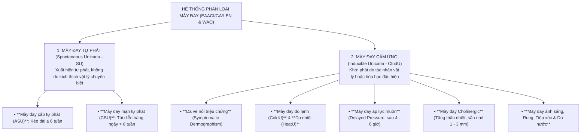

---

### SLIDE 13: BẢNG SO SÁNH KINH ĐIỂN: SẨN PHÙ (WHEAL) VS PHÙ MẠCH (ANGIOEDEMA)


#### 1. Bảng đối chiếu lâm sàng chi tiết của BSCKII:

| Tiêu chuẩn lâm sàng | Sẩn phù mày đay (Wheals) | Phù mạch (Angioedema / Phù Quincke) |
| :--- | :--- | :--- |
| **Vị trí giải phẫu bị tổn thương** | **Lớp trung bì nông (Superficial dermis)** ngay dưới màng đáy | **Lớp trung bì sâu và mô hạ bì / mô dưới niêm mạc** (Deep dermis & Subcutis / Submucosa) |
| **Hình thái thương tổn** | Sẩn hoặc mảng phù nề trung tâm màu trắng/hồng, bao quanh bởi bờ hồng ban rực rỡ | Khối sưng nề lan tỏa lớn, bờ không rõ, **màu sắc da bình thường hoặc hơi hồng nhạt** |
| **Cảm giác cơ năng chủ đạo** | **NGỨA DỮ DỘI (Pruritus)** $>$ Đau nhức | **ĐAU NHỨC, CĂNG TỨC, BỎNG RÁT** $>$ Ngứa ngáy |
| **Thời gian tồn tại của 1 tổn thương** | **Ngắn: $\le 24$ giờ** (thường lặn sau vài giờ, không để lại dấu vết) | **Dài hơn: $\le 72$ giờ** (thường kéo dài từ 2 đến 3 ngày mới thoái lui hoàn toàn) |
| **Tổn thương niêm mạc** | **Hoàn toàn KHÔNG tổn thương niêm mạc** | **RẤT THƯỜNG GẶP TỔN THƯƠNG NIÊM MẠC:** Sưng vều môi, mi mắt, lưỡi, thanh quản, ống tiêu hóa |
| **Mức độ nguy hiểm tính mạng** | Không gây tử vong (trừ khi nằm trong bệnh cảnh sốc phản vệ) | **CỰC KỲ NGUY HIỂM!** Phù nề thanh môn, nắp thanh quản gây tắc nghẽn đường thở dẫn đến ngạt thở tử vong |

---

### SLIDE 14 & 15: CHÙM HÌNH ẢNH LÂM SÀNG PHÙ MẠCH (ANGIOEDEMA)


#### 1. Phân tích các vị trí phù mạch lâm sàng nguy hiểm:
*   **Phù mạch vùng môi và mi mắt:** Môi trên hoặc môi dưới sưng vều to gấp 3 – 4 lần bình thường, căng mọng biến dạng; hai mi mắt sưng húp làm hẹp khe mi khiến bệnh nhân không mở được mắt.
*   **Phù mạch lưỡi và vòm họng:** Lưỡi sưng to chèn ép khoang miệng, nói ngọng, nuốt nghẹn, cảm giác vướng họng.
*   **CẤP CỨU KHẨN CẤP – PHÙ NỀ THANH MÔN (Laryngeal Edema):**
    *   Bệnh nhân cảm thấy nghẹt thở, thở rít thì hít vào (stridor), khàn tiếng, co kéo cơ hô hấp phụ ở hõm ức và cơ liên sườn, tím tái đầu chi.
    *   *Xử trí sống còn:* **TIÊM BẮP ADRENALINE (EPINEPHRINE) NGAY LẬP TỨC** ($0.3 - 0.5 \ \text{mg}$ tiêm bắp mặt trước ngoài đùi), cho thở oxy và chuẩn bị sẵn bộ mở khí quản cấp cứu!
*   **Phù mạch đường tiêu hóa:** Phù nề thành ruột gây đau quặn bụng từng cơn dữ dội, buồn nôn, nôn mửa và tiêu chảy (rất dễ bị chẩn đoán nhầm thành viêm ruột thừa cấp hoặc tắc ruột cơ học dẫn đến mổ oan).

---

### SLIDE 16 & 17: PHỔ LÂM SÀNG CÁC THỂ MÀY ĐAY CẢM ỨNG (CIndU)


#### 1. Đặc điểm nhận diện & Test kích thích chẩn đoán:
*   **1. Chứng da vẽ nổi có triệu chứng (Symptomatic Dermographism / Urticaria Factitia):**
    *   Thể thường gặp nhất trong nhóm CIndU. Xuất hiện sẩn phù ngứa gờ cao chạy dọc theo đường gãi hoặc cọ xát cơ học sau 1 – 5 phút, lặn sau 30 – 60 phút.
    *   *Test chẩn đoán:* Dùng đầu tù của que đè lưỡi hoặc dụng cụ đo lực vạch da (FricTest) gạch một đường nhẹ lên da vùng lưng hoặc cẳng tay.
*   **2. Mày đay do lạnh (Cold Urticaria):**
    *   Xuất hiện sẩn phù và phù mạch khi tiếp xúc với không khí lạnh, gió lạnh, nước lạnh hoặc ăn kem/uống nước đá.
    *   *Nguy cơ tử vong:* Bệnh nhân nhảy xuống hồ bơi nước lạnh có thể bị vỡ hạt dưỡng bào toàn thân gây tụt huyết áp ngất xỉu và đuối nước.
    *   *Test chẩn đoán:* **Nghiệm pháp viên đá lạnh (Ice cube test):** Đặt một viên đá bọc trong túi nilon lên mặt trước cẳng tay trong 5 phút. Quan sát sau khi lấy viên đá ra 10 phút, tại vị trí tiếp xúc xuất hiện một mảng sẩn phù đỏ rực hình viên đá $\rightarrow$ Test dương tính khẳng định!
*   **3. Mày đay do áp lực muộn (Delayed Pressure Urticaria):**
    *   Xuất hiện các khối phù nề đau nhức sâu dưới da sau **4 đến 6 giờ** chịu áp lực cơ học đè ép liên tục.
    *   *Vị trí:* Vùng thắt lưng nơi đeo dây thắt lưng chật, lòng bàn chân sau khi đi bộ đường dài, lòng bàn tay sau khi cầm búa/dụng cụ lao động, mông sau khi ngồi ghế cứng.
*   **4. Mày đay Cholinergic (Cholinergic Urticaria):**
    *   Xuất hiện khi nhiệt độ trung tâm cơ thể tăng lên (sau khi tập thể thao ra mồ hôi, tắm nước nóng, ăn thức ăn cay nóng hoặc xúc động tâm lý mạnh).
    *   *Hình thái thương tổn độc đáo:* **Các sẩn phù kích thước rất nhỏ li ti (1 – 3 mm) như hạt kê**, bao quanh bởi một quầng hồng ban rộng lớn, ngứa châm chích như kim châm.
*   **5. Mày đay do ánh sáng mặt trời (Solar Urticaria):** Xuất hiện sẩn phù trong vòng vài phút sau khi da tiếp xúc với ánh sáng mặt trời (tia UVA, UVB hoặc ánh sáng nhìn thấy).
*   **6. Mày đay do nước (Aquagenic Urticaria):** Cực kỳ hiếm gặp, sẩn phù xuất hiện khi da tiếp xúc với nước ở bất kỳ nhiệt độ nào.

---

## PHẦN III: TIẾP CẬN CẬN LÂM SÀNG & CHẨN ĐOÁN PHÂN BIỆT (SLIDE 18 – 23)

### SLIDE 18, 19 & 20: CHIẾN LƯỢC XÉT NGHIỆM CẬN LÂM SÀNG THEO EAACI 2022


#### 1. Chiến lược Xét nghiệm Tiếp cận Rõ ràng của BSCKII:

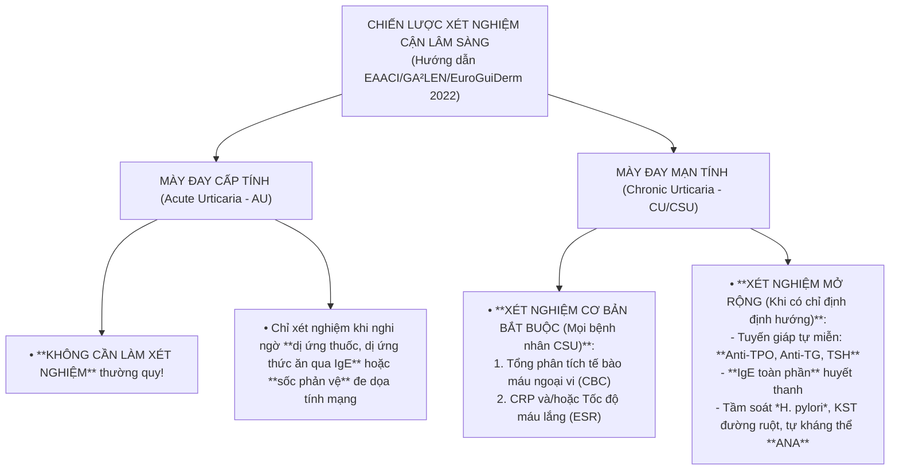

> [!TIP]
> **THÔNG ĐIỆP LÂM SÀNG CỦA BSCKII:**
> *   Rất nhiều bệnh nhân mày đay mạn tính tốn hàng chục triệu đồng làm các panel dị nguyên 60 – 100 dị nguyên thức ăn, bụi nhà. Hướng dẫn quốc tế nhấn mạnh: **Thực phẩm và dị nguyên hít gần như KHÔNG BAO GIỜ là nguyên nhân gây Mày đay mạn tính tự phát (CSU)**! Việc kiêng khem ăn uống mù quáng chỉ làm bệnh nhân suy dinh dưỡng và căng thẳng thêm.
> *   Hai xét nghiệm cơ bản bắt buộc phải làm ở bệnh nhân CSU là: **Công thức máu (CBC) và CRP/ESR**. Nếu CRP/ESR tăng vọt bất thường $\rightarrow$ Phải cảnh giác cao độ với bệnh lý tự miễn hệ thống hoặc Mày đay viêm mạch!

---

### SLIDE 21, 22 & 23: CHẨN ĐOÁN PHÂN BIỆT VỚI CÁC BỆNH LÝ NGUY HIỂM


#### 1. Bảng chẩn đoán phân biệt 4 thực thể lâm sàng quan trọng:

| Bệnh cảnh lâm sàng | Đặc điểm nhận diện cốt lõi | Dấu ấn vi thể & Cận lâm sàng | Thái độ xử trí |
| :--- | :--- | :--- | :--- |
| **Mày đay thông thường**<br>*(Urticaria)* | Sẩn phù ngứa, **lặn hoàn toàn $\le 24$ giờ**, không để lại vết thâm hay sẹo. | Mô học: Phù nề trung bì nông, mạch máu giãn, thâm nhiễm ít tế bào viêm. | Kháng Histamin H1 thế hệ 2 theo phác đồ bậc thang. |
| **Mày đay viêm mạch**<br>*(Urticarial Vasculitis)* | Sẩn phù **tồn tại kéo dài $> 24 – 48$ giờ**. Bệnh nhân than phiền **ĐAU RÁT BỎNG NHIỀU HƠN NGỨA**. Khi lặn để lại **dát xuất huyết bầm máu và sẹo thâm đen (purpura & hyperpigmentation)**. | **Sinh thiết da bắt buộc:** Thấy hình ảnh **Viêm mạch hoại tử bạch cầu (Leukocytoclastic vasculitis)**: hoại tử thành mạch, lắng đọng Fibrin, bụi nhân bạch cầu trung tính (leukocytoclasia). Giảm bổ thể C3, C4. | Kháng H1 kém đáp ứng. Bắt buộc dùng Corticosteroid toàn thân, Dapsone, Colchicine hoặc Hydroxychloroquine. |
| **Mày đay sắc tố**<br>*(Urticaria Pigmentosa / Cutaneous Mastocytosis)* | Các dát sẩn màu nâu đỏ hoặc nâu vàng rải rác toàn thân. **DẤU HIỆU DARIER DƯƠNG TÍNH:** Dùng đầu tù chà xát cơ học lên dát màu nâu, trong vòng vài phút dát này sẽ sưng phù gờ cao thành sẩn phù đỏ rực và ngứa dữ dội. | Sinh thiết da nhuộm Giemsa hoặc Toluidine blue thấy **tăng sinh dày đặc các cụm tế bào mast** ở lớp trung bì. | Tránh các yếu tố kích hoạt vỡ hạt (rượu, morphin, NSAID, tắm nước quá nóng). Kháng H1 + Ổn định dưỡng bào. |
| **Hồng ban vòng ly tâm**<br>*(Erythema Annulare Centrifugum - EAC)* | Hồng ban hình nhẫn hoặc hình vòng mở rộng dần ra xung quanh (ly tâm), phần trung tâm phẳng dần. **Đặc trưng bởi một viền vảy mỏng ở mép trong của gờ hồng ban (trailing scale)**. Tồn tại nhiều tuần đến nhiều tháng. | Sinh thiết da thấy thâm nhiễm tế bào lympho quanh mạch máu dạng "ống bọc áo ngoài" (coat-sleeve perivascular pattern). | Điều trị bệnh căn nguyên bên dưới (nhiễm nấm, ký sinh trùng, thuốc). |

---

## PHẦN IV: CƠ CHẾ BỆNH SINH PHÂN TỬ (SLIDE 24 & 25)

### SLIDE 24: CƠ CHẾ BỆNH SINH MÀY ĐAY CẤP (ACUTE URTICARIA)


#### 1. Ba cơ chế bệnh sinh chính của Mày đay cấp:
1.  **Phản ứng Quá mẫn Type I qua trung gian Kháng thể IgE (Gell & Coombs):**
    *   Điển hình trong mày đay do dị ứng thực phẩm (tôm, cua, đậu phộng), thuốc (nhóm Beta-lactam) hoặc nọc côn trùng (ong đốt).
    *   Kháng nguyên từ ngoài xâm nhập vào cơ thể đã được mẫn cảm trước đó, liên kết chéo (cross-linking) giữa hai phân tử IgE liền kề đang gắn sẵn trên thụ thể ái lực cao **$\text{Fc}\varepsilon\text{RI}$** bề mặt tế bào mast $\rightarrow$ Kích hoạt dòng thác phosphoryl hóa nội bào qua men Syk $\rightarrow$ Hòa màng và vỡ hạt giải phóng histamine chớp nhoáng.
2.  **Cơ chế Giả dị ứng / Không qua trung gian miễn dịch (Non-IgE mediated):**
    *   Điển hình do **Thuốc kháng viêm không Steroid (NSAIDs: Aspirin, Ibuprofen, Diclofenac)**:
        *   Thuốc ức chế men **Cyclooxygenase-1 (COX-1)**, làm chặn đứng con đường tổng hợp Prostaglandin $\text{E}_2$ ($\text{PGE}_2$ vốn có tác dụng ức chế dưỡng bào).
        *   Sự chuyển hướng chuyển hóa acid arachidonic sang con đường men 5-Lipoxygenase làm sản sinh ồ ạt các **Cysteinyl Leukotrienes ($\text{LTC}_4, \text{LTD}_4, \text{LTE}_4$)** $\rightarrow$ Gây giãn mạch, thoát mạch và co thắt phế quản dữ dội.
3.  **Mày đay tiếp xúc không dị ứng:**
    *   Tiếp xúc trực tiếp với hóa chất gây giải phóng histamine trực tiếp từ dưỡng bào mà không cần cơ thể mẫn cảm trước (ví dụ chất độc trong lông cây tầm ma, nọc sứa biển).

---

### SLIDE 25: ĐỘT PHÁ CƠ CHẾ PHÂN TỬ MÀY ĐAY MẠN TÍNH TỰ PHÁT (CSU)


#### 1. Hai phân nhóm Miễn dịch Tự miễn của CSU (Adv Exp Med Biol 2021):

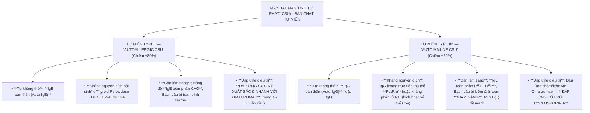

---

## PHẦN V: CHIẾN LƯỢC ĐIỀU TRỊ BẬC THANG & DỰ PHÒNG (SLIDE 26 – 38)

### SLIDE 26 & 27: BA NGUYÊN TẮC ĐIỀU TRỊ CỐT LÕI (AN BRAS DERMATOL 2019)


#### 1. Ba nguyên tắc vàng trong điều trị mày đay (Slide 27):
1.  **Mục tiêu tối thượng:** Điều trị kiểm soát triệu chứng hoàn toàn cho đến khi bệnh tự thoái lui thuyên giảm tự nhiên.
2.  **Phương pháp tiếp cận toàn diện:**
    *   Xác định và loại bỏ nguyên nhân gây bệnh (nếu phát hiện được).
    *   Tránh tiếp xúc với các yếu tố kích thích làm nặng bệnh (stress, nhiệt độ, rượu bia, NSAIDs).
    *   Tiến hành dung nạp / giải mẫn cảm (nếu có chỉ định).
    *   Sử dụng thuốc để ức chế tế bào mast vỡ hạt và phong bế tác dụng của các chất trung gian hóa học trên thụ thể đích.
3.  **Chiến lược dùng thuốc theo mục tiêu:** Điều trị nhằm đạt được mức kiểm soát bệnh tối đa: **UAS7 = 0** (không còn sẩn phù và ngứa) và **UCT = 16** (kiểm soát bệnh hoàn toàn), với liều thuốc thấp nhất có thể và duy trì an toàn lâu dài.

---

### SLIDE 28: BỘ CÔNG CỤ ĐO LƯỜNG ĐỘ NẶNG: THANG ĐIỂM UAS7 & UCT


#### 1. Thang điểm Hoạt động Mày đay trong 7 ngày (UAS7 - Urticaria Activity Score 7):
*   Bệnh nhân tự ghi nhật ký mỗi ngày liên tục trong 7 ngày. Mỗi ngày điểm số được tính bằng tổng của: **Điểm Sẩn phù (0 – 3 điểm)** + **Điểm Ngứa (0 – 3 điểm)** $\rightarrow$ Điểm tối đa trong 1 ngày là **6 điểm**.
*   **Tổng điểm UAS7 trong 7 ngày (tối đa 42 điểm):**

| Điểm số | Mức độ Sẩn phù (Số lượng thương tổn trong 24 giờ) | Mức độ Ngứa ngáy (Mức độ ảnh hưởng) |
| :---: | :--- | :--- |
| **0** | **Không có:** Hoàn toàn không có sẩn phù nào. | **Không ngứa.** |
| **1** | **Nhẹ:** Có từ **$< 20$ sẩn phù** trong 24 giờ. | **Ngứa nhẹ:** Ngứa thoáng qua, không gây khó chịu, không ảnh hưởng sinh hoạt. |
| **2** | **Vừa:** Có từ **$20 – 50$ sẩn phù** trong 24 giờ. | **Ngứa vừa:** Ngứa gây khó chịu nhưng chưa làm gián đoạn sinh hoạt hay giấc ngủ. |
| **3** | **Nặng:** Có **$> 50$ sẩn phù** hoặc các mảng sẩn phù liên kết thành mảng lớn. | **Ngứa dữ dội:** Ngứa liên tục, mất ngủ, không thể tập trung làm việc. |

*   **Phân tầng mức độ nặng theo tổng điểm UAS7 (0 – 42 điểm):**
    *   $\text{UAS7} = 0$: **Kiểm soát bệnh hoàn toàn (Well-controlled / Complete response)**.
    *   $\text{UAS7} = 1 - 6$: Mày đay mức độ rất nhẹ.
    *   $\text{UAS7} = 7 - 15$: Mày đay mức độ nhẹ.
    *   $\text{UAS7} = 16 - 27$: Mày đay mức độ trung bình.
    *   $\text{UAS7} = 28 - 42$: **MÀY ĐAY MỨC ĐỘ NẶNG (Severe Urticaria)**.

#### 2. Thang điểm Kiểm soát Mày đay (UCT - Urticaria Control Test):
*   Gồm 4 câu hỏi đánh giá hồi cứu trong 4 tuần vừa qua (mỗi câu từ 0 – 4 điểm, tổng tối đa **16 điểm**).
*   Điểm số **$\text{UCT} \ge 12$ điểm**: Bệnh được kiểm soát tốt.
*   Điểm số **$\text{UCT} < 12$ điểm**: Bệnh kiểm soát kém, cần phải bậc thang điều trị.

---

### SLIDE 29 & 30: PHÁC ĐỒ ĐIỀU TRỊ BẬC THANG QUỐC TẾ EAACI/GA²LEN 2022


#### 1. Lưu đồ 4 Bậc Điều trị Chuẩn Toàn cầu (Stepwise Algorithm):

```mermaid
flowchart TD
    Step1["**BẬC 1: KHỞI ĐẦU ĐIỀU TRỊ ĐẦU TAY**<br>Thuốc Kháng Histamin H1 thế hệ 2 (sgAH1) ở **LIỀU TIÊU CHUẨN** hàng ngày<br>*(Bilastine 20mg, Fexofenadine 180mg, Levocetirizine 5mg, Cetirizine 10mg...)*"]
    Step2["**BẬC 2: TĂNG LIỀU KHÁNG HISTAMIN H1 THẾ HỆ 2**<br>**TĂNG LIỀU GẤP 2, GẤP 3, TỐI ĐA GẤP 4 LẦN** liều tiêu chuẩn của 1 thuốc duy nhất<br>*(Lưu ý: KHÔNG phối hợp 2 loại kháng H1 khác nhau cùng lúc)*"]
    Step3["**BẬC 3: THÊM THUỐC SINH HỌC NHẮM TRÚNG ĐÍCH**<br>Duy trì sgAH1 liều cao + **OMALIZUMAB (Kháng thể kháng IgE)**<br>*Liều chuẩn: 300 mg tiêm dưới da (SC) mỗi 4 tuần*"]
    Step4["**BẬC 4: BỔ SUNG THUỐC ỨC CHẾ MIỄN DỊCH PHÂN TỬ**<br>Duy trì sgAH1 liều cao + **CYCLOSPORIN A (Ức chế Calcineurin)**<br>*Liều dùng: 3.5 – 5 mg/kg/ngày (Theo dõi sát Huyết áp & Creatinine máu mỗi tháng)*"]

    Step1 -->|"Sau 2 – 4 tuần không kiểm soát (UAS7 ≥ 16 hoặc UCT < 12)"| Step2
    Step2 -->|"Sau 2 – 4 tuần ở liều gấp 4 vẫn thất bại (UAS7 ≥ 16)"| Step3
    Step3 -->|"Sau 6 tháng điều trị Omalizumab vẫn thất bại"| Step4
```

---

### SLIDE 31 & 32: DƯỢC LÝ HỌC LÂM SÀNG CÁC THUỐC KHÁNG HISTAMIN H1


#### 1. Bảng so sánh Dược lý học: Kháng H1 Thế hệ 1 vs Thế hệ 2:

| Tiêu chí dược lý | Kháng Histamin H1 Thế hệ 1 | Kháng Histamin H1 Thế hệ 2 (Được khuyến cáo) |
| :--- | :--- | :--- |
| **Đại diện thuốc** | Chlorpheniramine, Hydroxyzine, Promethazine, Diphenhydramine, Cyproheptadine | **Bilastine, Fexofenadine, Levocetirizine, Cetirizine, Desloratadine, Loratadine, Rupatadine** |
| **Tính thấm qua hàng rào máu não** | Rất cao (thân dầu), qua hàng rào máu não dễ dàng | Rất thấp hoặc không thấm qua hàng rào máu não (ưa nước, chất nền của P-glycoprotein) |
| **Tác dụng ức chế thần kinh trung ương** | **Gây ngủ gà, an thần mạnh, suy giảm nhận thức**, giảm khả năng lái xe và vận hành máy móc | **Hoàn toàn KHÔNG gây buồn ngủ** (hoặc rất hiếm ở liều thông thường), không ảnh hưởng nhận thức |
| **Tính chọn lọc trên thụ thể H1** | Kém chọn lọc, đối kháng cả thụ thể Muscarinic, Serotonin, Alpha-adrenergic | **Cực kỳ chọn lọc trên thụ thể H1**, không có tác dụng kháng Cholinergic |
| **Tác dụng phụ kháng Cholinergic** | **Khô miệng, nhìn mờ, táo bón, bí tiểu**, tăng nhãn áp, làm nặng bệnh phì đại tiền liệt tuyến | **Hoàn toàn KHÔNG CÓ** các tác dụng phụ khô miệng, bí tiểu |
| **Thời gian bán thải & Số lần dùng** | Ngắn (4 – 6 giờ), phải uống 3 – 4 lần/ngày | **Kéo dài ($> 24$ giờ)**, chỉ cần uống **1 lần duy nhất trong ngày** |
| **Vị trí trong phác đồ hiện nay** | **KHÔNG CÒN ĐƯỢC KHUYẾN CÁO** trong điều trị thường quy mày đay | **LỰA CHỌN ĐẦU TAY DUY NHẤT** được mọi hiệp hội quốc tế đồng thuận |

#### 2. Bảng liều lượng chuẩn cho người lớn (Slide 32):
*   **Bilastine:** 20 mg/ngày (uống trước ăn 1 giờ hoặc sau ăn 2 giờ).
*   **Fexofenadine:** 180 mg/ngày (uống 1 lần).
*   **Levocetirizine:** 5 mg/ngày.
*   **Cetirizine:** 10 mg/ngày.
*   **Desloratadine:** 5 mg/ngày.
*   **Loratadine:** 10 mg/ngày.
*   **Rupatadine:** 10 mg/ngày (có thêm tác dụng kháng PAF - Platelet-Activating Factor).

---

### SLIDE 33, 34 & 35: CHIẾN LƯỢC TĂNG LIỀU GẤP 4 LẦN & THUỐC SINH HỌC MỚI


#### 1. Nghệ thuật Tăng liều Kháng H1 lên gấp 4 lần (Bậc 2 - Slide 34):
*   Tại sao lại tăng liều gấp 4 lần một loại thuốc mà không phối hợp 2 loại kháng H1 khác nhau?
    *   Các thử nghiệm lâm sàng đối chứng cho thấy việc phối hợp 2 thuốc kháng H1 khác nhau không làm tăng hiệu quả điều trị mà chỉ làm tăng nguy cơ tương tác thuốc và tác dụng phụ.
    *   Ngược lại, việc **tăng liều của một thuốc kháng H1 thế hệ 2 lên gấp 2, gấp 3, tối đa gấp 4 lần liều chuẩn** (ví dụ: Bilastine lên 40 – 80 mg/ngày; Fexofenadine lên 360 mg/ngày; Levocetirizine lên 10 – 20 mg/ngày) giúp tăng độ bão hòa gắn kết thụ thể H1 lên $> 90\%$, kiểm soát thêm được từ **$40 - 60\%$** số bệnh nhân thất bại với liều đơn!
    *   Dữ liệu an toàn thế giới khẳng định các thuốc kháng H1 thế hệ 2 khi tăng liều gấp 4 vẫn giữ được độ an toàn tuyệt vời, không gây độc tim và có thể dùng liên tục nhiều năm.

#### 2. Liệu pháp Sinh học Nhắm trúng đích Omalizumab (Bậc 3 - Slide 33):
*   **Bản chất:** Kháng thể đơn dòng tái tổ hợp nguồn gốc người kháng trực tiếp chuỗi nặng của phân tử IgE tự do.
*   **Cơ chế tác động kép:**
    1.  Bắt giữ và trung hòa toàn bộ các phân tử IgE tự do lưu hành trong máu, ngăn không cho IgE gắn vào thụ thể $\text{Fc}\varepsilon\text{RI}$ trên tế bào mast.
    2.  Làm sụt giảm mật độ thụ thể $\text{Fc}\varepsilon\text{RI}$ trên bề mặt tế bào mast và bạch cầu ái kiềm sau vài tuần điều trị $\rightarrow$ Ổn định màng dưỡng bào, triệt tiêu hoàn toàn phản ứng vỡ hạt.
*   **Liều dùng & Đáp ứng:** **300 mg tiêm dưới da mỗi 4 tuần**. Khoảng $70\%$ bệnh nhân đáp ứng ngoạn mục ngay sau 1 – 2 mũi tiêm đầu tiên.

#### 3. Các liệu pháp sinh học và phân tử nhỏ đang nghiên cứu (Slide 33 & 35):
*   **Thuốc ức chế men Bruton’s Tyrosine Kinase (BTK Inhibitors: Remibrutinib, Fenebrutinib):**
    *   Men BTK là mắt xích truyền tín hiệu nội bào sống còn nằm ngay dưới thụ thể $\text{Fc}\varepsilon\text{RI}$. Thuốc ức chế BTK dạng uống giúp khóa chặt tín hiệu vỡ hạt dưỡng bào từ bên trong, hiệu quả vượt trội trong các ca kháng trị với Omalizumab.
*   **Kháng thể kháng thụ thể IL-4R $\alpha$ (Dupilumab):** Chặn đứng con đường tín hiệu Th2 ($\text{IL}-4 / \text{IL}-13$).

---

### SLIDE 36: ĐIỀU TRỊ THAY THẾ & XỬ TRÍ ĐỢT BÙNG PHÁT CẤP TÍNH
#### 1. Nguyên tắc vàng sử dụng Corticosteroid toàn thân:
*   **Chỉ định duy nhất:** Chỉ dùng Corticoid toàn thân (Methylprednisolone hoặc Prednisolone uống/tiêm TM $0.5 \ \text{mg/kg/ngày}$) cho các đợt bùng phát mày đay cấp tính dữ dội hoặc đợt cấp nặng của CSU để nhanh chóng dập tắt triệu chứng.
*   **Thời gian sử dụng:** **TỐI ĐA TRONG VÒNG 7 ĐẾN 10 NGÀY**, sau đó phải cắt thuốc dứt khoát.
*   **CHỐNG CHỈ ĐỊNH DÙNG DÀI NGÀY:** Tuyệt đối không dùng Corticoid kéo dài để duy trì điều trị mày đay mạn tính vì nguy cơ biến chứng suy tuyến thượng thận, hội chứng Cushing, loãng xương, đái tháo đường, tăng huyết áp và gây hiện tượng bùng phát dữ dội khi ngưng thuốc (rebound phenomenon)!

---

### SLIDE 37 & 38: CÁC CẤP ĐỘ DỰ PHÒNG & THÔNG ĐIỆP KẾT LUẬN LÂM SÀNG


#### 1. Ba cấp độ dự phòng mày đay (Slide 37):
*   **Phòng ngừa cấp 1 (Tiên phát):** Chưa có biện pháp đặc hiệu; nghiên cứu cho thấy nuôi con bằng sữa mẹ hoàn toàn trên 6 tháng giúp giảm nguy cơ dị ứng và mày đay ở trẻ nhỏ.
*   **Phòng ngừa cấp 2 (Thứ phát):** Tránh tiếp xúc với các yếu tố kích hoạt đã xác định (tránh mặc đồ chẽn bó trong mày đay áp lực muộn, tránh tắm nước lạnh trong mày đay lạnh, tránh rượu bia/stress, tránh dùng NSAIDs).
*   **Phòng ngừa cấp 3 (Tam phát):** Tối ưu hóa điều trị duy trì liên tục bằng kháng H1 thế hệ 2 liều chuẩn hoặc tăng liều theo phác đồ hướng dẫn để duy trì chất lượng cuộc sống tối đa cho bệnh nhân.

#### 2. Thông điệp lâm sàng cốt lõi của bài học (Slide 38):
1.  Mày đay là bệnh lý da viêm rất thường gặp trên lâm sàng (chiếm tới $20\%$ dân số).
2.  Cơ chế bệnh sinh phức tạp, bao gồm miễn dịch qua IgE, tự kháng thể IgG và các cơ chế không qua miễn dịch.
3.  Phân loại rõ ràng dựa trên mốc thời gian **6 tuần** và sự hiện diện của yếu tố kích phát.
4.  Chẩn đoán chủ yếu dựa vào lâm sàng (sẩn phù lặn $\le 24$ giờ, phù mạch lặn $\le 72$ giờ).
5.  **Kháng Histamin H1 thế hệ 2 là nền tảng điều trị đầu tay**, khi cần có thể **tăng liều tối đa gấp 4 lần**.
6.  Kiểm soát bệnh hiệu quả bằng thang điểm chuẩn UAS7 và UCT.

---

## PHẦN MỞ RỘNG ĐÀO TẠO BSCKII: NGUYÊN LÝ VÀNG & TÌNH HUỐNG LÂM SÀNG

### 10 NGUYÊN LÝ "VÀNG" ĐIỀU TRỊ MÀY ĐAY CỦA BSCKII:

> [!IMPORTANT]
> 1. **Nguyên lý 1 (Quy tắc 24 giờ):** Từng nốt sẩn phù của mày đay thông thường bắt buộc phải lặn trong vòng 24 giờ. Nếu tổn thương đứng yên một chỗ $> 24 - 48$ giờ, ấn đau rát hơn ngứa và khi lặn để lại vết thâm máu $\rightarrow$ Bắt buộc phải sinh thiết da loại trừ **Mày đay viêm mạch (Urticarial Vasculitis)**!
> 2. **Nguyên lý 2 (Nói không với Kháng H1 thế hệ 1 kéo dài):** Không kê đơn Chlorpheniramine hay Hydroxyzine ban ngày cho bệnh nhân làm công việc lái xe, vận hành máy móc hoặc học tập vì nguy cơ tai nạn giao thông và giảm sút trí tuệ do ức chế thần kinh trung ương.
> 3. **Nguyên lý 3 (Tăng liều trước khi đổi thuốc):** Khi kháng H1 thế hệ 2 liều chuẩn không hiệu quả sau 2 – 4 tuần, **không vội đổi sang thuốc khác hoặc phối hợp bừa bãi**, mà hãy **tăng liều của chính thuốc đó lên gấp đôi, gấp 3, tối đa gấp 4 lần**.
> 4. **Nguyên lý 4 (Đừng bắt bệnh nhân kiêng ăn mù quáng):** Mày đay mạn tính ($> 6$ tuần) hầu như không phải do dị ứng thức ăn. Trừ khi bệnh nhân ăn vào bị nổi mề đay ngay trong vòng 2 giờ, còn lại không được bắt bệnh nhân kiêng khem thịt bò, gà, hải sản kéo dài gây suy nhược cơ thể.
> 5. **Nguyên lý 5 (Cấm lạm dụng Corticoid):** Corticosteroid toàn thân chỉ dùng cứu cánh trong đợt cấp tối đa 7 – 10 ngày. Tuyệt đối không dùng Corticoid để điều trị duy trì mày đay mạn tính!
> 6. **Nguyên lý 6 (Cảnh giác với thuốc giảm đau NSAIDs):** Dặn dò bệnh nhân mày đay mạn tính tránh tự ý mua các thuốc giảm đau kháng viêm NSAIDs (Aspirin, Ibuprofen, Diclofenac) vì chúng có thể kích hoạt cơn bùng phát dữ dội. Khi cần giảm đau hạ sốt, ưu tiên dùng **Paracetamol** liều vừa phải.
> 7. **Nguyên lý 7 (Đo lường bằng UAS7):** Bắt buộc hướng dẫn bệnh nhân cách tự tính điểm UAS7 mỗi tuần. Điểm số UAS7 là thước đo khách quan duy nhất để quyết định khi nào cần tăng bậc điều trị hoặc giảm liều xuống bậc.
> 8. **Nguyên lý 8 (Tầm soát bệnh tuyến giáp tự miễn):** Ở phụ nữ mắc CSU kéo dài, luôn luôn tầm soát chức năng tuyến giáp và tự kháng thể **Anti-TPO, Anti-TG**. Điều trị ổn định viêm tuyến giáp tự miễn đi kèm sẽ giúp mày đay thuyên giảm ngoạn mục.
> 9. **Nguyên lý 9 (Omalizumab là cứu tinh Bậc 3):** Ở bệnh nhân thất bại với kháng H1 liều gấp 4 lần, **Omalizumab 300mg tiêm dưới da mỗi 4 tuần** là vũ khí sinh học an toàn và hiệu quả nhất hiện nay, giúp kiểm soát bệnh ở $> 70\%$ ca kháng trị.
> 10. **Nguyên lý 10 (Trang bị bút tiêm Adrenaline cho phù mạch):** Bất kỳ bệnh nhân mày đay nào có tiền sử phù mạch đường thở (khó thở, nghẹn họng, thở rít) bắt buộc phải được hướng dẫn mang theo bên mình **bút tiêm tự động Adrenaline (Epipen 0.3mg)** để tự tiêm bắp cấp cứu tính mạng khi cần!

---

### 3 TÌNH HUỐNG LÂM SÀNG THỰC TẾ (MINI-CASES) ĐIỂN HÌNH:

#### Tình huống lâm sàng 1 (Case 1 – Mày đay mạn tính tự phát CSU kháng trị & Chiến lược Tăng liều Kháng H1 gấp 4 lần):
> **Bệnh sử:** Bệnh nhân nữ, 34 tuổi, nhân viên văn phòng, đến khám vì nổi sẩn phù đỏ ngứa ngáy dữ dội khắp người suốt 3 tháng nay. Các nốt sẩn phù xuất hiện hàng ngày, nhiều nhất vào chiều tối và sáng sớm, lặn sau 4 – 8 tiếng nhưng mọc lại liên tục ở chỗ khác. Bệnh nhân đã đi khám ở bệnh viện tuyến huyện, được kê đơn **Loratadine 10 mg/ngày uống 1 viên** nhưng tình trạng ngứa và nổi sẩn hầu như không thuyên giảm. Bệnh nhân mất ngủ triền miên, lo lắng bị "ung thư gan" nên đã tự kiêng hoàn toàn thịt bò, trứng, sữa và hải sản suốt 2 tháng nay khiến cơ thể sụt 4 kg.
> 
> **Thăm khám & Đánh giá độ nặng:**
> - Da toàn thân có rải rác hơn 40 sẩn phù màu hồng gờ cao, bờ rõ, ấn mất màu. Không có xuất huyết dưới da. Không có phù mạch ở môi, mắt.
> - Bệnh nhân chấm điểm nhật ký: Trung bình mỗi ngày có $> 30$ sẩn phù (2 điểm) và ngứa nhiều làm gián đoạn giấc ngủ (2 điểm) $\rightarrow$ Tổng điểm UAS mỗi ngày là 4 điểm $\rightarrow$ **Tổng điểm UAS7 = 28 điểm (Mày đay mức độ nặng)**. Điểm **$\text{UCT} = 5 \ \text{điểm}$** (kiểm soát rất kém).
> - Xét nghiệm cận lâm sàng: Công thức máu (CBC) bình thường, bạch cầu ái toan bình thường; CRP: $1.2 \ \text{mg/L}$ (bình thường); Men gan AST/ALT bình thường; TSH và Anti-TPO bình thường.
> 
> **Câu hỏi lâm sàng:**
> 1. Chẩn đoán xác định thể bệnh và giai đoạn của bệnh nhân này là gì?
> 2. Lời khuyên về chế độ dinh dưỡng ăn uống cho bệnh nhân là gì?
> 3. Thiết lập phác đồ điều trị bước tiếp theo chuẩn mực theo hướng dẫn EAACI/GA²LEN 2022?
> 
> **Phân tích & Hướng dẫn xử trí của BSCKII:**
> - **Chẩn đoán:** **Mày đay mạn tính tự phát (Chronic Spontaneous Urticaria - CSU) mức độ nặng ($\text{UAS7} = 28$), thất bại với kháng H1 thế hệ 2 liều chuẩn**.
> - **Tư vấn dinh dưỡng & Tâm lý:**
>   - Giải thích cho bệnh nhân hiểu rõ: Bệnh của cô kéo dài $> 3$ tháng là mày đay mạn tính tự phát (bản chất do cơ chế miễn dịch tự thân kích hoạt tế bào mast), hoàn toàn **KHÔNG PHẢI DO DỊ ỨNG THỨC ĂN** và chức năng gan hoàn toàn bình thường.
>   - **Yêu cầu bệnh nhân ngừng ngay việc kiêng khem ăn uống tiêu cực!** Cho bệnh nhân ăn uống trở lại bình thường đầy đủ dinh dưỡng để phục hồi thể trạng.
> - **Phác đồ điều trị bậc thang tiếp theo (Bậc 2 EAACI 2022):**
>   - Do bệnh nhân đã dùng Loratadine liều chuẩn 10mg trong 4 tuần không đáp ứng, theo khuyến cáo quốc tế, chúng ta tiến hành **BƯỚC 2: TĂNG LIỀU KHÁNG HISTAMIN H1 THẾ HỆ 2 LÊN GẤP 4 LẦN**:
>     - Chuyển sang sử dụng thuốc có hoạt lực mạnh và bằng chứng an toàn cao khi tăng liều: **Bilastine 20 mg** (uống 2 viên buổi sáng và 2 viên buổi tối trước ăn 1 giờ $\rightarrow$ Tổng liều $80 \ \text{mg/ngày}$, tức gấp 4 lần liều chuẩn).
>     - Hoặc tăng liều **Fexofenadine 180 mg x 2 viên/ngày** (uống sáng 1 viên, tối 1 viên $\rightarrow$ Liều 360 mg/ngày).
>   - Hẹn bệnh nhân tái khám sau **2 đến 4 tuần** kèm theo bảng theo dõi UAS7 hàng ngày.
>   - Nếu sau 4 tuần ở liều gấp 4 lần mà điểm UAS7 giảm về $\le 6$ điểm $\rightarrow$ Tiếp tục duy trì liều này trong 3 – 6 tháng rồi hạ dần liều. Nếu sau 4 tuần vẫn không kiểm soát ($\text{UAS7} \ge 16$) $\rightarrow$ Nâng lên **Bậc 3: Bổ sung Omalizumab 300 mg tiêm dưới da mỗi 4 tuần**.

---

#### Tình huống lâm sàng 2 (Case 2 – Chẩn đoán phân biệt Mày đay thông thường với Mày đay viêm mạch Urticarial Vasculitis):
> **Bệnh sử:** Bệnh nhân nữ, 42 tuổi, đến khám vì nổi nhiều ban đỏ gờ cao khắp hai cẳng chân, đùi và cẳng tay kéo dài hơn 2 tháng nay. Bệnh nhân mô tả: Các nốt ban này rất kỳ lạ, khi mới mọc lên thì hơi ngứa nhẹ, nhưng sau đó chuyển sang cảm giác **nóng rát, đau buốt châm chích như bị kim châm lửa đốt**. Mỗi nốt ban xuất hiện thường **đứng yên một chỗ kéo dài suốt 2 đến 3 ngày mới lặn**. Khi nốt ban lặn đi, tại vị trí đó **để lại một vết bầm máu màu tím sẫm rồi chuyển sang dát thâm đen nâu** kéo dài nhiều tuần không hết. Bệnh nhân có kèm theo đau nhức mỏi các khớp cổ chân và khớp gối hai bên. Đã uống nhiều loại thuốc dị ứng nhưng không đỡ.
> 
> **Thăm khám lâm sàng:**
> - Khám da vùng cẳng chân và đùi ghi nhận: Nhiều sẩn phù kích thước $1 - 3 \ \text{cm}$, màu đỏ sẫm. Dùng ngón tay ấn mạnh vào tổn thương thấy nền sẩn phù **không biến mất hoàn toàn mà để lại các chấm xuất huyết (purpura) màu tím đỏ ở trung tâm**.
> - Xen kẽ giữa các sẩn phù mới là các dát tăng sắc tố màu nâu đen do xuất huyết cũ.
> 
> **Câu hỏi lâm sàng:**
> 1. Dựa vào các dấu hiệu lâm sàng nào để khẳng định bệnh nhân này KHÔNG PHẢI mắc mày đay thông thường?
> 2. Chẩn đoán lâm sàng hướng tới bệnh lý gì? Cần chỉ định xét nghiệm vàng nào để xác định?
> 3. Hướng điều trị cho bệnh nhân này có điểm gì khác biệt cốt tử so với mày đay thông thường?
> 
> **Phân tích & Hướng dẫn xử trí của BSCKII:**
> - **Các dấu hiệu lâm sàng bác bỏ Mày đay thông thường:**
>   1.  *Thời gian tồn tại tổn thương:* Nốt ban tồn tại kéo dài **$> 24 – 48$ giờ** (trong khi mày đay thông thường lặn $\le 24$ giờ).
>   2.  *Cảm giác cơ năng:* Cảm giác **đau rát, bỏng buốt chiếm ưu thế** hơn cảm giác ngứa.
>   3.  *Di chứng sau khi lặn:* Để lại **xuất huyết bầm máu (purpura) và dát tăng sắc tố sau viêm màu nâu đen** kéo dài (mày đay thông thường khi lặn trả lại làn da hoàn toàn bình thường).
>   4.  Triệu chứng toàn thân đi kèm: Đau nhức các khớp cổ chân, khớp gối.
> - **Chẩn đoán hướng tới & Xét nghiệm vàng:**
>   - Chẩn đoán: Nghi ngờ **Mày đay viêm mạch (Urticarial Vasculitis)**.
>   - **Tiêu chuẩn vàng chẩn đoán:** Bắt buộc chỉ định **Sinh thiết da giải phẫu bệnh (Skin Punch Biopsy)** tại một sẩn phù mới xuất hiện dưới 24 giờ. Kết quả mô bệnh học sẽ thấy hình ảnh kinh điển của **Viêm mạch hoại tử bạch cầu (Leukocytoclastic Vasculitis)**: Phù nề nội mô mạch máu, lắng đọng fibrin hoại tử thành tiểu tĩnh mạch nông, hồng cầu thoát mạch ra mô kẽ (tạo nên xuất huyết) và hiện tượng thâm nhiễm dày đặc bạch cầu đa nhân trung tính bị thoái hóa vỡ nhân tạo thành bụi nhân (leukocytoclasia).
>   - Chỉ định xét nghiệm hệ thống: Định lượng nồng độ bổ thể máu **C3, C4** (để phân loại thể giảm bổ thể Hypocomplementemic Urticarial Vasculitis có tiên lượng nặng), kháng thể kháng nhân **ANA, Anti-dsDNA** (tầm soát Lupus ban đỏ hệ thống đi kèm), xét nghiệm tổng phân tích nước tiểu (tìm protein niệu và hồng cầu niệu để loại trừ tổn thương viêm cầu thận).
> - **Chiến lược điều trị khác biệt cốt tử:**
>   - Thuốc kháng Histamin H1 hầu như **KHÔNG CÓ TÁC DỤNG** đối với Mày đay viêm mạch.
>   - Bắt buộc phải điều trị bằng các thuốc kháng viêm và điều hòa miễn dịch:
>     - **Corticosteroid toàn thân:** Prednisone liều $0.5 - 1 \ \text{mg/kg/ngày}$, giảm liều dần.
>     - Phối hợp thuốc ức chế bạch cầu trung tính: **Dapsone 50 – 100 mg/ngày** hoặc **Colchicine 1 mg/ngày**.
>     - Trường hợp nặng hoặc có tổn thương thận: Phối hợp các thuốc ức chế miễn dịch mạnh như Azathioprine, Mycophenolate Mofetil hoặc Rituximab.

---

#### Tình huống lâm sàng 3 (Case 3 – Cấp cứu Phù mạch do Thuốc ức chế men chuyển ACEi):
> **Bệnh sử:** Bệnh nhân nam, 62 tuổi, có tiền sử tăng huyết áp đang điều trị bằng thuốc hạ áp **Enalapril 10 mg/ngày** suốt 6 tháng nay. Khoảng 2 giờ sau khi ngủ dậy, bệnh nhân đột ngột thấy môi trên sưng to nhanh chóng, sau đó lan sang môi dưới và hai bên má. Bệnh nhân cảm thấy căng tức, nghẹn ứ ở cổ họng, nói giọng ngọng nghẹo và bắt đầu cảm thấy khó thở, hít vào có tiếng rít. Trên da toàn thân hoàn toàn **KHÔNG CÓ sẩn phù mày đay và KHÔNG NGỨA**. Người nhà vội vã đưa bệnh nhân vào khoa Cấp cứu.
> 
> **Thăm khám cấp cứu:**
> - Bệnh nhân tỉnh, vẻ mặt hoảng hốt, vã mồ hôi.
> - Toàn bộ môi trên và môi dưới sưng vều biến dạng, lưỡi to bè đẩy tụt về phía sau làm hẹp eo họng.
> - Nhịp thở $28 \ \text{lần/phút}$, có tiếng thở rít thanh quản (stridor) thì hít vào, co kéo hõm ức rõ rệt. $\text{SpO}_2$ tụt xuống còn **$88\%$** trên khí trời. Huyết áp: $150/90 \ \text{mmHg}$, mạch $105 \ \text{lần/phút}$.
> 
> **Câu hỏi lâm sàng:**
> 1. Chẩn đoán xác định cho bệnh nhân này là gì? Thủ phạm gây bệnh là chất trung gian hóa học nào?
> 2. Tại sao bệnh nhân đã uống Enalapril suốt 6 tháng không sao mà bây giờ mới bị phù mạch?
> 3. Các bước xử trí cấp cứu khẩn cấp để khai thông đường thở và cứu sống bệnh nhân?
> 
> **Phân tích & Hướng dẫn xử trí của BSCKII:**
> - **Chẩn đoán xác định:** **Phù mạch cấp tính đe dọa tắc nghẽn đường thở do Thuốc ức chế men chuyển (ACEi-induced Angioedema)**.
> - **Cơ chế phân tử & Thủ phạm sinh học:**
>   - Đây là thể phù mạch **KHÔNG QUA TRUNG GIAN HISTAMINE**, mà qua trung gian chất hoạt mạch **BRADYKININ**!
>   - Bình thường, men chuyển Angiotensin (ACE) đồng thời cũng là men Kininase II chịu trách nhiệm thoái giáng và phân hủy Bradykinin. Thuốc Enalapril ức chế men ACE, dẫn đến **sự tích tụ nồng độ Bradykinin cực cao trong mô**. Bradykinin gắn vào thụ thể $\text{B}_2$ trên tế bào nội mô mạch máu, gây giãn mạch và tăng tính thấm thành mạch dữ dội ở lớp dưới niêm mạc lưỡi, thanh quản và môi.
>   - *Đặc điểm lâm sàng:* **Không có sẩn phù mày đay, không ngứa, không đáp ứng với thuốc kháng Histamin hay Corticoid thông thường**!
>   - *Tại sao uống 6 tháng mới bị?* Phù mạch do ACEi là một phản ứng không phụ thuộc liều, có thể xảy ra ngay sau liều đầu tiên, nhưng có tới $> 30\%$ trường hợp xảy ra sau nhiều tháng, thậm chí nhiều năm dùng thuốc liên tục.
> - **Xử trí cấp cứu khẩn cấp:**
>   1.  **Bảo vệ đường thở ngay lập tức (Airway First):**
      - Cho thở oxy qua mặt nạ. Chuẩn bị sẵn bộ đặt nội khí quản và bộ mở khí quản cấp cứu bên giường bệnh. Nếu thanh môn tiếp tục sưng phù bít tắc đường thở $\rightarrow$ Tiến hành đặt nội khí quản bằng ống soi mềm có gắn camera (Video laryngoscopy) hoặc chọc màng nhẫn giáp / mở khí quản cấp cứu để cứu sống bệnh nhân!
>   2.  **Dùng thuốc:**
      - Dù phù mạch do Bradykinin đáp ứng kém với thuốc dị ứng kinh điển, nhưng trong tình huống cấp cứu chưa phân định tuyệt đối, vẫn tiêm bắp ngay **Adrenaline 0.5 mg (IM)** để tận dụng tác dụng co mạch alpha-1 giúp giảm phù nề niêm mạc tức thì, phối hợp Methylprednisolone 80mg tiêm TM.
      - *Thuốc đặc trị theo cơ chế Bradykinin (nếu có sẵn):* **Icatibant** (thuốc đối kháng chọn lọc thụ thể Bradykinin $\text{B}_2$, tiêm dưới da 30mg) hoặc truyền huyết tương tươi đông lạnh (FFP - chứa men phân hủy kinin).
>   3.  **Mệnh lệnh an toàn sống còn:**
      - **NGỪNG NGAY LẬP TỨC VÀ VĨNH VIỄN THUỐC ENALAPRIL** (cũng như toàn bộ các thuốc nhóm ức chế men chuyển khác như Captopril, Lisinopril, Perindopril).
      - Ghi rõ tiền sử dị ứng phù mạch do ACEi vào trang đầu của hồ sơ bệnh án để cảnh báo cho tất cả các bác sĩ khác. Thay thế thuốc hạ áp bằng nhóm khác an toàn (như Chẹn kênh Canxi Amlodipine).

---

*(Hết giáo trình bài giảng Mày đay & Phù mạch - Hoàn tất Slide 1 đến Slide 38)*


<!-- === VIRTUAL_FILE: 08_Benh_Vi_Nam_Can_Dermatophytosis.md === -->

# BÀI GIẢNG CHUYÊN SÂU: BỆNH VI NẤM CẠN (SUPERFICIAL MYCOSES)
## VI NẤM SỢI TƠ (DERMATOPHYTOSIS), NẤM MEN CANDIDA & LANG BEN (MALASSEZIA)
### ĐẶC ĐIỂM HÌNH THÁI LÂM SÀNG, KỸ THUẬT SOI TƯƠI KOH, BẪY LẠM DỤNG CORTICOID & PHÁC ĐỒ ĐIỀU TRỊ TOÀN DIỆN

**Giảng viên biên soạn & Giảng dạy lâm sàng:** Bác sĩ Chuyên khoa II Da liễu & Vi nấm học lâm sàng  
**Đối tượng đào tạo:** Bác sĩ Đa khoa, Học viên Sau đại học (BSNT, CKI, CKII, ThS), Bác sĩ Thực hành Da liễu – Nhi khoa – Nội tổng quát  
**Báo cáo viên tài liệu nguồn:** BS.CKII Vũ Thị Phương Thảo (Trưởng phòng Kế hoạch tổng hợp – Bệnh viện Da Liễu TP.HCM, Giảng viên Bộ môn Da liễu ĐHQG-HCM)  
**Đơn vị đào tạo:** Bộ môn Da liễu – Đại học Khoa học Sức khỏe, ĐHQG-HCM & Bệnh viện Da Liễu TP.HCM  
**Tài liệu tham khảo đối chiếu chuẩn:**
1. *Fitzpatrick's Dermatology in General Medicine, 9th Edition (McGraw-Hill): Fungal Infections*.
2. *Bolognia Dermatology, 5th Edition, 2024 (Elsevier): Superficial Fungal Infections*.
3. *Habif's Clinical Dermatology, 7th Edition (Elsevier): Superficial Fungal Infections*.
4. *Guidelines for the Management of Tinea Capitis, Onychomycosis and Superficial Mycoses (British Association of Dermatologists - BAD / JAAD)*.
5. *Hướng dẫn Chẩn đoán và Điều trị các Bệnh Da liễu – Bộ Y tế Việt Nam*.

---

## LỜI MỞ ĐẦU CỦA GIẢNG VIÊN LÂM SÀNG (BSCKII)

> *"Kính thưa các đồng nghiệp và các bạn học viên,*
>
> *Việt Nam nằm trọn trong vùng khí hậu nhiệt đới gió mùa, nóng ẩm quanh năm. Đây chính là 'thiên đường sinh học' cho các loài vi nấm phát triển và sinh sôi. Trong thực hành da liễu hàng ngày, các bệnh lý do vi nấm cạn chiếm tới **$20 - 30\%$** tổng số lượt bệnh nhân đến khám tại các bệnh viện da liễu tuyến đầu.*
>
> *Nhìn bề ngoài, chẩn đoán một ca nấm da có vẻ như là bài học vỡ lòng của sinh viên y khoa năm thứ 3: 'Mảng hồng ban hình tròn, bờ gồ mụn nước, ly tâm, trung tâm lành dần và ngứa'. Thế nhưng, trên thực tế lâm sàng, đây lại là một trong những mặt bệnh **bị chẩn đoán nhầm và điều trị sai lệch nhiều nhất** trong cộng đồng y khoa Việt Nam!*
>
> *Hai vấn nạn lâm sàng nhức nhối mà một BSCKII da liễu phải đối mặt mỗi ngày:*
> 1. ***Đại dịch lạm dụng kem bôi phối hợp 3 thành phần (Corticoid - Kháng sinh - Kháng nấm):*** *Bệnh nhân (và thậm chí nhiều nhân viên y tế) hễ thấy ngứa là ra nhà thuốc mua ngay các loại tuýp thuốc 'bảy màu' (như Gentrisone, Silkron, Dibetalic...). Corticoid trong tuýp thuốc làm giảm viêm và hết ngứa tức thì trong vài ngày đầu, nhưng ngay sau đó nó dập tắt hoàn toàn hàng rào miễn dịch tại chỗ, mở đường cho vi nấm ăn sâu vào nang lông, phá hủy mô và làm biến dạng hoàn toàn tổn thương thành thể bệnh quái ác: **Tinea Incognito (Nấm da biến đổi hình thái)**. Hậu quả là teo da, rạn da không hồi phục, nhiễm nấm lan tỏa toàn thân và kháng thuốc kéo dài.*
> 2. ***Bỏ sót các cạm bẫy vi nấm học:** Nhầm lẫn giữa nấm móng do nấm sợi tơ (bắt đầu từ bờ tự do, không viêm quanh móng) với nấm móng do Candida (luôn bắt đầu từ gốc móng kèm viêm sưng đỏ quanh móng Paronychia); nhầm nấm da đầu Kerion de Celse mủ với nhọt da đầu rồi mang đi rạch áp-xe làm rụng tóc sẹo vĩnh viễn; hay không phân biệt được Lang ben với bệnh Bạch biến hoặc Phong.*
>
> *Hôm nay, dựa trên bài giảng chuẩn mực của BS.CKII Vũ Thị Phương Thảo, chúng ta sẽ phân tích toàn diện 39 slide, giải mã trọn vẹn từ cơ chế bệnh sinh, hình ảnh vi thể cạo nấm soi KOH, đến phác đồ kháng nấm tại chỗ và toàn thân chuẩn mực nhất!"*

---

## MỤC LỤC TỔNG QUAN BÀI HỌC

```
├── PHẦN MỞ ĐẦU: TIÊU ĐỀ, MỤC TIÊU & ĐẠI CƯƠNG PHÂN LOẠI (SLIDE 1 - 5)
│   ├── Slide 1 & 2: Tiêu đề & 4 Mục tiêu học tập cốt lõi
│   ├── Slide 3: Phân loại Vi nấm học theo mức độ xâm nhập mô (Nông, Dưới da, Sâu)
│   └── Slide 4 & 5: Đại cương Bệnh Vi nấm cạn & Ba nhóm căn nguyên thường gặp nhất
│
├── PHẦN I: VI NẤM SỢI TƠ (DERMATOPHYTOSIS / TINEA) (SLIDE 6 - 18)
│   ├── Slide 6: Vị trí giải phẫu & Bán chứng học tổn thương cơ bản kinh điển
│   ├── Slide 7, 8, 9, 10, 11: Bộ ảnh lâm sàng tổn thương thực tế (Thân, Bẹn, Chân, Móng, Da đầu, Kerion)
│   ├── Slide 12: Kỹ thuật Cận lâm sàng: Soi tươi KOH, Đèn Wood & Cấy nấm Sabouraud
│   ├── Slide 13 & 14: Nguyên tắc điều trị & Cảnh báo đỏ chống lạm dụng Corticoid (Tinea Incognito)
│   ├── Slide 15 & 16: Phác đồ Kháng nấm Bôi tại chỗ vs Toàn thân (Griseofulvin, Terbinafine, Itraconazole)
│   └── Slide 17 & 18: Điều trị Kerion de Celse, Nấm da đầu & Biện pháp khử trùng phòng ngừa
│
├── PHẦN II: BỆNH NẤM MEN CANDIDA (CANDIDIASIS) (SLIDE 19 - 31)
│   ├── Slide 19: Bản đồ phân loại vi nấm cạn (Nhánh Candida)
│   ├── Slide 20 & 21: Vi sinh học Candida albicans & Các chủng Non-albicans
│   ├── Slide 22: Bốn nhóm yếu tố thuận lợi sinh bệnh (Cơ học, Dinh dưỡng, Sinh lý, Bệnh toàn thân)
│   ├── Slide 23: Hình thái học lâm sàng trên Da & Niêm mạc
│   ├── Slide 24 - 28: Chùm ảnh lâm sàng thực tế: Kẽ ngón tay ngâm nước, Tưa miệng, Nứt mép, Balanitis, CMC
│   ├── Slide 29 & 30: Cận lâm sàng: Soi tươi KOH (Sợi tơ nấm giả & Bào tử men), Cấy Sabouraud
│   └── Slide 31: Nguyên tắc dự phòng & Chiến lược kiểm soát yếu tố thuận lợi
│
├── PHẦN III: BỆNH LANG BEN (PITYRIASIS VERSICOLOR) (SLIDE 32 - 39)
│   ├── Slide 32: Bản đồ phân loại vi nấm cạn (Nhánh Malassezia)
│   ├── Slide 33: Bán chứng học lâm sàng: Dát đổi màu, Dấu hiệu vỏ bào (Besnier sign) & Đèn Wood
│   ├── Slide 34: Bộ ảnh lâm sàng Lang ben trên thực tế da ngực, lưng, mặt
│   ├── Slide 35: Cận lâm sàng KOH: Hình ảnh kinh điển "Mì Ý và Thịt viên" (Spaghetti and Meatballs)
│   ├── Slide 36: Bảng phác đồ điều trị Lang ben & Viêm nang lông do Malassezia (Fitzpatrick 2019)
│   ├── Slide 37: Phác đồ dự phòng tái phát & Chăm sóc da nhờn
│   └── Slide 38 & 39: Hình ảnh vi thể KOH & Đèn Wood phát huỳnh quang vàng xanh
│
└── PHẦN MỞ RỘNG ĐÀO TẠO BSCKII:
    ├── 10 Nguyên lý "Vàng" thực hành lâm sàng Bệnh vi nấm cạn
    └── 3 Tình huống lâm sàng thực tế (Mini-Cases) có lời giải chi tiết
```

---

## PHẦN MỞ ĐẦU: TIÊU ĐỀ, MỤC TIÊU & ĐẠI CƯƠNG PHÂN LOẠI (SLIDE 1 – 5)

### SLIDE 1 & 2: TIÊU ĐỀ BÀI HỌC & MỤC TIÊU ĐÀO TẠO


#### 1. Nội dung nguyên văn trên Slide:
*   **Tiêu đề bài giảng:** BỆNH VI NẤM CẠN.
*   **Giảng viên:** BS.CKII Vũ Thị Phương Thảo.
*   **Đối tượng:** Sinh viên Y5 – Bác sĩ Đa khoa.
*   **4 Mục tiêu học tập cốt lõi:**
    1.  Liệt kê được các loại vi nấm cạn thường gặp nhất.
    2.  Mô tả được thương tổn cơ bản của từng thể bệnh vi nấm cạn trên lâm sàng.
    3.  Trình bày được nguyên tắc điều trị đúng đắn, an toàn và hiệu quả.
    4.  Nêu được các biện pháp phòng ngừa lây lan và chống tái phát bệnh trong gia đình và cộng đồng.

---

### SLIDE 3, 4 & 5: ĐẠI CƯƠNG VỀ VI NẤM & BA NHÓM CĂN NGUYÊN VI NẤM CẠN


#### 1. Phân loại Vi nấm theo Độ sâu Xâm nhập Mô (Slide 3):
*   **1. Vi nấm nông / cạn (Superficial Mycoses):** Chỉ gây bệnh giới hạn ở lớp sừng của thượng bì, sợi tóc và bản móng (những cấu trúc chết đã sừng hóa chứa keratin). Hoàn toàn không xâm nhập sâu xuống dưới lớp đáy thượng bì.
*   **2. Vi nấm dưới da (Subcutaneous Mycoses):** Xâm nhập qua các vết trầy xước vào mô trung bì và mô hạ bì (ví dụ: *Sporotrichosis, Chromoblastomycosis, Mycetoma*).
*   **3. Vi nấm sâu / Hệ thống (Deep / Systemic Mycoses):** Xâm nhập vào các cơ quan nội tạng (phổi, não, gan, lách, huyết tủy) đe dọa trực tiếp tính mạng (ví dụ: *Histoplasmosis, Cryptococcosis, Coccidioidomycosis, Talaromycosis*).

#### 2. Định nghĩa & Ba nhóm Vi nấm cạn thường gặp nhất (Slide 4 & 5):
*   **Định nghĩa:** Bệnh vi nấm cạn là tình trạng nhiễm trùng lớp sừng của da, lông, tóc và móng do các vi nấm gây bệnh gây ra.
*   **Ba "đại gia đình" vi nấm cạn kinh điển:**
    1.  **Vi nấm sợi tơ (Dermatophytes):** Là nhóm nấm ưa keratin thực thụ (*keratinophilic fungi*), tiết enzyme keratinase phân hủy chất sừng.
    2.  **Nấm men (Yeasts - chủ yếu là chi *Candida*):** Vi nấm cơ hội sống hội sinh trên cơ thể.
    3.  **Vi nấm men ưa mỡ *Malassezia*:** Căn nguyên gây bệnh Lang ben (*Pityriasis versicolor*) và Viêm nang lông do Malassezia.

---

## PHẦN I: VI NẤM SỢI TƠ (DERMATOPHYTOSIS / TINEA) (SLIDE 6 – 18)

### SLIDE 6: VỊ TRÍ GIẢI PHẪU & HÌNH THÁI LÂM SÀNG CỐT LÕI


#### 1. Nội dung nguyên văn trên Slide (Đã chuẩn hóa chính tả y khoa):
*   **Các vị trí giải phẫu mắc bệnh:** Da đầu, thân mình, bẹn, bàn chân, bàn tay, mặt, râu, móng.
*   **Thương tổn cơ bản kinh điển:**
    *   **Hồng ban hình vòng tróc vảy (Annular plaque):** Giới hạn cực kỳ rõ nét với da lành.
    *   **Tiến triển ly tâm (Centrifugal spread):** Trung tâm thương tổn có xu hướng lành dần (da phẳng lại, nhạt màu, tróc ít vảy mịn), trong khi bờ viền tiếp tục tiến triển mở rộng ra xung quanh.
    *   **Bờ viền nổi gờ cao, tập trung nhiều mụn nước nhỏ li ti**, không có tẩm nhuận cứng.
*   **Nấm móng (Tinea unguium):**
    *   Khởi đầu từ **bờ tự do** của móng hoặc bờ bên.
    *   Bản móng dày sừng lên, bên dưới có **nhiều bột vụn mủn**, móng mất độ bóng tự nhiên, chuyển sang màu vàng đục, nâu hoặc xám đen.
    *   **Đặc điểm nhận diện then chốt:** Thường **ÍT HOẶC HOÀN TOÀN KHÔNG CÓ VIÊM QUANH MÓNG** (giúp phân biệt sinh tử với nấm móng do Candida).

---

### SLIDE 7 ĐẾN 11: BỘ ẢNH LÂM SÀNG TỔN THƯƠNG THỰC TẾ


#### 1. Phân loại theo Vị trí Giải phẫu & Bán chứng học Chuyên sâu của BSCKII:

##### 1. Nấm Thân (Tinea Corporis / Hắc lào / Lác đồng tiền - Slide 7):
*   Tổn thương là mảng hồng ban hình tròn hoặc bầu dục giống như hình đồng tiền xu (nên dân gian gọi là lác đồng tiền).
*   **Cơ chế hình thành bờ viền mụn nước:** Khi vi nấm sợi tơ xâm nhập vào lớp sừng, chúng sử dụng keratin làm chất dinh dưỡng và nhân lên. Khi cạn kiệt keratin ở trung tâm, sợi nấm buộc phải vươn dài ra phía ngoài ngoại vi để tìm kiếm nguồn keratin mới. Tại rìa ngoài cùng, nơi mật độ vi nấm tập trung dày đặc nhất, hệ miễn dịch tế bào của vật chủ phản ứng dữ dội tạo nên phản ứng viêm cấp tính với vô số mụn nước nhỏ li ti nổi gờ cao trên bờ viền.
*   Ngứa ngáy nhiều, đặc biệt tăng lên khi thời tiết nóng bức, đổ mồ hôi hoặc mặc quần áo chật.

##### 2. Nấm Bẹn (Tinea Cruris - Slide 8):
*   Thường gặp ở nam giới thanh niên do vùng bẹn bìu thường xuyên ẩm ướt, cọ xát.
*   Thương tổn khởi đầu từ nếp lằn bẹn một bên, sau đó lan sang bên đối diện và lan xuống mặt trong đùi, ra phía sau mông hoặc lên vùng mu. Thường chừa lại vùng da bìu (khác với nấm Candida hay tấn công trực tiếp vào bìu).

##### 3. Nấm Bàn chân (Tinea Pedis / "Athlete's Foot" - Slide 8):
*   Thường gặp ở người thường xuyên đi giày bít bùng, vận động viên thể thao, người lội nước.
*   Gồm 3 thể lâm sàng chính:
    *   *Thể tróc vảy / Dày sừng (Moccasin type):* Lòng bàn chân và bờ bên dày sừng, tróc vảy mỏng khô màu trắng bạc, ít ngứa.
    *   *Thể kẽ ngón (Interdigital type):* Thường ở kẽ ngón 4 – 5, da mủn trắng, nứt nẻ, chảy dịch, rất ngứa và dễ bội nhiễm vi khuẩn gây viêm mô tế bào cẳng chân.
    *   *Thể mụn nước / Tổ đỉa (Vesiculobullous type):* Các mụn nước sâu dưới da ở lòng bàn chân, ngứa dữ dội.
*   **Hội chứng "Hai bàn chân, Một bàn tay" (Two feet-one hand syndrome):** Bệnh nhân bị nấm cả hai bàn chân nhưng chỉ bị nấm ở một bàn tay (thường là bàn tay thuận dùng để gãi chân). Bác sĩ thấy nấm 1 bàn tay bắt buộc phải vạch 2 bàn chân ra khám!

##### 4. Nấm Móng (Tinea Unguium / Onychomycosis - Slide 9):
*   Thường do *Trichophyton rubrum* ($> 85\%$). Bắt đầu từ bờ tự do hoặc bờ bên của móng, lan dần vào trung tâm và gốc móng.
*   Tăng sừng dưới móng (Subungual hyperkeratosis) làm bản móng bị đội cao lên, xốp mủn, dễ vỡ vụn khi cắt móng.
*   Móng mất hoàn toàn độ bóng trong suốt, chuyển sang màu vàng đục, nâu đen.
*   **Quy tắc vàng phân biệt:** **Không có viêm đỏ mô mềm quanh móng**.

##### 5. Nấm Da đầu (Tinea Capitis - Slide 10):
*   Gặp chủ yếu ở trẻ em trước tuổi dậy thì (sau dậy thì chất bã nhờn chứa acid béo có tác dụng kháng nấm tự nhiên).
*   Gồm 2 thể chính theo chủng nấm:
    *   *Thể mảng xám (do Microsporum):* Mảng rụng tóc lớn, tóc bị gãy cách da đầu vài milimét ($2 - 4 \ \text{mm}$), bao quanh chân tóc có một lớp bao trắng như phủ bột phấn (bào tử nấm bọc ngoài sợi tóc - Ectothrix).
    *   *Thể chấm đen (do Trichophyton):* Nhiều mảng rụng tóc nhỏ rải rác, tóc bị gãy cụt sát ngay bề mặt da đầu trông như các dấu chấm đen (bào tử nấm nằm bên trong sợi tóc - Endothrix).

##### 6. Áp-xe Nấm Da đầu (Kerion de Celse - Slide 11) – CẠM BẪY LÂM SÀNG NGUY HIỂM:
*   Là phản ứng viêm quá mẫn miễn dịch cực kỳ mãnh liệt của cơ thể đối với các chủng nấm sợi tơ có nguồn gốc từ động vật (*Zoophilic dermatophytes*: chó, mèo, thỏ, bò... như *Trichophyton mentagrophytes, T. verrucosum*).
*   **Hình thái thương tổn:** Khối u viêm gồ cao trên da đầu, sưng nề đỏ rực, mật độ mềm nhũn lùng nhùng, trên bề mặt có vô số lỗ chân lông rò mủ vàng óng trông giống hệt như **tổ ong (Kerion tiếng Hy Lạp nghĩa là tổ ong)**. Tóc vùng tổn thương rụng hoàn toàn hoặc bị mủ đẩy bật ra ngoài. Kèm theo sốt, hạch sau tai và hạch chẩm sưng to đau.
*   **CẠNH BÁO BÁC SĨ:** Khối mềm lùng nhùng và có mủ này rất dễ bị chẩn đoán nhầm thành **Áp-xe vi khuẩn (Bacterial abscess) hoặc Nhọt chùm (Carbuncle)**. Nếu bác sĩ đem dao rạch tháo mủ sẽ làm tổn thương sâu thêm chân tóc, gây sẹo xơ và dẫn đến **RỤNG TÓC VĨNH VIỄN KHÔNG BAO GIỜ MỌC LẠI!** Xử trí chuẩn mực là **KHÔNG ĐƯỢC RẠCH**, mà phải điều trị bằng kháng nấm toàn thân kết hợp Corticoid ngắn ngày để dập tắt phản ứng viêm.

---

### SLIDE 12: TIẾP CẬN CẬN LÂM SÀNG VI NẤM HỌC


#### 1. Ba vũ khí cận lâm sàng cốt lõi:
1.  **Xét nghiệm Soi tươi trực tiếp với dung dịch KOH (Direct KOH Examination):**
    *   *Kỹ thuật lấy mẫu chuẩn:* Dùng mép cùn của lưỡi dao mổ (dao số 15) cạo nhẹ tại **bờ viền đang tiến triển của tổn thương** (nơi có mật độ vi nấm cao nhất), thu thập các vảy da mịn lên phiến kính. (Nếu là nấm móng: lấy chất bột mủn sâu bên dưới bản móng gần gốc móng; nếu là nấm da đầu: dùng panh nhổ các sợi tóc gãy cụt).
    *   Nhỏ 1 giọt dung dịch **KOH 10 – 20%** (có thể pha thêm mực Parker hoặc chất huỳnh quang Calcofluor White), hơ nhẹ trên ngọn đèn cồn để KOH phá hủy chất sừng keratin mà không làm biến dạng thành tế bào nấm.
    *   *Hình ảnh khẳng định dưới kính hiển vi quang học ($400\times$):* Nhìn thấy **các sợi tơ nấm có vách ngăn, phân nhánh khúc khuỷu, chiết quang sáng (Septate branching hyphae)** chạy xuyên qua các tế bào biểu mô sừng. Có thể thấy các chuỗi bào tử đốt (arthroconidia).
2.  **Soi dưới Ánh sáng Đèn Wood (Wood’s Light Examination):**
    *   Chiếu đèn Wood (tia cực tím bước sóng $365 \ \text{nm}$) trong phòng tối:
        *   Nấm da đầu do chủng ***Microsporum*** (*M. canis, M. audouinii*): Phát ra **ánh sáng huỳnh quang màu xanh lá cây sáng rực (Bright green fluorescence)**.
        *   Nấm da đầu do chủng ***Trichophyton*** (*T. tonsurans*): **Hoàn toàn KHÔNG phát huỳnh quang** (âm tính).
3.  **Nuôi cấy Nấm (Fungal Culture):**
    *   Môi trường chuẩn: **Thạch Sabouraud Dextrose Agar (SDA)** có bổ sung Chloramphenicol (ức chế vi khuẩn) và Cycloheximide (ức chế nấm mốc tạp).
    *   Nuôi cấy ở nhiệt độ phòng ($25 - 28^\circ\text{C}$), theo dõi trong 2 – 4 tuần.
    *   *Mục đích:* Định danh chính xác loài nấm (Species identification) để truy tìm nguồn lây dịch tễ (từ đất, từ động vật hay từ người) và phục vụ các trường hợp nấm móng, nấm da đầu kháng trị.

---

### SLIDE 13 & 14: NGUYÊN TẮC ĐIỀU TRỊ & THẢM HỌA LẠM DỤNG CORTICOID (TINEA INCOGNITO)


#### 1. Bốn nguyên tắc điều trị nấm da bất di bất dịch (Slide 13):
1.  Chẩn đoán sớm và điều trị kịp thời để tránh lây lan cho bản thân và cộng đồng.
2.  **Điều trị đúng phác đồ, đủ liệu trình, đủ liều lượng và liên tục**, không bỏ thuốc dở chừng khi triệu chứng ngứa vừa giảm.
3.  Áp dụng triệt để các biện pháp khử mầm bệnh trong quần áo, tất vớ và đồ dùng cá nhân vào cuối đợt điều trị (luộc nước sôi, là ủi nóng).
4.  Điều trị đồng loạt cho các thành viên sống chung trong gia đình hoặc tập thể nếu có dấu hiệu lây lan.

#### 2. Cảnh báo đỏ: Thảm họa Tinea Incognito do lạm dụng Corticoid (Slide 14):

> [!CAUTION]
> **TẠI SAO PHẢI CẤM TUYỆT ĐỐI CÁC KEM BÔI 3 THÀNH PHẦN (CORTICOID + KHÁNG NẤM + KHÁNG SINH)?**
> *   Slide 14 nhấn mạnh: *"Khuyến cáo không dùng các dạng kem bôi có thành phần phối hợp kháng nấm/corticosteroid do tác dụng trị liệu rất kém và gây biến chứng teo da"*.
> *   **Cơ chế bệnh sinh của Tinea Incognito (Nấm biến đổi hình thái):**
>     *   Khi bôi Corticoid lên vùng da nhiễm nấm, hoạt chất này ức chế tại chỗ đại thực bào và tế bào lympho T, dập tắt phản ứng viêm $\rightarrow$ Bệnh nhân thấy hết ngứa và bớt đỏ ngay sau 1 – 2 ngày, lầm tưởng là "thuốc tiên".
>     *   Nhưng mất đi hàng rào miễn dịch bảo vệ, vi nấm sợi tơ nhân lên với tốc độ cấp số nhân, ăn sâu xuống tận nang lông và trung bì.
>     *   Thương tổn mất hoàn toàn hình thái kinh điển (mất bờ viền mụn nước, mất ranh giới rõ), trở thành các mảng đỏ thẫm xơ chai, giãn mạch máu li ti, teo da, rạn da nứt nẻ và mụn mủ sâu dạng u hạt (*Majocchi's granuloma*).
>     *   Khi bệnh nhân ngưng thuốc, bệnh bùng phát dữ dội lan rộng khắp toàn thân, việc điều trị sau đó cực kỳ nan giải và kéo dài hàng tháng trời!

---

### SLIDE 15 & 16: PHÁC ĐỒ ĐIỀU TRỊ TOÀN DIỆN: THUỐC BÔI VS THUỐC UỐNG


#### 1. Phác đồ Thuốc Bôi Tại chỗ (Topical Antifungals - Slide 16):
*   **Nguyên tắc thoa thuốc:**
    *   Thoa thuốc **2 lần/ngày** (sáng và tối). Thoa mỏng, rộng ra ngoài bờ rìa thương tổn lành khoảng **$1 - 2 \ \text{cm}$**.
    *   **QUY TẮC THỜI GIAN VÀNG:** Bắt buộc phải **tiếp tục thoa thuốc thêm 1 đến 2 tuần sau khi thương tổn trên da đã lặn sạch hoàn toàn** (để tiêu diệt triệt để các bào tử nấm còn sót lại trong lớp sừng sâu, ngăn ngừa tái phát).
*   **Bốn nhóm thuốc bôi kháng nấm thông dụng:**
    1.  *Nhóm Azoles (Ức chế men 14-alpha-demethylase $\rightarrow$ Chặn tổng hợp Ergosterol màng tế bào nấm):* **Clotrimazole, Ketoconazole, Miconazole, Econazole, Sertaconazole, Oxiconazole**. Tác dụng kìm nấm phổ rộng.
    2.  *Nhóm Allylamines (Ức chế men Squalene epoxidase $\rightarrow$ Tích tụ Squalene gây độc diệt nấm):* **Terbinafine 1%, Naftifine**. Tác dụng **diệt nấm cực mạnh (fungicidal)** đối với nấm sợi tơ, hiệu quả khỏi bệnh nhanh hơn nhóm Azoles.
    3.  *Nhóm Naphthionates:* **Tolnaftate**.
    4.  *Nhóm Substituted Pyridone:* **Ciclopirox Olamine** (thấm sâu tốt qua bản móng).

#### 2. Phác đồ Thuốc Kháng Nấm Đường Uống Toàn thân (Systemic Antifungals - Slide 15):

| Bệnh cảnh lâm sàng | Chỉ định bắt buộc toàn thân | Phác đồ kháng nấm đường uống lựa chọn hàng đầu | Thời gian điều trị chuẩn |
| :--- | :---: | :--- | :--- |
| **Nấm Da đầu**<br>*(Tinea Capitis)* | **BẮT BUỘC $100\%$**<br>*(Thuốc bôi không thấm vào chân tóc)* | **1. Griseofulvin:** $20 - 25 \ \text{mg/kg/ngày}$ (vi hạt) uống cùng bữa ăn giàu chất béo.<br>Hoặc: **2. Terbinafine:** Liều theo cân nặng ($< 20\text{kg}: 62.5\text{mg}$; $20-40\text{kg}: 125\text{mg}$; $> 40\text{kg}: 250\text{mg/ngày}$). | Griseofulvin: **6 – 8 tuần**.<br>Terbinafine: **4 – 6 tuần**. |
| **Nấm Vùng Râu**<br>*(Tinea Barbae)* | **BẮT BUỘC $100\%$** | **Terbinafine:** 250 mg/ngày.<br>Hoặc: **Itraconazole:** 200 mg/ngày. | **4 – 6 tuần liên tục**. |
| **Nấm Móng Tay**<br>*(Onychomycosis - Fingernails)* | **BẮT BUỘC** | **1. Terbinafine:** 250 mg/ngày liên tục.<br>Hoặc: **2. Itraconazole (Liệu pháp xung):** 200 mg x 2 lần/ngày x 1 tuần/tháng. | Terbinafine: **6 tuần**.<br>Itraconazole: **2 đợt xung**. |
| **Nấm Móng Chân**<br>*(Onychomycosis - Toenails)* | **BẮT BUỘC** | **1. Terbinafine:** 250 mg/ngày liên tục.<br>Hoặc: **2. Itraconazole (Liệu pháp xung):** 200 mg x 2 lần/ngày x 1 tuần/tháng. | Terbinafine: **12 tuần (3 tháng)**.<br>Itraconazole: **3 đợt xung**. |
| **Nấm Thân / Nấm Bẹn lan rộng**<br>*(Tinea Corporis / Cruris rộng)* | Khi tổn thương diện tích lớn, tái phát nhiều lần hoặc thất bại với thuốc bôi | **Terbinafine:** 250 mg/ngày x **2 tuần**.<br>Hoặc: **Itraconazole:** 100 – 200 mg/ngày x **1 – 2 tuần**. | **1 – 2 tuần**. |

---

### SLIDE 17 & 18: ĐIỀU TRỊ ĐẶC BIỆT KERION DE CELSE & DỰ PHÒNG DỊCH TỄ


#### 1. Xử trí Chuyên sâu Nấm da đầu & Áp-xe Kerion de Celse (Slide 17):
*   **Ức chế phản ứng viêm bùng nổ của Kerion:** Phối hợp thêm **Corticosteroid đường uống (Prednisone $0.5 - 1 \ \text{mg/kg/ngày}$ trong 10 – 14 ngày đầu)** song song với thuốc kháng nấm toàn thân để dập tắt nhanh phản ứng miễn dịch quá mẫn, giảm phù nề đau nhức và ngăn ngừa nguy cơ để lại sẹo xơ teo chân tóc vĩnh viễn.
*   **Dầu gội trị nấm hỗ trợ giảm phát tán bào tử:** Cho bệnh nhân gội đầu bằng dầu gội chứa **Selenium Sulfide 1%** hoặc **Ketoconazole 2%** mỗi ngày trong 2 tuần đầu tiên, sau đó duy trì 2 – 3 lần/tuần cho đến khi kết thúc liệu trình thuốc uống.
*   **Tầm soát gia đình:** Tất cả các thành viên khác trong gia đình sống chung cũng nên gội đầu bằng dầu gội Ketoconazole 2% từ 2 – 3 lần/tuần để loại bỏ trạng thái người lành mang mầm bệnh.

#### 2. Biện pháp Vệ sinh Dịch tễ & Dự phòng Tái nhiễm (Slide 18):
*   Khử trùng triệt để áo quần, khăn tắm, chăn màn, tất vớ bằng cách **giặt nước sôi nóng $> 60^\circ\text{C}$** và là ủi nóng mặt trong của quần áo.
*   Tuyệt đối không dùng chung đồ dùng cá nhân: khăn lau, chậu giặt, lược chải đầu, nón bảo hiểm, giày dép.
*   **Truy tìm và điều trị nguồn lây từ động vật:** Kiểm tra chó, mèo, thỏ nuôi trong nhà. Nếu thú cưng có mảng rụng lông, tróc vảy phải đưa ngay đến bác sĩ thú y điều trị dứt điểm (chó mèo là ổ chứa nấm *Microsporum canis* lây sang trẻ em).
*   Giữ cho da luôn khô thoáng, tránh ẩm ướt; mặc quần lót cotton rộng rãi, không đi giày bít kín suốt cả ngày.

---

## PHẦN II: BỆNH NẤM MEN CANDIDA (CANDIDIASIS) (SLIDE 19 – 31)

### SLIDE 19, 20 & 21: VI SINH HỌC & CĂN NGUYÊN CHI CANDIDA


#### 1. Nội dung nguyên văn trên Slide:
*   *Candida albicans* chiếm **$70 - 80\%$** các trường hợp, là nguyên nhân phổ biến nhất của cả nhiễm nấm Candida nông ở da niêm mạc và nhiễm Candida toàn thân xâm lấn.
*   Các chủng *Candida non-albicans* khác gây bệnh với tỷ lệ thấp hơn ($20 - 30\%$): ***C. tropicalis, C. parapsilosis, C. krusei, C. glabrata, C. guilliermondii, C. pseudotropicalis, C. lusitaniae***.
*   **Bản chất vi sinh học:** Các chủng vi nấm men này vốn là **vi sinh vật sống hoại sinh thường xuyên trên cơ thể người** (ở khoang miệng, đường tiêu hóa, âm đạo). Khi gặp điều kiện thuận lợi, chúng sẽ chuyển đổi hình thái sinh học và gây tổn thương da, móng, niêm mạc hoặc nhiễm trùng huyết toàn thân.
*   Bệnh phát triển bùng nổ trong điều kiện nóng ẩm, vệ sinh kém và suy giảm miễn dịch.

---

### SLIDE 22: BỐN NHÓM YẾU TỐ THUẬN LỢI SINH BỆNH


#### 1. Bốn nhóm yếu tố nguy cơ kinh điển (Cần tìm và triệt tiêu):
1.  **Yếu tố cơ học & Môi trường tại chỗ:** Da thường xuyên bị ẩm ướt, ngâm nước kéo dài (nghề rửa chén, chế biến thủy hải sản, giặt là), cọ xát cơ học, béo phì (các nếp gấp ngấn mỡ cọ xát giữ nhiệt và ẩm).
2.  **Yếu tố dinh dưỡng:** Suy dinh dưỡng, thiếu hụt vitamin nhóm B, thiếu máu thiếu sắt nặng.
3.  **Thay đổi sinh lý tự nhiên:** Người già suy kiệt, trẻ sơ sinh non yếu, **phụ nữ mang thai** (nồng độ glycogen âm đạo tăng vọt dưới tác động của estrogen tạo môi trường dinh dưỡng dồi dào cho nấm men).
4.  **Bệnh lý toàn thân & Yếu tố can thiệp y khoa:**
    *   **Bệnh đái tháo đường (Diabetes Mellitus):** Nồng độ đường trong máu và dịch mô cao kích thích nấm Candida phát triển dữ dội. Bệnh nhân bị nấm Candida tái đi tái lại bắt buộc phải tầm soát đường huyết!
    *   **Hội chứng suy giảm miễn dịch:** Bệnh nhân nhiễm HIV/AIDS (tưa miệng là dấu hiệu chỉ điểm lâm sàng giai đoạn tiến triển), bệnh nhân ung thư máu, ghép tạng.
    *   **Lạm dụng thuốc:** Sử dụng thuốc ức chế miễn dịch, **Corticosteroid toàn thân hoặc xịt họng kéo dài**, và việc dùng **kháng sinh phổ rộng kéo dài** (tiêu diệt sạch các vi khuẩn chí *Lactobacillus* cạnh tranh, tạo khoảng trống sinh thái cho Candida bùng phát).

---

### SLIDE 23 ĐẾN 28: BIỂU HIỆN LÂM SÀNG & BỘ ẢNH THỰC TẾ


#### 1. Các thể lâm sàng kinh điển của Nhiễm nấm Candida:

##### 1. Candida Da Nếp kẽ (Candida Intertrigo - Slide 23 & 24):
*   Vị trí: Các nếp kẽ lớn cọ xát và ẩm ướt: nếp gấp dưới vú (ở phụ nữ béo phì), kẽ bẹn, nách, nếp lằn mông, kẽ ngón tay (thường kẽ ngón 3 – 4 ở người làm nghề ngâm nước: Erosio interdigitalis blastomycetica).
*   **Bán chứng học lâm sàng độc đáo:**
    *   Mảng hồng ban màu đỏ tươi rực rỡ như thịt bò (**beefy-red erythema**), bề mặt trợt ướt át, nứt nẻ, đáy rỉ dịch thanh dịch.
    *   Bờ viền có một dải vảy da bong tróc mỏng hình răng cưa (collarette of scale).
    *   **DẤU HIỆU CHỈ ĐIỂM SỐNG CÒN: CÁC THƯƠNG TỔN VỆ TINH (SATELLITE LESIONS):** Xung quanh mảng đỏ lớn trung tâm, rải rác ở vùng da lành bên ngoài luôn xuất hiện các sẩn đỏ nhỏ, mụn mủ nhỏ li ti đứng riêng rẽ (gọi là tổn thương vệ tinh). *Cứ thấy mảng đỏ nếp kẽ kèm tổn thương vệ tinh $\rightarrow$ Chẩn đoán ngay Candida!*

##### 2. Candida Niêm mạc Miệng (Oral Candidiasis / Tưa miệng / Tưa lưỡi - Slide 25):
*   Thường gặp ở trẻ sơ sinh, người già mang răng giả, người dùng ống hít Corticoid trị hen phế quản không súc miệng, hoặc bệnh nhân HIV.
*   **Hình thái mảng tưa (Thrush):** Các mảng bựa trắng đục hoặc vàng ngà dày cộm trông giống như váng sữa đông dính chặt trên bề mặt niêm mạc lưỡi, khẩu cái, niêm mạc má.
*   **Nghiệm pháp cạo:** Dùng que đè lưỡi cạo nhẹ, mảng bựa trắng tróc ra dễ dàng để lộ bên dưới một **bề mặt niêm mạc đỏ rực, xung huyết và rất dễ rớm máu** (khác với Bạch sản - Leukoplakia cạo không tróc).

##### 3. Viêm Khóe mép / Nứt mép do Candida (Angular Cheilitis / Perlèche - Slide 26):
*   Hai bên khóe mép bị nứt nẻ, đỏ rực, đóng vảy tiết trắng ngà, đau rát khi há miệng nói hoặc ăn uống. Thường gặp ở người già bị tụt nướu mất răng làm khóe mép bị gấp nếp sâu ứ đọng nước bọt liên tục.

##### 4. Viêm Bao Quy đầu do Candida (Candida Balanitis / Balanoposthitis):
*   Thường lây truyền qua quan hệ tình dục với bạn tình bị viêm âm đạo do nấm.
*   Quy đầu và rãnh quy đầu đỏ rực, xuất hiện nhiều chấm mụn nước, mụn mủ nhỏ li ti trợt loét nông, phủ một lớp chất tiết màu trắng đục như bã đậu, ngứa ngáy và bỏng rát dữ dội sau quan hệ.

##### 5. Nấm Móng & Viêm Quanh Móng do Candida (Candida Onychomycosis & Paronychia - Slide 27):
*   Khác hẳn nấm sợi tơ: Candida **LUÔN BẮT ĐẦU BẰNG VIÊM MÔ MỀM QUANH MÓNG (PARONYCHIA)**.
*   Nếp gấp da quanh móng sưng to, đỏ ửng, căng bóng, mất lớp biểu bì biểu mô bảo vệ móng (cuticle). Khi dùng ngón tay ấn mạnh vào vùng gốc móng sưng đỏ, có thể thấy **một giọt mủ trắng đục phòi ra**.
*   Sau đó vi nấm mới xâm lấn vào bản móng từ phía gốc móng (proximal), làm móng đổi màu vàng nâu hoặc xanh đen, bề mặt móng gồ ghề lồi lõm có các rãnh ngang (đường Beau).

---

### SLIDE 29 & 30: CẬN LÂM SÀNG SOI TƯƠI KOH & NUÔI CẤY NẤM CANDIDA


#### 1. Kỹ thuật Cận lâm sàng & Hình ảnh Vi thể Đặc trưng:
*   **Soi tươi với dung dịch KOH 10 – 20%:**
    *   Lấy màng giả mạc trắng ở miệng, chất bựa mủn ở da hoặc giọt mủ quanh móng.
    *   *Hình ảnh định danh xác định dưới kính hiển vi quang học ($400\times$):*
        1.  **Tế bào hạt men hình cầu hoặc hình bầu dục đang nảy chồi (Budding blastoconidia)**, kích thước $3 - 6 \ \mu\text{m}$.
        2.  **Các sợi tơ nấm giả (Pseudohyphae):** Do các tế bào men nảy chồi kéo dài ra nhưng không tách rời nhau mà dính liền thành chuỗi dài có các chỗ thắt eo lại (nhìn giống như xâu xúc xích). *Sự xuất hiện của sợi tơ nấm giả chứng minh vi nấm Candida đang ở trạng thái hoạt động xâm lấn mô gây bệnh!*
*   **Nuôi cấy trên môi trường Sabouraud (SDA):**
    *   Chỉ định khi nghi ngờ nhiễm nấm kháng thuốc (*Candida non-albicans*).
    *   Sau 24 – 48 giờ ở $37^\circ\text{C}$, nấm mọc thành **các khuẩn lạc tròn, ướt, màu trắng đục như kem sữa, bề mặt trơn láng và bốc ra mùi men bánh mì / men bia rất đặc trưng**.

---

### SLIDE 31: NGUYÊN TẮC DỰ PHÒNG & ĐIỀU TRỊ CANDIDA


#### 1. Nguyên tắc cốt lõi: Triệt tiêu yếu tố thuận lợi
*   Slide 31 nhấn mạnh: *"Bệnh rất dễ tái phát nếu chưa khắc phục một cách hiệu quả các yếu tố thuận lợi: đái tháo đường, béo phì, tăng tiết mồ hôi, thời tiết ẩm ướt, sử dụng glucocorticoid kéo dài..."*.
*   **Biện pháp không dùng thuốc:**
    *   Giữ vùng da tổn thương luôn khô ráo, thoáng khí. Sau khi tắm hoặc làm việc ngâm nước phải lau khô ngay các kẽ ngón và nếp gấp da.
    *   Rửa sạch vùng tổn thương bằng xà phòng có tính sát khuẩn nhẹ (như Benzoyl peroxide bar).
    *   Dùng các loại phấn rôm hoặc bột chứa hoạt chất kháng nấm Imidazole rắc vào các nếp kẽ để hút ẩm và chống nấm.
    *   Bệnh nhân đái tháo đường phải kiểm soát chặt chẽ đường huyết (HbA1c $< 7\%$).
*   **Thuốc kháng nấm điều trị Candida:**
    *   *Tại chỗ:* Nystatin (dung dịch rà miệng, viên đặt), Clotrimazole 1%, Ketoconazole 2%, Miconazole bôi 2 lần/ngày trong 2 – 3 tuần.
    *   *Toàn thân:* **Fluconazole 150 mg uống 1 liều duy nhất** (rất hiệu quả cho viêm âm hộ - âm đạo hoặc viêm quy đầu do Candida); hoặc Fluconazole $100 - 200 \ \text{mg/ngày}$ trong 7 – 14 ngày cho các trường hợp tưa miệng nặng, nấm da lan tỏa hoặc viêm quanh móng.

---

## PHẦN III: BỆNH LANG BEN (PITYRIASIS VERSICOLOR) (SLIDE 32 – 39)

### SLIDE 32 & 33: BÁN CHỨNG HỌC LÂM SÀNG BỆNH LANG BEN


#### 1. Căn nguyên Vi sinh học:
*   Thuộc chi nấm men ưa mỡ **Malassezia** (trước đây gọi là *Pityrosporum ovale / Pityrosporum orbiculare*).
*   Hai loài gây bệnh hàng đầu: ***Malassezia globosa*** (chiếm đa số ở vùng nhiệt đới) và ***Malassezia furfur***.
*   Vi nấm này là thành viên của hệ vi sinh vật bình thường ký sinh trên da người, đặc biệt ưa thích cư trú tại các vùng da giàu tuyến bã nhờn. Dưới tác động của nhiệt độ cao, độ ẩm ướt, mồ hôi nhiều và bôi các loại dầu mỡ, nấm chuyển dạng từ dạng men (yeast form) sang dạng sợi (hyphal form) gây bệnh.

#### 2. Bán chứng học Lâm sàng Tinh tế (Slide 33):
*   **Dát biến đổi sắc tố (Versicolor = Đa màu sắc):**
    *   Tổn thương là các dát hình tròn hoặc bầu dục, kích thước ban đầu nhỏ vài milimét, sau đó lan rộng dần và liên kết lại với nhau thành các mảng lớn hình bản đồ.
    *   *Màu sắc cực kỳ đa dạng:* Có thể là **dát giảm sắc tố (màu trắng bệch)** ở người da sẫm màu; hoặc **dát tăng sắc tố (màu nâu sẫm, màu đen, màu hồng đỏ)** ở người da trắng.
*   **Vị trí phân bố chọn lọc:** Vùng da tiết nhiều chất bã nhờn: **vùng ngực, lưng, cổ, gốc cánh tay, mạn sườn**, đôi khi ở mặt (đặc biệt ở trẻ nhỏ).
*   **DẤU ẤN VÀNG: DẤU HIỆU VỎ BÀO / VẢY BÀO (BESNIER SIGN / SCRATCH SIGN):**
    *   Bình thường bề mặt thương tổn trông có vẻ nhẵn.
    *   Khi người bác sĩ dùng móng tay hoặc cạnh cùn của que đè lưỡi cạo nhẹ lên bề mặt dát vài lần $\rightarrow$ **Lập tức tróc ra một lớp vảy cám mỏng mịn rơi lả tả giống như dăm bào gỗ**. Dấu hiệu này cực kỳ có giá trị để phân biệt Lang ben giảm sắc tố với bệnh Bạch biến hay Phong cùi!
*   **Triệu chứng cơ năng:** Bình thường hầu như không ngứa ngáy; nhưng khi ra nắng, vận động nóng bức hoặc **đổ mồ hôi nhiều sẽ có cảm giác ngứa châm chích khó chịu như bị kim châm**.
*   **Soi Ánh sáng Đèn Wood:** Tổn thương lang ben phát ra ánh sáng huỳnh quang **màu vàng xanh lá cây (Yellow-green / Coppery-orange fluorescence)**.

---

### SLIDE 34 & 35: HÌNH ẢNH LÂM SÀNG & HÌNH ẢNH VI THỂ KOH ĐỘC NHẤT VÔ NHỊ


#### 1. Hình ảnh Vi thể Kinh điển: "Thịt trong nui" (Spaghetti and Meatballs - Slide 35 & 38):


*   Cạo vảy da nhỏ dung dịch KOH 10 – 20% (thường nhuộm thêm mực Parker xanh để tương phản):
*   Dưới kính hiển vi quang học ($400\times$), đập vào mắt người xem là một bức tranh vi thể vô cùng đặc trưng không thể nhầm lẫn với bất kỳ vi nấm nào khác, được y văn thế giới ví von là hình ảnh **"Mì Ý và Thịt viên" ("Spaghetti and Meatballs")** hoặc **"Thịt trong nui"**:
    *   *Những sợi "Mì Ý" (Spaghetti):* Là **các đoạn sợi tơ nấm ngắn, thô, thẳng hoặc cong queo** hình chữ Y, chữ V, chữ S, kích thước $2.5 - 4 \ \mu\text{m}$.
    *   *Những viên "Thịt" (Meatballs):* Là **các cụm tế bào nấm men tròn hoặc hình bầu dục tụ tập lại thành từng đám giống như chùm nho**.
*   *Lưu ý về Nuôi cấy:* Vi nấm *Malassezia* rất hiếm khi được chỉ định nuôi cấy trên lâm sàng vì chúng là loại nấm ưa lipid nghiêm ngặt, đòi hỏi môi trường nuôi cấy phải phủ thêm một lớp dầu mỡ (dầu olive) nấm mới mọc được.

---

### SLIDE 36 & 37: PHÁC ĐỒ ĐIỀU TRỊ & PHÒNG NGỪA TÁI PHÁT (FITZPATRICK 2019)


#### 1. Bảng Phác đồ Điều trị Lang ben (Fitzpatrick 9th Edition - Slide 36):

| Thể bệnh | Lựa chọn Hàng đầu (First-line) | Lựa chọn Hàng thứ hai (Second-line) |
| :--- | :--- | :--- |
| **Lang ben**<br>*(Pityriasis versicolor)* | **1. Dầu gội / Sữa tắm:**<br>- **Selenium Sulfide 2.5%** thoa toàn thân lưu 10 – 15 phút rồi tắm sạch, dùng hàng ngày trong 1 – 2 tuần.<br>- Hoặc **Ketoconazole 2% shampoo** dùng hàng ngày x 2 tuần.<br>**2. Dung dịch Propylene glycol 50%** thoa 2 lần/ngày x 2 tuần.<br>**3. Kem thoa nhóm Imidazole** (Ketoconazole, Clotrimazole) thoa 2 lần/ngày x 2 tuần. | **Thuốc kháng nấm đường uống** (Khi tổn thương lan rộng khắp người, kháng thuốc bôi hoặc tái phát nhiều lần):<br>👉 **Itraconazole:** 200 mg/ngày uống trong **7 ngày liên tục**.<br>👉 Hoặc **Fluconazole:** 300 mg/tuần uống trong **2 tuần** (hoặc 400 mg 1 liều duy nhất).<br>*(Lưu ý: Không dùng Ketoconazole đường uống do độc gan)*. |
| **Viêm nang lông do Malassezia**<br>*(Malassezia Folliculitis)* | Kháng nấm thoa $\pm$ Thuốc tiêu sừng (Propylene glycol). | **Itraconazole 200 mg/ngày uống trong 2 đến 4 tuần** (do nấm nằm sâu trong lòng nang lông, thuốc bôi khó thấm tới). |

#### 2. Phác đồ Dự phòng Tái phát Lang ben (Slide 37):
*   Lang ben có **tỷ lệ tái phát rất cao (lên tới $60 - 80\%$ sau 1 – 2 năm)** do vi nấm *Malassezia* là thành viên thường trú trên da, khi gặp thời tiết mùa hè nóng ẩm sẽ bùng phát trở lại.
*   **Chiến lược dự phòng duy trì:**
    *   Tắm/gội đầu bằng dầu gội **Selenium Sulfide hoặc Ketoconazole 2%** định kỳ **1 đến 2 lần mỗi tuần** trong suốt mùa nóng ẩm.
    *   Hoặc uống dự phòng theo xung: **Itraconazole 200 mg x 2 lần/ngày, mỗi tháng chỉ uống đúng 1 ngày duy nhất, duy trì liên tục trong 6 tháng**.
    *   Giữ da khô thoáng, tránh mặc quần áo ẩm ướt mồ hôi, tránh bôi các loại dầu dưỡng ẩm hay kem chống nắng quá nhờn bí da.
    *   Quần áo, khăn lau phải được giặt sạch, luộc kỹ và là ủi nóng thường xuyên.

> [!IMPORTANT]
> **LỜI DẶN DÒ SỐNG CÒN CỦA BSCKII VỀ HIỆN TƯỢNG "DÁT TRẮNG SAU KHI KHỎI NẤM":**
> *   Rất nhiều bệnh nhân sau khi uống đủ phác đồ Itraconazole 7 ngày và xét nghiệm soi nấm KOH đã âm tính hoàn toàn, nhưng vẫn hoang mang lo lắng quay lại phòng khám khiếu nại: *"Bác sĩ ơi, các đốm trắng ở lưng em vẫn còn nguyên, có phải em chưa khỏi bệnh không?"*.
> *   **Bác sĩ phải giải thích rõ cơ chế sắc tố:** Vi nấm *Malassezia* trong quá trình sinh sống tiết ra chất chuyển hóa **Acid Azelaic**. Chất này có tác dụng ức chế cạnh tranh men Tyrosinase trong tế bào hắc tố (Melanocytes), làm tế bào ngừng sản sinh hắc tố Melanin.
> *   Khi thuốc kháng nấm đã tiêu diệt sạch vi nấm, **các tế bào hắc tố cần một khoảng thời gian từ 3 đến 6 tháng (thậm chí lâu hơn kết hợp phơi nắng nhẹ)** để hồi phục chức năng và tái tổng hợp hạt melanin bù đắp lại. Các dát trắng này hoàn toàn vô hại, không còn vi nấm và không cần phải tiếp tục uống thuốc kháng nấm!

---

## PHẦN MỞ RỘNG ĐÀO TẠO BSCKII: NGUYÊN LÝ VÀNG & TÌNH HUỐNG LÂM SÀNG

### 10 NGUYÊN LÝ "VÀNG" ĐIỀU TRỊ BỆNH VI NẤM CẠN CỦA BSCKII:

> [!IMPORTANT]
> 1. **Nguyên lý 1 (Bờ viền là chìa khóa):** Khi nghi ngờ nấm da, luôn quan sát kỹ bờ viền tổn thương. Bờ gồ cao, có mụn nước nhỏ li ti, tiến triển ly tâm là hình ảnh chỉ điểm kinh điển của vi nấm sợi tơ.
> 2. **Nguyên lý 2 (Cạo đúng vị trí lấy mẫu):** Khi làm xét nghiệm soi tươi KOH, phải cạo vảy tại **rìa bờ viền đang hoạt động**, tuyệt đối không cạo ở trung tâm đã lành vì nơi đó mật độ sợi nấm rất thưa thớt, dễ dẫn đến âm tính giả.
> 3. **Nguyên lý 3 (Tuyên chiến với thuốc bôi 3 thành phần):** Tuyệt đối không kê đơn hoặc cho phép bệnh nhân dùng các loại kem bôi phối hợp Corticoid (như kem bảy màu, Gentrisone, Silkron) để điều trị nấm. Chúng là thủ phạm sinh ra thể bệnh quái ác *Tinea Incognito*.
> 4. **Nguyên lý 4 (Quy tắc thoa thêm 2 tuần):** Luôn dặn bệnh nhân nấm da phải tiếp tục thoa thuốc kháng nấm thêm **1 đến 2 tuần sau khi da đã sạch hoàn toàn thương tổn** để triệt tiêu sạch bào tử nấm ngủ ngầm.
> 5. **Nguyên lý 5 (Nấm da đầu bắt buộc dùng thuốc uống):** Nấm da đầu ($100\%$ các trường hợp) và nấm râu **KHÔNG THỂ CHỮA KHỎI BẰNG THUỐC BÔI ĐƠN THUẦN**, bắt buộc phải điều trị bằng kháng nấm toàn thân (Griseofulvin hoặc Terbinafine) đủ 6 – 8 tuần vì thuốc bôi không thể thấm sâu vào bên trong thân sợi tóc và nang tóc.
> 6. **Nguyên lý 6 (Cấm rạch áp-xe Kerion de Celse):** Khối u mềm rò mủ tổ ong Kerion de Celse là phản ứng quá mẫn miễn dịch chứ không phải áp-xe vi khuẩn thông thường. Cấm dùng dao rạch tháo mủ! Điều trị chuẩn là kháng nấm toàn thân phối hợp Corticoid uống ngắn hạn ($10 - 14$ ngày).
> 7. **Nguyên lý 7 (Dấu hiệu tổn thương vệ tinh của Candida):** Mảng hồng ban đỏ tươi ở nếp kẽ (dưới vú, bẹn, nách) đi kèm các sẩn mụn mủ vệ tinh rải rác xung quanh là dấu hiệu gần như tuyệt đối khẳng định nấm men *Candida*.
> 8. **Nguyên lý 8 (Tầm soát đái tháo đường khi nấm tái phát):** Bất kỳ bệnh nhân nào bị nấm Candida tái diễn nhiều lần (ở kẽ ngón, âm hộ, quy đầu) bắt buộc phải kiểm tra đường huyết đói và **HbA1c** để loại trừ đái tháo đường tiềm ẩn.
> 9. **Nguyên lý 9 (Dấu hiệu vỏ bào Besnier phân định Lang ben):** Dùng móng tay cạo nhẹ lên dát màu nghi ngờ, nếu thấy bong vảy cám mịn rơi như dăm bào $\rightarrow$ Dấu hiệu Besnier (+) giúp khẳng định ngay Lang ben và loại trừ Bạch biến (Bạch biến bề mặt da trơn láng hoàn toàn không bao giờ có vảy).
> 10. **Nguyên lý 10 (Trấn an dát trắng sau Lang ben):** Giải thích rõ cho bệnh nhân rằng các đốm trắng sau khi chữa khỏi lang ben sẽ mất từ 3 – 6 tháng để phục hồi màu da bình thường, không được tự ý tiếp tục uống thuốc kháng nấm kéo dài gây độc gan.

---

### 3 TÌNH HUỐNG LÂM SÀNG THỰC TẾ (MINI-CASES) ĐIỂN HÌNH:

#### Tình huống lâm sàng 1 (Case 1 – Thảm họa Tinea Incognito do lạm dụng kem bôi bảy màu):
> **Bệnh sử:** Bệnh nhân nam, 28 tuổi, làm nghề tài xế xe tải đường dài, đến khám vì vùng bẹn và đùi hai bên xuất hiện các mảng đỏ thẫm lan rộng, ngứa ngáy dữ dội kéo dài hơn 2 tháng nay. Bệnh nhân kể rằng ban đầu tổn thương chỉ là hai nốt tròn nhỏ bằng đồng xu ở nếp bẹn, rất ngứa. Bệnh nhân ra nhà thuốc tây gần nhà được người bán thuốc bán cho tuýp thuốc **Gentrisone (Betamethasone + Clotrimazole + Gentamicin)** về bôi. Bệnh nhân bôi thấy hết ngứa rất nhanh nên cứ mỗi lần ngứa lại bôi, liên tục suốt 2 tháng nay (đã dùng hết 6 tuýp thuốc). Gần đây, tổn thương bùng phát đỏ rực, lan rộng xuống tận khớp gối và lan ra sau mông, da mỏng rát và rạn nứt chảy dịch.
> 
> **Thăm khám lâm sàng:**
> - Vùng bẹn hai bên, toàn bộ mặt trong đùi lan xuống gần khớp gối và hai bên mông là các **mảng đỏ sẫm màu, ranh giới không còn rõ nét, mất hoàn toàn bờ viền mụn nước kinh điển**.
> - Trên bề mặt mảng đỏ có hiện tượng **teo da rõ rệt, da nhăn nheo như giấy bóng kính, giãn nhiều mạch máu nhỏ li ti (telangiectasia) và nhiều vết rạn da (striae) màu đỏ tím sâu hoắm**. Rải rác có nhiều mụn mủ nang lông sâu.
> - Xét nghiệm: Cạo vảy da ở rìa mảng đỏ soi tươi KOH: Thấy **vô số sợi tơ nấm có vách ngăn phân nhánh chiết quang dày đặc**.
> 
> **Câu hỏi lâm sàng:**
> 1. Chẩn đoán xác định cho bệnh nhân này là gì?
> 2. Phân tích cơ chế bệnh sinh dẫn đến tình trạng tổn thương da nặng nề của bệnh nhân?
> 3. Thiết lập phác đồ điều trị phục hồi chuẩn mực của BSCKII?
> 
> **Phân tích & Hướng dẫn xử trí của BSCKII:**
> - **Chẩn đoán:** **Nấm da biến đổi hình thái do lạm dụng Corticoid (Tinea Incognito) vùng bẹn - đùi biến chứng teo da, rạn da nặng nề**.
> - **Cơ chế bệnh sinh thảm họa:**
>   - Thành phần *Betamethasone dipropionate* trong tuýp Gentrisone là một Corticosteroid có hoạt lực rất mạnh. Khi bôi kéo dài 2 tháng ở vùng da mỏng như nếp bẹn, thuốc gây teo lớp biểu bì, thoái hóa các sợi collagen và elastin ở trung bì $\rightarrow$ Dẫn đến **rạn da vĩnh viễn không thể hồi phục** và giãn mạch máu dưới da.
>   - Corticoid ức chế miễn dịch tại chỗ, làm tê liệt phản ứng thực bào của bạch cầu $\rightarrow$ Vi nấm sợi tơ nhân lên tự do, xâm nhập sâu vào các nang lông (viêm nang lông do nấm / Majocchi's granuloma), làm xóa nhòa ranh giới ly tâm tự nhiên và biến dạng tổn thương thành mảng đỏ lan tỏa.
> - **Chiến lược điều trị chuẩn mực:**
>   1.  **DỪNG NGAY LẬP TỨC VÀ VĨNH VIỄN TUÝP THUỐC BÔI GENTRISONE!** Giải thích rõ cho bệnh nhân hiểu tác hại tàn phá của Corticoid.
>   2.  **Kháng nấm đường uống toàn thân (Bắt buộc):** Do nấm đã ăn sâu vào nang lông và diện tích lan rộng toàn bộ hai đùi mông:
>       - Kê đơn: **Itraconazole 100 mg x 2 viên/ngày (200 mg/ngày)** uống ngay sau bữa ăn no nhiều dầu mỡ liên tục trong **2 đến 4 tuần**.
>       - Hoặc: **Terbinafine 250 mg/ngày** uống liên tục trong **2 đến 4 tuần**.
>   3.  **Thuốc thoa tại chỗ an toàn:**
>       - Giai đoạn đầu da đang viêm đỏ trợt rát: Cho thoa dung dịch màu sát trùng làm dịu như **Eosin 2%** hoặc kem kháng nấm đơn thuần dịu nhẹ: **Ciclopirox Olamine 1%** hoặc **Terbinafine 1% kem** thoa mỏng 1 – 2 lần/ngày.
>   4.  **Chăm sóc phục hồi da:** Hướng dẫn mặc quần đùi lụa hoặc cotton rộng thùng thình, không mặc đồ lót bó chật. Các vết rạn da sau khi sạch nấm sẽ nhạt màu dần thành màu trắng nhưng sẹo rạn da là vĩnh viễn.

---

#### Tình huống lâm sàng 2 (Case 2 – Chẩn đoán nhầm Áp-xe Kerion de Celse ở Trẻ em):
> **Bệnh sử:** Bệnh nhi nam, 7 tuổi, được mẹ đưa đến khám vì vùng đỉnh đầu xuất hiện một khối sưng to, chảy mủ, rụng tóc suốt 10 ngày nay. Gia đình có nuôi 2 con mèo con nhặt ngoài đường về, gần đây 2 con mèo có biểu hiện rụng lông từng đốm tròn ở tai và mũi. Mẹ bé đưa bé đi khám tại một phòng khám ngoại khoa, bác sĩ chẩn đoán là "Áp-xe da đầu nhiễm trùng do tụ cầu" và đã dùng kim chọc hút nhưng chỉ ra ít dịch mủ máu loãng, sau đó kê đơn kháng sinh Cefixime uống 7 ngày nhưng khối sưng ngày càng to thêm, chảy dịch nhiều hơn và bé kêu đau nhức.
> 
> **Thăm khám lâm sàng:**
> - Vùng đỉnh đầu có một khối gồ cao kích thước khoảng $4 \times 5 \ \text{cm}$, da đầu đỏ rực, phù nề căng bóng. Sờ nắn khối có mật độ **mềm nhũn lùng nhùng**, trên bề mặt có **nhiều lỗ chân lông mở rộng rỉ dịch mủ vàng nhạt trông như mặt tổ ong**.
> - Toàn bộ tóc tại khối tổn thương đã bị rụng sạch, một số sợi tóc còn sót lại dùng kẹp rút ra rất nhẹ nhàng không đau.
> - Hạch sau tai và hạch chẩm bên cùng bên sưng to $1.5 \ \text{cm}$, đau nhẹ. Bé hơi sốt $37.8^\circ\text{C}$.
> - Xét nghiệm: Nhổ các sợi tóc sót và cạo vảy mủ soi tươi KOH: Thấy các chuỗi bào tử nấm bọc dày đặc quanh chân sợi tóc (dạng Ectothrix).
> 
> **Câu hỏi lâm sàng:**
> 1. Chẩn đoán xác định cho bệnh nhi là gì? Chủng nấm thủ phạm thường gặp nhất từ mèo là gì?
> 2. Sai lầm nghiêm trọng nào cần tuyệt đối tránh trong xử trí khối tổn thương này?
> 3. Thiết lập phác đồ điều trị toàn diện để cứu vãn chân tóc cho bệnh nhi?
> 
> **Phân tích & Hướng dẫn xử trí của BSCKII:**
> - **Chẩn đoán xác định:** **Nấm da đầu thể áp-xe Kerion de Celse** lây truyền từ mèo cưng (*Microsporum canis* hoặc *Trichophyton mentagrophytes*).
> - **Sai lầm nghiêm trọng cần tránh:** **TUYỆT ĐỐI KHÔNG DÙNG DAO MỔ ĐỂ RẠCH THÁO MỦ KHỐI KERION!** Khối lùng nhùng này không phải là một ổ áp-xe tụ mủ thuần túy của vi khuẩn, mà là tổ chức viêm phù nề quá mẫn miễn dịch dữ dội của cơ thể với kháng nguyên nấm. Việc rạch mổ sẽ cắt đứt các nang tóc, gây bội nhiễm vi khuẩn thêm và để lại sẹo xơ co rút vĩnh viễn, đứa trẻ sẽ bị hói đầu một mảng lớn suốt đời!
> - **Phác đồ điều trị cứu vãn chân tóc chuẩn mực:**
>   1.  **Kháng nấm đường uống toàn thân (Bắt buộc):**
        - Lựa chọn hàng đầu cho trẻ em: **Griseofulvin** liều $20 - 25 \ \text{mg/kg/ngày}$ (chia làm 2 lần uống cùng thức ăn giàu chất béo như sữa chua, phô mai để tăng hấp thu), điều trị liên tục trong **6 đến 8 tuần**.
        - Hoặc: **Terbinafine uống** (bé 7 tuổi nặng 22 kg $\rightarrow$ Dùng liều **125 mg/ngày**, tức nửa viên 250mg) uống liên tục trong **4 đến 6 tuần**.
>   2.  **Dập tắt phản ứng viêm quá mẫn:**
        - Cho uống phối hợp: **Prednisolone liều $0.5 - 1 \ \text{mg/kg/ngày}$ trong 10 đến 14 ngày đầu tiên**. Corticoid đường uống sẽ giúp giảm sưng nề nhanh chóng, cắt đứt phản ứng phá hủy nang tóc, giúp nang tóc có cơ hội hồi phục và mọc lại sau này.
>   3.  **Chăm sóc tại chỗ:**
        - Rửa nhẹ nhàng khối sưng bằng nước muối sinh lý ấm và dung dịch Povidone-iodine pha loãng.
        - Gội đầu bằng **Dầu gội Ketoconazole 2%** 2 – 3 lần/tuần để diệt bào tử bề mặt.
>   4.  **Xử lý ổ dịch:** Đưa ngay 2 con mèo con đến phòng khám thú y để điều trị nấm triệt để, cách ly trẻ khỏi mèo cho đến khi mèo khỏi bệnh.

---

#### Tình huống lâm sàng 3 (Case 3 – Candida nếp kẽ ở Bệnh nhân Đái tháo đường tiềm ẩn):
> **Bệnh sử:** Bệnh nhân nữ, 56 tuổi, thể trạng béo phì (BMI 29.5), đến khám vì ngứa ngáy bỏng rát dữ dội ở hai nếp gấp dưới bầu vú và vùng bẹn suốt hơn 1 tháng nay. Bệnh nhân đã tự mua nhiều loại thuốc bôi trị ngứa nhưng cứ đỡ vài ngày lại bùng phát trở lại. Mỗi khi ra mồ hôi, vùng dưới vú cọ xát vào áo ngực đau rát đến mức không chịu nổi.
> 
> **Thăm khám lâm sàng:**
> - Nâng hai bầu vú lên quan sát thấy: Toàn bộ nếp lằn nếp gấp dưới hai vú là các **mảng đỏ tươi rực rỡ như thịt bò (beefy-red), bề mặt trợt ướt át nứt nẻ rỉ dịch vàng nhạt, có bờ viền bong vảy mép mỏng**.
> - Đặc biệt, rải rác xung quanh mảng đỏ lớn, trên vùng da lành ở bụng trên và bờ vú xuất hiện **hàng chục nốt sẩn đỏ và mụn mủ nhỏ li ti đứng đơn độc (tổn thương vệ tinh - satellite pustules)**.
> - Vùng nếp gấp bẹn hai bên cũng có tổn thương tương tự.
> - Xét nghiệm: Cạo dịch mủn soi tươi KOH thấy: **Vô số tế bào nấm men hình bầu dục nảy chồi kèm các đoạn sợi tơ nấm giả (pseudohyphae) chiết quang**.
> - Xét nghiệm máu: **Đường huyết đói (Glucose): $11.8 \ \text{mmol/L}$**; **$\text{HbA1c} = 9.2\%$** (trước đây bệnh nhân chưa từng đi khám sức khỏe, không hề biết mình bị đái tháo đường).
> 
> **Câu hỏi lâm sàng:**
> 1. Chẩn đoán xác định cho bệnh nhân này là gì?
> 2. Mối liên hệ bệnh sinh mật thiết giữa đái tháo đường và sự bùng phát nấm Candida là gì?
> 3. Kế hoạch điều trị toàn diện bao gồm cả kiểm soát bệnh nội khoa nền?
> 
> **Phân tích & Hướng dẫn xử trí của BSCKII:**
> - **Chẩn đoán xác định:** **Nhiễm nấm Candida da nếp kẽ (Candida Intertrigo) dưới vú và bẹn trên bệnh nhân Đái tháo đường type 2 mới phát hiện kiểm soát kém**.
> - **Mối liên hệ bệnh sinh mật thiết:**
>   - Ở bệnh nhân đái tháo đường chưa kiểm soát ($\text{HbA1c} = 9.2\%$), nồng độ glucose trong máu và trong dịch tiết mồ hôi, dịch mô kẽ tăng rất cao. Đường chính là nguồn cơ chất dinh dưỡng tối ưu kích thích nấm men *Candida albicans* tăng sinh bùng nổ.
>   - Đồng thời, tình trạng tăng đường huyết mạn tính làm ức chế chức năng thực bào và hóa ứng động của bạch cầu đa nhân trung tính, làm suy yếu hàng rào bảo vệ tự nhiên của da. Nếu không kiểm soát được đường huyết, nấm Candida sẽ tái phát $100\%$ dù dùng các thuốc kháng nấm mạnh nhất.
> - **Kế hoạch điều trị toàn diện:**
>   1.  **Kiểm soát bệnh nền Đái tháo đường (Ưu tiên hàng đầu):** Hội chẩn ngay bác sĩ chuyên khoa Nội tiết để thiết lập phác đồ hạ đường huyết (dùng thuốc viên Metformin hoặc Insulin) nhằm đưa glucose máu về mức an toàn.
>   2.  **Kháng nấm toàn thân:** Kê đơn **Fluconazole 150 mg uống 1 viên duy nhất**. Sau 1 tuần tái khám đánh giá, nếu tổn thương chưa thoái lui hoàn toàn có thể cho uống thêm 1 liều Fluconazole 150mg nữa.
>   3.  **Điều trị tại chỗ:**
        - Trong 3 – 5 ngày đầu da đang trợt ướt: Cho đắp gạc dung dịch sát khuẩn làm khô như **Eosin 2%** hoặc nước muối sinh lý ấm mỗi ngày 2 lần trong 15 phút.
        - Khi tổn thương đã khô ráo se miệng: Thoa kem **Clotrimazole 1%** hoặc **Ketoconazole 2%** ngày 2 lần trong 2 tuần liên tục.
>   4.  **Chăm sóc & Phòng ngừa tái phát:**
        - Hướng dẫn bệnh nhân mặc áo ngực bằng chất liệu cotton mềm mại nâng đỡ ngực, tránh gọng cứng cọ xát.
        - Giữ các nếp gấp dưới vú luôn khô thoáng; có thể lót một dải gạc mềm sạch dưới nếp vú để hút mồ hôi.
        - Sau khi khỏi bệnh, duy trì rắc bột phấn chứa hoạt chất kháng nấm Clotrimazole vào nếp dưới vú hàng ngày.

---

*(Hết giáo trình bài giảng Bệnh vi nấm cạn - Hoàn tất Slide 1 đến Slide 39)*


<!-- === VIRTUAL_FILE: 09_Mun_Trung_Ca_Acne_Vulgaris.md === -->

# BÀI GIẢNG CHUYÊN SÂU: MỤN TRỨNG CÁ (ACNE VULGARIS)
## TỪ BỐN CƠ CHẾ BỆNH SINH PHÂN TỬ ĐẾN CHIẾN LƯỢC ĐIỀU TRỊ ĐA MÔ THỨC
### HƯỚNG DẪN THUỐC BÔI TẠI CHỖ, KHÁNG SINH UỐNG, ISOTRETINOIN HỆ THỐNG & DỰ PHÒNG SẸO MỤN

**Giảng viên biên soạn & Giảng dạy lâm sàng:** Bác sĩ Chuyên khoa II Da liễu & Thẩm mỹ Da  
**Đối tượng đào tạo:** Bác sĩ Đa khoa, Học viên Sau đại học (BSNT, CKI, CKII, ThS), Bác sĩ Thực hành Da liễu – Thẩm mỹ nội khoa  
**Báo cáo viên tài liệu nguồn:** ThS.BSNT Nguyễn Tâm Anh  
**Đơn vị đào tạo:** Bộ môn Da liễu – Trường Đại học Khoa học Sức khỏe, Đại học Quốc gia TP. Hồ Chí Minh  
**Tài liệu tham khảo đối chiếu chuẩn:**
1. *Guidelines of Care for the Management of Acne Vulgaris (American Academy of Dermatology - AAD 2024 Guidelines, JAAD)*.
2. *European Evidence-based (S3) Guideline for the Treatment of Acne (EDF/EADV Update)*.
3. *Fitzpatrick's Dermatology in General Medicine, 9th Edition (McGraw-Hill): Acne Vulgaris*.
4. *Habif's Clinical Dermatology: A Color Guide to Diagnosis and Therapy, 7th Edition (Elsevier)*.
5. *Rook's Textbook of Dermatology, 10th Edition, 2024 (Wiley-Blackwell)*.
6. *Hướng dẫn Chẩn đoán và Điều trị Bệnh Mụn trứng cá – Bộ Y tế Việt Nam*.

---

## LỜI MỞ ĐẦU CỦA GIẢNG VIÊN LÂM SÀNG (BSCKII)

> *"Kính thưa các đồng nghiệp và các bạn học viên,*
>
> *Mụn trứng cá (Acne Vulgaris) là bệnh lý da liễu phổ biến nhất của nhân loại, ảnh hưởng tới **hơn $85\%$ thanh thiếu niên** và có xu hướng kéo dài dai dẳng sang tuổi trưởng thành ở phụ nữ. Trong mắt nhiều người, mụn trứng cá chỉ là 'chuyện bình thường của tuổi dậy thì'. Nhưng dưới lăng kính của người thầy thuốc chuyên khoa da liễu, đây là một **bệnh da viêm mạn tính của đơn vị nang lông tuyến bã**, mang lại gánh nặng tâm lý xã hội vô cùng tàn khốc.*
>
> *Những nốt sẩn viêm, mụn mủ, nốt nang tấy đỏ trên gương mặt làm xói mòn lòng tự trọng, gây lo âu, trầm cảm, thu mình xã hội và thậm chí dẫn đến ý tưởng tự sát ở lứa tuổi thanh thiếu niên. Nghiêm trọng hơn, nếu không được can thiệp điều trị đúng đắn và kịp thời, mụn trứng cá sẽ để lại những di chứng vĩnh viễn không thể đảo ngược: **Các vết thâm PIH/PIE kéo dài hàng năm trời** và đặc biệt là **những hố sẹo lõm (sẹo đáy nhọn, đáy vuông, lượn sóng) hoặc sẹo lồi xơ chai biến dạng khuôn mặt**.*
>
> *Để điều trị thành công một ca mụn trứng cá, người bác sĩ không thể chỉ kê đơn theo thói quen hay dựa vào các trào lưu mỹ phẩm truyền tai trên mạng xã hội. Chúng ta phải làm chủ được:*
> 1. ***Bản chất 4 cơ chế bệnh sinh đan xen:*** *Tăng tiết bã nhờn dưới tác động của Androgen $\rightarrow$ Tăng sừng hóa bất thường gây bít tắc cổ nang lông $\rightarrow$ Sự bùng phát mất cân bằng của vi khuẩn Cutibacterium acnes $\rightarrow$ Phản ứng viêm miễn dịch bẩm sinh qua thụ thể TLR2/TLR4.*
> 2. ***Chiến lược điều trị phối hợp đa mô thức theo Y học thực chứng:*** *Biết cách kết hợp Retinoids thoa (Adapalene, Tretinoin) để giải phóng bít tắc cổ nang lông với Benzoyl Peroxide (BPO) để diệt khuẩn mà KHÔNG BAO GIỜ GÂY KHÁNG THUỐC; sử dụng kháng sinh đường uống (Doxycycline) đúng liều, đúng thời gian (tối đa 3 – 4 tháng) để bảo tồn hệ vi sinh vật đường ruột; và chỉ định đúng thời điểm 'vũ khí tối thượng' **Isotretinoin đường uống** (nắm vững liều tích lũy $120 - 150 \ \text{mg/kg}$, quy tắc ngừa thai nghiêm ngặt iPLEDGE và theo dõi xét nghiệm men gan, lipid máu).*
>
> *Bài giảng hôm nay được biên soạn công phu từ 30 slide của ThS.BSNT Nguyễn Tâm Anh, tích hợp trọn vẹn cập nhật của AAD 2024 và Rook's 2024, sẽ trang bị cho các đồng nghiệp một nền tảng kiến thức vững chắc nhất để tự tin giải quyết mọi ca mụn trứng cá từ nhẹ đến phức tạp nhất trên lâm sàng!"*

---

## MỤC LỤC TỔNG QUAN BÀI HỌC

```
├── PHẦN MỞ ĐẦU: TIÊU ĐỀ, NỘI DUNG & ĐẠI CƯƠNG (SLIDE 1 - 3)
│   ├── Slide 1 & 2: Tiêu đề bài giảng & 4 Trọng tâm nội dung
│   └── Slide 3: Đại cương về Mụn trứng cá: Đơn vị nang lông tuyến bã & Gánh nặng tâm lý
│
├── PHẦN I: BỐN CƠ CHẾ BỆNH SINH PHÂN TỬ & CÁC YẾU TỐ KHỞI PHÁT (SLIDE 4 - 6)
│   ├── Slide 4 & 5: Mô hình 4 cơ chế bệnh sinh cốt lõi (Tăng bã, Tăng sừng, C. acnes, Viêm)
│   └── Slide 6: Các yếu tố kích phát hiện đại (Nội tiết, Di truyền, Chế độ ăn High-GI/Sữa, Maskne, Thuốc)
│
├── PHẦN II: HÌNH THÁI HỌC LÂM SÀNG & PHÂN LOẠI ĐỘ NẶNG (SLIDE 7 - 13)
│   ├── Slide 7: Mụn trứng cá không viêm (Nhân đóng / Mụn đầu trắng vs Nhân mở / Mụn đầu đen)
│   ├── Slide 8: Mụn trứng cá viêm (Sẩn đỏ, Mụn mủ, Nốt cứng đau, Nang xoang mủ)
│   ├── Slide 9: Tiêu chuẩn phân loại mức độ nặng theo AAD & Thang điểm GEA
│   └── Slide 10 - 13: Bộ ảnh lâm sàng tổn thương thực tế từ mức độ nhẹ đến rất nặng
│
├── PHẦN III: CÁC THỂ LÂM SÀNG ĐẶC BIỆT & BỆNH LÝ DẠNG TRỨNG CÁ (SLIDE 14 - 20)
│   ├── Slide 14 - 17: Các thể đặc biệt (Mụn phụ nữ trưởng thành, Mụn sơ sinh/nhũ nhi, Acne Fulminans, Morbihan)
│   ├── Slide 18: Các tổn thương dạng giống mụn (Acne mechanica, Tropical acne, Pseudoacne)
│   └── Slide 19 - 20: Mụn trứng cá do thuốc (Drug-induced acne: Corticoid, Lithium, INH, B12, EGFRi)
│
├── PHẦN IV: CẬN LÂM SÀNG, CHẨN ĐOÁN & CHẨN ĐOÁN PHÂN BIỆT (SLIDE 21 - 24)
│   ├── Slide 21: Chỉ định xét nghiệm nội tiết tố (DHEA-S, Testosterone, LH/FSH) & Tầm soát PCOS
│   ├── Slide 22: Tiêu chuẩn chẩn đoán xác định trên lâm sàng
│   └── Slide 23 - 24: Chẩn đoán phân biệt kinh điển: Trứng cá đỏ (Rosacea), Viêm quanh miệng, Nấm Malassezia
│
├── PHẦN V: BIẾN CHỨNG, DI CHỨNG SẸO MỤN & CÁC PHƯƠNG PHÁP ĐIỀU TRỊ (SLIDE 25 - 29)
│   ├── Slide 25 & 26: Thảm họa di chứng: Hồng ban sau viêm PIE, Thâm PIH & Phân loại 4 dạng sẹo mụn
│   ├── Slide 27: Ma trận toàn diện các phương pháp điều trị (Tại chỗ, Hệ thống, Vật lý, Dược mỹ phẩm)
│   ├── Slide 28: Sơ đồ cơ chế tác động của các nhóm thuốc lên 4 mắt xích bệnh sinh
│   └── Slide 29: Lưu đồ phác đồ điều trị theo bậc độ nặng chuẩn AAD 2024 / Fitzpatrick
│
└── PHẦN MỞ RỘNG ĐÀO TẠO BSCKII:
    ├── 10 Nguyên lý "Vàng" thực hành lâm sàng Mụn trứng cá
    └── 3 Tình huống lâm sàng thực tế (Mini-Cases) có lời giải chi tiết
```

---

## PHẦN MỞ ĐẦU: TIÊU ĐỀ, NỘI DUNG & ĐẠI CƯƠNG (SLIDE 1 – 3)

### SLIDE 1 & 2: TIÊU ĐỀ BÀI HỌC & TRỌNG TÂM ĐÀO TẠO
*   **Tiêu đề bài giảng:** MỤN TRỨNG CÁ (Acne Vulgaris).
*   **Giảng viên:** ThS.BSNT Nguyễn Tâm Anh.
*   **Đơn vị:** Bộ môn Da liễu – Trường Đại học Khoa học Sức khỏe, Đại học Quốc gia TP. Hồ Chí Minh.
*   **Nội dung đào tạo:** Đại cương $\rightarrow$ Dịch tễ $\rightarrow$ Cơ chế bệnh sinh $\rightarrow$ Thể lâm sàng $\rightarrow$ Cận lâm sàng $\rightarrow$ Chẩn đoán phân biệt $\rightarrow$ Biến chứng sẹo $\rightarrow$ Chiến lược điều trị toàn diện.

---

### SLIDE 3: ĐẠI CƯƠNG VỀ MỤN TRỨNG CÁ
*   **Bản chất bệnh học:** Mụn trứng cá là một rối loạn viêm mạn tính đa yếu tố của **đơn vị nang lông – tuyến bã (Pilosebaceous unit)**.
*   **Tác động tâm lý:** Gây ảnh hưởng tâm lý, xã hội và kinh tế vô cùng nặng nề; làm suy giảm chất lượng cuộc sống tương đương với các bệnh mạn tính nguy hiểm như hen phế quản hay đái tháo đường.
*   **Đặc trưng lâm sàng:** Xuất hiện đồng thời nhiều loại thương tổn: **Nhân mụn (Comedones)**, sẩn viêm, mụn mủ, nốt và nang.
*   **Biến chứng & Di chứng:** Hồng ban dai dẳng sau viêm (PIE), tăng sắc tố sau viêm (PIH), và **sẹo lõm/sẹo lồi vĩnh viễn**.

---

## PHẦN I: BỐN CƠ CHẾ BỆNH SINH PHÂN TỬ & CÁC YẾU TỐ KHỞI PHÁT (SLIDE 4 – 6)

### SLIDE 4 & 5: BỐN MẮT XÍCH BỆNH SINH CỐT LÕI


#### 1. Bốn cơ chế bệnh sinh phân tử liên hoàn:

```mermaid
flowchart TD
    Root["BỐN CƠ CHẾ BỆNH SINH CỐT LÕI CỦA MỤN TRỨNG CÁ (ACNE VULGARIS)"]
    Root --> M1["**1. TĂNG TIẾT BÃ NHỜN (Seborrhea)**<br>• Androgen (DHT, DHEA-S) gắn thụ thể AR trên tế bào tuyến bã<br>• Enzyme 5α-reductase type 1 chuyển Testosterone → DHT<br>• Tăng sinh & tiết dầu ồ ạt trong lòng nang lông"]
    Root --> M2["**2. TĂNG SỪNG HÓA CỔ NANG LÔNG (Hyperkeratinization)**<br>• Tế bào sừng kết dính chặt do giảm Acid Linoleic & tăng Peroxy hóa Squalene<br>• Bít tắc lỗ thoát chất bã → **TẠO VI NHÂN MỤN (Microcomedone)**"]
    Root --> M3["**3. VI KHUẨN C. ACNES & LOẠN KHUẨN PHYLOTYPE**<br>• Chủng độc lực **Cutibacterium acnes Phylotype IA1** tăng sinh trong môi trường kỵ khí giàu bã nhờn<br>• Tiết enzyme Lipase thủy phân Triglyceride → Axit béo tự do gây kích ứng"]

    M1 --> M4
    M2 --> M4
    M3 --> M4

    M4["**4. PHẢN ỨNG VIÊM & ĐÁP ỨNG MIỄN DỊCH BẨM SINH TẠI CHỖ**<br>• *C. acnes* kích hoạt thụ thể **Toll-like Receptor 2 & 4 (TLR2, TLR4)**<br>• Phóng thích thác cytokine tiền viêm: **IL-1α, IL-8, TNF-α, IL-12**<br>• Thu hút bạch cầu trung tính giải phóng enzyme phá vỡ vách nang lông → **SẨN VIÊM, MỤN MỦ, NỐT NANG SÂU TRUNG BÌ**"]
```

#### 2. Phân tích & Giảng giải chuyên sâu của BSCKII:
*   **Mắt xích 1: Vai trò tối thượng của Hormone Androgen:**
    *   Tuyến bã nhờn là một cơ quan phụ thuộc nội tiết tố nam (Androgen-dependent). Khi bước vào tuổi dậy thì, tuyến thượng thận và tuyến sinh dục bắt đầu sản sinh lượng lớn DHEA-S và Testosterone.
    *   Tại tế bào tuyến bã nhờn (Sebocytes), men **$5\alpha$-reductase type 1** chuyển đổi Testosterone thành **Dihydrotestosterone (DHT)** — phân tử có hoạt tính sinh học gắn vào thụ thể Androgen (AR) mạnh gấp 5 đến 10 lần. DHT kích hoạt các yếu tố phiên mã nhân tế bào, thúc đẩy tuyến bã phì đại và sản xuất một lượng bã nhờn khổng lồ đổ vào phễu nang lông.
*   **Mắt xích 2: Vi nhân mụn (Microcomedone) – Khởi nguồn của mọi thương tổn:**
    *   Bình thường, các tế bào sừng lót mặt trong cổ nang lông sẽ bong ra từng tế bào riêng lẻ và bị dòng chất bã nhờn cuốn trôi ra bề mặt da.
    *   Ở người bị mụn trứng cá, chất bã nhờn bị biến đổi thành phần sinh hóa: nồng độ **Acid Linoleic bị sụt giảm nghiêm trọng**, đồng thời chất béo **Squalene bị oxy hóa** mạnh mẽ dưới tác động của tia cực tím và ô nhiễm. Sự thiếu hụt acid béo thiết yếu kích hoạt tế bào sừng sản sinh quá mức Keratin 6, 16 và các cầu nối desmosome liên kết quá chặt chẽ. Hậu quả là các tế bào sừng dính bết lại với nhau thành từng khối nút nhầy bít kín cổ phễu nang lông $\rightarrow$ Hình thành tổn thương tiềm tàng đầu tiên: **Vi nhân mụn (Microcomedone)**.
*   **Mắt xích 3: Sự thật về *Cutibacterium acnes* – Câu chuyện về Chủng vi khuẩn (Phylotypes):**
    *   Trước đây y văn gọi là *Propionibacterium acnes*, nay đã được đổi tên chính thức thành ***Cutibacterium acnes***.
    *   *Nghiên cứu mới nhất về hệ vi sinh vật (Microbiome):* Cần hiểu rằng *C. acnes* là vi khuẩn hội sinh bình thường có mặt trên da của tất cả mọi người (kể cả người không có mụn). Điểm khác biệt mấu chốt không phải là *số lượng vi khuẩn*, mà là **sự mất cân bằng giữa các phân nhóm chủng (Phylotype Dysbiosis)**:
        *   Ở da người bị mụn: Chiếm ưu thế bởi các chủng mang độc lực gây viêm cao như **Phylotype IA1**. Chủng này tiết nhiều enzyme tiêu hủy mô và tạo màng sinh học (biofilm) chống lại kháng sinh.
        *   Ở da khỏe mạnh: Chiếm ưu thế bởi các chủng lành tính bảo vệ da như **Phylotype II và III**.
*   **Mắt xích 4: Viêm xuất hiện trước cả khi nhìn thấy mụn:**
    *   Các nghiên cứu miễn dịch học gần đây đã lật đổ quan niệm cũ cho rằng "viêm là giai đoạn muộn sau khi nang lông bị vỡ". Thực tế, phản ứng thâm nhiễm lympho bào T xung quanh cổ nang lông đã xuất hiện ngay từ giai đoạn vi nhân mụn (Microcomedone) trước khi có sự tăng sinh rõ rệt của vi khuẩn!

---

### SLIDE 6: CÁC YẾU TỐ KHỞI PHÁT & LÀM NẶNG BỆNH HIỆN ĐẠI


#### 1. Bảy nhóm yếu tố kích phát được chứng minh bởi Y học thực chứng (Eur J Clin Microbiol 2025):
1.  **Rối loạn Nội tiết tố:** Tuổi dậy thì, chu kỳ kinh nguyệt (bùng phát mụn trước hành kinh 7 ngày do progesterone và tụt estrogen), mang thai, Hội chứng buồng trứng đa nang (PCOS), u tuyến thượng thận.
2.  **Yếu tố Di truyền (Genetics):** Nếu cả bố và mẹ đều từng bị mụn trứng cá nặng, con cái có nguy cơ mắc mụn trứng cá nặng và để lại sẹo cao gấp 4 lần so với dân số chung.
3.  **Chế độ ăn uống hiện đại (Diet):**
    *   **Thực phẩm có chỉ số đường huyết cao (High-Glycemic Index - High-GI):** Bánh ngọt, trà sữa, nước ngọt có ga, bánh mì trắng, đồ chiên rán $\rightarrow$ Gây tăng vọt nồng độ Glucose máu $\rightarrow$ Kích thích tuyến tụy tiết ồ ạt **Insulin** và gan tiết **IGF-1 (Insulin-like Growth Factor 1)**. IGF-1 kích hoạt con đường tín hiệu **mTORC1**, kích thích trực tiếp tuyến bã tăng tiết dầu và làm tăng sừng hóa cổ nang lông.
    *   **Sữa bò và các sản phẩm từ sữa (đặc biệt là sữa tách béo - Skim milk):** Chứa sẵn các tiền chất hormone androgen và kích thích tăng tiết IGF-1 nội sinh.
4.  **Hệ vi sinh vật bề mặt da (Microbiome):** Sự mất cân bằng giữa *C. acnes*, nấm men *Malassezia* và *Staphylococcus epidermidis*.
5.  **Mụn trứng cá do Thuốc (Drug-Induced Acne):** Corticosteroid (uống hoặc kem bôi), Lithium (thuốc tâm thần), Phenytoin (chống động kinh), Isoniazid (thuốc lao), Vitamin B12 liều cao, Testosterone và Anabolic Steroids (chất kích thích cơ bắp ở người tập gym).
6.  **Tác nhân Cơ học & Môi trường:** Đeo khẩu trang liên tục nhiều giờ tạo môi trường nóng ẩm bí bách (**"Maskne"**), cọ xát của mũ bảo hiểm chật, ô nhiễm khói bụi mịn PM2.5.
7.  **Mỹ phẩm sinh nhân mụn (Comedogenic Cosmetics):** Các loại kem nền quá đặc, dầu tẩy trang không được nhũ hóa kỹ, mỹ phẩm chứa dầu khoáng (Mineral oil), bơ hạt mỡ, Isopropyl myristate gây bít tắc lỗ chân lông.

---

## PHẦN II: HÌNH THÁI HỌC LÂM SÀNG & PHÂN LOẠI ĐỘ NẶNG (SLIDE 7 – 13)

### SLIDE 7 & 8: ĐẶC TÍNH BÁN CHỨNG HỌC TỔN THƯƠNG MỤN TRỨNG CÁ


#### 1. Nhóm Mụn Trứng Cá Không Viêm (Non-Inflammatory Lesions - Slide 7):
*   **Nhân mụn đóng (Closed Comedone / Mụn đầu trắng):**
    *   Tổn thương là các sẩn nhỏ li ti kích thước $1 - 2 \ \text{mm}$, hơi gồ nhẹ trên mặt da, màu trắng ngà hoặc cùng màu da.
    *   Bản chất: Lỗ thoát của cổ nang lông bị bít kín hoàn toàn bởi khối tế bào sừng và bã nhờn ứ đọng bên trong. Khi dùng ngón tay kéo căng nhẹ vùng da xung quanh sẽ nhìn thấy các nhân trắng nổi rõ lên. Đây là tổn thương tiền đề dễ bị viêm chuyển thành mụn mủ.
*   **Nhân mụn mở (Open Comedone / Mụn đầu đen):**
    *   Lỗ phễu nang lông bị giãn rộng nở to ra bề mặt da.
    *   Trung tâm có một nút sừng đặc quánh màu đen sẫm hoặc nâu đen.
    *   *Giải mã cơ chế màu đen:* **Màu đen KHÔNG PHẢI LÀ BỤI BẨN!** Màu đen là do chất hắc tố Melanin và lipid (Squalene) trong nút sừng bị **oxy hóa khi tiếp xúc trực tiếp với không khí**.

#### 2. Nhóm Mụn Trứng Cá Viêm (Inflammatory Lesions - Slide 8):
*   **Sẩn viêm (Inflammatory Papules):** Tổn thương gồ cao, đường kính $< 5 \ \text{mm}$, bao quanh bởi quầng hồng ban đỏ rực, sờ vào thấy cộm cứng, đau nhẹ đến vừa.
*   **Mụn mủ (Pustules):** Thương tổn gồ cao chứa dịch mủ màu trắng hoặc vàng nhạt nhìn thấy rõ qua lớp biểu bì mỏng, xung quanh có quầng đỏ viêm. Thường tiến triển từ sẩn viêm khi bạch cầu đa nhân trung tính kéo đến tạo mủ.
*   **Nốt viêm (Nodules):** Thương tổn viêm sâu dưới da, đường kính lớn **$> 5 \ \text{mm}$**, mật độ chắc, đau nhức dữ dội khi chạm vào. Quá trình viêm đã phá vỡ hoàn toàn vách nang lông lan rộng ra lớp trung bì sâu.
*   **Nang (Cysts):** Các khối viêm lớn hơn, bên trong chứa đầy dịch mủ và dịch thanh tơ huyết hoại tử. Nhiều nang cạnh nhau có thể thông thương với nhau tạo thành **các xoang mủ và đường hầm rò dịch (sinus tracts)** dưới da. Tổn thương nốt nang có **nguy cơ để lại sẹo vĩnh viễn lên tới $> 90\%$**!

---

### SLIDE 9 ĐẾN 13: TIÊU CHUẨN PHÂN ĐỘ ĐỘ NẶNG & BỘ ẢNH THỰC TẾ


#### 1. Bảng Phân loại Độ nặng Chuẩn Quốc tế (AAD & Thang điểm GEA):

| Mức độ nặng | Đặc điểm thương tổn lâm sàng chủ đạo | Số lượng thương tổn ước tính trên mặt | Định hướng chiến lược điều trị |
| :--- | :--- | :--- | :--- |
| **MỨC ĐỘ NHẸ**<br>*(Mild Acne - Slide 10)* | Chủ yếu là **nhân mụn không viêm** (đầu trắng, đầu đen), có thể có vài sẩn viêm nhỏ rải rác, hoàn toàn không có nốt nang. | $< 20$ nhân mụn không viêm,<br>hoặc $< 15$ sẩn viêm,<br>Tổng số tổn thương $< 30$. | **Điều trị tại chỗ đơn thuần:**<br>Retinoids thoa $\pm$ BPO / Kháng sinh thoa. |
| **MỨC ĐỘ TRUNG BÌNH**<br>*(Moderate Acne - Slide 11)* | Nhiều nhân mụn kèm theo **nhiều sẩn viêm và mụn mủ**, có thể có từ 1 – 2 nốt viêm nhỏ, tổn thương lan ra trán, má, cằm. | $20 – 100$ nhân mụn,<br>hoặc $15 – 50$ sẩn/mụn mủ viêm,<br>Tổng số tổn thương: $30 – 125$. | **Phối hợp tại chỗ + Toàn thân:**<br>Retinoids thoa + BPO + **Kháng sinh uống (Doxycycline)** hoặc Liệu pháp nội tiết. |
| **MỨC ĐỘ NẶNG**<br>*(Severe Acne - Slide 12 & 13)* | Viêm nhiễm lan tỏa dữ dội khắp mặt, ngực, lưng. Xuất hiện **nhiều nốt (nodules), nang (cysts) sâu, đau nhức**, nguy cơ sẹo rỗ cực kỳ cao. | $> 5$ nốt nang viêm sâu,<br>hoặc $> 50$ sẩn mụn mủ viêm,<br>Tổng số tổn thương $> 125$. | **CHỈ ĐỊNH VÀNG: ISOTRETINOIN ĐƯỜNG UỐNG** là lựa chọn số 1. |

---

## PHẦN III: CÁC THỂ LÂM SÀNG ĐẶC BIỆT & BỆNH LÝ DẠNG TRỨNG CÁ (SLIDE 14 – 20)

### SLIDE 14 ĐẾN 17: CÁC THỂ LÂM SÀNG ĐẶC BIỆT


#### 1. Bán chứng học các Thể Lâm sàng Đặc biệt của BSCKII:

##### 1. Mụn Trứng cá ở Phụ nữ Trưởng thành (Adult Female Acne - Slide 14 & 15):
*   Khởi phát sau 25 tuổi (hoặc kéo dài liên tục từ tuổi vị thành niên sang tuổi trưởng thành).
*   **Vùng phân bố chữ U đặc thù (U-zone distribution):** Tổn thương viêm khu trú tập trung ở **1/3 dưới khuôn mặt: vùng cằm, góc hàm, bờ viền xương hàm dưới và quanh miệng**; trán và mũi thường sạch.
*   Tổn thương chủ yếu là các sẩn viêm đỏ sâu dưới da, đau nhức, rất ít nhân mụn đầu đen.
*   Bùng phát theo chu kỳ kinh nguyệt (nổi nhiều trước kỳ kinh 7 – 10 ngày).
*   Rất hay kháng trị với các phác đồ kháng sinh thông thường, đáp ứng xuất sắc với **Liệu pháp nội tiết (Spironolactone hoặc Thuốc tránh thai kết hợp COC)**.

##### 2. Mụn Trứng cá Ác tính (Acne Fulminans - Slide 14 & 16) – CẤP CỨU DA LIỄU:
*   Là thể bệnh mụn trứng cá nặng nề và nguy hiểm nhất, thường gặp ở nam thiếu niên 13 – 22 tuổi.
*   **Bệnh cảnh khởi phát rầm rộ, đột ngột:** Toàn bộ vùng ngực, lưng, mặt bùng phát hàng loạt các nốt, nang viêm sâu nhanh chóng tiến triển thành **các ổ loét hoại tử xuất huyết phủ vảy tiết đen dày, cực kỳ đau đớn**.
*   **Triệu chứng toàn thân nặng nề:** Sốt cao dao động, rét run, sụt cân, mệt mỏi; **đau nhức xương và viêm đa khớp dữ dội** (đặc biệt khớp cùng chậu, khớp ức đòn); gan lách to.
*   Cận lâm sàng: Bạch cầu máu tăng vọt, tốc độ máu lắng ESR và CRP tăng rất cao, có thể có tổn thương tiêu xương trên X-quang.
*   *Yếu tố kích hoạt nguy hiểm:* Thường bị kích hoạt khi bác sĩ khởi đầu **Isotretinoin liều quá cao ngay từ đầu** trên bệnh nhân có mụn trứng cá nặng!
*   **Chiến lược xử trí sống còn:** **DÙNG CORTICOID TOÀN THÂN NGAY LẬP TỨC (Prednisone $0.5 - 1 \ \text{mg/kg/ngày}$ trong 4 – 6 tuần)** để dập tắt phản ứng viêm hệ thống, sau đó mới phối hợp Isotretinoin từ liều cực thấp ($0.1 \ \text{mg/kg/ngày}$) và tăng dần.

##### 3. Mụn Trứng cá Cụm (Acne Conglobata - Slide 14 & 16):
*   Thể bệnh mạn tính cực kỳ nặng nề, thường khu trú ở lưng, mông, ngực và mặt.
*   Đặc trưng bởi vô số nhân mụn kép (nhiều lỗ thông nhau), các khối nốt nang viêm khổng lồ liên kết lại thành mảng xơ chai dưới da, **tạo thành mạng lưới đường hầm và xoang rò rỉ dịch mủ máu hôi thối liên tục**.
*   Khi lành để lại di chứng tàn phá kinh hoàng: **Sẹo cầu xơ chai (bridging scars), sẹo lồi và sẹo lõm biến dạng**.

##### 4. Phù Cứng Mặt (Morbihan Disease / Solid Facial Edema - Slide 14 & 17):
*   Là biến chứng hiếm gặp của mụn trứng cá hoặc trứng cá đỏ kéo dài.
*   Phù nề mô mềm mạn tính, cứng chắc, không lõm khi ấn, khu trú ở vùng giữa mặt (trán, glabella, mi mắt, má và mũi) do quá trình viêm làm tắc nghẽn và xơ hóa mạng lưới mạch bạch huyết mặt.

---

### SLIDE 18, 19 & 20: TỔN THƯƠNG DẠNG GIỐNG MỤN & MỤN DO THUỐC


#### 1. Dấu hiệu Nhận diện "Mụn do Thuốc" (Drug-Induced Acne / Acneiform Eruption):
*   **Đặc điểm lâm sàng kinh điển để phân biệt với Mụn trứng cá thông thường:**
    1.  *Khởi phát đột ngột, đồng loạt:* Hàng trăm nốt mụn mọc rộ lên cùng một lúc sau khi dùng thuốc.
    2.  *Tính chất ĐỒNG DẠNG (Monomorphic lesions):* Tất cả các tổn thương đều **cùng một lứa tuổi, cùng một kích thước và cùng một hình thái** (toàn bộ là sẩn đỏ hoặc toàn bộ là mụn mủ nhỏ li ti).
    3.  *HOÀN TOÀN KHÔNG CÓ NHÂN MỤN (Không có comedone).*
    4.  *Vị trí phân bố bất thường:* Lan rộng ra cả cẳng tay, cẳng chân, bụng.
*   **Các thủ phạm thuốc hàng đầu:**
    *   **Corticosteroid ("Mụn do kem trộn"):** Rất phổ biến tại Việt Nam do sử dụng các loại kem bôi làm trắng da cấp tốc chứa Corticoid. Khi ngưng kem, da bùng phát hàng ngàn sẩn mụn mủ đỏ rực khắp mặt.
    *   **Thuốc ức chế thụ thể EGFR (Cetuximab, Erlotinib) trong điều trị ung thư:** Gây phát ban dạng mụn ở mặt và ngực ($> 80\%$ bệnh nhân). Cần lưu ý đây là dấu hiệu chỉ điểm thuốc trúng đích đang phát huy tác dụng diệt tế bào ung thư tốt, không được tùy tiện ngừng thuốc ung thư!
    *   **Lithium, Phenytoin, Isoniazid (INH), Vitamin B12 liều cao, Testosterone/Anabolic steroids.**

---

## PHẦN IV: CẬN LÂM SÀNG, CHẨN ĐOÁN & CHẨN ĐOÁN PHÂN BIỆT (SLIDE 21 – 24)

### SLIDE 21 & 22: TIẾP CẬN CẬN LÂM SÀNG & TIÊU CHUẨN CHẨN ĐOÁN
*   **Cận lâm sàng:** Không phải là yêu cầu thường quy đối với đa số bệnh nhân mụn trứng cá thông thường.
*   **Chỉ định Xét nghiệm Nội tiết tố khi nghi ngờ Cường Androgen (Hyperandrogenism):**
    *   *Chỉ định khi nào?* Ở phụ nữ bị mụn trứng cá khởi phát muộn, mụn kháng trị với các phác đồ chuẩn, hoặc đi kèm các dấu hiệu nam hóa: **Rối loạn kinh nguyệt (kinh thưa, vô kinh), rậm lông (Hirsutism ở mép, cằm, ngực, bụng), rụng tóc kiểu hói nam, phì đại âm vật, béo phì, dấu gai đen**.
    *   *Các xét nghiệm cần làm (lấy máu vào buổi sáng ngày thứ 2 đến thứ 5 của chu kỳ kinh):*
        *   **DHEA-S huyết thanh:** Đánh giá nguồn Androgen từ tuyến thượng thận.
        *   **Testosterone toàn phần và Testosterone tự do:** Đánh giá nguồn Androgen từ buồng trứng.
        *   **Tỷ lệ LH / FSH:** Tỷ lệ $\text{LH}/\text{FSH} > 2 - 3$ gợi ý mạnh mẽ Hội chứng buồng trứng đa nang (PCOS).
        *   **17-Hydroxyprogesterone (17-OHP):** Loại trừ Tăng sản thượng thận bẩm sinh thể khởi phát muộn (Late-onset CAH).
        *   **Siêu âm đầu dò âm đạo:** Tìm hình ảnh buồng trứng đa nang (chuỗi hạt ngọc buồng trứng).
*   **Tiêu chuẩn Chẩn đoán Lâm sàng:**
    *   Dựa vào sự xuất hiện của **Nhân mụn (Comedones)** kết hợp sẩn viêm, mụn mủ, nốt nang tại các vùng da giàu tuyến bã nhờn (mặt, ngực, lưng).

---

### SLIDE 23 & 24: CHẨN ĐOÁN PHÂN BIỆT KINH ĐIỂN (FITZPATRICK 9TH)


#### 1. Bảng Đối chiếu Chẩn đoán Phân biệt 4 Bệnh lý Vùng mặt:

| Tiêu chuẩn lâm sàng | Mụn trứng cá (Acne Vulgaris) | Trứng cá đỏ (Rosacea) | Viêm da quanh miệng (Perioral Dermatitis) | Viêm nang lông Malassezia (Pityrosporum Folliculitis) |
| :--- | :--- | :--- | :--- | :--- |
| **Nhân mụn (Comedone)** | **BẮT BUỘC PHẢI CÓ** (Đầu đen / Đầu trắng) | **TUYỆT ĐỐI KHÔNG CÓ** nhân mụn | **KHÔNG CÓ** nhân mụn | **KHÔNG CÓ** nhân mụn |
| **Đỏ da nền & Giãn mạch** | Không có (chỉ đỏ quanh sẩn mụn) | **Đỏ da nền dai dẳng, cơn bốc hỏa (Flushing), giãn mạch li ti (Telangiectasia)** | Đỏ da giới hạn quanh miệng, cằm | Không có đỏ da nền |
| **Vị trí phân bố** | Mặt (trán, má, cằm), ngực, lưng | Vùng trung tâm mặt: mũi, hai má, trán, cằm | Quanh miệng, rãnh mũi má, **CHỪA LẠI VIỀN DA SÁT MÔI ĐỎ** | Thân trên, lưng, ngực, vai, cánh tay; ít ở mặt |
| **Triệu chứng cơ năng** | Đau nhức khi có viêm sâu | Nóng rát, châm chích, nhạy cảm ánh nắng | Căng rát, châm chích khó chịu | **NGỨA DỮ DỘI**, ngứa tăng khi đổ mồ hôi |
| **Cận lâm sàng** | Không cần | Soi tìm Demodex ($> 5 \ \text{con/cm}^2$) | Tiền sử bôi Corticoid | **Soi tươi KOH:** Bào tử nấm men Malassezia nảy chồi |

---

## PHẦN V: BIẾN CHỨNG, DI CHỨNG SẸO MỤN & CÁC PHƯƠNG PHÁP ĐIỀU TRỊ (SLIDE 25 – 29)

### SLIDE 25 & 26: THẢM HỌA DI CHỨNG SẸO MỤN


#### 1. Bốn dạng Sẹo mụn Kinh điển (Acne Scarring - Slide 26):
1.  **Sẹo lõm đáy nhọn (Ice-pick scars - Chiếm $60 - 70\%$ sẹo lõm):**
    *   Hẹp ($< 2 \ \text{mm}$), bờ sắc nét, ăn sâu hình phễu xuống tận lớp trung bì sâu hoặc hạ bì trông như bị dùi đục đâm vào.
    *   Rất khó đáp ứng với laser vi điểm thông thường; phương pháp điều trị tối ưu là **Chấm TCA nồng độ cao điểm sẹo (TCA Cross $70 - 100\%$)** hoặc bấm sẹo (Punch excision).
2.  **Sẹo lõm đáy vuông (Boxcar scars - Chiếm $20 - 30\%$):**
    *   Đường kính $1.5 - 4 \ \text{mm}$, đáy phẳng nằm ngang, bờ thẳng đứng vuông góc với mặt da. Nông ($0.1 - 0.5 \ \text{mm}$) hoặc sâu ($> 0.5 \ \text{mm}$).
    *   Điều trị: Bóc tách đáy sẹo (Subcision) kết hợp Laser $\text{CO}_2$ Fractional hoặc mài da.
3.  **Sẹo lõm đáy tròn lượn sóng (Rolling scars - Chiếm $15 - 25\%$):**
    *   Đường kính rộng ($> 4 \ \text{mm}$), bờ thoai thoải mềm mại, làm bề mặt da gồ ghề nhấp nhô như sóng lượn.
    *   Cơ chế: Do các dải xơ sợi từ lớp hạ bì co kéo dính chặt màng đáy xuống sâu.
    *   **Điều trị bắt buộc số 1:** **Bóc tách đáy sẹo (Subcision)** bằng kim Nokor hoặc canulla để cắt đứt hoàn toàn các dải xơ co kéo trước khi làm các thủ thuật tái tạo bề mặt.
4.  **Sẹo lồi và sẹo phì đại (Hypertrophic & Keloid scars):** Khối mô sẹo tăng sinh gờ cao màu hồng tím, thường ở vùng xương ức ngực, lưng và bờ viền xương hàm dưới.

---

### SLIDE 27 & 28: MA TRẬN ĐIỀU TRỊ TOÀN DIỆN & CƠ CHẾ TÁC ĐỘNG


#### 1. Ma trận phân loại các vũ khí điều trị mụn trứng cá:

##### A. Thuốc Bôi Tại chỗ (Topical Therapies):
1.  **Retinoids tại chỗ (Thế hệ 1: Tretinoin; Thế hệ 3: Adapalene, Tazarotene; Thế hệ 4: Trifarotene):**
    *   *Cơ chế:* Gắn vào thụ thể RAR trong nhân tế bào $\rightarrow$ Bình thường hóa quá trình sừng hóa cổ nang lông, bong nhân mụn, ngăn hình thành vi nhân mụn mới, kháng viêm.
    *   *Lựa chọn hàng đầu:* **Adapalene 0.1% - 0.3%** (ít kích ứng nhất, bền vững dưới ánh sáng).
2.  **Benzoyl Peroxide (BPO 2.5% - 5%):**
    *   *Cơ chế:* Phóng thích oxy nguyên tử tự do tiêu diệt vi khuẩn *C. acnes* theo cơ chế oxy hóa cực mạnh; tiêu sừng nhẹ.
    *   **ƯU THẾ TUYỆT ĐỐI:** **HOÀN TOÀN KHÔNG BAO GIỜ BỊ KHÁNG THUỐC!**
    *   *Lưu ý:* Có thể làm bạc màu quần áo, khăn gối; nồng độ 2.5% có hiệu quả diệt khuẩn tương đương 10% nhưng ít gây đỏ rát kích ứng da hơn nhiều.
3.  **Kháng sinh bôi tại chỗ (Clindamycin 1%, Erythromycin):**
    *   **QUY TẮC AN TOÀN AAD 2024:** **TUYỆT ĐỐI KHÔNG DÙNG KHÁNG SINH THOA ĐƠN ĐỘC!** Luôn luôn phải phối hợp cùng Benzoyl Peroxide (BPO) để ngăn chặn vi khuẩn *C. acnes* đột biến đề kháng kháng sinh.
4.  **Acid Azelaic (15% - 20%):**
    *   Tác dụng đa năng: Diệt khuẩn *C. acnes*, kháng viêm, ức chế men tyrosinase giúp **trị thâm sau viêm (PIH) cực kỳ xuất sắc**. An toàn tuyệt đối cho phụ nữ mang thai (nhóm B).
5.  **Clascoterone 1% kem (Winlevi):** Thuốc thoa mới nhất ức chế cạnh tranh thụ thể Androgen tại chỗ trên tuyến bã.

##### B. Thuốc Điều trị Toàn thân (Systemic Therapies):
1.  **Kháng sinh đường uống (Doxycycline, Minocycline):**
    *   Kháng sinh hàng đầu: **Doxycycline 100 mg/ngày** (uống sau ăn no với nhiều nước).
    *   *Cơ chế:* Ức chế tổng hợp protein vi khuẩn qua ribosome 30S, đồng thời có hoạt tính kháng viêm mạnh mẽ (ức chế men Matrix Metalloproteinases - MMPs).
    *   **NGUYÊN TẮC THỜI GIAN VÀNG:** **Chỉ dùng trong thời gian ngắn từ 2 đến tối đa 3 – 4 tháng**, luôn kết hợp cùng BPO/Retinoids thoa; tuyệt đối không dùng kéo dài để tránh kháng thuốc và phá hủy hệ vi sinh đường ruột.
2.  **Isotretinoin đường uống (13-cis-retinoic acid) – VŨ KHÍ TỐI THƯỢNG:**
    *   Thuốc duy nhất tác động đồng thời lên **cả 4 cơ chế bệnh sinh của mụn trứng cá** (làm teo tuyến bã tới $90\%$, giảm tiết dầu, ức chế tăng sừng, gián tiếp triệt tiêu *C. acnes* và kháng viêm sâu).
    *   *Liều lượng:* Khởi đầu $0.3 - 0.5 \ \text{mg/kg/ngày}$, tăng dần lên $0.5 - 1.0 \ \text{mg/kg/ngày}$.
    *   **LIỀU TÍCH LŨY MỤC TIÊU (CUMULATIVE DOSE):** Phải đạt tổng liều tích lũy từ **$120 \ \text{mg/kg}$ đến $150 \ \text{mg/kg}$** trong toàn bộ đợt điều trị (thường kéo dài 6 – 9 tháng) để đạt tỷ lệ khỏi bệnh vĩnh viễn và giảm thiểu tối đa nguy cơ tái phát sau khi ngưng thuốc.
    *   **CẢNH BÁO QUÁI THAI (TERATOGENICITY):** Gây dị tật thai nhi nghiêm trọng ($> 30\%$). Phụ nữ trong độ tuổi sinh đẻ bắt buộc phải cam kết sử dụng **2 biện pháp tránh thai đồng thời**, thử thai âm tính trước khi kê đơn và hàng tháng trong suốt quá trình uống thuốc. Định kỳ kiểm tra men gan (AST/ALT) và Lipid máu (Triglyceride, Cholesterol).
3.  **Liệu pháp Nội tiết tố (Hormonal Therapy ở Nữ giới):**
    *   **Thuốc tránh thai phối hợp đường uống (COCs):** Chứa Estrogen + Progestin thế hệ mới có tính kháng androgen (như Drospirenone, Dienogest, Cyproterone acetate).
    *   **Spironolactone (50 – 100 mg/ngày):** Khóa thụ thể Androgen và ức chế enzyme $5\alpha$-reductase, cực kỳ hiệu quả cho mụn trứng cá phụ nữ trưởng thành vùng cằm quai hàm.

---

### SLIDE 29: LƯU ĐỒ PHÁC ĐỒ ĐIỀU TRỊ BẬC THANG CHUẨN AAD 2024 / FITZPATRICK


#### 1. Thuật toán Điều trị Thực hành Bậc thang:

```mermaid
flowchart TD
    Step1["**BẬC 1: MỤN TRỨNG CÁ MỨC ĐỘ NHẸ (MILD ACNE)**<br>• **Lựa chọn 1**: Retinoids thoa (**Adapalene 0.1%** hoặc Tretinoin) đơn độc buổi tối<br>• **Lựa chọn 2**: Phối hợp cố định **[BPO + Retinoids thoa]** hoặc **[BPO + Clindamycin]**<br>• *Thay thế cho da nhạy cảm / thâm PIH / mang thai*: **Acid Azelaic 15 – 20%** thoa 2 lần/ngày"]
    Step2["**BẬC 2: MỤN TRỨNG CÁ MỨC ĐỘ TRUNG BÌNH (MODERATE ACNE)**<br>• **Phối hợp tại chỗ**: [Retinoids thoa tối] + [Benzoyl Peroxide 2.5 – 5% sáng] ± [Kháng sinh thoa]<br>• **KẾT HỢP ĐƯỜNG UỐNG**: **Doxycycline 100 mg/ngày** (Tối đa 12 tuần)<br>• *Hoặc Liệu pháp Nội tiết (Nữ giới)*: **Spironolactone 50 – 100mg** hoặc **Thuốc tránh thai COC**"]
    Step3["**BẬC 3: MỤN TRỨNG CÁ NẶNG / NỐT NANG / TÁI PHÁT (SEVERE / NODULOCYSTIC ACNE)**<br>• **CHỈ ĐỊNH HÀNG ĐẦU**: **ISOTRETINOIN ĐƯỜNG UỐNG**<br>• Liều điều trị: **0.5 – 1.0 mg/kg/ngày** → Đạt **Tổng liều tích lũy 120 – 150 mg/kg**<br>• *(Bắt buộc: Kiểm tra AST/ALT, Lipid máu & Cam kết 2 biện pháp tránh thai ở nữ)*"]

    Step1 -->|"Không đáp ứng sau 8 – 12 tuần"| Step2
    Step2 -->|"Mụn viêm nặng / Nốt nang / Nguy cơ sẹo rỗ cao"| Step3
```

---

## PHẦN MỞ RỘNG ĐÀO TẠO BSCKII: NGUYÊN LÝ VÀNG & TÌNH HUỐNG LÂM SÀNG

### 10 NGUYÊN LÝ "VÀNG" ĐIỀU TRỊ MỤN TRỨNG CÁ CỦA BSCKII:

> [!IMPORTANT]
> 1. **Nguyên lý 1 (Trị mụn là cuộc chạy việt dã):** Luôn dặn dò bệnh nhân: Mọi loại thuốc trị mụn cần tối thiểu **8 đến 12 tuần** mới phát huy hiệu quả rõ rệt. Không được nôn nóng đổi thuốc liên tục sau 1 – 2 tuần.
> 2. **Nguyên lý 2 (Khởi đầu chậm với Retinoids thoa):** Để hạn chế kích ứng đỏ rát, bong tróc khi mới dùng Retinoids: Cho bệnh nhân thoa cách ngày (2 – 3 lần/tuần) trong 2 tuần đầu, bôi trên nền da khô sau bước kem dưỡng ẩm (kỹ thuật kẹp ẩm Sandwich).
> 3. **Nguyên lý 3 (BPO là người bạn đồng hành của Kháng sinh):** Không bao giờ kê đơn kháng sinh thoa đơn độc! Luôn luôn phối hợp cùng Benzoyl Peroxide (BPO) để khóa chặt nguy cơ vi khuẩn *C. acnes* kháng thuốc.
> 4. **Nguyên lý 4 (Quy tắc 3 tháng của Kháng sinh uống):** Kháng sinh đường uống (Doxycycline) chỉ dùng tối đa trong 3 đến 4 tháng. Khi mụn viêm đã thoái lui, phải dừng kháng sinh và chuyển sang duy trì bằng Retinoids thoa đơn độc.
> 5. **Nguyên lý 5 (Liều tích lũy Isotretinoin là chìa khóa chống tái phát):** Uống Isotretinoin không chỉ đợi đến khi hết sạch mụn là ngừng! Bắt buộc phải tính toán và uống đủ **liều tích lũy từ $120 - 150 \ \text{mg/kg}$** để triệt tiêu vĩnh viễn tuyến bã nhờn phì đại.
> 6. **Nguyên lý 6 (Cảnh báo trầm cảm và quái thai của Isotretinoin):** Thăm khám kỹ tiền sử rối loạn tâm thần, trầm cảm trước khi kê đơn Isotretinoin. Bắt buộc cam kết tránh thai kép ở bệnh nhân nữ trong suốt thời gian uống thuốc và sau khi ngưng thuốc tối thiểu 1 tháng.
> 7. **Nguyên lý 7 (Cấm nặn mụn viêm bằng tay bẩn):** Việc dùng tay cào gãi, nặn các sẩn viêm, mụn mủ chưa chín sẽ làm rách bao nang lông, đẩy vi khuẩn và mủ tràn sâu vào trung bì, gây phản ứng viêm lan tỏa và tạo thành những hố sẹo rỗ vĩnh viễn.
> 8. **Nguyên lý 8 (Điều chỉnh chế độ ăn giảm đường và sữa):** Hướng dẫn bệnh nhân cắt giảm tối đa trà sữa, bánh ngọt, đồ ngọt (High-GI) và sữa bò tươi để hạ thấp nồng độ hormone IGF-1 kích thích tuyến bã.
> 9. **Nguyên lý 9 (Phân biệt mụn phụ nữ trưởng thành):** Ở phụ nữ $> 25$ tuổi mụn tập trung vùng cằm quai hàm và bùng phát theo chu kỳ kinh nguyệt $\rightarrow$ Nghĩ ngay đến vai trò của nội tiết tố và ưu tiên dùng **Spironolactone** hoặc **Thuốc tránh thai kết hợp**.
> 10. **Nguyên lý 10 (Trị sẹo từ giai đoạn mụn viêm):** Cách trị sẹo mụn hiệu quả nhất chính là **dập tắt phản ứng viêm càng sớm càng tốt** để ngăn ngừa sẹo hình thành. Một khi sẹo xơ đã ổn định, việc phục hồi sẽ vô cùng tốn kém và không bao giờ trả lại được làn da nguyên vẹn $100\%$.

---

### 3 TÌNH HUỐNG LÂM SÀNG THỰC TẾ (MINI-CASES) ĐIỂN HÌNH:

#### Tình huống lâm sàng 1 (Case 1 – Mụn trứng cá mức độ nặng ở Nam thiếu niên & Thiết lập phác đồ Isotretinoin):
> **Bệnh sử:** Bệnh nhân nam, 17 tuổi, học sinh cấp 3, được mẹ đưa đến khám vì mặt nổi rất nhiều mụn viêm bọc mủ đau nhức suốt 8 tháng nay. Bệnh nhân đã điều trị tại spa bằng phương pháp nặn mụn và peel da nhiều lần nhưng mụn ngày càng bùng phát dữ dội hơn. Gần đây bệnh nhân xấu hổ, mặc cảm, từ chối đến trường, thường xuyên đeo khẩu trang cả ngày trong phòng ngủ.
> 
> **Thăm khám lâm sàng:**
> - Bệnh nhân nặng **$60 \ \text{kg}$**.
> - Khám da vùng mặt: Toàn bộ hai má, trán và cằm có hơn **40 sẩn viêm đỏ, 20 mụn mủ và 8 nốt nang viêm sâu kích thước $0.5 - 1.5 \ \text{cm}$**, sưng đỏ, đau nhức khi chạm vào. Vùng thái dương và má đã xuất hiện nhiều vết sẹo rỗ đáy vuông nông mới hình thành. Vùng lưng trên cũng có rải rác nhiều nốt mụn viêm.
> - Đánh giá phân loại: **Mụn trứng cá nốt nang mức độ nặng (Severe Nodulocystic Acne)**, nguy cơ tàn phá sẹo rỗ vĩnh viễn cực cao.
> 
> **Câu hỏi lâm sàng:**
> 1. Phương pháp điều trị lựa chọn hàng đầu (Gold standard) cho bệnh nhân này là gì?
> 2. Tính toán liều dùng hàng ngày và tổng liều tích lũy mục tiêu cho bệnh nhân?
> 3. Cần làm những xét nghiệm cận lâm sàng nào trước khi điều trị và hướng dẫn chăm sóc tác dụng phụ ra sao?
> 
> **Phân tích & Hướng dẫn xử trí của BSCKII:**
> - **Lựa chọn điều trị hàng đầu:** **Isotretinoin đường uống (13-cis-retinoic acid)** là chỉ định chuẩn mực số 1 duy nhất có thể dập tắt nhanh chóng các nốt nang viêm và ngăn chặn sẹo rỗ.
> - **Tính toán liều lượng chuẩn:**
>   - Cân nặng bệnh nhân: $60 \ \text{kg}$.
>   - **Tổng liều tích lũy mục tiêu:** $120 - 150 \ \text{mg/kg} \rightarrow$ Tổng liều cần đạt trong toàn bộ đợt điều trị là: $60 \times 120 = \mathbf{7.200 \ \text{mg}}$ đến $60 \times 150 = \mathbf{9.000 \ \text{mg}}$.
>   - **Phác đồ dùng thuốc chi tiết:**
>     - *Tháng thứ 1 (Liều khởi đầu thăm dò):* Cho uống **Isotretinoin 20 mg/ngày** (uống trong hoặc ngay sau bữa ăn có chất béo để hấp thu tối đa). Liều thấp tháng đầu giúp tránh hiện tượng bùng phát mụn dữ dội (purging/flare-up).
>     - *Từ tháng thứ 2 trở đi:* Nâng liều lên **30 – 40 mg/ngày** (tương đương $0.5 - 0.7 \ \text{mg/kg/ngày}$).
>     - *Thời gian điều trị dự kiến:* Khoảng **7 đến 8 tháng** liên tục để tích lũy đủ $7.200 - 9.000 \ \text{mg}$.
> - **Xét nghiệm cận lâm sàng & Quản lý tác dụng phụ:**
>   - *Xét nghiệm bắt buộc trước điều trị và kiểm tra lại sau 1 tháng:* **Men gan (AST, ALT)** và **Bilan Lipid máu (Triglyceride, Cholesterol toàn phần)**.
>   - *Quản lý tác dụng phụ khô da niêm mạc ($100\%$ bệnh nhân gặp phải):* Kê đơn kem dưỡng ẩm phục hồi không sinh nhân mụn thoa toàn mặt ngày 2 – 3 lần; son dưỡng môi chứa sáp ong/dầu khoáng thoa liên tục chống nứt môi; nhỏ nước mắt nhân tạo chống khô mắt. Dặn dò bệnh nhân không uống rượu bia trong suốt thời gian điều trị.

---

#### Tình huống lâm sàng 2 (Case 2 – Mụn trứng cá ở Phụ nữ trưởng thành kháng trị & Liệu pháp Spironolactone):
> **Bệnh sử:** Bệnh nhân nữ, 29 tuổi, nhân viên ngân hàng, đến khám vì vùng cằm và quai hàm liên tục nổi các nốt mụn viêm sâu nhức nhối kéo dài suốt 2 năm nay. Bệnh nhân đã từng uống Doxycycline 100mg/ngày trong 3 tháng có đỡ mụn, nhưng cứ ngưng thuốc kháng sinh được 2 – 3 tuần là mụn lại bùng phát trở lại như cũ. Mụn nổi nhiều nhất vào tuần trước khi có kinh nguyệt. Chu kỳ kinh nguyệt của bệnh nhân không đều (35 – 45 ngày mới có kinh một lần). Bệnh nhân đã kết hôn, hiện tại chưa có kế hoạch sinh con trong 2 năm tới.
> 
> **Thăm khám lâm sàng:**
> - Tổn thương tập trung chọn lọc ở **vùng chữ U (vùng cằm, góc hàm hai bên và quanh miệng)**: Có khoảng 15 sẩn viêm đỏ sâu, chai cứng, đau nhức, kèm nhiều dát thâm đen sau viêm (PIH). Vùng trán và hai má da tương đối mịn màng.
> - Thể trạng hơi thừa cân, vùng mép có một ít lông tơ rậm.
> - Xét nghiệm nội tiết: Testosterone tự do tăng nhẹ; Siêu âm đầu dò âm đạo ghi nhận hình ảnh buồng trứng dạng đa nang (PCOS).
> 
> **Câu hỏi lâm sàng:**
> 1. Chẩn đoán xác định cho bệnh nhân này là gì? Tại sao điều trị bằng kháng sinh uống Doxycycline lại thất bại tái phát?
> 2. Phác đồ điều trị trúng đích tối ưu nhất cho bệnh nhân này là gì?
> 
> **Phân tích & Hướng dẫn xử trí của BSCKII:**
> - **Chẩn đoán:** **Mụn trứng cá ở phụ nữ trưởng thành (Adult Female Acne) thể nốt viêm vùng chữ U liên quan đến Hội chứng Buồng trứng đa nang (PCOS)**.
> - **Lý do thất bại với Doxycycline:** Mụn của bệnh nhân có căn nguyên cốt lõi là **sự kích thích liên tục của hormone Androgen** lên tuyến bã nhờn vùng cằm (nơi mật độ thụ thể androgen cao nhất). Kháng sinh Doxycycline chỉ có tác dụng diệt khuẩn và giảm viêm tạm thời, hoàn toàn không can thiệp được vào gốc rễ rối loạn nội tiết tố. Khi ngưng kháng sinh, dòng dầu thừa do androgen kích thích lại tiếp tục bùng nổ gây tắc nghẽn và tái phát mụn.
> - **Phác đồ điều trị trúng đích tối ưu:**
>   1.  **Liệu pháp Kháng Androgen đường uống (Lựa chọn số 1):**
        - Kê đơn: **Spironolactone 50 mg/ngày** trong tháng đầu, sau đó có thể tăng lên **100 mg/ngày** (uống vào buổi sáng để tránh đi tiểu đêm). Spironolactone khóa chặt thụ thể Androgen tại tuyến bã và ức chế men $5\alpha$-reductase, giúp giảm tiết dầu rõ rệt sau 2 – 3 tháng.
        - Kết hợp: **Thuốc tránh thai phối hợp đường uống (COC chứa Drospirenone)** vừa giúp điều hòa chu kỳ kinh nguyệt, tăng SHBG làm giảm testosterone tự do, vừa đảm bảo tránh thai an toàn khi dùng Spironolactone (vì Spironolactone có nguy cơ nữ hóa thai nhi nam).
>   2.  **Phác đồ thuốc bôi tại chỗ phối hợp:**
        - Buổi tối: Thoa kem **Adapalene 0.1%** mỏng toàn vùng cằm quai hàm để giải phóng bít tắc cổ nang lông.
        - Buổi sáng: Thoa kem **Acid Azelaic 20%** vừa kháng viêm, diệt khuẩn vừa trị vết thâm PIH rất tốt.

---

#### Tình huống lâm sàng 3 (Case 3 – Chẩn đoán nhầm Trứng cá đỏ Rosacea thành Mụn trứng cá thông thường):
> **Bệnh sử:** Bệnh nhân nữ, 38 tuổi, giáo viên, đến khám vì hai má đỏ rực và nổi nhiều nốt sẩn đỏ mụn mủ nhỏ suốt 6 tháng nay. Bệnh nhân kể rằng trước đây da mặt rất trắng trẻo. Khoảng 1 năm nay, mỗi khi đứng lớp giảng bài, đi ra nắng, ăn đồ ăn cay nóng hoặc uống một ngụm rượu vang là mặt đỏ bừng lên như uống rượu, cảm giác nóng rát châm chích khó chịu. Gần đây trên nền đỏ da xuất hiện nhiều nốt mụn nhỏ. Bệnh nhân nghĩ mình bị "mụn trứng cá tuổi trung niên" nên tự mua tuýp kem chấm mụn Benzoyl Peroxide 5% về bôi. Sau khi bôi BPO được 3 ngày, hai má bệnh nhân bỏng rát dữ dội, đỏ rực như tôm luộc, da tróc vảy đau rát không chịu nổi.
> 
> **Thăm khám lâm sàng:**
> - Vùng trung tâm mặt (hai gò má, mũi và cằm) có **nền hồng ban đỏ rực rỡ đối xứng, trên nền đỏ da có vô số mạch máu nhỏ li ti giãn nở ngoằn ngoèo (telangiectasia)**.
> - Rải rác trên vùng đỏ da có khoảng 20 sẩn viêm đỏ và mụn mủ nhỏ kích thước $1 - 2 \ \text{mm}$.
> - **ĐẶC ĐIỂM QUAN SÁT THEN CHỐT:** **HOÀN TOÀN KHÔNG CÓ BẤT KỲ NHÂN MỤN ĐẦU ĐEN HAY ĐẦU TRẮNG NÀO (KHÔNG CÓ COMEDONES)!**
> - Soi da dưới kính hiển vi: Mật độ ký sinh trùng *Demodex folliculorum* tăng cao ($> 12 \ \text{con/cm}^2$).
> 
> **Câu hỏi lâm sàng:**
> 1. Chẩn đoán xác định cho bệnh nhân này là gì? Dấu hiệu nào giúp loại trừ dứt khoát mụn trứng cá thông thường?
> 2. Tại sao bệnh nhân bị bỏng rát dữ dội sau khi bôi kem Benzoyl Peroxide (BPO)?
> 3. Thiết lập phác đồ điều trị phục hồi đúng đắn theo chuẩn mực của BSCKII?
> 
> **Phân tích & Hướng dẫn xử trí của BSCKII:**
> - **Chẩn đoán xác định:** **Bệnh Trứng cá đỏ thể sẩn mụn mủ (Papulopustular Rosacea) bội nhiễm Demodex**.
> - **Dấu hiệu loại trừ Mụn trứng cá thông thường:**
>   - Bệnh nhân **hoàn toàn KHÔNG CÓ nhân mụn (Comedones)**. Nguyên lý vàng da liễu: *Không có comedone thì không phải là Acne Vulgaris!*
>   - Có triệu chứng kinh điển của Rosacea: Cơn bốc hỏa đỏ bừng mặt (flushing) kích hoạt bởi nhiệt độ, thức ăn cay nóng, cồn; đỏ da nền đối xứng vùng trung tâm mặt kèm giãn mạch mạng nhện (telangiectasia).
> - **Lý do bỏng rát với Benzoyl Peroxide:** Bệnh nhân Rosacea có hàng rào bảo vệ da cực kỳ suy yếu và hệ thần kinh - mạch máu da tăng nhạy cảm tột độ. Benzoyl Peroxide là chất oxy hóa mạnh gây khô da và kích ứng dữ dội, chống chỉ định bôi trên nền da đang đỏ rát của Rosacea!
> - **Phác đồ điều trị chuẩn mực của BSCKII:**
>   1.  **DỪNG NGAY LẬP TỨC BENZOYL PEROXIDE!**
>   2.  **Kháng sinh đường uống kháng viêm mạch máu:**
        - Kê đơn: **Doxycycline liều thấp kháng viêm (Sub-antimicrobial dose): 40 mg/ngày** (hoặc dùng viên 50mg hoặc 100mg/ngày trong 4 – 8 tuần). Ở liều này, Doxycycline phát huy tác dụng ức chế các enzyme MMPs và cytokine tiền viêm của Rosacea mà không gây chọn lọc vi khuẩn kháng thuốc.
>   3.  **Thuốc thoa trúng đích tiêu diệt Demodex & Kháng viêm:**
        - Buổi tối: Thoa kem **Ivermectin 1%** (kem Soolantra) thoa 1 lần/ngày. Ivermectin vừa tiêu diệt triệt để ký sinh trùng Demodex, vừa có hoạt tính kháng viêm cực mạnh, giúp lặn sạch sẩn mụn mủ sau 4 – 8 tuần.
        - Hoặc thay thế: Gel **Metronidazole 0.75%** thoa 2 lần/ngày.
>   4.  **Phục hồi hàng rào bảo vệ da:** Dùng sữa rửa mặt cực kỳ dịu nhẹ không bọt, thoa kem dưỡng ẩm chứa Ceramide/Niacinamide và bôi kem chống nắng vật lý (chứa Kẽm Oxit / Titanium Dioxide) hàng ngày để bảo vệ da khỏi tia UV.

---

*(Hết giáo trình bài giảng Mụn trứng cá - Hoàn tất Slide 1 đến Slide 30)*

<!-- === VIRTUAL_FILE: README.md === -->

# BỘ GIÁO TRÌNH LÂM SÀNG DA LIỄU TOÀN DIỆN (CHUYÊN KHOA II)
## CHƯƠNG TRÌNH ĐÀO TẠO BÁC SĨ ĐA KHOA (Y5) & SAU ĐẠI HỌC (BSNT, CKI, CKII)
**Đơn vị đào tạo:** Bộ môn Da liễu – Đại học Khoa học Sức khỏe, Đại học Quốc gia TP. Hồ Chí Minh  
**Chủ nhiệm & Ban giảng huấn:** Bệnh viện Da Liễu TP. Hồ Chí Minh & ĐHQG-HCM  
**Biên soạn & Giảng dạy lâm sàng:** Bác sĩ Chuyên khoa II Da liễu & Hoa liễu  
**Chuẩn tham chiếu quốc tế:** *Fitzpatrick's 9th, Bolognia 5th (2024), Rook's 10th (2024), Habif's 7th, Hướng dẫn CDC 2021, EAACI/GA²LEN 2022, AAD 2024, và Phác đồ Bộ Y tế Việt Nam*.

---

## TỔNG QUAN CHƯƠNG TRÌNH ĐÀO TẠO (MASTER SYLLABUS)

Toàn bộ **9 chuyên đề bài giảng chuyên sâu** (tổng cộng 411 slide bài giảng gốc) đã được phân tích cặn kẽ từng slide một, giải mã cơ chế bệnh sinh phân tử, trích xuất và liên kết toàn bộ hàng trăm hình ảnh vi thể - lâm sàng thực tế, xây dựng bảng chẩn đoán phân biệt đa chiều, cập nhật phác đồ điều trị quốc tế mới nhất, đúc kết **10 Nguyên lý "Vàng" thực hành lâm sàng** và giải quyết chi tiết **3 Tình huống lâm sàng thực tế (Mini-Cases)** cho mỗi bài học.

```
========================================================================================================================
STT  TÊN CHUYÊN ĐỀ BÀI HỌC                                 SỐ SLIDE  DUNG LƯỢNG  HÌNH ẢNH  FILE BÀI GIẢNG MARKDOWN
========================================================================================================================
01   Bệnh Vảy nến (Psoriasis Vulgaris)                     44 slide   127 KB      54 ảnh   [01_Benh_Vay_Nen_Psoriasis.md](01_Benh_Vay_Nen_Psoriasis.md)
02   Trúng độc da do thuốc (SCARs: SJS/TEN, DRESS, AGEP)   62 slide   132 KB      74 ảnh   [02_Trung_Doc_Da_Do_Thuoc_SCARs.md](02_Trung_Doc_Da_Do_Thuoc_SCARs.md)
03   Viêm da cơ địa (Atopic Dermatitis)                    78 slide   108 KB      81 ảnh   [03_Viem_Da_Co_Dia_Atopic_Dermatitis.md](03_Viem_Da_Co_Dia_Atopic_Dermatitis.md)
04   Bệnh Giang mai (Syphilis / Treponema pallidum)        48 slide    79 KB      81 ảnh   [04_Benh_Giang_Mai_Syphilis.md](04_Benh_Giang_Mai_Syphilis.md)
05   Lậu & Viêm niệu đạo không do lậu (GU & NGU)           27 slide    86 KB      36 ảnh   [05_Lau_Va_Viem_Nieu_Dao_Khong_Do_Lau.md](05_Lau_Va_Viem_Nieu_Dao_Khong_Do_Lau.md)
06   Sùi mào gà (Condylomata Acuminata / HPV)              45 slide    63 KB      90 ảnh   [06_Sui_Mao_Ga_HPV.md](06_Sui_Mao_Ga_HPV.md)
07   Mày đay & Phù mạch (Urticaria & Angioedema)           38 slide    78 KB      76 ảnh   [07_May_Day_Urticaria.md](07_May_Day_Urticaria.md)
08   Bệnh vi nấm cạn (Dermatophytes, Candida, Malassezia)  39 slide    64 KB      68 ảnh   [08_Benh_Vi_Nam_Can_Dermatophytosis.md](08_Benh_Vi_Nam_Can_Dermatophytosis.md)
09   Mụn trứng cá (Acne Vulgaris)                          30 slide    61 KB      35 ảnh   [09_Mun_Trung_Ca_Acne_Vulgaris.md](09_Mun_Trung_Ca_Acne_Vulgaris.md)
========================================================================================================================
TỔNG CỘNG: 9 BÀI HỌC HOÀN CHỈNH                           411 slide   ~798 KB    595 ảnh   TOÀN BỘ ĐÃ HOÀN TẤT 100%
========================================================================================================================
```

---

## TÓM TẮT TRỌNG TÂM LÂM SÀNG TỪNG CHUYÊN ĐỀ

### 1. [Bệnh Vảy Nến (Psoriasis Vulgaris)](01_Benh_Vay_Nen_Psoriasis.md)
*   **Tác giả nguồn:** BS.CKII Nguyễn Thành Đạt.
*   **Trọng tâm bệnh sinh:** Trục miễn dịch tế bào $\text{IL}-23 / \text{Th}17 / \text{IL}-17\text{A}$ kích thích tế bào sừng tăng sinh chu chuyển siêu tốc từ 28 ngày rút ngắn còn 3 – 4 ngày.
*   **Dấu hiệu chỉ điểm:** Dấu hiệu giọt nến, dấu hiệu bộc lộ màng, dấu hiệu sương máu (Auspitz sign), hiện tượng đồng ứng đẳng hướng Koebner.
*   **Phân độ & Tiêu chuẩn:** Thang điểm diện tích và độ nặng PASI, BSA, DLQI; tiêu chuẩn chẩn đoán viêm khớp vảy nến CASPAR ($\ge 3$ điểm).
*   **Điều trị:** Bậc thang từ Corticoid bôi + Calcipotriol $\rightarrow$ Quang trị liệu (NB-UVB) $\rightarrow$ Thuốc toàn thân cổ điển (Methotrexate, Cyclosporin, Acitretin) $\rightarrow$ Thuốc sinh học nhắm trúng đích (Kháng TNF, Kháng IL-17, Kháng IL-23).

---

### 2. [Trúng Độc Da Do Thuốc Nặng (SCARs)](02_Trung_Doc_Da_Do_Thuoc_SCARs.md)
*   **Tác giả nguồn:** BS.CKII Nguyễn Thành Đạt.
*   **Trọng tâm bệnh sinh:** Miễn dịch dị ứng Type IV (IVa – IVd theo Gell & Coombs cải tiến), khái niệm p-i concept (tương tác trực tiếp không cần kháng nguyên), mối liên quan di truyền dược lý học **HLA-B\*15:02** (Carbamazepine) và **HLA-B\*58:01** (Allopurinol).
*   **Bốn hội chứng SCARs nguy kịch:**
    *   *SJS/TEN:* Hoại tử thượng bì qua trung gian Granulysin/FasL; nghiệm pháp Nikolsky (+); thang điểm tiên lượng tử vong SCORTEN ($0 - 7$ điểm).
    *   *DRESS:* Tam chứng sốt cao, phát ban đỏ, tổn thương nội tạng (viêm gan, thận) kèm tăng bạch cầu ái toan và tái hoạt virus herpes người (HHV-6); tiêu chuẩn RegiSCAR.
    *   *AGEP:* Bùng phát hàng ngàn mụn mủ vô trùng trên nền hồng ban sau khi uống thuốc 1 – 2 ngày; vai trò của bạch cầu trung tính và IL-8 (Type IVd).
    *   *GBFDE:* Hồng ban cố định nhiễm sắc thể bọng nước lan tỏa.

---

### 3. [Viêm Da Cơ Địa (Atopic Dermatitis)](03_Viem_Da_Co_Dia_Atopic_Dermatitis.md)
*   **Tác giả nguồn:** BS.CKII Nguyễn Thành Đạt.
*   **Trọng tâm bệnh sinh:** Đột biến mất chức năng gen Filaggrin (*FLG*), thiếu hụt yếu tố dưỡng ẩm tự nhiên NMF, tăng mất nước qua biểu bì (TEWL), mất cân bằng hệ vi sinh vật với sự chiếm ưu thế của *Staphylococcus aureus*, chuyển pha miễn dịch từ Th2/Th22 cấp tính sang Th1 mạn tính.
*   **Tiêu chuẩn chẩn đoán:** Bộ tiêu chuẩn Hanifin & Rajka (3/4 tiêu chuẩn chính + 3/23 tiêu chuẩn phụ) và Tiêu chuẩn Hội đồng Làm việc Vương quốc Anh (UK Working Party).
*   **Thang điểm đo lường:** SCORAD, EASI, POEM.
*   **Điều trị:** Dưỡng ẩm là nền tảng số 1 (Quy tắc 3 phút, ngón tay cái FTU), Corticoid thoa ngắn hạn, TCI (Tacrolimus), tắm thuốc tẩy pha loãng (Bleach bath), thuốc sinh học Dupilumab (kháng IL-4R $\alpha$) và thuốc ức chế men JAK (Upadacitinib, Abrocitinib).

---

### 4. [Bệnh Giang Mai (Syphilis)](04_Benh_Giang_Mai_Syphilis.md)
*   **Tác giả nguồn:** Bộ môn Da liễu – Đại học Khoa học Sức khỏe, ĐHQG-HCM.
*   **Trọng tâm lâm sàng:**
    *   *Giang mai I:* Săng giang mai (vết loét tròn/bầu dục đáy sạch cộm cứng carton, không đau) + Hạch chúa vệ tinh không viêm mủ.
    *   *Giang mai II ("Kẻ bắt chước vĩ đại"):* Đào ban, sẩn giang mai với **viền vảy Biett** ở lòng bàn tay bàn chân, sẩn phì đại ẩm ướt **Condyloma lata**, rụng tóc hình rừng thưa/gián gặm (moth-eaten alopecia).
    *   *Giang mai III:* Củ và Gôm giang mai (Gumma), phình tách động mạch chủ, giang mai thần kinh (Tabes dorsalis).
*   **Chiến lược xét nghiệm:** Phối hợp Non-treponemal (RPR/VDRL) và Treponemal (TPHA/TPPA/FTA-ABS); giải mã hiện tượng âm tính giả Prozone và hiện tượng Sẹo huyết thanh (Serofast).
*   **Phác đồ điều trị:** **Benzathine Penicillin G 2.4 triệu UI IM 1 liều duy nhất** cho giang mai sớm; 3 liều cách nhau mỗi tuần cho giang mai muộn; Aqueous Penicillin G 18 – 24 triệu UI/ngày truyền TM cho giang mai thần kinh. Giải mẫn cảm Penicillin bắt buộc cho phụ nữ mang thai. Xử trí phản ứng Jarisch-Herxheimer.

---

### 5. [Lậu & Viêm Niệu Đạo Không Do Lậu (GU & NGU)](05_Lau_Va_Viem_Nieu_Dao_Khong_Do_Lau.md)
*   **Tác giả nguồn:** TS.BS Phạm Văn Bắc – ThS.BS Nguyễn Thành Đạt.
*   **Trọng tâm vi sinh:** *Neisseria gonorrhoeae* (song cầu Gram âm nội bào) vs *Chlamydia trachomatis* (ký sinh nội bào bắt buộc, chu kỳ EB-RB), *Mycoplasma genitalium*.
*   **So sánh lâm sàng kinh điển:** GU (ủ bệnh ngắn 2-5 ngày, tiểu buốt như dao rạch, mủ vàng xanh ồ ạt, lỗ sáo sưng nề "bull head clap") vs NGU (ủ bệnh dài 1-3 tuần, tiểu buốt nhẹ, dịch nhầy trong/đục ít giọt buổi sáng).
*   **Cập nhật CDC 2021:**
    *   *Lậu:* **Ceftriaxone 500 mg IM 1 liều duy nhất** (nâng lên 1g nếu $\ge 150\text{kg}$), loại bỏ hoàn toàn Azithromycin 1g, phối hợp Doxycycline 100mg x 2 lần/ngày x 7 ngày nếu chưa loại trừ Chlamydia.
    *   *NGU:* **Doxycycline 100 mg x 2 lần/ngày trong 7 ngày** là lựa chọn số 1.
    *   *NGU dai dẳng:* Phác đồ 2 bước (Doxycycline 7 ngày nối tiếp ngay Moxifloxacin 400mg x 7 ngày) để diệt *M. genitalium* kháng Macrolide.
    *   Nguyên tắc quản lý bạn tình trong vòng 60 ngày (EPT) và kiêng quan hệ 7 ngày.

---

### 6. [Sùi Mào Gà (Condylomata Acuminata / HPV)](06_Sui_Mao_Ga_HPV.md)
*   **Tác giả nguồn:** ThS.BS Phạm Thị Uyển Nhi (BV Da Liễu TP.HCM).
*   **Trọng tâm virus & Sinh ung:** HPV 6, 11 (nguy cơ thấp, gây $> 90\%$ sùi mào gà) vs HPV 16, 18 (nguy cơ cao, oncoprotein E6 bất hoạt p53, E7 bất hoạt pRb gây ung thư cổ tử cung, hậu môn, dương vật, hầu họng).
*   **Bản lĩnh chẩn đoán phân biệt 7 thực thể:**
    *   *4 thực thể sinh lý bình thường:* Sẩn hạt ngọc dương vật (PPP), Gai âm hộ (gốc rời rạc), Tuyến bã Fordyce, U mềm treo da (Skin tags).
    *   *3 thực thể bệnh lý:* U mềm lây (sẩn rốn lõm bã đậu), Sẩn ướt giang mai II (Condyloma lata phẳng ẩm ướt), Ung thư tế bào gai (SCC thâm nhiễm cứng, loét sâu).
*   **Điều trị:** Bệnh nhân tự thoa (Imiquimod 5%, Podofilox 0.5% - chống chỉ định có thai) vs Bác sĩ can thiệp (Áp lạnh Nitơ lỏng, TCA 80-90% - an toàn cho thai kỳ, Laser $\text{CO}_2$).
*   **Vaccine Gardasil 9:** Bảo vệ 9 type, tiêm cho nam và nữ 9 – 45 tuổi (lịch 2 liều cho trẻ 9-14 tuổi; lịch 3 liều $0-2-6$ tháng cho người từ 15 tuổi trở lên).

---

### 7. [Mày Đay & Phù Mạch (Urticaria & Angioedema)](07_May_Day_Urticaria.md)
*   **Tác giả nguồn:** BS.CKII Nguyễn Vũ Hoàng (BV Da Liễu TP.HCM).
*   **Phân định lâm sàng:** Sẩn phù Wheals (trung bì nông, lặn $\le 24$ giờ, ngứa dữ dội, không để lại sẹo thâm) vs Phù mạch Angioedema (trung bì sâu/hạ bì, tồn tại $\le 72$ giờ, đau nhức căng tức, tổn thương niêm mạc môi mắt, nguy cơ ngạt thở do phù nề thanh môn).
*   **Cơ chế tự miễn phân tử của CSU:** Tự dị ứng Type I (IgE kháng TPO, IL-24) vs Tự miễn Type IIb (IgG kháng tiểu đơn vị $\alpha$ của $\text{Fc}\varepsilon\text{RI}$).
*   **Đo lường độ nặng:** Thang điểm UAS7 ($0 - 42$) và thang điểm kiểm soát UCT ($0 - 16$).
*   **Phác đồ bậc thang EAACI/GA²LEN 2022:** Bậc 1 Kháng H1 thế hệ 2 liều chuẩn $\rightarrow$ Bậc 2 Tăng liều Kháng H1 thế hệ 2 lên tối đa gấp 4 lần (không phối hợp 2 loại) $\rightarrow$ Bậc 3 Bổ sung Omalizumab 300mg SC mỗi 4 tuần $\rightarrow$ Bậc 4 Cyclosporin A (3.5 – 5 mg/kg/ngày). Corticoid toàn thân tối đa 7 – 10 ngày cho đợt cấp nặng; nhận diện phù mạch do thuốc hạ áp ACEi qua trung gian Bradykinin.

---

### 8. [Bệnh Vi Nấm Cạn (Superficial Mycoses)](08_Benh_Vi_Nam_Can_Dermatophytosis.md)
*   **Tác giả nguồn:** BS.CKII Vũ Thị Phương Thảo (BV Da Liễu TP.HCM).
*   **Ba nhóm căn nguyên:**
    1.  *Vi nấm sợi tơ (Dermatophytes: Trichophyton, Microsporum, Epidermophyton):* Dát hồng ban hình vòng, tiến triển ly tâm, bờ gồ mụn nước rõ nét. Cận lâm sàng: Soi KOH thấy sợi nấm có vách ngăn phân nhánh. Nấm da đầu bắt buộc uống Griseofulvin/Terbinafine. Nhận diện và cấm rạch áp-xe Kerion de Celse. Cấm dùng kem phối hợp Corticoid gây *Tinea Incognito*.
    2.  *Nấm men Candida (C. albicans 70-80%):* Mảng đỏ tươi rực rỡ ở nếp kẽ (Intertrigo) + **Mụn mủ vệ tinh (Satellite lesions)**; Tưa miệng; Viêm quanh móng (Paronychia sưng đỏ đau trước khi tổn thương bản móng). Liên quan mật thiết với đái tháo đường chưa kiểm soát.
    3.  *Lang ben (Malassezia globosa/furfur):* Dát thay đổi sắc tố (giảm sắc tố trắng, tăng sắc tố nâu hồng); **Dấu hiệu vỏ bào Besnier (+)**; Đèn Wood huỳnh quang vàng xanh; Soi KOH thấy hình ảnh **"Mì Ý và Thịt viên" (Spaghetti and Meatballs)**. Giải thích cơ chế Acid Azelaic ức chế men Tyrosinase để bệnh nhân yên tâm về các dát trắng sau khỏi nấm.

---

### 9. [Mụn Trứng Cá (Acne Vulgaris)](09_Mun_Trung_Ca_Acne_Vulgaris.md)
*   **Tác giả nguồn:** ThS.BSNT Nguyễn Tâm Anh (Bộ môn Da liễu ĐHQG-HCM).
*   **Bốn mắt xích bệnh sinh:** Tăng tiết bã nhờn do Androgen $\rightarrow$ Tăng sừng hóa bất thường bít tắc phễu nang lông $\rightarrow$ Bùng phát mất cân bằng chủng *Cutibacterium acnes* $\rightarrow$ Phản ứng viêm qua thụ thể TLR2/TLR4.
*   **Hình thái học & Phân độ:** Nhân mụn đóng (đầu trắng), nhân mụn mở (đầu đen oxy hóa melanin), sẩn viêm, mụn mủ, nốt, nang. Phân độ Nhẹ – Trung bình – Nặng theo AAD/GEA.
*   **Các thể đặc biệt:** Mụn phụ nữ trưởng thành vùng chữ U (đáp ứng với Spironolactone/COC); Mụn ác tính Acne Fulminans (loét hoại tử, sốt đau khớp, cấp cứu bằng Corticoid toàn thân); Mụn cụm Acne Conglobata (xoang rò mủ xơ chai); Phù cứng mặt Morbihan.
*   **Chẩn đoán phân biệt:** Trứng cá đỏ Rosacea (không có comedone, có bốc hỏa và giãn mạch); Viêm nang lông Malassezia; Mụn do thuốc (corticoid, EGFRi - tổn thương đồng dạng, mọc rộ).
*   **Chiến lược điều trị AAD 2024:**
    *   Nhẹ: Retinoids thoa (Adapalene) $\pm$ Benzoyl Peroxide (BPO - không bao giờ kháng thuốc).
    *   Trung bình: Phối hợp tại chỗ + Kháng sinh uống Doxycycline 100mg/ngày (tối đa 3 – 4 tháng).
    *   Nặng / Nốt nang: **Isotretinoin đường uống** (liều tích lũy $120 - 150 \ \text{mg/kg}$, quản lý men gan, lipid máu và tránh thai kép tuyệt đối ở nữ).
    *   Phân loại và định hướng điều trị 4 dạng sẹo mụn: Sẹo đáy nhọn (TCA Cross), sẹo đáy vuông (Laser/Subcision), sẹo lượn sóng (Subcision bóc tách đáy sẹo), sẹo lồi.

---

## HƯỚNG DẪN TRA CỨU HÌNH ẢNH MINH HỌA (ASSETS REPOSITORY)

Toàn bộ 595 hình ảnh vi thể, giải phẫu bệnh, biểu hiện lâm sàng thực tế và lưu đồ phác đồ điều trị được trích xuất ở độ phân giải gốc từ các file PDF bài giảng và lưu trữ trong cấu trúc thư mục sau:

```
c:\Users\PC\Downloads\dalieu\markdown\assets\
├── vay_nen\              --> 54 hình ảnh chuyên đề Vảy nến
├── di_ung_thuoc\          --> 74 hình ảnh chuyên đề Trúng độc da do thuốc (SCARs)
├── viem_da_co_dia\        --> 81 hình ảnh chuyên đề Viêm da cơ địa
├── giang_mai\             --> 81 hình ảnh chuyên đề Bệnh Giang mai
├── lau_viem_nieu_dao\     --> 36 hình ảnh chuyên đề Lậu & Viêm niệu đạo
├── sui_mao_ga\            --> 90 hình ảnh chuyên đề Sùi mào gà (HPV)
├── me_day\                --> 76 hình ảnh chuyên đề Mày đay & Phù mạch
├── vi_nam_can\            --> 68 hình ảnh chuyên đề Bệnh vi nấm cạn
└── mun_trung_ca\          --> 35 hình ảnh chuyên đề Mụn trứng cá
```

---
*(Hết tài liệu giới thiệu Bộ Giáo trình Lâm sàng Da liễu Toàn diện - ĐHQG-HCM)*
